<div align="center">

<picture>
  <source media="(prefers-color-scheme: dark)" srcset="apps/docs/logo/dark.svg">
  
</picture>

### One API for your customers' security tools.

Your customers connect their scanners through a hosted connect page. SecureFabric syncs
every resource and vulnerability finding into one canonical, **Leen V2-compatible**
model, keeps it fresh, and serves it over a REST API with signed webhooks.

[Quickstart](#quickstart) ·
[Architecture](docs/architecture/README.md) ·
[API docs](apps/docs/quickstart.mdx) ·
[Connectors](#connectors) ·
[Running locally](#running-locally) ·
[Operating](#operating)

<br>

<picture>
  <source media="(prefers-color-scheme: light)" srcset="docs/images/overview-light.png">
  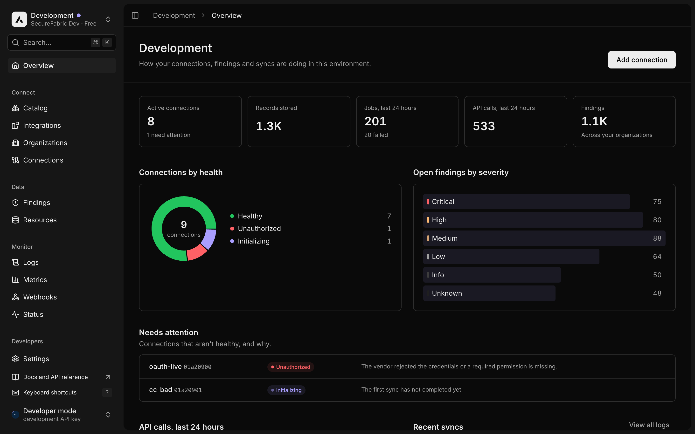
</picture>

</div>

## Contents

- [How it works](#how-it-works)
- [Quickstart](#quickstart)
- [Features](#features)
- [The dashboard](#the-dashboard)
- [Connectors](#connectors)
- [Webhooks](#webhooks)
- [Repository layout](#repository-layout)
- [Running locally](#running-locally)
- [Commands](#commands)
- [Testing](#testing)
- [Operating](#operating)
- [Configuration](#configuration)
- [Documentation](#documentation)

## How it works

1. **Create an organization** for each of your customers, under one of your environments
   (`dev`, `prod`).
2. **Send them a connect link.** Your backend creates a connect session, and the customer
   picks a tool and authorizes it on the hosted connect page, or in a modal on your own site
   with [connect-js](packages/connect-js/README.md). Credentials are sealed before the
   request returns and only workers can open them.
3. **Read their data.** SecureFabric verifies the credentials, probes what each stream can
   read and starts syncing. Findings and resources come back from `/v1` in one shape,
   whichever vendor they came from, and every change is sent to your webhooks.

```
 dashboard / customers ──► FastAPI (/v1, problem+json, API keys or WorkOS sessions)
                               │  writes rows + outbox in one transaction
                               ▼
                     Postgres 17: control · sync · data · events · obs  (RLS per environment)
                               ▲                                ▲
   scheduler ── admits stream runs ──► Absurd queues ──► workers (sync · control · delivery · maintenance)
                                                             │  connectors (packages/connectors) via the CDK
                                                             ▼
                                                     vendor APIs (GitHub, SANDBOX…) · MinIO (raw pages)
```

Postgres is the only state. The sync engine runs on Absurd (`absurd-sdk`), a durable task
queue inside Postgres, so a sync survives a worker restart and resumes from
its last checkpoint.

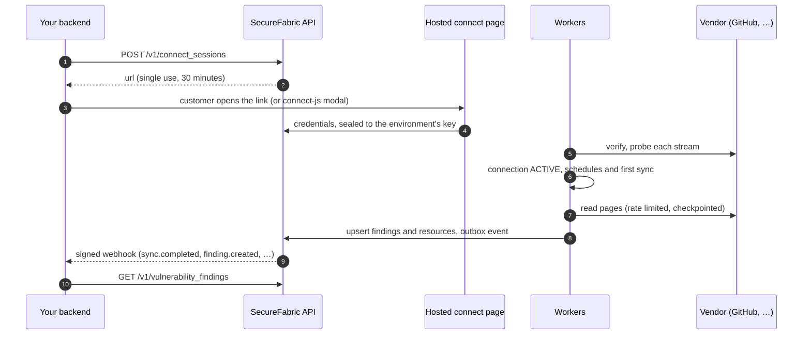

The full design, with every invariant and the test that proves it, is in
[docs/architecture/](docs/architecture/README.md).

## Quickstart

With the stack running ([Running locally](#running-locally)) and an API key from
`make seed` or **Settings → API keys**:

```bash
export SF_API_KEY="sfk_test_..."
export SF_API=http://localhost:8000

# 1. An organization for one of your customers
curl $SF_API/v1/organizations \
  -H "Authorization: Bearer $SF_API_KEY" -H "Content-Type: application/json" \
  -d '{"identifier": "acme", "name": "Acme Corp"}'

# 2. A connect link for it; open the returned url and use any key starting with sbx_
curl $SF_API/v1/connect_sessions \
  -H "Authorization: Bearer $SF_API_KEY" -H "Content-Type: application/json" \
  -d '{"organization_id": "<org id>", "integrations": ["SANDBOX"]}'

# 3. Its connection, then that connection's findings once the first sync has finished
curl "$SF_API/v1/connections?organizationId=<org id>" -H "Authorization: Bearer $SF_API_KEY"
curl "$SF_API/v1/vulnerability_findings?severity=CRITICAL,HIGH&state=OPEN&limit=10" \
  -H "Authorization: Bearer $SF_API_KEY" \
  -H "X-CONNECTION-ID: <connection id>"   # or X-ORGANIZATION-ID for all of its tools
```

On your own page, open the link in a modal instead:

```ts
import { SecureFabric } from "@securefabric/connect-js";

SecureFabric.connect({
  url: session.url,
  onSuccess: ({ connectionId }) => save(connectionId),
}).open();
```

The same walkthrough against the hosted API is in
[apps/docs/quickstart.mdx](apps/docs/quickstart.mdx).

## Features

**One data model**
- Vulnerability findings (code, secrets, dependencies, hosts, images, infrastructure as
  code, domains) and the resources they affect (repositories, branches, hosts, images,
  containers), with Leen V2 field names, enums and query parameters.
- Finding history, severity and state summaries, and CVE enrichment from NVD, CISA KEV,
  FIRST EPSS and OSV.
- Write-back actions on findings (`POST /v1/vulnerability_findings/{id}/actions`) and an
  allowlisted, read-only passthrough to the vendor API.

**Connecting tools**
- A hosted connect page, embeddable with connect-js as a modal or popup, branded with your
  name, logo and accent color.
- API keys, OAuth2 (authorization code with PKCE, client credentials) and GitHub App
  installations. Per-stream access is probed when a connection is verified.
- Connection health with a reason and who has to fix it, kept as a history.

**Syncing**
- Schedules per stream, full and incremental passes, and vendor webhooks turned into
  targeted refreshes.
- Fair admission under per-connection, per-environment and per-connector caps. Runs park on
  rate limits instead of holding a worker, retry at 1/5/15/60 minutes and checkpoint every
  page.
- Deletions detected by sweeping after full passes, with a guard against partial ones.

**Tenancy and security**
- Accounts → environments → organizations → connections. Every tenant table has row-level
  security keyed on the environment.
- Credentials sealed to a per-environment X25519 key: the API can seal but never open them.
  Raw vendor pages and stored payloads are encrypted too.
- Roles (admin, developer, support), scoped API keys, WorkOS sign-in and an audit log of
  who did what.

**Developers**
- An OpenAPI document generated from the code, with typed TypeScript and Python clients.
- Webhooks signed with HMAC-SHA256, retried for 24 hours, replayable, and also readable as a
  pull feed from `GET /v1/events`.
- A connector SDK with a manifest, an 11-check conformance suite and golden output tests.

## The dashboard

The dashboard (Next.js 16, React 19) is where your team runs SecureFabric: Catalog,
Integrations, Organizations, Connections, Findings, Resources, Logs, Metrics, Webhooks,
Status and Settings, in dark and light themes.

<table>
  <tr>
    <td width="50%" valign="top">
      <b>Connections</b><br>
      Each customer's connected tool, with its state, health and last update.<br><br>
      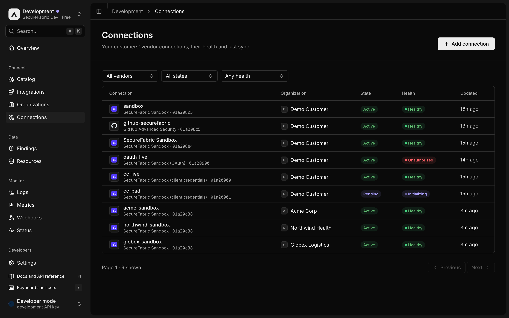
    </td>
    <td width="50%" valign="top">
      <b>Connection</b><br>
      Health and its history, and what each stream can read, when it runs and how many records it holds.<br><br>
      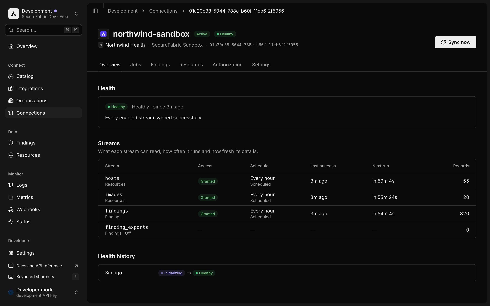
    </td>
  </tr>
  <tr>
    <td width="50%" valign="top">
      <b>Findings</b><br>
      Vulnerability findings from every connected tool, by organization, severity, state and type.<br><br>
      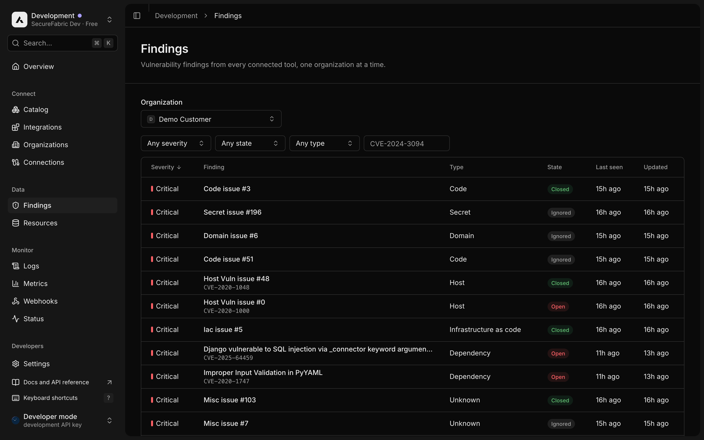
    </td>
    <td width="50%" valign="top">
      <b>Resources</b><br>
      The repositories, branches, hosts and images those findings affect.<br><br>
      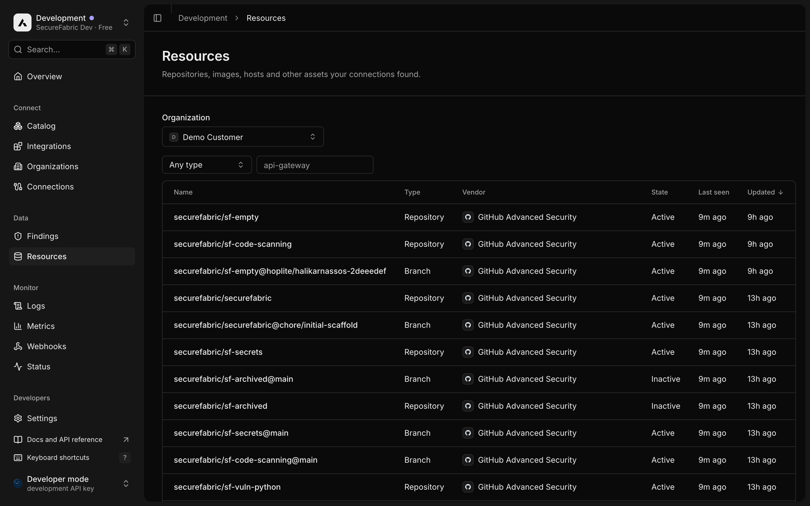
    </td>
  </tr>
  <tr>
    <td width="50%" valign="top">
      <b>Catalog</b><br>
      Every tool your customers can connect, what each one syncs, and what is coming next.<br><br>
      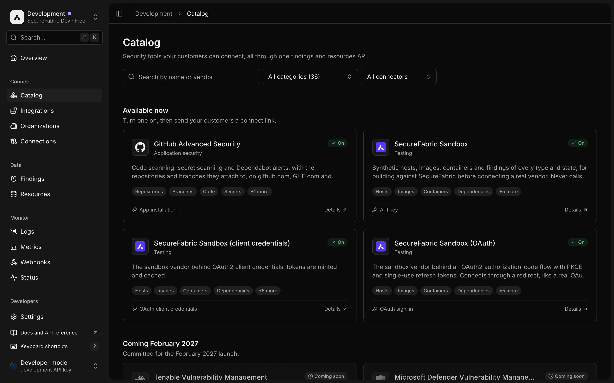
    </td>
    <td width="50%" valign="top">
      <b>Connector details</b><br>
      Each stream's schedule, how it reads and how deletions are detected, and how your customer connects.<br><br>
      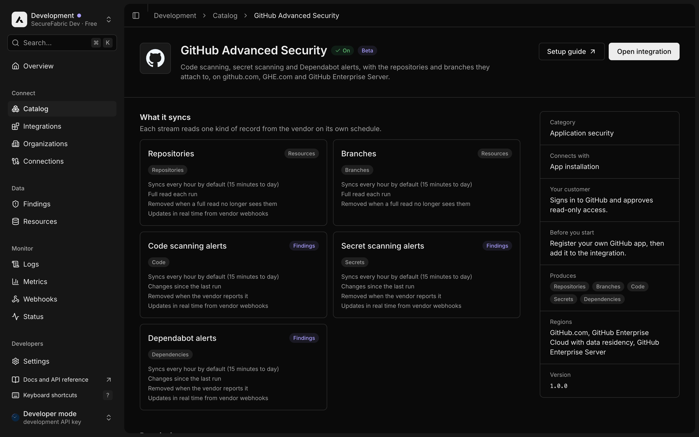
    </td>
  </tr>
  <tr>
    <td width="50%" valign="top">
      <b>Logs</b><br>
      Every sync, credential check and write-back action, filterable, with a details sheet.<br><br>
      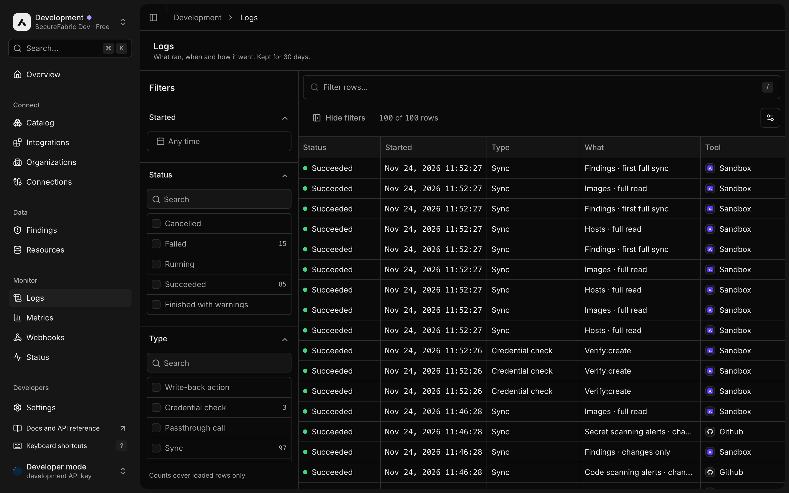
    </td>
    <td width="50%" valign="top">
      <b>Status</b><br>
      Whether SecureFabric and this environment's syncs are running normally, in plain language.<br><br>
      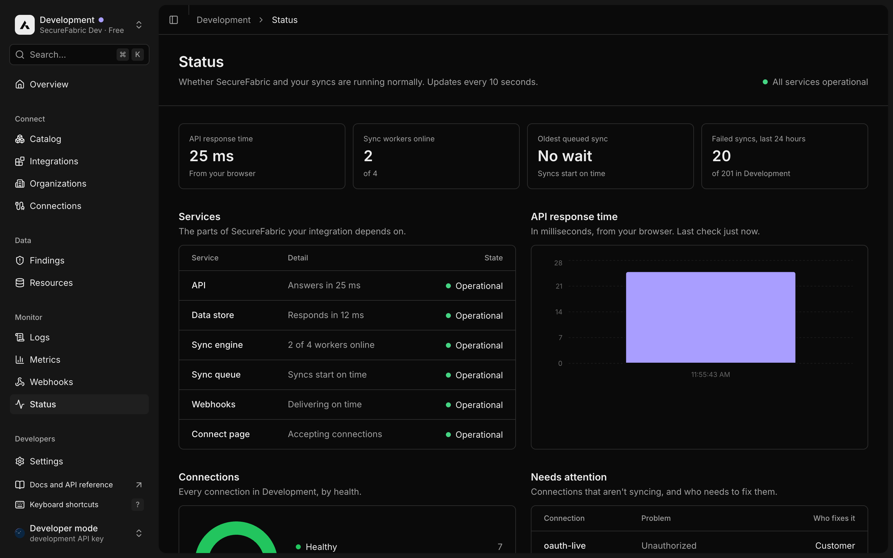
    </td>
  </tr>
  <tr>
    <td width="50%" valign="top">
      <b>Organizations</b><br>
      Your customers, each with its own connections and data.<br><br>
      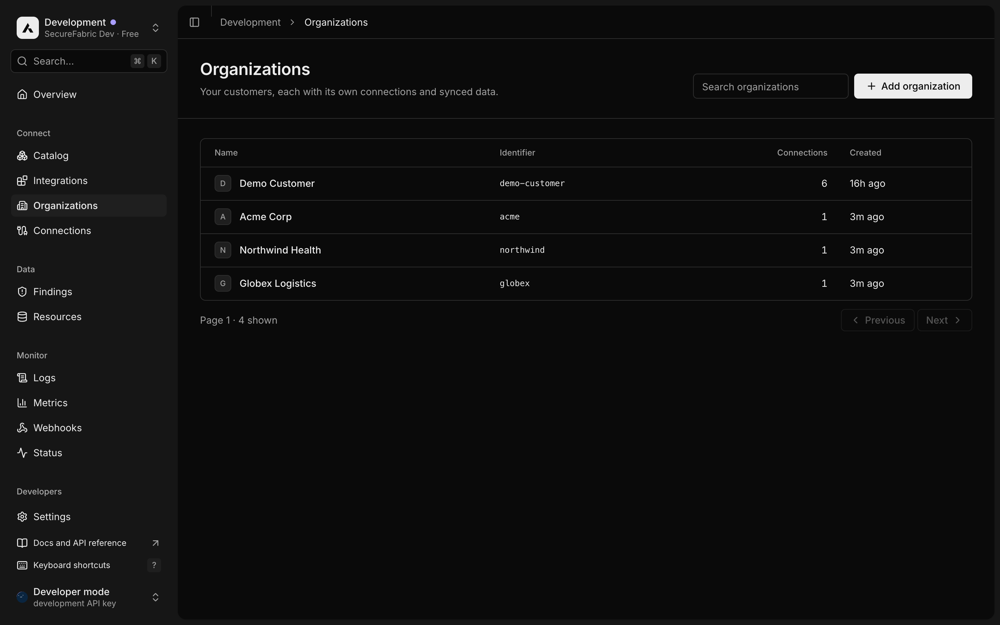
    </td>
    <td width="50%" valign="top">
      <b>Command palette</b><br>
      <kbd>⌘</kbd> <kbd>K</kbd> to jump anywhere or run a command; <kbd>G</kbd> then a letter to go to a page.<br><br>
      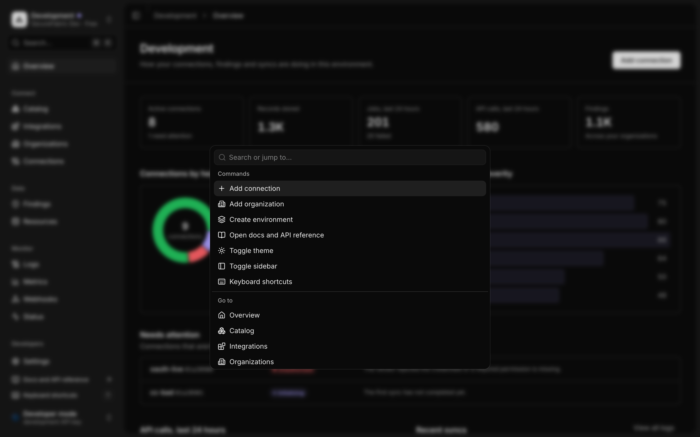
    </td>
  </tr>
</table>

### The connect page

What your customer sees. Brand it under **Settings → Connect page**, with a live preview in
light and dark.

<table>
  <tr>
    <td width="50%" valign="top">
      <b>Hosted connect page</b><br>
      Opened from a connect link or with connect-js.<br><br>
      <picture>
        <source media="(prefers-color-scheme: light)" srcset="docs/images/connect-light.png">
        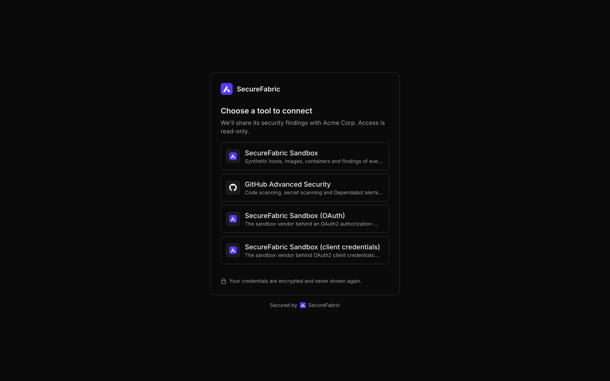
      </picture>
    </td>
    <td width="50%" valign="top">
      <b>Branding</b><br>
      Name, logo, accent color and appearance.<br><br>
      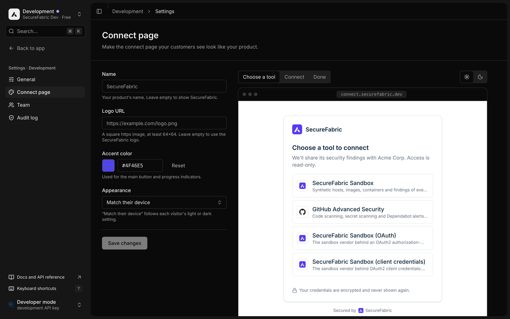
    </td>
  </tr>
</table>

<sub>Screenshots are of a local development stack with sample data, signed in with
<code>SF_DEV_API_KEY</code>. Regenerate them with <code>make dev</code>, <code>make seed</code> and
any headless browser at 1440×900.</sub>

## Connectors

A connector is a manifest (streams, auth, options, write-back) plus code written against the
CDK in `packages/cdk`. Each one passes the conformance suite and golden output tests, and its
reference page in [docs/connectors/](docs/connectors/) is generated from the manifest.

| | Connector | Syncs | Connects with | Reference |
| --- | --- | --- | --- | --- |
| 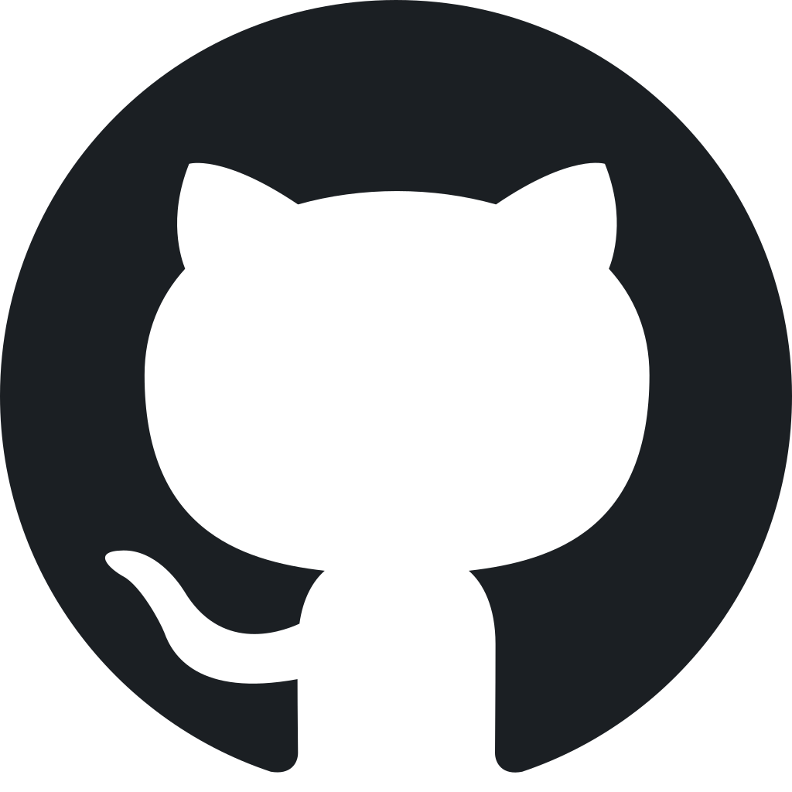 | GitHub Advanced Security | Repositories, branches, code scanning, secret scanning and Dependabot alerts on github.com, GHE.com and GitHub Enterprise Server | GitHub App installation | [docs/connectors/github.md](docs/connectors/github.md) |
|  | SecureFabric Sandbox | Synthetic hosts, images, containers and findings of every type and state, with API key, OAuth and client-credentials variants | API key (`sbx_…`), OAuth2 | [docs/connectors/sandbox.md](docs/connectors/sandbox.md) |

The sandbox never calls the network, so it exercises every platform feature (rate limits,
deletions, parking, write-back, health codes) in tests and in the quickstart.

**On the roadmap** (shown greyed out in the Catalog until the API lists them):

| When | Connectors |
| --- | --- |
| February 2027 | Tenable, Microsoft Defender Vulnerability Management, Amazon Inspector, Qualys VMDR, GitLab Ultimate, SonarQube, Semgrep, Aikido, Socket |
| With vendor partner access | CrowdStrike Falcon Spotlight, Wiz, Wiz Code, Snyk, Upwind, Tanium Comply |
| March–April 2027 | Rapid7 InsightVM, SentinelOne, Microsoft Defender (GCC High), Mend, Orca, Checkmarx One, Black Duck SCA and Coverity, Arnica, Heeler |
| Detection and posture | CrowdStrike Falcon Insight, Defender for Endpoint, Amazon GuardDuty, AWS Security Hub, Defender for Cloud, Intune, Wiz Cloud |

To add one, start with `uv run securefabric-cdk new` and follow
[Part 5 of the architecture](docs/architecture/05-connector-platform.md). Connector code may
import only the CDK, the schema package, its own package and the standard library
(`securefabric-cdk lint-imports`, enforced by a test).

## Webhooks

Register an HTTPS endpoint with `POST /v1/webhook_endpoints` (or under **Webhooks**) and
SecureFabric sends:

| Events | When |
| --- | --- |
| `connection.created` · `updated` · `paused` · `resumed` · `deleted` | A connection's lifecycle or health changes |
| `sync.completed` | A sync job finished |
| `finding.created` · `updated` · `deleted` | A finding appeared, changed or disappeared |
| `resource.created` · `updated` · `deleted` | The same for resources |
| `action.completed` · `failed` | A write-back action finished |
| `webhook.ping` | You pinged the endpoint |

Each delivery carries `SecureFabric-Signature: v1=<hex>`, an HMAC-SHA256 over
`{timestamp}.{raw body}`. Failures are retried for 24 hours, and anything missed can be
replayed. Verification samples in [Python, Node.js, Go and Ruby](docs/webhooks/) are run in CI
against the delivery code. The details are in [docs/guides/webhooks.md](docs/guides/webhooks.md).

## Repository layout

A Python and TypeScript monorepo, run by uv, pnpm and Turborepo.

| Path | What it is | |
| --- | --- | --- |
| `apps/api` | FastAPI: the public `/v1` API, connect flow, inbound vendor webhooks, status | Python |
| `apps/worker` | Absurd worker; roles: scheduler, sync, control, delivery, maintenance | Python |
| `apps/dash` | Next.js dashboard and the hosted connect page | TS |
| `apps/docs` | User-facing documentation (Mintlify); the API reference comes from `openapi.json` | MDX |
| `apps/storybook` | Storybook for `packages/ui` | TS |
| `packages/core` | Settings, logging with redaction, ids, canonical JSON, crypto (vault) | Python |
| `packages/db` | Role-bound psycopg pools, tenant transactions, migration runner | Python |
| `packages/schema` | Canonical records (Leen V2 shapes), enums, event envelope | Python |
| `packages/cdk` | Connector SDK: manifest, HTTP client, egress policy, pagination, fixtures | Python |
| `packages/connectors` | GitHub and SANDBOX connectors (manifest, mapping, golden output) | Python |
| `packages/domain` | Tenancy, connections, write path, sync engine, events, ops, enrichment | Python |
| `packages/tasks` | Absurd queues and typed task contracts | Python |
| `packages/client` | TypeScript API client generated from the OpenAPI document | TS |
| `packages/connect-js` | Embeddable connect flow (modal or popup, React bindings) | TS |
| `packages/ui`, `tokens`, `config` | Design system and shared TypeScript config | TS |
| `clients/python` | Python API client generated from the OpenAPI document | Python |
| `db/migrations` | Forward-only SQL: `0001` Absurd, `0002` platform schema and RLS, `0003+` additions | SQL |
| `docs/` | Architecture, plan, runbooks, guides and generated connector pages | |
| `scripts/`, `tools/` | `make status`, `make demo`, benchmarks, drills and the GitHub test org seeder | |

Dependencies flow one way, `apps → packages`. The API is the source of truth for every type
on the wire:

```
pydantic models ──FastAPI──► openapi.json ──openapi-typescript──► @securefabric/client ──► dash
```

`make generate` rebuilds the TypeScript client, and `make dev` keeps it live. CI fails if a
generated file is stale.

## Running locally

You need uv, Python 3.13, Node 22+ (`.nvmrc` pins 26), pnpm 11 and Docker. `make bootstrap`
checks them all.

```bash
make bootstrap   # check tools, create .env, install deps and git hooks
make dev         # Postgres + MinIO (Docker), migrations, api, worker, dash, client watcher
make seed        # bootstrap the platform; demo account, environment, API key, SANDBOX connection
make status      # is everything up, migrated and draining?
```

| URL | What |
| --- | --- |
| http://localhost:3000 | Dashboard (WorkOS sign-in, or `SF_DEV_API_KEY` in `apps/dash/.env.local`) |
| http://localhost:8000/docs | Swagger UI for the public API |
| http://localhost:8000/v1/status | System status (a summary without credentials; more with a key) |
| http://localhost:9001 | MinIO console (raw page archive) |
| http://localhost:3333 | Documentation site (`pnpm dev:docs`) |
| http://localhost:7890 | Habitat, Absurd's dashboard (`make habitat`; dev only) |

To sign in to the dashboard without WorkOS, put the key that `make seed` prints in
`apps/dash/.env.local` as `SF_DEV_API_KEY`. The dashboard then calls the API with that key
and shows **Developer mode** in the account menu.

For vendor redirects and webhooks the API must be public: run
`ngrok http --url=<your sticky domain> 8000` and set `PUBLIC_API_URL` to it. To run against a
real GitHub organization, fill in the `GITHUB_APP_*` variables in `.env`; `make github-seed`
(with `GITHUB_SEED_TOKEN` and `GITHUB_TEST_ORG`) sets up the test repositories.

`make status` tells you what is down and what to run:

```
Processes
  ✔ api                     http://localhost:8000 · ready=ok
  ✔ dash                    http://localhost:3000
  ✔ worker                  all (sync_interactive,sync_bulk,control,delivery,maintenance, x4)

Workspace & queues
  ·   dev                   4 organizations · 9 connections (7 healthy, 1 need attention, 1 initializing)
  ✔ queue sync_bulk         0 pending · 0 running · 0 sleeping · 160 done · 0 failed
  ✔ queue sync_interactive  0 pending · 0 running · 0 sleeping · 150 done · 0 failed
```

Prefer containers? `make stack` runs Postgres, the API, the worker and Habitat in Docker with
hot reload; pair it with `make dev-dash`. `make up` starts the production-like stack.

## Commands

`make` with no target lists everything. The ones you will use:

| Command | Does |
| --- | --- |
| `make dev` | Everything, hot-reloading: Postgres, MinIO, api, worker, dash, client watcher |
| `make dev-api` / `dev-worker` / `dev-dash` | One process on its own |
| `make status` | Toolchain, services, migrations, processes, workspace, queues, drift, git |
| `make status-api API_KEY=…` | `GET /v1/status` from the running API |
| `make demo API_KEY=… CONNECTION=<id>` | Trigger an on-demand sync and follow it to the end |
| `make verify` | Everything CI runs: lockfiles, lint, types, tests, drift |
| `make lint` / `fmt` | Ruff for Python, Ultracite (Biome) for TypeScript |
| `make generate` | Regenerate `packages/client/src/v1.ts` from the API |
| `make db-migrate` | Apply pending migrations; `make db-new-migration name=…` adds one |
| `make tasks q=control` | Inspect an Absurd queue (`sync_interactive`, `sync_bulk`, `delivery`, `maintenance`) |
| `make docs-connectors` | Regenerate `docs/connectors/*.md` from each connector's manifest |
| `make storybook` | Browse `packages/ui` on :6006 |
| `make bench` | The benchmark gates (ingest, API latency, admission, outbox, Absurd) |

## Testing

```bash
make test           # every package via turbo; integration tests skip without Postgres
make test-all       # every test; integration ones need `make db-up`
make verify         # what CI runs
```

Python tests run against real Postgres and Absurd, each in its own `securefabric_test*`
database; they never fall back to `DATABASE_URL`. Connectors are tested against in-process
vendors (the SANDBOX vendor, `FakeGitHub`) through the real executor, so conformance covers the
whole pipeline without network access. Row-level security has its own suite
(`make test-db`): a missing tenant setting must read zero rows.

Narrower targets: `test-api`, `test-worker`, `test-domain`, `test-db`, `test-cdk`,
`test-connectors`, `test-dash` and the rest under `make help`.

## Operating

- **Admin CLI** (`securefabric-admin`): `bootstrap` (platform apps from `.env`), `seed`,
  `operator <email>` (grant operator access), `dryrun` / `record --connection <id> --stream <s>`
  (read a live stream without persisting; record scrubbed fixtures).
- **Operator console** at `/[env]/admin` in the dashboard: alerts with runbooks,
  cross-account search, the scheduler, audited repairs and raw pages. Runbooks live in
  [docs/runbooks/](docs/runbooks/README.md).
- **Connector CLI** (`securefabric-cdk`): `validate`, `new`, `capabilities [--check]`,
  `scan-fixtures`, `lint-imports`, `schema`.
- **Status** has three audiences: anyone sees the summary; API keys and sessions also see
  workers, queues and run counts; operators see host names and open alerts.
- **Metrics** are OpenTelemetry: set `OTEL_EXPORTER_OTLP_ENDPOINT` and every service exports
  over OTLP/HTTP; without it the meter is a no-op.
- **Payload encryption**: set `PAYLOAD_KEYS` and stored vendor payloads are sealed with
  AES-256-GCM, bound to their row. The `payload_reencrypt` maintenance job seals older rows and
  re-seals after a key rotation (add a version, wait for `remaining: 0`, drop the old one).
- **Maintenance jobs** handle partitions, retention, purges, token refresh sweeps and
  enrichment (NVD, KEV, EPSS, OSV).
- **Deploying**: `make images` builds the API and worker runtime images from the
  `Dockerfile`; `compose.yaml` is the production-like stack (`make up`,
  `make scale-worker n=4`). Run migrations once per release with `securefabric-migrate`.

## Configuration

pydantic-settings, one prefix per service: `DATABASE_*`, `ABSURD_*`, `API_*`, `WORKER_*`, plus
platform settings (`PUBLIC_API_URL`, `VAULT_*`, `INGRESS_KEY`, `BLOB_*`, `WORKOS_*`,
`GITHUB_APP_*`, `NVD_API_KEY`). [`.env.example`](.env.example) lists every variable; the
dashboard's are in [`apps/dash/.env.example`](apps/dash/.env.example). Real environment
variables win over `.env`.

`securefabric-migrate` applies `db/migrations/*.sql` in order, one transaction per file, under
an advisory lock, and refuses to run if an applied file's checksum changed. Never edit an
applied migration: add a new one.

## Documentation

| Where | What |
| --- | --- |
| [docs/architecture/](docs/architecture/README.md) | The as-built architecture in ten parts. **Start here** to understand how the system works. |
| [apps/docs/](apps/docs/) | The customer-facing docs site: quickstart, concepts, connect, connectors, guides, API reference |
| [docs/guides/](docs/guides/) | [Receiving webhooks](docs/guides/webhooks.md) · [Migrating from Leen V2](docs/guides/leen-migration.md) |
| [docs/connectors/](docs/connectors/) | Generated pages per connector: auth, permissions, streams, options and mappings |
| [docs/runbooks/](docs/runbooks/README.md) | One page per operator alert and connection health code, plus the restore drill |
| [docs/plan/](docs/plan/00-README.md) | The original design, parts 00–10; build status is in [progress.md](progress.md) |
| [apps/dash/README.md](apps/dash/README.md) | How the dashboard is put together |
