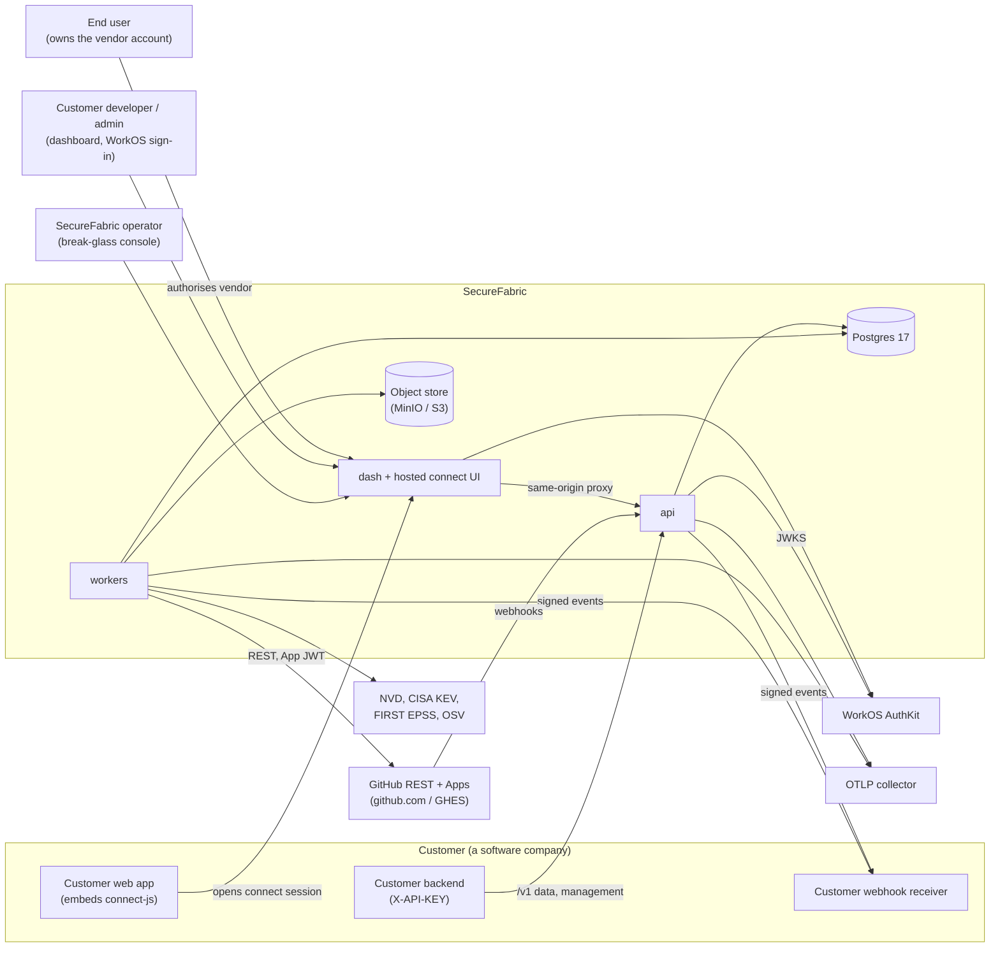
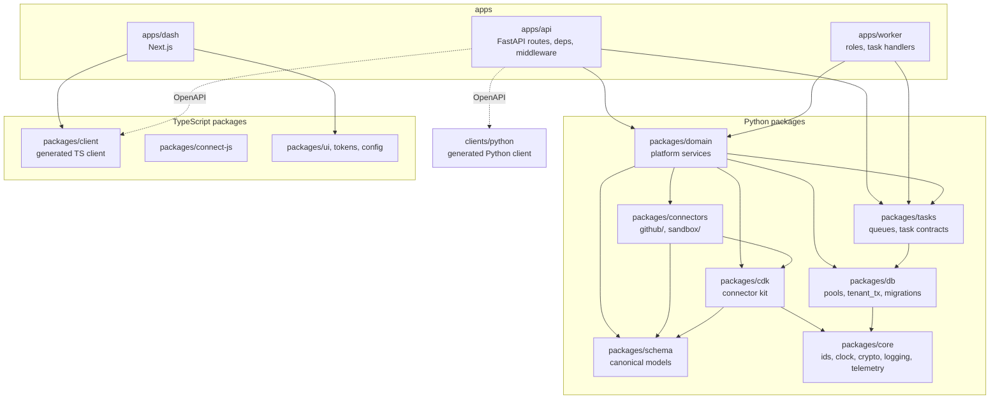
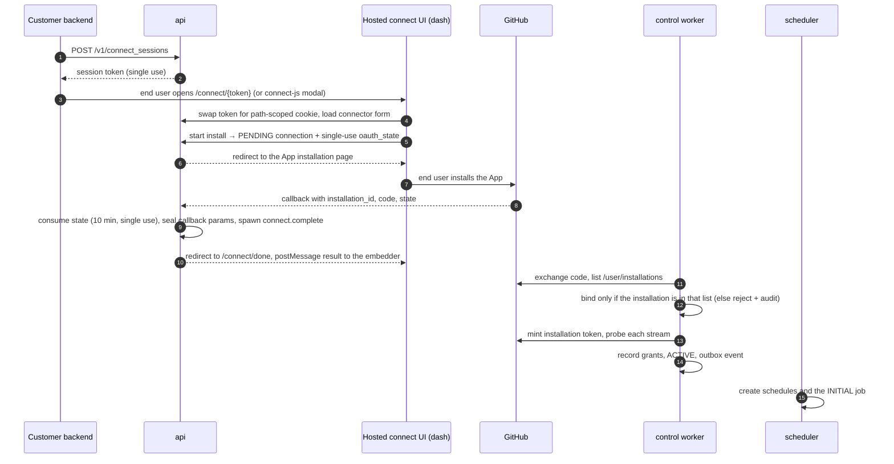
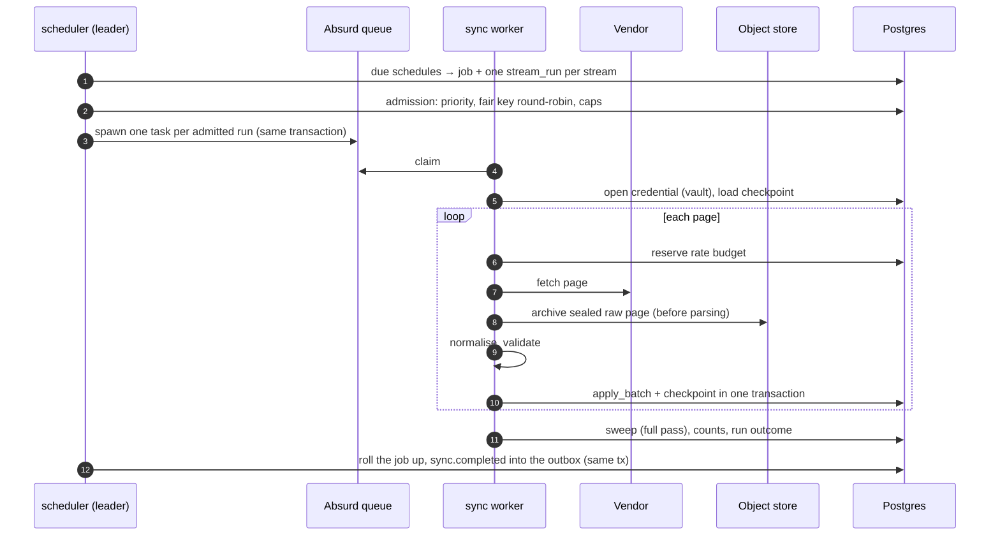
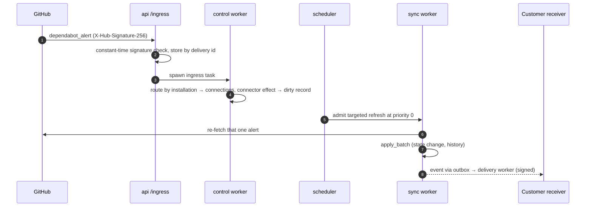

# Part 1: System context

This part places SecureFabric in its surroundings: who uses it, what it talks to, which processes it runs, how the code is layered, and how the four main flows (connect, sync, read, react) cross the system. Read it first. Every later part zooms into one box on the diagrams here.

## 1. What SecureFabric is

SecureFabric is a multi-tenant security data platform. Customers connect their security vendors once; SecureFabric keeps a normalised, continuously refreshed copy of the vendors' assets and vulnerability findings, and serves it to the customer's own product through one API and one event stream.

The customer is usually a software company building a security product (a risk dashboard, a ticketing integration, a compliance tool). Their end users own the vendor accounts. SecureFabric sits between the two: the end user authorises access through a hosted connect flow, and the customer's backend reads canonical data without writing a line of vendor-specific code.

Three properties define the product and drive most of the architecture:

| Property | What it means | Where it shows up |
|---|---|---|
| **Canonical data, normalised at ingest** | Findings and resources from any vendor land in the same typed tables with the same enums. The wire format is compatible with Leen V2 (PD-9), so a Leen customer can switch base URL. | [Part 3](03-data-model-and-record-store.md), [Part 7](07-public-api-and-events.md) |
| **Fresh and complete, provably** | Scheduled incremental syncs, periodic full reconcile passes with sweep deletion, and vendor webhooks that trigger targeted re-fetches. Readers paging by `updatedSince` never miss a change (CDC-01). | [Part 4](04-sync-engine.md) |
| **Vendor credentials no API-tier compromise can read** | Credentials are sealed to a per-environment public key; only worker processes hold the private half. | [Part 2](02-tenancy-identity-and-security.md) |

The current scope is set by the plan ([../plan/00-README.md](../plan/00-README.md)): GitHub Advanced Security covered completely (repositories, branches, Dependabot, code scanning and secret scanning alerts, on github.com and GHES, read and write-back), and every platform primitive a later connector needs, exercised by a second, synthetic connector called SANDBOX.

## 2. Actors and external systems

| Actor | Authenticates with | Uses |
|---|---|---|
| Customer backend | API key (`X-API-KEY`), scoped to one environment | The `/v1` API: data, connections, connect sessions, webhooks, usage |
| Customer developer | WorkOS AuthKit session (dashboard) | The same `/v1` API through the dashboard, plus session-only management (members, environments) |
| End user | A single-use connect session token | The hosted connect UI only |
| Vendor (GitHub) | HMAC signature on its webhook deliveries | `/ingress/*`, which is not in the public schema |
| Operator | WorkOS session with the operator flag, plus `X-Support-Reason` on every request | `/v1/admin/*` and the dashboard's admin page |

## 3. Processes

SecureFabric is a modular monolith in Python 3.13 on one Postgres 17 database, plus a Next.js dashboard. There is no Redis and no message broker: locks are Postgres advisory locks, rate budgets are Postgres rows, queues are Absurd tables, and the outbox is a Postgres table. The only other stateful dependency is an S3-compatible object store for the raw page archive.

| Process | Entrypoint | Database role | Vault | Does |
|---|---|---|---|---|
| `api` | `securefabric-api` (`apps/api`) | `sf_api` | wrap only | Public and dashboard HTTP API, connect-flow endpoints, inbound vendor webhooks, writes outbox rows |
| `scheduler` | `securefabric-worker --role scheduler` | `sf_system` | none | Fires due schedules, admits stream runs into Absurd, expires stuck runs, rolls jobs up, dispatches the outbox, spawns maintenance windows. Leader-elected singleton |
| `sync` | `securefabric-worker --role sync` | `sf_worker` | unwrap | Runs connector streams: fetch, archive, normalise, write. Claims from `sync_interactive` and `sync_bulk` |
| `control` | `securefabric-worker --role control` | `sf_worker` | unwrap | Verification and probes, connect completion (GitHub install proof, OAuth code exchange), ingress processing, write-back actions, operator repairs |
| `delivery` | `securefabric-worker --role delivery` | `sf_worker` | unwrap | Outbound webhook delivery and signing |
| `maintenance` | `securefabric-worker --role maintenance` | `sf_system` | unwrap | Partitions, retention and purge, refresh sweeps, redelivery poller, payload re-encryption, enrichment |
| `dash` | `next start` (`apps/dash`) | none | none | Dashboard, hosted connect UI, same-origin API proxy |

One worker image serves every worker role (`apps/worker/src/securefabric_worker/main.py`). `--role all` runs every role in one process for local development; a comma list (`sync,control`) runs a subset. Each role builds its own `Platform` (`packages/domain/src/securefabric_domain/runtime.py`), and the role decides which database role the connection pool logs in as and whether the key provider can unwrap environment keys. That is how the trust boundaries in [Part 2](02-tenancy-identity-and-security.md) become concrete: the API process is built with a `WrapOnlyKeyProvider` and the `sf_api` role, so it has neither the key material nor the grants to read credentials.

Every role except the scheduler scales horizontally and holds no state. The scheduler takes a session advisory lock; any number of copies can run and one is active.

### Queues

Absurd provides durable task execution in Postgres: leases with claim timeouts, crash recovery, cancellation and idempotent spawn. SecureFabric runs five queues, mapped to roles in `packages/tasks/src/securefabric_tasks/queues.py`:

| Queue | Role | Holds |
|---|---|---|
| `sync_interactive` | sync | On-demand and webhook-targeted runs (priority 0) and initial syncs (priority 1) |
| `sync_bulk` | sync | Scheduled incrementals and reconcile passes (priority 2) |
| `control` | control | Verify, probe, connect completion, ingress, actions, repairs |
| `delivery` | delivery | One task per outbound webhook delivery attempt |
| `maintenance` | maintenance | Retention, partitions, purge, sweeps, re-encryption |

Absurd claims strictly in FIFO order, so priority, fairness and concurrency caps cannot live inside it. They live in SecureFabric's own `sync.stream_run` table and the scheduler's admission step, which decides what enters Absurd and when (PD-1). See [Part 4](04-sync-engine.md).

## 4. Code layout and layering

The rules the layering enforces:

- **Apps are thin adapters.** `apps/api` turns HTTP into calls on `securefabric_domain`; `apps/worker` turns Absurd tasks into calls on the same services (`handlers.py` maps task names to domain functions). Business logic lives in `packages/domain`.
- **Connectors import only the CDK and the schema.** A connector never touches the database, the vault or an HTTP library directly (CDK-03). `securefabric-cdk lint-imports` enforces it and `test_import_boundary` proves the check catches violations. The CDK defines ports (rate budget, raw capture, credential access) that the domain implements. That is what makes the next connector a pure addition under `packages/connectors/<vendor>/`.
- **The schema imports nothing of ours.** It is the single source for validation, the OpenAPI document, the generated clients and the connector reference pages.
- **Generated artefacts are checked, not trusted.** `packages/client/src/v1.ts` is generated from the API's OpenAPI document, and `docs/connectors/*.md` from each connector's manifest, capabilities and mapping. Pre-commit and CI fail when either is stale.

| Package | Owns |
|---|---|
| `packages/core` | Settings base, structlog with redaction, problem+json errors, UUIDv7/UUIDv5 ids, injectable clock, canonical JSON hashing, vault and payload crypto, OpenTelemetry setup |
| `packages/db` | Role-bound connection pools, `tenant_tx` / `system_tx`, migration runner |
| `packages/schema` | Canonical `Resource` and `VulnerabilityFinding` models, enums, health codes, event payloads |
| `packages/cdk` | Manifest model, stream contracts, HTTP client, pagination, egress, token providers, OAuth2, fixtures, golden output, conformance helpers, CLI |
| `packages/connectors` | GitHub and SANDBOX connectors: manifest, streams, mapping, fixtures, golden output, capabilities |
| `packages/tasks` | The five queues, the role-to-queue map, typed task contracts |
| `packages/domain` | Tenancy, catalogue, vault, connections, connect, records, sync engine, events, data API, actions, enrichment, ingress, obs, maintenance, operator console, status |
| `apps/api` | Routes, principals, rate limiting, idempotency, request metrics |
| `apps/worker` | Roles, queue workers, heartbeats, the scheduler loop |
| `apps/dash` | Dashboard, hosted connect UI, AuthKit session, `/api/sf` proxy |
| `packages/connect-js` | Embeddable loader for the connect UI |
| `packages/client`, `clients/python` | Generated API clients |
| `tools/` | GitHub org seeding, benchmark gates, drills |

## 5. Data stores

One Postgres database holds everything, in five schemas:

| Schema | Holds |
|---|---|
| `control` | Accounts, environments (with their wrapped key pairs), memberships, API keys, organizations, connectors, integrations, vendor apps, connections, grants, connect sessions, actions |
| `sync` | Schedules, jobs, stream runs, checkpoints, rate buckets, ingress deliveries |
| `data` | Resources, findings, state history, links, the per-object clock, raw page index |
| `events` | Outbox, webhook endpoints, deliveries and attempts |
| `obs` | Operations and their lines, audit events, usage, alerts, worker heartbeats, API rate counters |

Row-level security keyed on a transaction-local environment setting guards every tenant table. With no setting, a query returns zero rows. Hot tables are hash-partitioned by connection and time series are range-partitioned by day or month. The object store holds sealed raw vendor pages, so any stream can be re-normalised from the archive with no vendor calls. Details are in [Part 3](03-data-model-and-record-store.md).

## 6. The four main flows

### Connect

A customer backend creates a connect session; the end user completes the hosted flow; a control worker proves the credential works before the connection becomes ACTIVE.

Credentials submitted through a form (API keys, OAuth client credentials) follow the same shape: the API seals them to the environment's public key before the handler returns, and a control worker opens and verifies them. The GitHub callback only consumes `state`; it never trusts the `installation_id` until a worker has proved the user can see it, so a forged id is rejected and audited. See [Part 6](06-connections-and-connect-flow.md).

### Sync

The write path `records.apply_batch` takes an advisory lock, assigns `updated_at` from a per-(connection, object type) monotonic clock, and skips rows whose canonical hash has not changed, so an idle re-sync writes nothing and moves no timestamps. Failures are classified: transient vendor errors retry on SecureFabric's own schedule (1, 5, 15, 60 minutes with jitter), long rate-limit resets park the run and free the worker, and authorisation failures go straight to an UNAUTHORIZED health code. Absurd's own retries only cover a worker dying mid-task (PD-13). See [Part 4](04-sync-engine.md).

### Read

A customer calls `GET /v1/vulnerability_findings` with an API key and, optionally, `X-CONNECTION-ID` or an organization scope. The API authenticates the key (HMAC with a pepper, cached briefly), checks the key's region, opens a tenant transaction with the environment set, runs a keyset query that walks an index, and returns Leen-shaped JSON with a signed cursor. The cursor carries the filter set, so a page cannot be continued with different filters. Enrichment (CVSS, KEV, EPSS) is joined at read time. See [Part 7](07-public-api-and-events.md).

### React

Webhooks never carry data into the store (PD-11). They mark a record dirty and the worker re-fetches it from the vendor, so out-of-order deliveries, forged payloads and shapes that differ from the REST API cannot corrupt data. Scheduled sync stays the source of truth; webhooks only cut latency. Live, a dismissal on GitHub showed up in SecureFabric 5.7 s later (gate: 2 minutes).

## 7. Cross-cutting principles

These recur in every part. Each was a deliberate choice; the reasoning is in the decision log ([Part 10](10-decisions-status-and-roadmap.md) and [../plan/01-architecture.md](../plan/01-architecture.md)).

1. **Postgres is the platform.** Queues, locks, rate budgets, the outbox and logs all live in one database. That makes "write the state change and its event in one transaction" the default, not a distributed-systems project. The cost is that Postgres capacity is the scaling limit; the benchmark gates in [Part 9](09-operations-and-reliability.md) measure how far it goes.
2. **Fail closed on tenancy.** Application code filters by environment *and* RLS checks the same id. A forgotten filter returns nothing, not someone else's data. A generated suite checks every id endpoint against another environment's key.
3. **The API cannot read secrets.** Not by policy but by construction: no private key, no grant on wrapped key columns.
4. **Normalise once, at ingest.** Readers query typed columns. Vendor payloads are stored as opaque, optionally encrypted bytes (PD-12) and are never filtered on in SQL.
5. **Our retries, Absurd's recovery.** Classified failures are SecureFabric's to schedule; crashes are Absurd's to recover.
6. **Every claim has a test.** Isolation, idempotency, ordering, sweep safety, signature verification and the webhook samples in four languages all have tests that fail if the guarantee breaks. Each part lists its invariants with the tests that prove them.
7. **Contracts are generated.** OpenAPI → TypeScript and Python clients; manifest + capabilities + mapping → connector docs; JSON Schema → connect forms. Drift fails the build.

## 8. Running it

`make dev` starts Postgres, MinIO, the API, a worker in `all` mode and the dashboard. `make verify` runs everything CI runs: lockfile checks, ruff, mypy strict, pytest, Biome, tsc, vitest, and the client and token drift checks. `make status` prints the same status document as `GET /v1/status`. The [README](../../README.md) has the full setup, and `make help` lists every target.

## Further reading

- [../plan/00-README.md](../plan/00-README.md): the plan's one-page shape and decisions PD-1 to PD-10
- [../plan/01-architecture.md](../plan/01-architecture.md): processes, trust boundaries and the full decision log as designed
- [../../progress.md](../../progress.md): what was built, how each item was validated, and the deviations
- [Part 10](10-decisions-status-and-roadmap.md): decisions as built, current status and what is left
