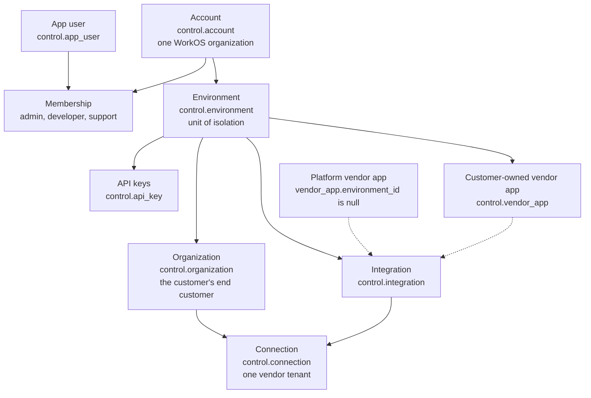
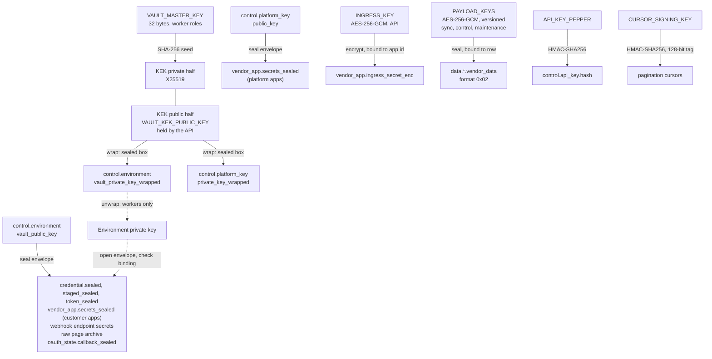
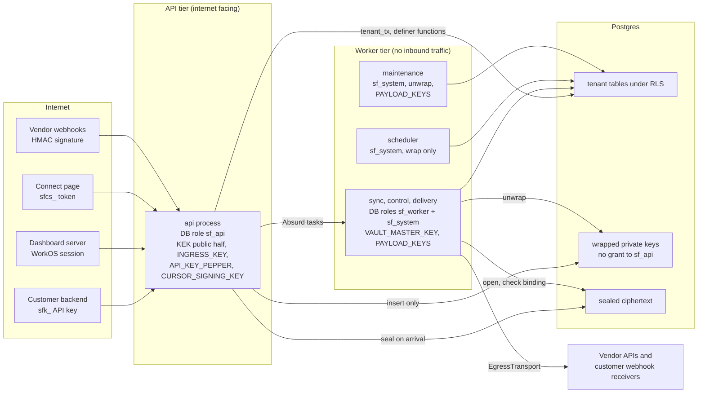

# Part 2: Tenancy, identity and security

This part covers how SecureFabric separates tenants, how a request becomes a principal, which Postgres role each process runs as and what that role may touch, how vendor credentials and other secrets are encrypted, and what an attacker who owns one tier can and cannot reach. Read it before changing anything in `packages/core/src/securefabric_core/crypto.py`, `packages/db/src/securefabric_db/tenant.py`, a migration's grants or policies, or an authentication dependency. The connection lifecycle and the connect flow, which use these mechanisms, are in [Part 6](06-connections-and-connect-flow.md).

## 1. Context

SecureFabric holds two things a customer would be badly hurt to lose: long-lived credentials to their end customers' security vendors, and the vulnerability findings those vendors report. Many customers share one deployment, and each customer serves many end customers. The design has to answer three questions:

1. **Isolation.** How does a bug in one query, or a guessed id, avoid exposing another tenant's rows? The requirement is TEN-02: an id from another environment is indistinguishable from one that does not exist, so cross-environment access is a 404, never a 403. SEC-05 asks for row-level security on every tenant table.
2. **Credential custody.** How are vendor credentials stored so that the internet-facing tier cannot read them? PD-4 decides that credentials are sealed to a per-environment public key and only worker processes hold the private key. This replaces task-scoped tokens (SEC-04). SEC-02 asks that ciphertext copied to another connection be useless, SEC-03 asks for key rotation by version, AUTH-09 makes credentials write-only, and STORE-09 asks for encryption of stored vendor payloads.
3. **Identity.** Who is calling? PD-8 gives one `/v1` surface with two authenticators, API keys for customer backends and WorkOS AuthKit sessions for the dashboard, producing the same principal. TEN-06, TEN-07 and TEN-08 shape API keys (hashed, revocable within 60 seconds, scoped, several per environment), and API-10 binds keys to a region.

Supporting requirements: SEC-07 (redaction of secrets in logs and stored errors), SEC-08 (append-only audit log), and RATE-07, HOOK-08 and AUTH-12 (an egress policy so a customer-supplied URL cannot reach internal services). Tenancy follows PD-3 (Account, Environment, Organization, Connection, with Integration between connector and connection), and platform-owned vendor apps follow PD-10.

The constraints that shaped the build: the API is the only internet-facing process and must be assumed compromisable; the dashboard uses the same API as customers; WorkOS is kept basic (no SSO, SCIM or enforced MFA in this plan); and the whole system runs on one Postgres database, so isolation has to be enforced inside the database, not by separate databases.

## 2. Tenancy model



| Entity | Table | Scoped by | Notes |
|---|---|---|---|
| Account | `control.account` | global | The billing entity. `workos_organization_id` links it to a WorkOS organization. A new account gets two environments, `dev` (not production) and `prod`. |
| User | `control.app_user` | global | Created on first sign-in from the WorkOS user id. Carries `is_operator`. |
| Membership | `control.membership` | account | `role` is `admin`, `developer` or `support`. |
| Environment | `control.environment` | account | The isolation boundary: API keys, data, webhooks and the vault key pair all belong to one environment. `settings` holds connect UI branding, `allowed_redirect_origins` and `default_sync_interval_s`. |
| Integration | `control.integration` | environment | A connector enabled and configured in one environment: `enabled_streams`, `stream_intervals`, `option_defaults`, `write_back_enabled`, optional `vendor_app_id`. |
| Vendor app | `control.vendor_app` | environment, or none | A vendor-side app registration (GitHub App, OAuth client). Platform-owned rows have `environment_id` null and are readable by every tenant. |
| Organization | `control.organization` | environment | `identifier` unique among live rows of the environment. Deleting one with a live connection is a 409 (TEN-03). |
| Connection | `control.connection` | environment | One vendor tenant through one integration. Lifecycle in [Part 6](06-connections-and-connect-flow.md). |

Every tenant row below the account carries `environment_id`, and every row-level security policy compares against it (section 4). The account is deliberately not the isolation unit: a customer's `dev` and `prod` must not see each other's data even though one person administers both.

Code: `packages/domain/src/securefabric_domain/tenancy.py` (accounts, environments, organizations, keys, audit), `packages/domain/src/securefabric_domain/catalog.py` (integrations and vendor apps).

## 3. Principals and authentication

Every authenticator produces the same `Principal` (`tenancy.py`):

```
Principal(kind, account_id, environment_id, scopes, actor_id,
          role, is_operator, organization_id, request_id, ip, user_agent, extra)
```

`kind` is `api_key`, `user`, `connect_session` or `system`. Domain functions take the principal, call `principal.require(scope)` (403 `scope_missing`, naming the scope), and open `tenant_tx(pool, principal.env)`. `principal.env` raises 400 `environment_required` when a session request did not select an environment. Nothing below `apps/api/src/securefabric_api/deps.py` knows which authenticator was used.

`get_principal` in `deps.py` dispatches on the token prefix. It reads `X-API-KEY` first (Leen clients send it), then `Authorization: Bearer`. A token starting `sfk_` is an API key, `sfcs_` is a connect session token and is refused on non-connect routes (401 `invalid_credential_for_route`), and anything else is treated as a WorkOS access token. The principal is then stamped with request id, client IP and user agent (used by the audit log) and passed through the per-environment rate limiter.

### 3.1 API keys

| Property | Implementation |
|---|---|
| Format | `sfk_<live\|test>_<region>_<43 base62>`, about 256 bits of randomness (`generate_api_key`). `live` for production environments, `test` otherwise. |
| Storage | `control.api_key.hash` = HMAC-SHA256 of the full key under `API_KEY_PEPPER` (`hash_api_key`, `crypto.keyed_hash`). Only `prefix` (the first 16 characters for region `us`) is kept in clear, for display. The full key is returned once, at creation. |
| Lookup | `control.resolve_api_key(hash)`, a `SECURITY DEFINER` function (section 4.3), because authentication must find the key before it knows the tenant. |
| Region | `KEY_PATTERN` captures the region segment; a key for another region is rejected with 401 `wrong_region` before any database lookup (API-10). |
| Scopes | `provisioning:read`, `provisioning:write`, `data:read`, `jobs:execute`, `webhooks:manage`, `keys:manage`, `actions:write`. The set is also a `check` constraint on the column. A key created by a key cannot carry scopes its creator lacks (403 `scope_escalation`). |
| Cache | `KEY_CACHE` keeps lookups, including misses, for `KEY_CACHE_TTL_S` = 30 seconds, so a revocation takes effect everywhere within 60 seconds (TEN-06). `revoke_api_key` clears the local process's cache at once. The cache empties itself above 10,000 entries. |
| Usage | `last_used_at` is written at most once a minute per key. |
| Environment | A key belongs to one environment. A request that also sends a different `X-Environment-Id` gets 404 `environment_not_found`, by the TEN-02 rule. |

Several live keys per environment are allowed (TEN-08); rotation is create, deploy, revoke.

### 3.2 Dashboard sessions (WorkOS AuthKit)

The dashboard signs users in through WorkOS AuthKit, keeps the session in an encrypted cookie, and calls the API through a same-origin proxy (`/api/sf`), so the access token never reaches browser JavaScript ([Part 8](08-dashboard-and-clients.md)). The API sees a bearer token and verifies it in `packages/domain/src/securefabric_domain/workos.py`:

- Only `RS256` is accepted. The key is chosen by `kid` from WorkOS's JWKS (`/sso/jwks/{client_id}`), cached for `JWKS_TTL_S` = 600 seconds; an unknown `kid` forces one refetch, which handles key rotation.
- `exp` and `sub` are required, with 30 seconds of leeway. The issuer must be one of `accepted_issuers()`, and a `client_id` claim, when present, must match ours. The audience is not checked (`verify_aud: False`).
- The `sub` claim maps to `control.app_user`; a user seen for the first time is fetched from WorkOS and upserted (just-in-time provisioning).
- The `org_id` claim maps to `control.account.workos_organization_id`. An organization never seen before becomes an account on the spot, with this user as admin. A user whose token proves WorkOS membership but who has no local membership row is recorded as `developer`. A token with no `org_id` uses the user's first membership.
- The principal's scopes come from the role: `admin` gets every scope, `developer` every scope except `keys:manage`, `support` only `provisioning:read` and `data:read` (`ROLE_SCOPES`).
- A session is not bound to an environment. The dashboard sends `X-Environment-Id` (a UUID or a slug), resolved with `control.account_environments(account_id)`; an environment of another account is a 404.

A first sign-in with no organization calls `POST /v1/onboarding`, which creates the WorkOS organization, an admin membership there, and locally the account, the membership and the two environments (`onboard`, `provision_account`). Endpoints that only make sense for a person (onboarding, environments, members, the audit log) call `require_session`; membership changes also call `require_admin`. Role enforcement stops there by design: TEN-09 (fine-grained RBAC) is deferred, and `require_admin` is the single place to tighten it.

WorkOS failures map to 503 `identity_unavailable` (unreachable or 5xx) and to 401 for rejections.

### 3.3 Connect session tokens

A connect session token (`sfcs_` plus 32 random bytes, stored as a plain SHA-256 in `control.connect_session.token_hash`) is a bearer credential for one organization and a list of integrations, valid for 30 minutes. It produces a principal with `kind = connect_session`, scopes `provisioning:read` and `provisioning:write`, and `organization_id` set, and it is accepted only by `/v1/connect/*` routes (`get_connect_principal`, which also reads the `sf_connect` cookie the hosted page sets). Lookup goes through `control.resolve_connect_session`. Details are in [Part 6](06-connections-and-connect-flow.md).

### 3.4 Operators

`control.app_user.is_operator` marks SecureFabric staff. It is never set through the API: `securefabric-admin operator <email>` (`grant_operator` in `admin.py`) sets it through the `sf_system` pool and writes an `operator.granted` audit event marked `break_glass`. `packages/domain/src/securefabric_domain/operator.py` gates every admin endpoint with `require_operator`. To act inside a customer environment, `support_principal` requires an `X-Support-Reason` header of at least 5 characters, resolves the environment through `control.operator_environment`, returns a principal that is read-only unless the call is a repair, and writes a `support.access` audit event with the reason. Cross-account search and the scheduler view go through `control.operator_search` and `control.operator_scheduler` (section 4.3).

### 3.5 System principal

Background work that acts on a tenant's behalf (verification, purge, installation binding) uses `system_principal(environment_id)`, which audits as `actor_kind = system`.

## 4. Postgres roles and row-level security

### 4.1 Roles

Migration `db/migrations/0002_platform.sql` creates three application roles. No process connects as the owner: `create_pool` in `packages/db/src/securefabric_db/pool.py` connects with the migrating login and runs `SET ROLE` on every new connection, so policies and column grants apply exactly as with separate logins. Every pooled connection also gets `statement_timeout = 60s`.

| Role | Attributes | Used by (`runtime._DB_ROLE`) | May touch |
|---|---|---|---|
| `sf_api` | RLS applies | `api` | DML on tables in `control`, `sync`, `data`, `events`, `obs`, except: on `control.environment` only the listed columns (select excludes `vault_private_key_wrapped` and `vault_previous_private_key_wrapped`; insert includes the wrapped key so the API can create environments; update only `name`, `settings`, `deleted_at`, `is_production`); on `control.platform_key` only `id`, `public_key`, `key_version`. No update or delete on `obs.audit_event`. |
| `sf_worker` | RLS applies | `sync`, `control`, `delivery`, `test` | DML on every table in the five schemas, wrapped key columns included. No update or delete on `obs.audit_event`. |
| `sf_system` | `bypassrls` | `scheduler`, `maintenance`, and a small second pool (`system_pool`, at most 4 connections) in `sync`, `control` and `delivery` | Everything `sf_worker` has, across tenants, plus execute on the partition DDL functions. |

All three roles may use the Absurd schema (spawn, claim, complete tasks). The API process gets no `sf_system` pool (`build_platform` only adds one for worker roles), so the API's only database identity is `sf_api`.

### 4.2 Row-level security

The tenant setting is a transaction-local GUC, read by one function:

```sql
create function control.current_environment_id() returns uuid language sql stable as $$
  select nullif(current_setting('app.environment_id', true), '')::uuid
$$;
```

A `do` block in `0002_platform.sql` enables RLS and creates a `tenant_isolation` policy (`using` and `with check` both `environment_id = control.current_environment_id()`) on 31 tables: the tenant tables of `control` (keys, organizations, integrations, connections, credentials, grants, connect sessions, OAuth state, health events, idempotency keys), `sync` (schedules, jobs, stream runs, checkpoints, dirty records, raw pages), `data` (resources, findings, links, state history, quarantine, stream heads, object clocks), `events` (outbox, webhook endpoints, deliveries, attempts) and `obs` (operations, operation events, usage). Three tables get their own policies:

- `control.environment`: a row is visible to a transaction whose setting is its own `id`.
- `control.vendor_app`: select allows `environment_id is null` (platform apps are shared, PD-10) or the tenant's own rows; insert, update and delete only the tenant's own. Platform rows are therefore writable only by `sf_system`.
- `obs.audit_event`: select only the tenant's own rows; insert always allowed, because account-level events have no environment.

With no setting, `current_environment_id()` is null, `environment_id = null` is never true, and every protected table reads as empty. Isolation fails closed.

`packages/db/src/securefabric_db/tenant.py` provides the two transaction shapes:

- `tenant_tx(pool, environment_id)` opens a transaction and runs `select set_config('app.environment_id', $1, true)`. The `true` makes it local to the transaction, so a pooled connection never carries one tenant's setting into the next request.
- `system_tx(pool)` opens a transaction with no setting. On an `sf_system` pool it sees everything; on `sf_api` or `sf_worker` it sees only global tables.

The 404 rule (TEN-02) falls out of this: a domain function reads by id inside `tenant_tx`, another environment's row is simply absent, and the function raises `NotFoundError`. No code path compares environments by hand.

RLS defends against query bugs: a missing `where environment_id = ...` cannot leak. It does not defend against code that chooses the setting, so a compromised API process can set any environment id (section 9).

Tables without RLS are global or internal by design: `control.account`, `control.app_user`, `control.membership`, `control.connector`, `control.platform_key`, the CVE mirror in `data`, `sync.ingress_delivery`, scheduler leases and rate buckets, and `obs.alert`, `obs.worker_heartbeat`, `obs.api_rate_counter`. `test_every_tenant_table_has_rls` fails the build if a table with an `environment_id` column lacks RLS, with an explicit allowlist (`obs.api_rate_counter` only).

### 4.3 SECURITY DEFINER functions

Some reads must happen before the tenant is known, and some operational reads must cross tenants without giving the API role `bypassrls`. Each is a narrow `SECURITY DEFINER` function owned by the migrating role, with `search_path` pinned to `pg_catalog` and its schema, `execute` revoked from `public` and granted to named roles.

| Function | Migration | Purpose | Granted to |
|---|---|---|---|
| `control.resolve_api_key(hash)` | 0002 | One key row (plus account id and `is_production`) for one exact hash | `sf_api`, `sf_worker`, `sf_system` |
| `control.resolve_connect_session(hash)` | 0002 | One connect session for one exact token hash | same |
| `control.account_environments(account_id)` | 0002 | The live environments of one account, for `X-Environment-Id` resolution | same |
| `control.resolve_oauth_state(state)` | 0002 | The tenant of an OAuth callback, which arrives with only `state` | same |
| `control.vendor_app_ingress(connector, ref)` | 0002 | The encrypted webhook secret of one vendor app (or every platform app for `default`) | same |
| `public.sf_ensure_partitions`, `public.sf_drop_partitions_before` | 0002 | Partition DDL as the owner | `sf_system` |
| `control.operator_search(q)`, `control.operator_scheduler()`, `control.operator_environment(id)` | 0004, 0005 | Cross-account search, the live scheduler view, environment lookup for support access | `sf_api`, `sf_system`, then `sf_worker` (0005) |
| `obs.system_status()` | 0006 | Counts, versions and timings for `GET /v1/status`, including the migration ledger and worker heartbeats; nothing tenant-scoped | all three |
| `obs.flush_api_calls(...)` | 0007, fixed in 0008 | Adds an API instance's per-environment call counts to the shared rate-limit window and records `api.calls` usage across tenants in one statement | `sf_api` |

The pre-tenant resolvers each return at most one row for one exact secret hash or random state, so knowing the function exists does not let a caller enumerate tenants. The operator functions are callable by `sf_api`, so the gate is `require_operator` in Python, plus the audit event on every support access.

## 5. The vault and cryptography

### 5.1 Key hierarchy



All primitives live in `packages/core/src/securefabric_core/crypto.py`; the database-aware service is `packages/domain/src/securefabric_domain/vault.py`.

### 5.2 The key encryption key

The KEK is asymmetric (a deviation from the plan, which assumed a symmetric KEK; recorded in `progress.md`). `LocalKeyProvider` derives an X25519 private key from `VAULT_MASTER_KEY` (`sha256(b"securefabric/vault-kek/v1" + master_key)` as the seed). Wrapping is a libsodium sealed box to the KEK public key, prefixed with a format byte (`_WRAP_FORMAT = 1`); unwrapping needs the private half. `WrapOnlyKeyProvider` holds only the public half and raises `VaultError` on `unwrap`.

The asymmetry is what lets the API create environments (generate a key pair, wrap the private half, store both) without ever being able to open a wrapped key. `build_kek` in `packages/domain/src/securefabric_domain/runtime.py` decides per role: `sync`, `control`, `delivery`, `maintenance` and `test` get `LocalKeyProvider` (`Platform.can_unwrap` is true); `api` and `scheduler` get a wrap-only provider built from `VAULT_KEK_PUBLIC_KEY`. In local development, when `VAULT_KEK_PUBLIC_KEY` is unset, the API derives the public half from `VAULT_MASTER_KEY` and keeps only the wrap-only object; a production deployment must set the public key and withhold the master key from API hosts. `Platform.unwrap` refuses outright for any role that cannot unwrap. `VAULT_KEY_PROVIDER` accepts only `local` today; the `KeyProvider` protocol (`wrap`, `unwrap`) is the seam for a cloud KMS.

### 5.3 Environment key pairs and sealed envelopes

`create_environment_row` (`tenancy.py`) calls `generate_key_pair(platform.kek)`: a fresh X25519 pair whose private half is wrapped immediately. The row stores `vault_public_key`, `vault_private_key_wrapped` and `vault_key_version` (1). Columns `vault_previous_public_key` and `vault_previous_private_key_wrapped` exist for rotation.

Sealing (`seal_for`) is a sealed box to the environment public key over a JSON envelope:

```json
{"v": 1, "environment_id": "...", "connection_id": "...", "purpose": "credential", "payload": {...}}
```

A sealed box has no associated data, so the SEC-02 binding lives inside the plaintext. `open_envelope` checks `v`, `environment_id`, `connection_id` and `purpose` against the row the ciphertext was read from and raises `VaultError` on any mismatch, so ciphertext pasted onto another connection, environment or purpose does not open. `connection_id` doubles as the owner id for secrets that do not belong to a connection (the vendor app id, the webhook endpoint id).

| Purpose | Stored in | Sealed by | Opened by |
|---|---|---|---|
| `credential` | `control.credential.sealed`, `staged_sealed` | API (create, rotate), control worker (OAuth2 refresh token) | sync and control workers (`sync/credentials.py`) |
| `token` | `control.credential.token_sealed` (all schemes' cached access tokens in one envelope) | workers | workers |
| `vendor_app` | `control.vendor_app.secrets_sealed` | API (customer apps), bootstrap (platform apps) | workers (`open_vendor_app_secrets`) |
| `webhook_secret` | webhook endpoint rows | API | delivery workers |
| `raw_page` | the raw page archive in object storage (`sync/archive.py`) | sync workers | workers (the operator raw page viewer and re-normalisation run in workers) |
| `oauth_callback` | `control.oauth_state.callback_sealed` | API callback | control worker, which nulls the column once read |

Workers cache unwrapped environment private keys for 300 seconds per `(environment, version)` (`_private_cache` in `vault.py`). `_environment_private_key` opens rows sealed under the current version or the one before it, which is the rotation window SEC-03 needs. Every open increments the `vault_opens` metric labelled by role and purpose.

**Platform key pair.** `control.platform_key` (a single row, created on first use by `ensure_platform_key`) seals the secrets of platform-owned vendor apps, such as the shared GitHub App's private key and client secret, with `environment_id = "platform"` in the envelope. The API may read only its public half.

### 5.4 Ingress key

Inbound vendor webhooks must be verified synchronously in the API, which cannot open the vault. Their secrets are therefore encrypted with a separate symmetric key, `INGRESS_KEY`, held by the API: `IngressCipher` is AES-256-GCM with a 12-byte random nonce and associated data `securefabric/ingress/v1/<vendor_app_id>`, stored in `control.vendor_app.ingress_secret_enc`. Binding to the app id means a ciphertext copied to another app row does not decrypt. The trade-off is explicit: an API compromise exposes inbound webhook secrets, and a forged inbound webhook can only cause re-fetches from the vendor, never write data directly ([Part 5](05-connector-platform.md)).

### 5.5 Vendor payload encryption (STORE-09)

Canonical records keep the vendor's original payload in a `vendor_data` column. `encode_vendor_data` in `packages/domain/src/securefabric_domain/records.py` writes a one-byte format header: `0x01` is zlib-compressed JSON, `0x02` is the same sealed with `PayloadKeyring`. The keyring is AES-256-GCM with versioned keys from `PAYLOAD_KEYS` (`"1:<base64>,2:<base64>"`): new payloads use the highest version, every listed version still opens, and the blob is `version byte || nonce || ciphertext`. The associated data is `sf-payload-v1:<environment_id>/<connection_id>/<object_type>` (`payload_binding`), so a payload copied onto another tenant's row fails to open.

Only `sync`, `control`, `maintenance` and `test` load `PAYLOAD_KEYS`. The API never decodes `vendor_data`.

Rotation: add version N+1, let the `payload_reencrypt` maintenance job (every 10 minutes, `maintenance.py`) re-seal rows that are plaintext or carry an older version, then drop the old version. The job walks each table in `(connection_id, id)` order with `for update skip locked`, up to 20,000 rows per run, rewrites only `vendor_data` (so `updated_at` and the change feed do not move), and counts rows it cannot open instead of stalling on them, raising the `payload_unreadable` alert ([runbook](../runbooks/payload_unreadable.md)). With no `PAYLOAD_KEYS` set, payloads are stored as `0x01`.

### 5.6 Signing and keyed hashes

| Key | Algorithm | Used for |
|---|---|---|
| `API_KEY_PEPPER` | HMAC-SHA256 | `control.api_key.hash`. A leaked table cannot be brute-forced offline without the pepper. |
| `CURSOR_SIGNING_KEY` | HMAC-SHA256 truncated to 128 bits | Pagination cursors (`packages/domain/src/securefabric_domain/paging.py`). A cursor carries the sort key, direction, the active filters and a scope such as `connections:<environment_id>`; a tampered cursor is 400 `invalid_cursor`, a cursor from another scope is 400 `cursor_scope_mismatch`, and a changed filter is a 400 naming it. |
| none (plain SHA-256) | SHA-256 | Connect session tokens. They carry 256 bits of randomness and live 30 minutes, so a pepper adds nothing. |

`_key_bytes` in `runtime.py` accepts either base64 of exactly 32 bytes or any string of at least 32 characters, which it hashes to 32 bytes.

## 6. Egress policy

Every outbound HTTP call to a vendor or a customer webhook goes through `EgressTransport` (`packages/cdk/src/securefabric_cdk/egress.py`). `Platform.vendor_transport()` and `Platform.webhook_transport()` build it, so connectors cannot opt out; the GitHub code exchange and installation listing in the connect flow use the same transport.

For each request the transport:

1. Rejects known metadata host names (`metadata.google.internal`, `metadata`, `instance-data`).
2. Resolves the host itself (`getaddrinfo`), or takes a literal IP as is.
3. Rejects the request if any resolved address is not globally routable or is multicast. Python's `is_global` covers private, loopback, link-local (including 169.254.169.254), CGNAT (100.64/10), reserved and unique-local IPv6 ranges; IPv4-mapped IPv6 addresses are unwrapped first. The error is `EgressDenied`, a `ConfigInvalid`, so a run that hits it ends with `CONFIGURATION_ERROR` (owner CUSTOMER).
4. Pins the connection to the first checked address: rewrites the URL host to the IP, keeps the original `Host` header, and sets the `sni_hostname` extension so TLS still verifies the certificate for the real name. DNS rebinding between check and connect is therefore impossible.

Redirects are followed by the client, so each hop passes through the transport and is re-checked. Customer-supplied URLs are also validated when they are registered, with `check_url`: absolute `http(s)`, no userinfo, and resolving to public addresses. Vendor app `base_url` (`create_vendor_app` in `catalog.py`) and webhook endpoint URLs (`events/endpoints.py`) additionally require `https`. `EGRESS_ALLOW_PRIVATE=true` disables the address check for local development and tests and must never be set in production. WorkOS calls do not go through the egress transport; the host is fixed configuration, not customer input.

## 7. Redaction (SEC-07)

`packages/core/src/securefabric_core/redact.py` removes secrets by field name and by value pattern.

- **Names.** A regex matches `secret`, `password`, `token`, `authorization`, `api_key`, `private_key`, `client_secret`, `credential(s)`, `cookie`, `refresh_token`, `access_token`, `session_token`, `signature`, `pepper`, `master_key` as a name or name component. An allowlist keeps names that look sensitive but are not (`secret_type`, `secret_scanning_*`, `token_expires_at`, `credentials_schema`, `fields_set` and others).
- **Patterns.** GitHub tokens (`gh[pousr]_`, `github_pat_`), our API keys (`sfk_`), connect tokens (`sfcs_`), webhook secrets (`whsec_`), JWTs, PEM private keys, bearer headers, AWS access key ids and Stripe-style keys.
- **Literals.** `register_secret` adds a value to a per-process set. Workers register every credential field, vendor app secret, static header and access token they open or mint (`sync/credentials.py`), so a secret with no recognisable shape is still scrubbed from anything the process later logs.

`structlog_processor` applies `redact` to every log line. The same function scrubs operation-log lines, error bodies stored on runs, and recorded fixtures. Beyond the redactor, several paths avoid writing secrets at all: credential validation errors name only the JSON path (`validate_credentials` in `connections.py`), a crashed verification stores only the exception type (`record_verify_crash`), the access log never records request bodies (`middleware.py`), and HTTP token-endpoint responses are never captured into the raw archive (`capture=False` in `oauth2._token_call`).

## 8. Audit log (SEC-08)

`audit()` in `tenancy.py` inserts into `obs.audit_event` (monthly range partitions): environment, account, `actor_kind` (`user`, `api_key`, `support`, `system`, `connect_session`), `actor_id`, `action`, target, IP, user agent, request id and a JSON `detail`. It runs on the same connection, in the same transaction, as the change it records, so a mutation and its audit row commit or roll back together.

Every application role lacks `update` and `delete` on the table; the rows are append-only. Retention drops whole partitions after 366 days through `sf_drop_partitions_before`, which runs as the owner. Tenants read their own rows through `GET /v1/audit_events` (dashboard sessions only); account-level events (`environment_id` null) are inserted but are not visible through RLS.

Actions recorded include `account.created`, `environment.created`, `environment.updated`, `api_key.created`, `api_key.revoked`, `organization.created`, `vendor_app.created`, `connection.created`, `connection.updated`, `connection.metadata_updated`, `connection.purged`, `connect_session.created`, `connect.installation_bound`, `connect.installation_rejected`, `support.access` and `operator.granted`.

## 9. Trust boundaries



What a compromise of each tier reaches:

| Compromised | Can | Cannot |
|---|---|---|
| API host (code execution as the API process) | Read and write every tenant's canonical rows, by setting `app.environment_id` to any value; read non-RLS tables (accounts, users, memberships, stored inbound webhook payloads in `sync.ingress_delivery`, alerts); read every ciphertext; see credentials submitted to it while it is compromised, because sealing happens in the API; see the private key of an environment created while it is compromised, because generation happens in the API before wrapping; verify and forge inbound webhooks (holds `INGRESS_KEY`); forge pagination cursors; mint API keys by writing rows (holds the pepper). | Unwrap any environment or platform private key (no column grant on the wrapped key, no KEK private half), so it cannot open stored credentials, cached tokens, vendor app secrets, outbound webhook signing secrets or the raw page archive; decrypt `vendor_data` sealed with `PAYLOAD_KEYS`; use `bypassrls`; update or delete audit rows. |
| Database credentials of `sf_api` only | Everything in the first column that the database alone grants. | The same as the second column. |
| A worker host | Everything: it holds the KEK private half, `PAYLOAD_KEYS` and an `sf_system` pool. | Nothing of note. This is why workers accept no inbound traffic. |
| A database backup | All canonical fields in clear; ciphertext. | Open sealed values or `0x02` payloads without the KEK and payload keys, which are not in the database. |
| A malicious tenant | Supply URLs and credentials. | Reach internal addresses (egress policy), bind another tenant's GitHub installation ([Part 6](06-connections-and-connect-flow.md)), read another environment's ids (RLS, 404 rule). |

The statement in PD-4, "an API-tier compromise cannot leak vendor credentials", holds for credentials already stored. It does not hold for credentials submitted to a compromised API, which is inherent to sealing on arrival.

## 10. Invariants and how they are enforced

| Guarantee | Mechanism | Test |
|---|---|---|
| A transaction with no tenant setting reads zero rows from every RLS table, and another tenant's setting reads none of this tenant's rows | `control.current_environment_id()` returns null; `tenant_isolation` policies | `packages/db/tests/test_rls.py::test_no_tenant_setting_reads_zero_rows` |
| Every table with an `environment_id` column has RLS | Guard query over `pg_class` with an explicit allowlist | `packages/db/tests/test_rls.py::test_every_tenant_table_has_rls` |
| A tenant cannot insert rows into another environment | `with check` clause of the policy | `packages/db/tests/test_rls.py::test_rls_rejects_writes_into_another_tenant` |
| The API role cannot read wrapped private keys; workers can | Column grants on `control.environment` and `control.platform_key` | `packages/db/tests/test_rls.py::test_api_role_cannot_read_wrapped_private_keys` |
| The audit log is append-only | `revoke update, delete` from all application roles | `packages/db/tests/test_rls.py::test_audit_log_is_append_only` |
| Every endpoint taking an id returns 404 for another environment's id, and changes nothing | RLS plus `NotFoundError` on absent rows; suite generated from the OpenAPI document | `apps/api/tests/test_isolation.py::test_every_id_endpoint_is_404_across_environments`, `apps/api/tests/test_core.py::test_cross_environment_ids_are_404` |
| Sealed values open only with the matching environment, connection and purpose | Envelope binding in `open_envelope` | `packages/core/tests/test_primitives.py::test_sealed_envelope_opens_only_with_matching_binding`, `test_wrong_private_key_cannot_open` |
| The API's key provider can wrap but never unwrap; tampered wrapped keys are rejected | `WrapOnlyKeyProvider`, sealed-box authentication | `packages/core/tests/test_primitives.py::test_wrap_only_provider_cannot_unwrap`, `test_kek_unwrap_rejects_tampering_and_other_keys` |
| Inbound webhook secrets decrypt only for their own vendor app | AES-GCM associated data | `packages/core/tests/test_primitives.py::test_ingress_cipher_is_bound` |
| Stored payloads are bound to their row, and key rotation keeps every row readable without moving `updated_at` | `PayloadKeyring` associated data and versions; `payload_reencrypt` | `packages/core/tests/test_crypto.py::test_payload_keyring_binds_rows_and_rotates`, `packages/domain/tests/test_records.py::test_vendor_payloads_are_encrypted_at_rest_when_keys_are_set`, `test_payload_key_rotation_drill`, `test_reencryption_skips_and_alerts_on_rows_it_cannot_open` |
| API keys are shown once, scoped, and fail after revocation | Hash-only storage, `Principal.require`, cache TTL | `apps/api/tests/test_core.py::test_api_keys_shown_once_scoped_and_revocable` |
| Malformed, unknown and wrong-region keys are 401 problem documents | `KEY_PATTERN`, region check before lookup | `apps/api/tests/test_core.py::test_authentication_errors_are_problem_json` |
| Tampered pagination cursors are rejected | HMAC tag on the cursor | `apps/api/tests/test_core.py::test_organizations_crud_search_paging_and_conflict` |
| Status and usage metering work under `sf_api` without table rights on internal tables | `obs.system_status()`, `obs.flush_api_calls()` | `apps/api/tests/test_core.py::test_status_runs_under_the_api_role_and_hides_detail_by_audience`, `test_rate_limit_counters_and_api_usage_flush_as_the_api_role` |
| Secrets are redacted by name, pattern and registered literal | `redact`, `register_secret` | `packages/core/tests/test_primitives.py::test_redact_by_name_and_pattern`, `test_registered_literals_are_scrubbed` |
| No credential appears in operation logs; invalid credentials are never echoed | Redaction, path-only validation errors | `apps/api/tests/test_connections.py::test_operations_log_and_usage`, `test_invalid_credentials_never_echo_the_value` |
| Vendor and webhook calls cannot reach private or metadata addresses, including through redirects | `EgressTransport`, `check_url` | `packages/cdk/tests/test_http.py::test_egress_rejects_private_and_metadata`, `test_egress_transport_pins_and_checks_redirects` |
| Operator access requires the flag and a reason, and is audited | `require_operator`, `support_principal` | `packages/domain/tests/test_operator.py::test_operator_console` |

## 11. Failure modes

| Situation | What happens | Recovery |
|---|---|---|
| A query runs outside `tenant_tx` on `sf_api` or `sf_worker` | It reads zero rows from RLS tables, and inserts fail the `with check`. The caller usually surfaces a 404. | Fix the call site. Isolation never degrades open. |
| A worker starts without `VAULT_MASTER_KEY`, or with the wrong one | `build_kek` raises `VaultError` at start-up; with a wrong key, every unwrap fails the sealed-box check. | Restore the key. Nothing was written with a wrong key, because wrapping happens only at environment creation. |
| A sealed value's binding does not match its row | `open_envelope` raises `VaultError`; the run or verification fails. | Investigate as tampering or a copy bug; the value is not usable on that row by design. |
| A row sealed under a vault version older than current minus one | `_environment_private_key` raises `no key for vault version`. | Only reachable after two rotations without re-sealing; environment key rotation is not yet built (section 13). |
| `PAYLOAD_KEYS` loses a version that still has rows | Those rows raise `VaultError` on decode; sync of the affected record fails; `payload_reencrypt` skips them and raises `payload_unreadable`. | Put the key back and let the job re-seal; the data is otherwise only recoverable by a full re-sync. See [runbook](../runbooks/payload_unreadable.md). |
| WorkOS is unreachable | Tokens with a cached `kid` still verify for up to 10 minutes of JWKS cache; first-time users and onboarding get 503 `identity_unavailable`. API keys are unaffected. | Automatic once WorkOS answers. |
| An API key is revoked | The revoking process forgets it at once; other API processes within 30 seconds. | None needed. |
| A customer URL resolves to a private address | Registration fails with 422 (`invalid_base_url` for a vendor app, `invalid_url` for a webhook endpoint). If DNS changes later, the request fails with `EgressDenied` and the run ends `CONFIGURATION_ERROR`. | The customer fixes DNS or the URL. |
| `INGRESS_KEY` is not set | Ingress routes answer 404 `ingress_not_found`; registering a vendor app with a webhook secret fails with `ingress_unavailable`. | Configure the key and re-register the secret. |
| The audit insert fails | The surrounding transaction rolls back, so the mutation does not happen either. | Retry. |

## 12. Extending it

**A new tenant table.** Give it `environment_id uuid not null`, then in the same migration `alter table ... enable row level security` and create a `tenant_isolation` policy with both `using` and `with check`. `test_every_tenant_table_has_rls` fails until you do. If the table is deliberately cross-tenant, add it to `NOT_TENANT_SCOPED` with a comment saying why. New endpoints that take its ids are covered by `test_isolation.py` automatically, because the suite is generated from the OpenAPI document. Read and write it only inside `tenant_tx`.

**A pre-tenant or cross-tenant read for the API.** Write a `SECURITY DEFINER` function: `set search_path = pg_catalog, <schema>`, return the minimum columns for one exact key, `revoke all ... from public`, and grant `execute` to the roles that need it. Do not grant the API role table rights or `bypassrls`.

**A new secret kind.** Seal it with `vault.seal_for(conn, environment_id, connection_id=<owner id>, purpose="<new purpose>", payload=...)`, store the returned `vault_key_version` next to it, and open it only in a worker role with `vault.open_for`. Add the field name to the redaction regex if it is not already covered, and call `register_secret` on the opened value.

**A new API scope.** Add it to `SCOPES` and `ROLE_SCOPES` in `tenancy.py`, and in a new migration replace the `check` constraint on `control.api_key.scopes`.

**A cloud KMS.** Implement `KeyProvider` (`wrap` with the public half only for the API; `unwrap` in workers) and add a branch to `build_kek` keyed on `VAULT_KEY_PROVIDER`.

**A new outbound integration.** Use `platform.vendor_transport()` or `platform.webhook_transport()`; never construct a bare `httpx2` transport for customer-influenced URLs. Validate stored URLs with `check_url(require_https=True)` at registration.

## 13. Known gaps and open questions

- **No KMS.** `VAULT_KEY_PROVIDER` accepts only `local`; `.env.example` lists `aws_kms` as "later". Hosting and KMS choice are an open owner decision (`docs/plan/10-delivery-plan.md`, section 7, item 8).
- **The master key reaches the API in local setups.** When `VAULT_KEK_PUBLIC_KEY` is unset, `build_kek` derives the wrap-only provider from `VAULT_MASTER_KEY`, which therefore sits in the API's environment. Nothing refuses this configuration, and `.env.example` does not list `VAULT_KEK_PUBLIC_KEY`. A production start-up check would close it.
- **Environment key rotation is not built.** The schema has `vault_key_version` and the `vault_previous_*` columns, and `open_for` accepts the previous version, but no code generates a new environment key pair or re-seals rows (no writer of `vault_previous_private_key_wrapped` exists). SEC-03 is met for payload keys only. The platform key pair has a `key_version` column and no rotation either.
- **Crypto-shredding is not built.** There is no endpoint or task that deletes an environment or destroys its wrapped key, so D8's "deleting an environment shreds its secrets" is design only.
- **The API role's table grants are broader than some comments claim.** `0002_platform.sql` grants `sf_api` DML on all tables in the five schemas, then narrows only `control.environment`, `control.platform_key` and `obs.audit_event`. That includes non-RLS cross-tenant tables such as `control.account`, `control.app_user`, `sync.ingress_delivery`, `obs.alert`, `obs.worker_heartbeat` and `obs.api_rate_counter`. The comments in `0006_system_status.sql` and `0007_api_usage_flush.sql` say `sf_api` has no rights on the last two. Whether to revoke these grants (and route the remaining API uses through definer functions) is open; this was checked by reading the migrations, not against a live database.
- **WorkOS hardening.** The audience claim is not verified. Just-in-time account creation makes the first user seen with an unknown `org_id` that account's admin. There are no automated tests for session verification, JIT provisioning or onboarding; they were validated live once (`progress.md`, M0 exit). `progress.md` cites `apps/api/tests/test_core.py` as validating WorkOS session verification, but that file has no WorkOS test.
- **Coarse authorisation.** TEN-09 is deferred: API keys are governed only by scopes, users only by admin versus non-admin. The `scope_escalation` check has no test.
- **Redaction is best effort.** It knows names, patterns and registered literals. The literal set is per process and never shrinks during a worker's lifetime.
- **Egress pins the first resolved address only**, and there is no allowlist of vendor hosts. Published static egress IPs (RATE-07) are a deployment matter.
- **Only `vendor_data` is encrypted at rest by the application.** Canonical columns (titles, CVEs, repository names) rely on database and disk encryption, and payload encryption is off unless `PAYLOAD_KEYS` is set.
- **Deferred by the plan:** SSO and SCIM (TEN-10), enforced MFA (TEN-11), customer-managed keys (SEC-03), and a penetration test before general availability (SEC-10).

## Further reading

- [Plan part 3: tenancy, connections and vault](../plan/03-tenancy-connections-vault.md), sections 1 to 5
- [Plan part 9: operations, security and quality](../plan/09-operations-security-quality.md), section 2 (security controls and threats)
- [Plan part 1: architecture](../plan/01-architecture.md) and the decision log in [plan part 0](../plan/00-README.md) (PD-3, PD-4, PD-8, PD-10)
- [Leen V2 and WorkOS research notes](../research/leen-v2-and-workos.md)
- [Part 1: System context](01-system-context.md), [Part 6: Connections and the connect flow](06-connections-and-connect-flow.md), [Part 9: Operations and reliability](09-operations-and-reliability.md)
- Runbooks: [payload_unreadable](../runbooks/payload_unreadable.md), [ingress_signature_failures](../runbooks/ingress_signature_failures.md), [restore_drill](../runbooks/restore_drill.md)
