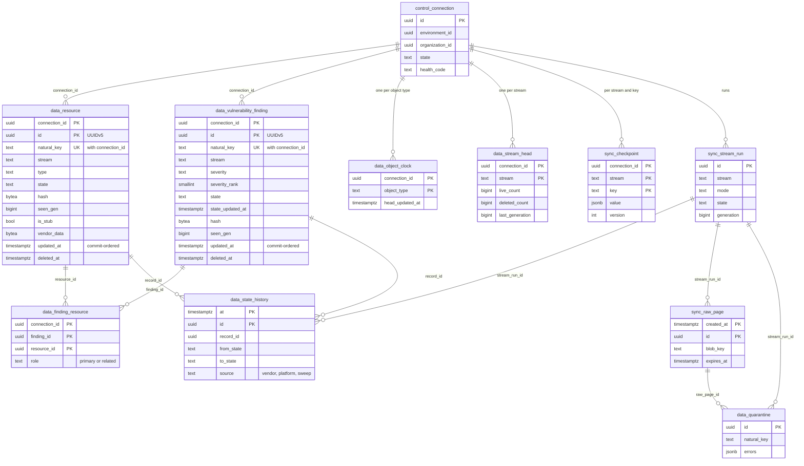
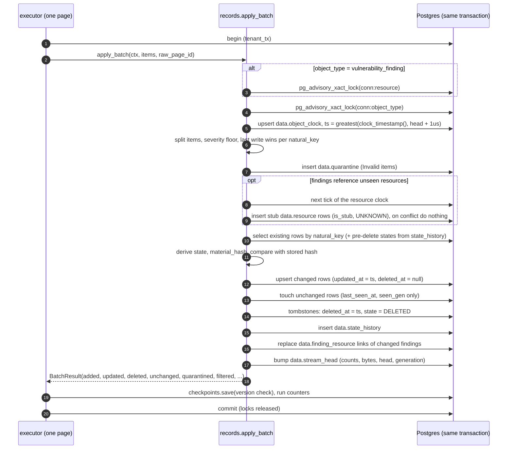

# Part 3: Data model and record store

This part describes how SecureFabric stores what it syncs: the five Postgres schemas and their main tables, the canonical record model shared by connectors and the store, and the single write path (`records.apply_batch`) that every canonical row goes through. It also covers sweep deletion, the raw page archive, vendor payload encryption, and retention. Read it before you change a migration, add a field to a canonical record, touch `packages/domain/src/securefabric_domain/records.py`, or write a reader that depends on `updated_at`.

## Context

The platform has to turn many vendor APIs into one stable, Leen V2-compatible dataset (PD-9) that customers read incrementally through `/v1` and through webhooks. These requirements shaped the store:

| Requirement | What it forces |
|---|---|
| STORE-01 stable ids | The same vendor record keeps the same id across re-syncs, resets and re-installs of the connector. |
| STORE-02, STORE-03 (D5) | Re-syncing an unchanged vendor must not rewrite rows or move `updated_at`. |
| CDC-01, PD-6 | A reader paging by `(updated_at, id)` within a connection must never skip a change. |
| CDC-02 | Deletions appear in the incremental feed. |
| STORE-04 | A deleted record that reappears is undeleted, with the right state. |
| STORE-05, STORE-06 | Records the vendor stopped listing are deleted, but only after a complete pass and behind a guard. |
| STORE-07 | Every state change is kept in an append-only history. |
| STORE-09, PD-12 | Raw vendor payloads are stored as opaque bytes, and can be encrypted without a migration. |
| STORE-10, STORE-11 | Every vendor response is archived before parsing, and can be replayed through a newer normaliser. |
| STORE-13, STORE-14 | Writers for one connection and object type are serialised; record counts are exact. |
| NORM-08, NORM-14 | Invalid records are quarantined, not dropped; a finding never points at a resource that does not exist. |
| PD-5 | Canonical typed tables, hash-partitioned by connection, with a per-row `seen_gen` for sweep deletion. |

The design intent is in [plan part 2](../plan/02-data-model.md) and [plan part 4, sections 7 and 8](../plan/04-sync-engine.md). This part describes what was built. Tenancy (row-level security, roles, the vault) is covered in [Part 2](02-tenancy-identity-and-security.md); the read side of the data API is in [Part 7](07-public-api-and-events.md).

## How it works

### The five schemas

All platform tables are created by `db/migrations/0002_platform.sql`. Later migrations add `control.action` (0003), operator `SECURITY DEFINER` functions (0004, 0005), status and usage-flush functions (0006 to 0008). The vendored Absurd queue lives in its own `absurd` schema (0001).

Every tenant row carries `environment_id`, and RLS on each tenant table compares it to the transaction-local setting `app.environment_id` (see [Part 2](02-tenancy-identity-and-security.md)). Enumerations are `text` with `check` constraints, so a new value is an ordinary migration. Data tables have no foreign keys to control tables: `connection_id` is a soft reference so purge can bulk-delete per connection and history can outlive a connection.

The table below lists the tables that matter for the record store and the engine. Control-plane tables owned by other parts are listed briefly.

| Table | Purpose | Key / notable indexes |
|---|---|---|
| **control** | | |
| `control.account`, `app_user`, `membership`, `environment`, `api_key` | Tenancy and identity ([Part 2](02-tenancy-identity-and-security.md)) | UUIDv7 PKs |
| `control.organization`, `integration`, `vendor_app`, `connection`, `credential`, `connection_grant`, `connect_session`, `oauth_state` | Connections and the connect flow ([Part 6](06-connections-and-connect-flow.md)) | `connection` carries `state`, health columns, `event_seq`, `data_shard` |
| `control.connector` | Loaded connector manifests, one `is_current` per id | PK `(id, version)` |
| `control.connection_health_event` | Health transitions | PK `(at, id)`, monthly range partitions |
| `control.idempotency_key` | API idempotency | PK `(environment_id, key)` |
| **sync** | | |
| `sync.stream_schedule` | When each stream of a connection next runs | unique `(connection_id, stream)` |
| `sync.job`, `sync.stream_run` | Customer-visible job and the per-stream unit of admission ([Part 4](04-sync-engine.md)) | partial unique "one active run" index |
| `sync.checkpoint` | Resume position per stream, optimistic `version` | PK `(connection_id, stream, key)`, `key in ('default','sweep','export')` |
| `sync.concurrency_limit`, `sync.rate_bucket`, `sync.scheduler_lease` | Admission caps, vendor rate buckets | |
| `sync.ingress_delivery`, `sync.dirty_record` | Inbound webhooks and the keys they mark for re-fetch | unique `(vendor_app_id, delivery_id)`; PK `(connection_id, stream, vendor_key)` |
| `sync.raw_page` | Index of archived vendor responses | PK `(created_at, id)`, daily range partitions |
| `sync.generation_seq` | Sequence for full-pass generations | |
| **data** | | |
| `data.resource` | Canonical assets (repositories, branches, hosts, images...) | PK `(connection_id, id)`, unique `(connection_id, natural_key)`, 64 hash partitions |
| `data.vulnerability_finding` | Canonical findings | same keys, 64 hash partitions, GIN on `cve_ids` |
| `data.finding_resource` | Finding to resource links, `role in ('primary','related')` | PK `(connection_id, finding_id, resource_id)`, 64 hash partitions |
| `data.state_history` | Append-only state transitions (STORE-07) | PK `(at, id)`, monthly range partitions |
| `data.quarantine` | Records that failed canonical validation (NORM-08) | `(connection_id, created_at desc)` |
| `data.stream_head` | Exact live/deleted counts per stream (STORE-14) | PK `(connection_id, stream)` |
| `data.object_clock` | Monotonic `updated_at` clock per (connection, object type) (PD-6) | PK `(connection_id, object_type)` |
| `data.cve`, `data.advisory_alias`, `data.enrichment_cursor` | Global CVE mirror and GHSA aliases (not tenant data, no RLS) | PK `cve_id`, `alias` |
| **events** | | |
| `events.outbox_event` | Transactional outbox ([Part 7](07-public-api-and-events.md)) | PK `(created_at, id)`, monthly partitions |
| `events.webhook_endpoint`, `webhook_delivery`, `webhook_attempt` | Outbound webhooks | trigger caps 5 live endpoints per environment |
| **obs** | | |
| `obs.operation`, `obs.operation_event` | Customer-visible operation log (OBS-01) | daily range partitions |
| `obs.audit_event` | Append-only audit | monthly partitions; update/delete revoked |
| `obs.usage_event`, `obs.usage_daily`, `obs.api_rate_counter` | Metering | |
| `obs.worker_heartbeat`, `obs.alert` | Worker liveness, alerts | `alert_open` unique on `(name, subject)` while unresolved |

The core of the record store and how the engine tables point at it. Lines from `data.*` to `control.connection` are soft references (no foreign keys); the rest are logical relationships keyed as shown.



### Partitioning

Two schemes are in use, for two different access patterns.

**Hash by connection.** `data.resource`, `data.vulnerability_finding` and `data.finding_resource` are `partition by hash (connection_id)` with modulus 64, created in a `do` block in the migration (`data.resource_h00` to `_h63`, and so on). A connection's rows always sit in one partition, so every connection-scoped query and every purge touches one partition. Primary keys lead with `connection_id` because a partitioned unique index must include the partition key. Sixty-four was chosen to keep partitions near 1.5M rows at the year-one target of 100M findings (progress.md records 2,375 bytes per finding with indexes and the API gates measured at 1M rows in one partition).

The main read indexes are `(connection_id, updated_at, id)` for the incremental feed, `(organization_id, updated_at, id)` for organization-scoped feeds, `(connection_id, state, severity_rank desc, id)` for the default findings sort, and a plain `(id)` index for get-by-id. `severity_rank` (`Severity.rank`, 5 for CRITICAL down to 0 for UNKNOWN) exists so that sorting by severity is an index order. `packages/domain/tests/test_query_shape.py` pins the predicate shapes: one connection must be an equality, not `= any($1)`, or the planner abandons the index.

**Range by time.** Append-heavy, time-bounded tables are `partition by range` on their timestamp: daily for `sync.raw_page`, `obs.operation`, `obs.operation_event`; monthly for `control.connection_health_event`, `data.state_history`, `events.outbox_event`, `obs.audit_event`, `obs.usage_event`. Two `SECURITY DEFINER` functions own the DDL and are executable only by `sf_system`:

- `public.sf_ensure_partitions(parent, unit, from, to)` creates missing partitions named `<table>_pYYYYMMDD` or `_pYYYYMM`, plus a `_default` partition.
- `public.sf_drop_partitions_before(parent, before)` drops partitions whose upper bound is at or before the date.

The migration creates an initial window. The **partition manager** is the `partitions` job in `packages/domain/src/securefabric_domain/maintenance.py`, run hourly on the `maintenance` queue: daily tables get partitions from yesterday to 8 days ahead, monthly tables from the first of this month to 62 days ahead. It then counts rows in each `_default` partition; any row there means the manager fell behind, and it raises `partition_manager_behind`.

`sync.ingress_delivery` is deliberately not partitioned (a documented deviation): its `(vendor_app_id, delivery_id)` uniqueness must hold across days.

### The canonical model (`packages/schema`)

`packages/schema/src/securefabric_schema` is the single source for record shapes, enumerations, health codes and the event envelope. It imports nothing else from the repository.

- `records.py` defines `ResourceRecord` and `FindingRecord`, the internal shapes a connector's pure `normalize` returns, plus the nested blocks (`Group`, `Tag`, `Vulnerability`, `CvssScore`, `Reference`, `Analytic`, `Product`, `Ticket`, `ResourceRelated`, `AffectedCode`, `AffectedPackage`, `VendorAttributes`, `ResourceRef`). All models are `extra="forbid"` and frozen. `natural_key` is 1 to 512 characters, matching the `check` in SQL.
- `enums.py` defines `ResourceType`, `ResourceState`, `FindingType`, `Severity` (with `rank`), `FindingState`, `Reachability`, `HealthCode` (with status, resolution owner, roll-up severity and description), run and job states, `Mode`, `SyncMode` and `DeletionMode`.
- `events.py` defines `EventType`, the reserved CDC names, and `EventEnvelope`.

**Leen V2 alignment.** Field names and enumeration values follow Leen V2 where Leen defines them (PD-9). Anything not in Leen is marked "additive" in the source: `AffectedPackage.fixed_version` and `path`, the extra keys in `ResourceRecord.data` for types Leen has no shape for, and on the wire `connection_id`, `organization_id`, `cve_ids`, `is_stub`, `created_at`, `updated_at`, `deleted_at`, `enrichment` and `_meta`. Enumerations are open on the wire: clients must tolerate unknown values. The public rendering is `render_resource` and `render_finding` in `packages/domain/src/securefabric_domain/data_api.py`, contract-tested against Leen's published schema in `apps/api/tests/test_data.py`. See the [Leen migration guide](../guides/leen-migration.md) and [research notes](../research/leen-v2-and-workos.md).

**What connectors cannot say.** Platform-derived fields are absent from the record models on purpose, because connectors that reimplement them diverge: ids, hashes, `first_seen`, stub resources, the severity floor, the `state_updated_at` fallback, and the `REOPENED` and `DELETED` states. `FindingRecord` has a validator that rejects `REOPENED` and `DELETED` (`test_connectors_cannot_report_platform_derived_states`). `cve_ids` are upper-cased, checked for the `CVE-` prefix and de-duplicated. `meta_derived` lists fields the connector derived rather than read, so "never fabricates" (NORM-09) can be checked by the conformance suite.

`material(record)` returns the fields that make up the material hash: the whole record dumped as JSON except `vendor_data`.

### Record ids

`packages/core/src/securefabric_core/ids.py`:

```
record_id(connection_id, kind, natural_key) = uuid5(RECORD_NAMESPACE, f"{connection_id}|{kind}|{natural_key}")
```

`kind` is `resource` or `finding` (the write path maps `vulnerability_finding` to `finding`). `RECORD_NAMESPACE` is a fixed UUID that must never change: changing it re-keys every stored record. Because the id depends on the connection, the same vendor object seen through two connections gets two ids, and the id is known before the row exists, which is what lets a finding link to a resource that has not been written yet. The natural key is the connector's responsibility and must use identifiers the vendor never reuses (GitHub uses numeric ids, not names; see [the GitHub connector page](../connectors/github.md)). Control-plane rows use UUIDv7 (`absurd.portable_uuidv7()` in SQL, `uuid7()` in Python).

### Canonical JSON and the material hash

`packages/core/src/securefabric_core/canonical.py` defines `canonical_json` and `material_hash` (SHA-256 of the canonical JSON). The encoding is independent of key order, whitespace and float spelling: keys sorted by code point, datetimes normalised to UTC milliseconds (`...T10:15:00.123Z`), integral floats encoded as integers, `-0.0` as `0`, NaN and infinities rejected, sets rejected because they have no order. This is what makes STORE-02 hold across connector versions and Python dict orderings. The write path hashes `material(record)` with the platform-derived `state` substituted, so a change from `OPEN` to `REOPENED` is a material change.

### The write path: `records.apply_batch`

`packages/domain/src/securefabric_domain/records.py` is the only code that writes `data.resource` and `data.vulnerability_finding`. `apply_batch(conn, ctx, items, raw_page_id=...)` runs inside the caller's transaction (the executor opens one `tenant_tx` per page, which also saves the checkpoint and run counters, so a page commits as a unit). `BatchContext` carries the tenant ids, stream, object type, connector version, the pass `generation` (0 for non-full writes), `stream_run_id`, the optional `severity_floor`, and the optional `payload_cipher`. `items` is a mix of `ResourceRecord`/`FindingRecord`, `Tombstone` (vendor-reported deletion) and `Invalid` (normalisation failure).



Step by step:

1. **Lock order.** A findings batch first takes the advisory lock for `(connection, resource)`, then `(connection, vulnerability_finding)`. A resource batch takes only the resource lock. The lock key is `hashtextextended('<connection_id>:<object_type>', 0)` and is transaction-scoped (`pg_advisory_xact_lock`), so it is released at commit or rollback. Findings need the resource lock because they may create stub resources; sweeps and the resource-to-finding cascade take locks in the same order, so there is no deadlock between them (STORE-13).

2. **The clock.** `next_ts` upserts `data.object_clock` and returns `greatest(clock_timestamp(), head_updated_at + 1 microsecond)`. Every changed row in the batch gets this one `ts` as `updated_at` (and as `created_at`/`first_seen_at` on insert). The clock is per (connection, object type), not per stream, because two streams can write one object type (GitHub `repositories` and `branches` are both resources). This is a documented deviation: the plan put the clock on `stream_head`.

3. **Generation.** `seen_gen` for the batch is `ctx.generation` during a full pass. Otherwise it is `current_generation()`, the `last_value` of `sync.generation_seq`, which is at least the generation of every running pass. A targeted or incremental write during a full pass therefore never makes a row look unobserved to that pass's sweep.

4. **Partition and filter.** Items split into records, tombstones and invalid. A finding below `severity_floor` is counted as `filtered` and dropped, except `UNKNOWN`, which is never filtered. Filtering here, after normalisation, keeps natural keys and history consistent when the option changes. Within one batch the last record for a natural key wins.

5. **Quarantine.** Each `Invalid` becomes a `data.quarantine` row with its validation errors and the `raw_page_id` of the archived response, so an operator can see the vendor bytes that failed. `executor._normalize` turns both pydantic `ValidationError` and any exception raised by a connector's `normalize` into `Invalid`: a normaliser bug quarantines a record, not the run.

6. **Stubs (NORM-14).** For a findings batch, every `ResourceRef` whose natural key is not yet in `data.resource` gets a stub row with the id the real row will have, `is_stub = true`, `state = 'UNKNOWN'`, `seen_gen = 0`, and the stream named in the ref (or `unknown`). Stubs take their own tick of the resource clock, because stamping them with the finding clock would break the resource feed's ordering (a bug found and fixed during validation). Insert is `on conflict do nothing`, so a stub never moves an existing row. When the owning stream later writes that natural key, the stub is always treated as changed and overwritten.

7. **Hash gate.** For each record the path computes the id, derives the state (step 8), and hashes `material(record)` with that state. If a live, non-stub row exists with the same hash, the row goes on a touch list: only `last_seen_at = ts` and `seen_gen = greatest(seen_gen, gen)` are updated, and `updated_at` does not move (STORE-02, STORE-03). Otherwise the row is upserted with one `insert ... select ... from jsonb_populate_recordset(...) on conflict (connection_id, natural_key) do update` that sets the canonical columns, `hash`, `updated_at`, `last_seen_at`, `seen_gen = greatest(...)` and `deleted_at = null`, and leaves `first_seen_at` and `created_at` as they were. Unlike the plan's single SQL statement, the comparison is done in Python after one `select` of the existing rows; that also gives exact per-row classification for the counts.

8. **Derived state.** `_derive_finding_state` applies the platform rules for findings:
   - A live row that was `CLOSED`, `IGNORED` or `REOPENED` and is reported `OPEN` becomes `REOPENED`. `REOPENED` therefore sticks until the vendor reports a non-open state.
   - A deleted row that reappears `OPEN` becomes `REOPENED` if its state before deletion (read from the last `to_state = 'DELETED'` row in `data.state_history`) was `CLOSED`, `IGNORED` or `REOPENED`; otherwise `OPEN` (STORE-04).
   - Any other report is taken as is.

9. **`state_updated_at` (NORM-05).** When a finding's state changes or the finding is new: the connector's `state_changed_at` if it provided one and the derived state is not `REOPENED`; else, for a new `OPEN` finding, the vendor's `created_at`; else `ts`. If the state did not change the previous value is kept.

10. **Tombstones.** A `Tombstone` for a live row sets `deleted_at = ts`, `state = 'DELETED'`, `updated_at = ts` (and `state_updated_at` for findings). A tombstone for an unknown or already deleted row is ignored.

11. **History, links, counts.** Each state change (including first insert, with `from_state` null) appends to `data.state_history` with `source` `vendor`, `platform` (undelete) or `sweep`. Links for every changed finding are deleted and re-inserted from its `resources` list. `data.stream_head` gets the live and deleted deltas, `head_updated_at = greatest(...)`, and `last_generation` for full passes; stub creations bump the stub's own stream head. Because counts change only under the lock, in the same transaction as the rows, they are exact by construction (STORE-14), with no triggers.

`apply_batch` returns a `BatchResult` (`added`, `updated`, `deleted`, `unchanged`, `quarantined`, `filtered`, `undeleted`, `stubs`, `ts`, `changed_ids`), which the executor adds to the run's counters.

### Why `updated_at` is commit-ordered (CDC-01, PD-6)

A reader that pages by `(updated_at, id)` can skip a row if a transaction with an earlier timestamp commits after the reader has moved past that timestamp. That is the normal behaviour of `now()` or `clock_timestamp()` under concurrency.

Here every writer for a (connection, object type) holds the same transaction-scoped advisory lock from before it picks `ts` until it commits, and `ts` is strictly greater than the head the previous writer committed. So within one connection and object type, `updated_at` order equals commit order, and no row can later appear behind a reader's position. Everything that sets `updated_at` on canonical rows goes through this lock: batches, stubs, tombstones, sweeps and the cascade. Things that do not change content do not touch `updated_at`: touching unchanged rows, the `payload_reencrypt` job, and retention.

What readers rely on (implemented in `data_api.py`, described in [Part 7](07-public-api-and-events.md)):

- Within one connection, a keyset cursor on `(updated_at, id)` with `updatedSince` never skips a change. `test_concurrent_writers_never_hide_a_change_from_an_incremental_reader` runs 4 writers and 3 readers and checks every reader saw every row's final `updated_at`.
- An unchanged re-sync produces no feed entries. `last_seen_at` moves without `updated_at` (the `lastSeenSince` filter uses it).
- Deletions are rows with `state = 'DELETED'` and `deleted_at` set, returned by an `updatedSince` read (CDC-02), until retention hard-deletes them after 90 days.
- `changeType` is derived from `created_at` versus `updated_at` and `deleted_at`.
- Organization-scoped feeds merge connections whose clocks are independent, so they hide rows with `updated_at` younger than 5 seconds (`ORG_FEED_GUARD_S`). The guard assumes no batch transaction lasts longer than that (see Known gaps).

### Sweep deletion

A stream whose manifest declares `deletion: sweep` (or any stream on a reconcile full pass, unless it declares `none`) deletes records a complete listing did not observe. The mechanism, in `records.sweep`, `sweep_preview` and `_cascade`:

1. **Generation.** A full or backfill pass takes a generation from `sync.generation_seq` (`new_generation`). The slice handler persists it on `sync.stream_run.generation` before any page commits, and the executor stores it in the checkpoint's `pass` field, so a re-claimed or retried slice continues the same pass. Every row the pass writes or touches gets `seen_gen >= generation`.
2. **Only after a complete listing.** The executor calls the sweep only after `stream.read()` returned normally. An interrupted pass never sweeps. A backfill bounded by `initial_lookback_days` never sweeps, because it did not list everything.
3. **Guard (STORE-06).** Under the same lock order, `sweep_preview` counts live rows of this stream with `seen_gen < generation` (`would_delete`) and all live rows. `guard_trips` is true when `would_delete > 20` and `would_delete > 50%` of live. A tripped guard leaves the data alone and returns `aborted`, unless the connector's `sweep_confirmed(stream, would_delete, live, vendor_total)` confirms the shrink from the vendor's own count (GitHub: the installation's repository count). The run still succeeds, with a warning, and the handler raises `sweep_aborted`.
4. **Delete.** The sweep takes a fresh clock tick, then repeatedly updates up to 1,000 victims (`deleted_at`, `state = 'DELETED'`, `updated_at`, `state_updated_at` for findings) until none are left, writes history with `source = 'sweep'`, and decrements the stream head.
5. **Cascade.** When resources are swept, findings whose `primary` resource was deleted are deleted in the same transaction (lock `vulnerability_finding`, its own clock tick, history, per-stream head updates). For GitHub this handles a repository removed from the installation.

### The raw page archive

`packages/domain/src/securefabric_domain/sync/archive.py` (`RawArchive`) and `blob.py` implement STORE-10 and RAW-02.

- **Before parsing.** The CDK `HttpClient` calls `capture.capture(request_summary, body)` for every 2xx response (unless a request opts out), before returning the response to connector code. The body has already passed through the manifest's `scrub_fields`. A normaliser crash therefore still leaves the evidence.
- **Sealed.** The payload `{summary, body}` is sealed with `seal_envelope` to the environment's public key, bound to the environment, connection and purpose `raw_page`. Only roles that can unwrap the environment key (workers) can open it; `read_raw_page` is worker-only, and the operator viewer reaches it through the `raw.read` task on the control queue.
- **Blob plus index.** Sealed bytes go to object storage under `<environment_id>/<connection_id>/<stream>/<page_id>`; then a `sync.raw_page` row (`seq`, `blob_key`, `bytes`, `request_summary` with method, path template, query and status, `expires_at = now + 7 days`) is inserted in its own short transaction. The page's records later carry `raw_page_id = archive.last_id` into quarantine rows.
- **Storage.** `S3BlobStore` uses the MinIO client against `BLOB_ENDPOINT` / `BLOB_BUCKET` (MinIO in compose) and installs a 7-day lifecycle rule on the bucket. Without blob settings the platform falls back to `MemoryBlobStore` (tests).
- **Not on the critical path.** A failed `put` is logged, counted, and raises `raw_archive_failing` once per slice; the sync carries on. The archive is evidence, not the source of truth.

**Re-normalisation (STORE-11).** `packages/domain/src/securefabric_domain/renormalize.py` replays a stream's unexpired raw pages, oldest first, through the current connector's `normalize`, with no vendor calls, and writes each page through `apply_batch`. Because writes are hash-gated, only records whose mapping output changed move. Items are extracted from each body by `items_of`, which accepts a top-level list or a list under `items`, `repositories`, `data` or `results`, or a single object with `id` or `number`. It runs as the operator repair `renormalize` (`operator.repair` task, control queue), validated up front by the admin API.

### Vendor payload encryption at rest (STORE-09, PD-12)

`vendor_data` is `bytea` with a one-byte format header (`encode_vendor_data`):

| Header | Meaning |
|---|---|
| `0x01` | zlib-compressed canonical-ish JSON (sorted keys) |
| `0x02` | the same bytes sealed with `PayloadKeyring` (AES-256-GCM): `[key version][12-byte nonce][ciphertext]`, with associated data `sf-payload-v1:<environment_id>/<connection_id>/<object_type>` |

`PAYLOAD_KEYS` is `"1:<base64 32 bytes>,2:<...>"`; the highest version seals, every listed version opens. Binding the ciphertext to the row's environment, connection and object type means a payload copied onto another tenant's row does not open. Only the `sync`, `control` and `maintenance` roles load the keys (`runtime.build_platform`). `vendor_data` is excluded from the material hash, so encrypting or re-encrypting never moves `updated_at`.

The `payload_reencrypt` maintenance job (every 10 minutes, budget 20,000 rows) walks both tables in primary-key order with `for update skip locked` and re-seals rows that are plaintext (`0x01`) or sealed with an older key version. A row that cannot be opened is counted, skipped and alerted on (`payload_unreadable`) instead of stalling the walk. Key rotation is: add a version, let the job re-seal, drop the old version (`test_payload_key_rotation_drill`).

### Retention and purge

All in `maintenance.py`, hourly unless noted, run by `sf_system`:

| What | Rule |
|---|---|
| Range partitions | Dropped when older than: `sync.raw_page` 7 days, `obs.operation`/`operation_event` 30 days, `events.outbox_event` 90 days, `obs.audit_event` 366 days, `connection_health_event`, `data.state_history`, `obs.usage_event` 400 days |
| Row deletes | `sync.job` 90 days (terminal only), `data.quarantine` 30 days, `idempotency_key` 24 h, `oauth_state` 2 days, used/expired `connect_session` 2 days, `ingress_delivery` 7 days, `webhook_attempt` 30 days, non-pending `webhook_delivery` 90 days, `api_rate_counter` 1 day, resolved `alert` 90 days |
| Soft-deleted records | `data.vulnerability_finding` and `data.resource` rows with `deleted_at` older than 90 days are hard-deleted |
| Raw blobs | Bucket lifecycle rule, 7 days |
| Connection purge | `purge`: a `DELETED` connection past `purge_after` (30 days, CON-04) has its links, findings, resources, stream heads, clock, checkpoints, quarantine, dirty records and grants deleted, is marked `HARD_DELETED`, and its blob prefix is removed |

## Invariants and how they are enforced

| Guarantee | Mechanism | Test |
|---|---|---|
| The same vendor record always gets the same id | UUIDv5 over `connection_id|kind|natural_key`, fixed namespace | `packages/core/tests/test_primitives.py::test_record_id_is_stable_and_scoped`; `packages/connectors/tests/test_sandbox_conformance.py::test_3_stable_ids` |
| Hashing is independent of key order and float spelling | `canonical_json` rules | `test_primitives.py::test_hash_is_independent_of_key_order`, `test_integral_floats_hash_as_integers` |
| `vendor_data` never affects the hash | `material()` excludes it | `packages/schema/tests/test_schema.py::test_material_hash_input_excludes_the_raw_vendor_payload` |
| An unchanged re-sync does not move `updated_at` | Hash gate, touch list | `packages/domain/tests/test_records.py::test_insert_then_unchanged_does_not_move_updated_at`; `test_sandbox_conformance.py::test_1_idempotent` |
| Incremental readers never skip a change within a connection | Advisory lock held to commit, monotonic `data.object_clock` | `test_records.py::test_concurrent_writers_never_hide_a_change_from_an_incremental_reader` |
| `REOPENED` is derived and sticky; connectors cannot report it | `_derive_finding_state`; schema validator | `test_records.py::test_reopened_is_derived_and_sticky`; `test_schema.py::test_connectors_cannot_report_platform_derived_states` |
| Tombstones delete and reappearance undeletes | Tombstone branch; upsert clears `deleted_at` | `test_records.py::test_tombstone_and_undelete` |
| No finding points at a missing resource | Stubs on their own resource tick | `test_records.py::test_stub_resources_and_links`; `test_sandbox_conformance.py::test_9_linked` |
| Counts are exact | Head deltas under the lock, same transaction | `test_records.py::test_counts_are_exact` |
| Invalid records are quarantined; floor filters without losing UNKNOWN | `_quarantine`, severity floor branch | `test_records.py::test_quarantine_and_severity_floor` |
| Sweep deletes exactly what a full pass did not see, even after a resume | Generation persisted on the run and checkpoint; sweep only after `read()` completes | `test_sandbox_conformance.py::test_2_resumable`, `test_4_sweep_correct` |
| A suspicious shrink never deletes data; resource deletion cascades | `guard_trips`, `_cascade` | `test_records.py::test_sweep_guard_and_cascade`; `test_sandbox_conformance.py::test_5_guarded` |
| Vendor payloads are encrypted and bound to their row | `PayloadKeyring`, `0x02` format | `packages/core/tests/test_crypto.py::test_payload_keyring_binds_rows_and_rotates`; `test_records.py::test_vendor_payloads_are_encrypted_at_rest_when_keys_are_set` |
| Key rotation never moves `updated_at`; unreadable rows do not stall it | `payload_reencrypt` | `test_records.py::test_payload_key_rotation_drill`, `test_reencryption_skips_and_alerts_on_rows_it_cannot_open` |
| Re-normalisation makes no vendor calls | Replays `sync.raw_page` through `apply_batch` | `packages/domain/tests/test_operator.py::test_renormalisation_replays_the_archive_without_vendor_calls` |
| Scope predicates stay index-friendly | `_common_where` shapes | `packages/domain/tests/test_query_shape.py::test_one_connection_is_an_equality`, `test_organization_scope_leads_with_organization_id` |
| Partitions exist ahead; old ones are dropped | `partitions`, `retention` jobs | `packages/domain/tests/test_maintenance.py::test_partitions_are_created_ahead`, `test_retention_drops_old_partitions_and_rows` |
| Deleted connections are purged on day 30 | `purge` job | `test_maintenance.py::test_purge_hard_deletes_after_30_days` |
| Every tenant table has RLS | Migration loop plus guard test | `packages/db/tests/test_rls.py::test_every_tenant_table_has_rls` |

## Failure modes

**Worker dies mid-page.** The page's records, history, links, counts, checkpoint and run counters are one transaction. A crash rolls all of it back and the advisory locks are released by Postgres. The resumed slice re-reads from the last committed checkpoint and re-applies the page; the hash gate makes that a no-op for rows that did commit earlier.

**Two writers on one connection.** They serialise on the advisory lock. Contention is bounded by the per-connection admission cap of 3 runs ([Part 4](04-sync-engine.md)). A long transaction blocks other writers for that connection and object type only.

**Normaliser bug or schema violation.** The record goes to `data.quarantine` with the error and raw page id; the rest of the page commits. The slice handler raises `quarantine_spike` when quarantined records exceed 1% of a run's processed records ([runbook](../runbooks/quarantine_spike.md)). After a connector fix, `renormalize` replays the last 7 days of pages.

**Vendor listing shrinks by mistake** (an API bug, a permission change that empties a listing). The sweep guard trips, nothing is deleted, the run succeeds with a warning and `sweep_aborted` pages on-call ([runbook](../runbooks/sweep_aborted.md)).

**Object storage down.** Archive writes fail and are skipped; syncs continue; `raw_archive_failing` is raised ([runbook](../runbooks/raw_archive_failing.md)). Those pages cannot be re-normalised later.

**Partition manager stops.** Rows land in `_default` partitions; inserts keep working; `partition_manager_behind` fires ([runbook](../runbooks/partition_manager_behind.md)). Once rows are in a default partition, creating the matching range partition will fail until they are moved, so the alert must be handled promptly.

**Payload key missing.** Rows sealed with a dropped key cannot be opened; `payload_reencrypt` skips them and raises `payload_unreadable` ([runbook](../runbooks/payload_unreadable.md)). Canonical columns are unaffected; only the raw `vendor_data` is lost.

**Counts drift** (for example after manual SQL). The operator repair `rebuild_counts` recomputes `live_count` and `deleted_count` from the tables.

## Extending it

**Add a field to a canonical record.**
1. Add it to `ResourceRecord` or `FindingRecord` in `packages/schema/src/securefabric_schema/records.py` (mark it "additive" if Leen does not have it).
2. Add a nullable column in a new forward-only migration in `db/migrations/` (expand first; never edit an applied migration).
3. Map it in `records._row` and add it to `_RESOURCE_UPDATE` or `_FINDING_UPDATE`, or the upsert will not update it.
4. Render it in `data_api.render_resource` / `render_finding` and regenerate the OpenAPI document and clients ([Part 8](08-dashboard-and-clients.md)).
5. Note that the field is now part of the material hash: the next sync of every row whose value is non-empty will count as an update and move `updated_at`. If that is not acceptable for existing data, backfill the column and re-normalise rather than letting a sync churn the feed.

**Add an enumeration value.** Add it to the `StrEnum` in `enums.py` and to the `check` constraint in a new migration. Clients already tolerate unknown values.

**Add a new object type** (NORM-12 reserves Detection, Compliance, Identity, Device). This needs a new hash-partitioned table with the same key shape (`PK (connection_id, id)`, unique `(connection_id, natural_key)`, `seen_gen`, `hash`, the `(connection_id, updated_at, id)` index), an entry in `_TABLE` and `_KIND` in `records.py`, a `record_id` kind, RLS (add it to the migration loop so `test_every_tenant_table_has_rls` covers it), the manifest `object` literal in the CDK, and its read endpoints. Keep the lock order acyclic if the new type references another.

**Add a range-partitioned table.** Create it `partition by range`, seed partitions in the migration with `sf_ensure_partitions`, and add it to `DAILY` or `MONTHLY` and to `PARTITION_RETENTION_DAYS` in `maintenance.py`.

## Known gaps and open questions

- **The organization-feed guard is not enforced by a transaction limit.** `ORG_FEED_GUARD_S = 5` assumes no batch transaction runs longer than 5 seconds, and the comment in `packages/db/src/securefabric_db/pool.py` says so, but the pool sets `statement_timeout = '60s'`, which bounds a single statement, not a transaction. A page transaction that takes longer than 5 seconds (large page, sweep of many rows in one transaction, lock wait) could commit rows that an organization-scoped reader has already passed. Per-connection feeds are not affected. Options: an `idle_in_transaction_session_timeout` plus a transaction deadline for page transactions, or a larger guard.
- **`stream_head.bytes` is cumulative, not current.** `apply_batch` adds the size of every newly written `vendor_data` blob and never subtracts the old size, so it grows on every update. It is not read anywhere today; `rebuild_counts` resets it to 0.
- **Retention hard-deletes soft-deleted records without adjusting `deleted_count`**, so `stream_head.deleted_count` overstates after 90 days. It also means an incremental reader that has not polled for 90 days can miss deletions; this reader contract is not documented on the API yet.
- **Reset with `wipe` hard-deletes rows** (`jobs.reset_connection`): readers see no tombstones for them, `data.finding_resource` links are left behind for the deleted rows, and no state history is written.
- **Re-normalisation does not apply `severity_floor`.** `renormalize` builds its `BatchContext` without the connection's floor, so a replay can write findings the sync filtered out. It also relies on `items_of` heuristics to find items in a body; a connector whose envelope uses another key is silently skipped. It runs on the control queue as an operator repair, not as a maintenance task as the plan says.
- **`raw_page_id` is the last captured response**, not necessarily the one a quarantined record came from when a page needs several requests or export chunks download in parallel.
- **The archive falls back to memory silently.** Without `BLOB_ENDPOINT` and keys, `build_platform` uses `MemoryBlobStore`; in a multi-process deployment the index rows would point at blobs nobody can read. A production boot check would catch this.
- **`vendor_data` has no reader.** It is written, encrypted and re-encrypted, but no API or task decodes it except re-encryption. It is kept for future features and for re-normalisation of fields not in the archive window.
- **Plan versus code on the hash.** The plan excludes "vendor scan identifiers" from the material hash; the code hashes everything except `vendor_data`, including `vendor.updated_at`. A vendor that bumps its own `updated_at` without a material change will move our `updated_at`.
- **Batch size is not capped by the store.** The plan states batches of at most 1,000 records; `apply_batch` accepts whatever a page contains.
- **Scale evidence is per partition.** The year-one target (100M findings) was closed on measurements at 1M rows in one partition on a laptop, not a full-size run (progress.md, NFR-06). Post-backfill autovacuum caused p95 spikes in the benchmark; partition-level autovacuum settings from the plan are not applied yet.
- **Reserved, unused columns**: `resource.entity_id`, `vulnerability_finding.cluster_id`, `connection.data_shard` (STORE-08 is a hook only), and the `sweep` checkpoint key (the generation lives on `stream_run` and in the `default` checkpoint instead). STORE-15 (customer bucket export) is not in this plan.

## Further reading

- Design intent: [plan part 2, data model](../plan/02-data-model.md); [plan part 4, sections 7 to 9](../plan/04-sync-engine.md); [plan part 1, PD-11 to PD-13](../plan/01-architecture.md)
- [Part 2: Tenancy, identity and security](02-tenancy-identity-and-security.md) for RLS, roles and the vault
- [Part 4: Sync engine](04-sync-engine.md) for who calls `apply_batch` and when
- [Part 5: Connector platform](05-connector-platform.md) for `normalize`, natural keys and `sweep_confirmed`
- [Part 7: Public API and events](07-public-api-and-events.md) for the feed semantics readers see
- [Leen migration guide](../guides/leen-migration.md), [Leen V2 research notes](../research/leen-v2-and-workos.md)
- Connector pages: [GitHub](../connectors/github.md), [SANDBOX](../connectors/sandbox.md)
- Runbooks: [sweep_aborted](../runbooks/sweep_aborted.md), [quarantine_spike](../runbooks/quarantine_spike.md), [raw_archive_failing](../runbooks/raw_archive_failing.md), [partition_manager_behind](../runbooks/partition_manager_behind.md), [payload_unreadable](../runbooks/payload_unreadable.md), [restore_drill](../runbooks/restore_drill.md)
