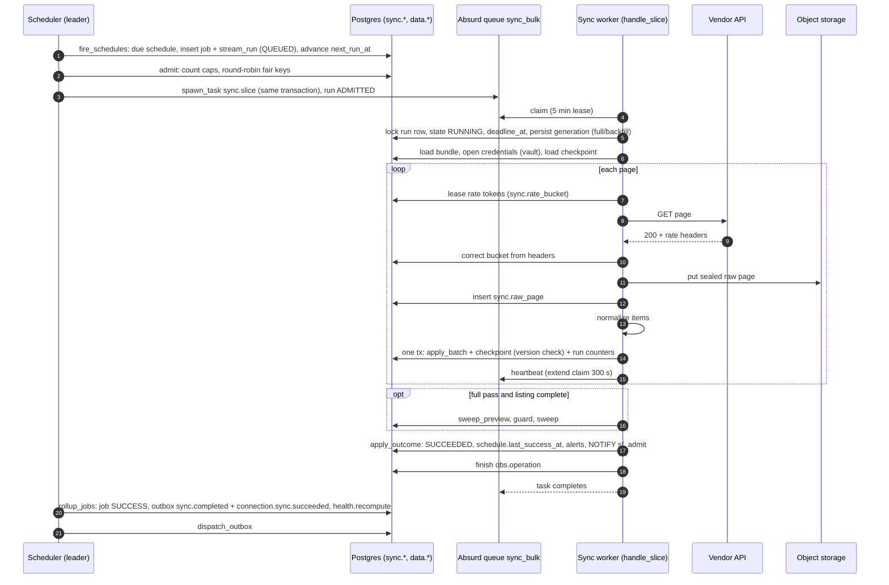
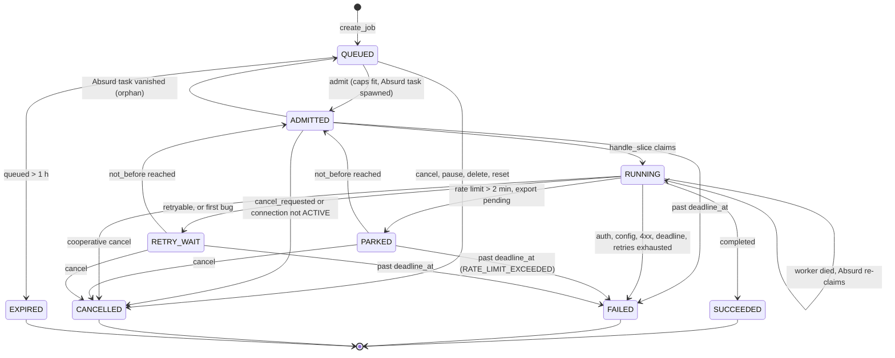

# Part 4: Sync engine

This part describes how SecureFabric decides what to sync, when, and how much at once, and how one slice of one stream run executes on a worker: schedules, jobs, stream runs, the scheduler loop and admission, the Absurd queues, the slice handler and its outcome table, checkpoints, rate budgets, credentials at run time, health, targeted and on-demand runs, exports, and the operation log. Read it before you change anything under `packages/domain/src/securefabric_domain/sync/`, `packages/tasks` or `apps/worker`, or when you debug a run that did not start, did not finish, or finished with the wrong health code.

## Context

The engine turns "this connection has these streams enabled" into normalised rows ([Part 3](03-data-model-and-record-store.md)) on time, within the vendor's rate limits, resumably, and without one tenant starving another. The requirements that shaped it:

| Requirement | What it forces |
|---|---|
| SYNC-02 | Each stream has its own schedule, checkpoint, status and counts. |
| SYNC-04 | A run resumes from a durable checkpoint after any crash. |
| SYNC-06 | On-demand jobs; two quick requests return the same job. |
| SYNC-08 | At most one active run per stream. |
| SYNC-09 | Three timeouts: queue wait, run deadline, worker heartbeat. |
| SYNC-10 | Retryable failures retry on a fixed schedule with jitter, then fail. |
| SYNC-11, SYNC-12 | Priority, fairness between tenants, concurrency caps with overrides. |
| SYNC-13, SYNC-14 | Cancel within seconds; reset to a full pass. |
| SYNC-16 | Async vendor exports (request, poll, download). |
| RATE-02 to RATE-05 | Park on long rate-limit waits; shared per-credential budgets corrected by vendor headers; keep the last 10% for interactive work; one 401 retry only with a new token. |
| AUTH-05, AUTH-06 | Token refresh is single-flight across processes; repeated refresh failure exhausts after four days. |
| CON-12 | Every run ends with one health code; connection health is the worst across streams. |

**Why an admission layer on top of Absurd (PD-1).** Absurd (the vendored Postgres queue in the `absurd` schema) gives leases with claim timeouts, crash detection and re-claim, cancellation and idempotent spawn. It claims tasks strictly in `available_at` order: no priority, no fairness, no keyed concurrency. Those are requirements, so they live one level up in `sync.stream_run` and a scheduler that decides what enters Absurd. A run that is queued, backing off or parked is just a row that has not been admitted, so nothing sits in Absurd waiting and its FIFO is harmless. PD-13 follows from this: retries of classified failures are ours (the run row waits on our schedule); Absurd's own `max_attempts` only covers a worker dying mid-task.

Design intent is in [plan part 4](../plan/04-sync-engine.md); this part describes what was built and where it differs.

## How it works

### Vocabulary and tables

| Concept | Table / module | Notes |
|---|---|---|
| Schedule | `sync.stream_schedule` | One per (connection, stream): `interval_s`, `next_run_at`, `full_every_s`, `next_full_at`, `last_success_at`, `state` (`STARTED`, `PAUSED`, `DELETED`) |
| Job | `sync.job` | Customer-visible group of runs started together: `type` (`INITIAL`, `SCHEDULED`, `ON_DEMAND`, `WEBHOOK`, `RETRY`), `status` (`QUEUED`, `RUNNING`, `SUCCESS`, `PARTIAL`, `FAILED`, `CANCELLED`) |
| Stream run | `sync.stream_run` | The unit of admission, retry and health: `mode`, `state`, `priority`, `fair_key`, `budget_key`, `queue`, `attempt`, `slice`, `not_before`, `deadline_at`, `generation`, `cancel_requested`, counters, `health_code`, `error`, `target_keys` |
| Slice | one Absurd task `sync.slice` | Executes part of a run. A run that parks and resumes has several slices. |
| Mode | `securefabric_schema.Mode` | `backfill` (first run), `incremental`, `full` (complete pass, may sweep), `targeted` (webhook-named keys) |

Code lives in `packages/domain/src/securefabric_domain/sync/`: `jobs.py` (schedules, jobs, on-demand, cancel, reset), `scheduler.py` (the loop and admission), `handler.py` (the Absurd task body and outcome table), `executor.py` (running one slice), `checkpoints.py`, `ratebudget.py`, `credentials.py`, `health.py`, `oplog.py`, `exports.py`, `bundle.py` (everything a slice needs about a connection), `archive.py` (raw pages, [Part 3](03-data-model-and-record-store.md)).

### Schedules

`jobs.ensure_schedules` creates one schedule per enabled stream when a connection activates (`initial_job`) and marks schedules of disabled streams `DELETED`. The interval is the connection option `stream_intervals[stream]`, else the integration's `stream_intervals`, else the manifest's `interval.default`. `next_run_at` is `now + interval ± 10%` (`jittered`), so connections created together drift apart. Streams whose `sync_mode` is not `full` get `full_every_s` from the manifest's `full_every`: a periodic **reconcile pass** that sweeps, which catches what an incremental feed cannot express and bounds the damage of an incremental bug to one interval. If the cadence shrinks, `least(...)` makes the shorter one take effect now.

Schedules used to be copied once at activation, so a connector release never reached existing connections. The fix is `reconcile_all_schedules`, which the scheduler leader runs every time it acquires leadership: it re-applies `ensure_schedules` to every active connection of every integration whose connector is registered. Failure is logged and never blocks leadership.

`jobs.mode_for` picks the mode when a schedule fires: `full` if the stream's `sync_mode` is `full` or a full refresh was forced; `backfill` if the stream never succeeded; `full` if `next_full_at` is due; otherwise `incremental`.

### Jobs and stream runs

`jobs.create_job` inserts a `sync.job` and one `sync.stream_run` per requested stream, then `pg_notify('sf_admit', job_id)`. The partial unique index `stream_run_one_active` on `(connection_id, stream) where state in (QUEUED, ADMITTED, RUNNING, PARKED, RETRY_WAIT) and mode <> 'targeted'` enforces SYNC-08 in the database; the insert uses the matching `on conflict ... do nothing`, so a stream that already has an active run is skipped. If no run was created the job row is deleted and `create_job` returns `None`. This also bounds queue growth: a slow stream cannot accumulate a backlog of scheduled runs. Targeted runs are exempt because they are small and do not touch checkpoints.

Priority is `0` for on-demand and webhook-targeted work (`PRIORITY_INTERACTIVE`), `1` for initial jobs, `2` for scheduled work. `queue_for` maps priority 0 and 1 to `sync_interactive` and 2 to `sync_bulk`. `fair_key` is `<environment_id>/<organization_id>`. `budget_key` comes from the manifest template `http.budget.key` (GitHub: `{vendor_app_id}:{installation_id}`, prefixed with the connector id), so runs of different connections that share a GitHub installation share a budget and a concurrency cap.

### The scheduler loop

`Scheduler.run_forever` in `scheduler.py` runs in the worker's `scheduler` role on the cross-tenant `sf_system` pool.

**Leader election.** The scheduler opens a dedicated autocommit connection and calls `pg_try_advisory_lock(727401002)`. A session advisory lock is released automatically if the connection drops, so a dead leader's lock frees itself. Followers retry every 5 seconds; a lost connection retries after 2. On acquiring leadership it runs `reconcile_all_schedules`, then `LISTEN sf_admit` and `LISTEN sf_outbox`.

**Wake-up.** Between ticks it waits up to `WORKER_SCHEDULER_INTERVAL` (default 1 s) or until a notification arrives. `create_job`, on-demand promotion, ingress routing, actions and every slice outcome notify `sf_admit`; the outbox notifies `sf_outbox`. An on-demand request is therefore admitted within milliseconds rather than on the next tick.

**Tick contents.** Each step is its own short transaction, and a failing tick is logged and retried on the next one:

| Step | Function | Does |
|---|---|---|
| 1 | `fire_schedules` | Due `STARTED` schedules of `ACTIVE` connections, `for update skip locked`, grouped by connection: one `SCHEDULED` job per connection, `next_run_at` advanced with jitter, `next_full_at` advanced when the run is full |
| 2 | `targeted_from_dirty` | Groups `sync.dirty_record` by (connection, stream); creates a `targeted` run with up to 200 keys, or an `incremental` run if more than 500 are dirty |
| 3 | `admit` | Section below |
| 4 | `expire` | Queue-wait timeout, orphaned admissions, run deadlines |
| 5 | `rollup_jobs` | Finishes jobs whose runs are all terminal, emits events, recomputes health |
| 6 | `dispatch_outbox` | Outbound events ([Part 7](07-public-api-and-events.md)) |
| 7 | `maintenance.spawn_due` | One `maintenance.run` task per job per window ([Part 9](09-operations-and-reliability.md)) |
| every 10 ticks | `record_gauges` | Admission lag, schedule lateness, outbox lag, runs by state and priority (OPS-03) |

### Admission

`Scheduler.admit` runs in one transaction under `pg_advisory_xact_lock(727401003)`, so even two schedulers that briefly both believe they lead cannot oversubscribe a cap.

1. **Candidates.** Up to 5,000 runs in `QUEUED`, `PARKED` or `RETRY_WAIT` with `not_before <= now()` and not `cancel_requested`, ordered by `priority, created_at`.
2. **Current load.** Counts of runs in `ADMITTED` or `RUNNING` per budget key, connection, environment, connector, queue and globally. `PARKED` runs count against nothing: a run waiting 20 minutes for a GitHub reset holds no worker and no slot (RATE-02).
3. **Order.** Strict priority first. Within a priority level, round-robin across `fair_key`, least recently admitted key first (`_last_admitted`, kept in the scheduler's memory). From each fair key's queue it takes the oldest run that fits, not only the head, so one blocked connection does not block its tenant's other connections. A tenant with 500 queued runs gets one slot per round like everyone else (SYNC-11).
4. **Caps.** A run is admitted only if every scope has room. Overrides come from `sync.concurrency_limit` (`scope_kind`, `scope_id`, `max_running`), looked up as exact id, then `*`, then the default:

| Scope | Default | Purpose |
|---|---|---|
| `budget` | manifest `http.budget.max_concurrency` (GitHub 4, SANDBOX 8, default 4) | Protects the vendor credential and our rate budget |
| `connection` | 3 | Bounds write contention on one connection's advisory locks |
| `environment` | 50 | Fairness between customers |
| `connector` | 500 | Blast radius if one vendor misbehaves |
| `queue` | 64 | Keeps Absurd's backlog shallow |
| `global` | 2000 | Overall ceiling |

5. **Spawn.** `_spawn` calls `spawn_sql` (`packages/tasks/src/securefabric_tasks/spec.py`), which runs `absurd.spawn_task` inside the admission transaction, with idempotency key `run:<run_id>:<attempt>:<slice>` and `max_attempts = 20`. It increments `slice` and sets `state = 'ADMITTED'`, `admitted_at`, `absurd_task_id`. The spawn commits or rolls back with the state change, so there is never a task without an admitted run or the reverse. At most 500 runs are admitted per tick.

### Queues and worker roles

Five Absurd queues are created by the migration (`packages/tasks/src/securefabric_tasks/queues.py`):

| Queue | Tasks | Worker role |
|---|---|---|
| `sync_interactive` | `sync.slice` for priority 0 and 1 | `sync` or `sync-interactive` |
| `sync_bulk` | `sync.slice` for scheduled work | `sync` or `sync-bulk` |
| `control` | `connection.verify`, `connect.complete`, `ingress.process`, `action.perform`, `passthrough.request`, `operator.repair`, `raw.read` | `control` |
| `delivery` | `webhook.deliver` | `delivery` |
| `maintenance` | `maintenance.run` | `maintenance` |

Two sync queues with separate worker pools are a hard reservation: bulk work can never occupy interactive workers, so an on-demand job starts promptly even when the bulk queue is saturated.

`apps/worker/src/securefabric_worker/main.py` runs one process per role list (`WORKER_ROLE`, default `all` for local development). Each queue gets its own `AsyncAbsurd` client and platform, with `WORKER_CONCURRENCY` (default 4), `WORKER_CLAIM_TIMEOUT` (default 300 s) and `WORKER_POLL_INTERVAL` (0.25 s). `handlers.py` registers thin adapters from task names to domain functions. Each process upserts `obs.worker_heartbeat` every 5 seconds for `make status` and `GET /v1/status`. On SIGTERM a worker stops claiming and waits up to 30 seconds for in-flight tasks; a slice still running after that is re-claimed by another worker once its claim expires, and resumes from its checkpoint.

### One scheduled run, end to end

### The slice handler

`handler.handle_slice(platform, run_id, environment_id, heartbeat=ctx.heartbeat)` is the body of every `sync.slice` task.

1. In one tenant transaction it locks the run row. A run that is no longer `ADMITTED` or `RUNNING` returns `stale` (a duplicate or late task). A run with `cancel_requested`, or whose connection is not `ACTIVE`, becomes `CANCELLED`.
2. It sets `deadline_at` on the first slice (`now + 4 h`, `DEFAULT_RUN_TIMEOUT`) and keeps it for later slices.
3. For `full` and `backfill` runs without a generation it takes one from `sync.generation_seq` and stores it on the run **before any page commits**, so a re-claimed slice continues the same pass and the sweep deletes exactly what an uninterrupted pass would (STORE-05).
4. It sets `RUNNING`, marks the job `RUNNING`, and opens or reuses the run's `obs.operation`.
5. It calls `executor.run_slice` with a `cancel_check`, a `heartbeat` that extends the Absurd claim by 300 s (`HEARTBEAT_S`), and an `on_run_update` callback that adds each page's counts to the run row inside the page transaction.
6. `apply_outcome` maps the result to the next state.

**Executing.** `executor.run_slice` loads the `Bundle` (connection, integration, vendor app, connector, merged options), builds a `RawArchive`, a `DbRateBudget` and the connector `Context` (`bundle.build_context`, which also opens credentials), then runs one of three loops: `_run_targeted`, `exports.run_export` for an `ExportStream`, or `_run_listing`. In `_run_listing`:

- The checkpoint stores `{"cursor": ..., "pass": {"mode", "generation"}}`. A full pass whose stored `pass` differs (a new pass) starts from `stream.fresh_checkpoint(cursor)`, which keeps only the stream's persistent keys such as a watermark; a resumed pass continues from the stored cursor. Checkpoints are therefore tied to a pass generation.
- For each page yielded by `stream.read(ctx, cursor, mode)`: `ctx.check()`, normalise, then **one** `tenant_tx` with `apply_batch`, `checkpoints.save` and the run counters. The page is the unit of durability: there is no state where records were written but the checkpoint was lost.
- When the listing is fully consumed and the pass sweeps, it runs the sweep with the guard ([Part 3](03-data-model-and-record-store.md)), then saves the checkpoint with `pass: null`.

Absurd's step memoisation is deliberately not used for pages: a stream with thousands of pages would accumulate thousands of memoised results. The checkpoint table is the resume mechanism.

**Three timeouts (SYNC-09).**

| Timeout | Where | Effect |
|---|---|---|
| Queue wait, 1 h | `Scheduler.expire` | A run still `QUEUED` one hour after creation becomes `EXPIRED` with `EXECUTION_TIMEOUT` and raises `admission_lag` |
| Run deadline, 4 h | `Context.check()` raises `DeadlineExceeded` in the worker; `Scheduler.expire` for runs past `deadline_at` | A running slice fails with `EXECUTION_TIMEOUT` at the next page boundary (checkpoint kept). Past the deadline, `PARKED` runs fail with `RATE_LIMIT_EXCEEDED`, `ADMITTED`/`RETRY_WAIT` runs fail with `EXECUTION_TIMEOUT` (an admitted task is cancelled in Absurd), and `RUNNING` runs get `cancel_requested` |
| Heartbeat, 5 min | Absurd claim timeout (`WORKER_CLAIM_TIMEOUT`), extended after every page | A dead worker's task is re-claimed by another worker; the slice resumes from the checkpoint with the same run `attempt` |

`expire` also re-queues **orphaned admissions**: an `ADMITTED` run whose Absurd task no longer exists or is no longer pending, running or sleeping goes back to `QUEUED`, so it cannot hold a cap slot forever.

**Cooperative cancellation (SYNC-13).** `_watch_cancel` reads `cancel_requested` once a second and sets `ctx.cancelled`; `ctx.check()` at the next page boundary raises `Cancelled`. The current page transaction either commits or rolls back, and the run ends `CANCELLED` with the last committed checkpoint kept.

**Outcome table.** `executor.classify` maps the CDK's closed error set to an outcome; `apply_outcome` maps the outcome to state:

| Outcome (`kind`) | Raised by | Run state | Health code | Next |
|---|---|---|---|---|
| `completed` | normal end | `SUCCEEDED` | `HEALTHY` | `schedule.last_success_at` advances (not for targeted runs) |
| `completed` + warning | `FeatureNotEnabled` | `SUCCEEDED` | `HEALTHY` | Grant recorded `NOT_ENABLED`; never makes the connection unhealthy |
| `parked` | `RateLimited` (wait > 120 s, or after 8 short waits), `ExportWait` | `PARKED`, `not_before` = reset (default +5 min) | `RATE_LIMIT_EXCEEDED` (exports: `HEALTHY`) | Re-admitted after the reset, same attempt |
| `retry` | `VendorUnavailable`, transport errors, `CheckpointConflict`, `CursorExpired`, `ExportExpired` | `RETRY_WAIT`, `attempt + 1` | `VENDOR_SERVER_ERROR` or `INTERNAL_ERROR` | Backoff 60, 300, 900, 3600 s ±20%; after the 4th retry, `FAILED` |
| `failed` | `AuthRejected`, `PermissionMissing` (grant `UNAUTHORIZED`), `ReauthorizationRequired`, `VendorRejected`, `ConfigInvalid`, `DeadlineExceeded`, other `ConnectorError` | `FAILED` | `UNAUTHORIZED`, `REAUTHORIZATION_REQUIRED`, `VENDOR_CLIENT_ERROR` (401/403 map to `UNAUTHORIZED`), `CONFIGURATION_ERROR`, `EXECUTION_TIMEOUT`, or the error's own code | No retry; next scheduled slot |
| `cancelled` | `Cancelled` | `CANCELLED` | `HEALTHY` | Checkpoint kept |
| `bug` | any other exception | `RETRY_WAIT` once (60 s ±20%), then `FAILED` | `INTERNAL_ERROR` | Raises `internal_error` (pages on-call) |
| worker died | (no outcome) | stays `RUNNING` | | Absurd re-claims after the claim timeout |

`apply_outcome` also upserts `control.connection_grant` when the outcome carries a grant, raises `sweep_aborted` when the guard tripped, raises `quarantine_spike` when quarantined records exceed 1% of processed ones, notifies `sf_admit` so the freed slot is reused immediately, and finishes or flushes the operation log. Short waits (2 minutes or less) are slept in-process by the CDK HTTP client, because releasing and re-admitting costs more than it saves.

### Stream run states

### Checkpoints

`checkpoints.py` stores one row per `(connection_id, stream, key)` with `key` in `default`, `export` (and a reserved `sweep`). `save` is an optimistic write: insert with `version = 1` when the caller read nothing, otherwise `update ... where version = expected` returning the new version. A mismatch raises `CheckpointConflict`, which aborts the page transaction (so the records roll back too) and is classified as `retry`. Two slices of one stream should never run together (SYNC-08), so a conflict signals a bug or a manual reset under a running slice, and retrying from the fresh checkpoint is the safe answer. Reset deletes the rows (`checkpoints.clear` or `reset_connection`).

### Rate budgets

`ratebudget.DbRateBudget` implements RATE-03 and RATE-04 over `sync.rate_bucket` (one row per budget key: `capacity`, `tokens`, `refill_per_s`, `reset_at`, `vendor_remaining`, `vendor_limit`).

- **Block leasing.** A worker leases up to 50 tokens (`LEASE_BLOCK`) in one `update` that also refills by elapsed time, spends them locally, and returns the remainder on `release()` at the end of the slice. There is no database round trip per request.
- **Header correction.** After every response the CDK HTTP client calls `observe(remaining, limit, reset_at)` with the vendor's headers (names declared in the manifest's retry spec). The bucket's tokens drop to at most `remaining - local_lease`, `capacity` and `refill_per_s` follow the vendor's limit, and `reset_at` is recorded. The vendor is the truth; the bucket is a prediction.
- **Proactive throttle.** If the vendor's remaining fraction (or, without headers, the bucket's) is below 10%, a non-interactive slice gives its lease back and raises `RateLimited` until the reset, so scheduled work parks and on-demand or webhook work still has budget.
- **Waiting.** A short shortfall sleeps in-process; a wait longer than `PARK_THRESHOLD_S` (120 s), or more than 8 short waits in a row (a fix for an empty bucket spinning), raises `RateLimited` and parks the run.
- **Per-second spacing.** `max_requests_per_second` from the manifest enforces a minimum gap between requests in one slice.

The CDK HTTP client separately handles vendor 403/429 rate responses (`Retry-After`, remaining = 0 with a reset, or a manifest body pattern such as GitHub's secondary limit): it sleeps if the longest signal is at most 120 s, otherwise raises `RateLimited`.

### Credentials at run time

`credentials.py` is the only place workers open connection secrets. `build_auth` opens the sealed credential and the vendor app secrets (registering every secret value with the log redactor) and asks the connector for an auth plan: static headers (`StaticSecret`) or per-scheme token exchanges (`ExchangeProvider` over a `DbCredentialStore`). Sandbox connections of a real connector replay recorded fixtures with a placeholder token and no credentials.

`DbCredentialStore` keeps short-lived tokens sealed in `control.credential.token_sealed` (all schemes in one sealed map) so every worker shares them. Refresh is **single-flight**: an in-process `asyncio.Lock` per (connection, scheme) means one coroutine per process waits on the database, and a session `pg_advisory_lock` on `credential:<connection>:<scheme>` serialises processes. Inside the lock the cache is re-read, so waiters find the fresh token instead of refreshing again. Locks are per scheme because GitHub's installation-token exchange needs the app-JWT scheme while holding its own lock, and session advisory locks on two pooled connections are not reentrant. A rotated refresh token is written back into the sealed credential. `record_failure` counts refresh failures once per calendar day and sets `refresh_exhausted` after 4 days (AUTH-06), which surfaces as `REAUTHORIZATION_REQUIRED`. The `token_refresh` maintenance job refreshes tokens untouched for 24 hours so a broken credential is found before the next sync.

### Health classification and roll-up

Each run ends with one health code from `classify`. `health.compute` derives the connection's health (CON-12):

- For each enabled stream: a `NOT_ENABLED` grant adds a detail with `reason: feature_not_enabled` and does not count; an `UNAUTHORIZED` grant counts as `UNAUTHORIZED`; `UNSUPPORTED` is a detail only. Otherwise the latest terminal non-targeted run decides: `SUCCEEDED` is `HEALTHY`, `FAILED` uses its code, `CANCELLED` is `HEALTHY`, no run yet (or `EXPIRED`) is `INITIALIZING`.
- A revoked installation (`connection_config._revoked`) or an explicit override adds `UNAUTHORIZED` or the override code.
- The worst code by the fixed `HealthCode.severity` order wins: `HEALTHY` < `INITIALIZING` < `RATE_LIMIT_EXCEEDED` < `EXECUTION_TIMEOUT` < `VENDOR_SERVER_ERROR` < `VENDOR_CLIENT_ERROR` < `INTERNAL_ERROR` < `CONFIGURATION_ERROR` < `UNAUTHORIZED` < `REAUTHORIZATION_REQUIRED`.

`health.recompute` runs when a job rolls up (and from connection operations). If the code or details changed it updates `control.connection`, and if the code changed it writes `control.connection_health_event` and emits `connection.health.changed` in the same transaction (HOOK-01). Each code has a runbook in [`docs/runbooks/health/`](../runbooks/health/).

**Job roll-up.** `rollup_jobs` finishes jobs whose runs are all terminal: all cancelled (or none) is `CANCELLED`, all succeeded is `SUCCESS`, some succeeded is `PARTIAL`, otherwise `FAILED`. The job takes the worst run code. In the same transaction it emits `sync.completed` (per-stream counts, totals, window, `has_changes`), then `connection.sync.succeeded`, or `connection.sync.unauthorized` / `connection.sync.failed`, writes a `job.finished` usage event, and recomputes health.

**Vendor outage detection (RATE-08).** The `alerts` maintenance job raises `connector_failure_rate` when more than 20% of a connector's runs in 10 minutes (at least 10 runs) failed with `VENDOR_SERVER_ERROR` or `RATE_LIMIT_EXCEEDED`.

### On-demand, targeted, cancel and reset

**On-demand (SYNC-06).** `POST /v1/connections/{id}/jobs` calls `jobs.on_demand`, which locks the connection row. If any requested stream already has an active non-targeted run, it promotes those not yet admitted to priority 0 on `sync_interactive`, notifies, and returns that run's job id, so two quick POSTs return the same job. Otherwise it creates an `ON_DEMAND` job at priority 0 with modes from `mode_for` (`force_full_refresh` forces `full`).

**Targeted runs from dirty records (PD-11).** Inbound webhooks are signals, never data: `ingress.process` upserts `sync.dirty_record (connection_id, stream, vendor_key)` and notifies. `targeted_from_dirty` skips a (connection, stream) that already has an active targeted run; otherwise it creates a `WEBHOOK` job at priority 0. With at most 500 dirty keys it is a `targeted` run carrying the 200 oldest keys in `target_keys`; above 500 it is an ordinary `incremental` run and the dirty rows are deleted, because one listing is cheaper than hundreds of single fetches. `_run_targeted` calls `stream.read_one(ctx, key)` for each key (a `GoneMarker` becomes a `Tombstone`), writes one batch through `apply_batch`, and deletes those dirty keys in the same transaction. Live, a dismissal on GitHub was reflected in 5.7 seconds (progress.md).

**Cancel (SYNC-13).** `POST /v1/jobs/{id}/cancel` calls `jobs.cancel_job`: runs in `QUEUED`, `PARKED` or `RETRY_WAIT` become `CANCELLED` immediately; `ADMITTED` and `RUNNING` runs get `cancel_requested` and stop at the next page boundary. Pausing and deleting a connection do the same for all its runs.

**Reset (SYNC-14).** `POST /v1/connections/{id}/reset` calls `jobs.reset_connection`: refused with `sync_in_progress` while any run is `ADMITTED` or `RUNNING`; cancels waiting runs, deletes checkpoints for the streams, optionally (`wipe`) deletes their rows and stream heads, and queues an `ON_DEMAND` full pass at priority 0. Writes are hash-gated, so a reset of an unchanged tenant reports zero added and updated.

### Export streams (SYNC-16)

`exports.run_export` drives a connector's `ExportStream` (`request_export`, `poll`, `read_chunk`). State lives in the `export` checkpoint: `export_id`, `requested_at`, `generation`, `chunks`, `done`.

- If there is no export id it requests one (full passes request everything; incremental passes pass the `watermark` from the `default` checkpoint) and saves it, so a later slice continues the same export instead of requesting another. An export state from an older pass generation is discarded.
- While the vendor prepares the export it polls up to 3 times in-slice when the suggested wait is 10 s or less; otherwise it raises `ExportWait` and the run **parks** with `HEALTHY` until the suggested time, holding no worker.
- Ready chunks download 4 at a time; each chunk is applied in chunk order and recorded in `done` in the same transaction as its records, so a worker killed mid-download resumes with exactly the unfinished chunks.
- An export the vendor reports `expired` or `failed` is requested again, up to 3 times.
- A full export is a complete listing: it sweeps with the guard, then clears the `export` checkpoint and sets the `default` checkpoint's watermark to `requested_at`.

SANDBOX's `finding_exports` stream is the reference; GitHub does not need exports.

### Operation log (OBS-01)

`oplog.py` writes the customer-visible log: one `obs.operation` per logical action (a stream run's operation is reused across its slices, found by `stream_run_id`) and its `obs.operation_event` lines. The CDK HTTP client logs one `http` line per vendor call (method, path template, status, duration, retry number, rate remaining; never bodies or headers). Every message and field passes `redact`. Lines are buffered and flushed in their own transaction every 200 lines, at the end of the slice, and by `finish_operation`, which sets status (`success`, `warning`, `failed`, `cancelled`), a redacted summary of counts, and `duration_ms`. `GET /v1/jobs/{id}/logs` reads them.

## Invariants and how they are enforced

| Guarantee | Mechanism | Test |
|---|---|---|
| An on-demand job runs to success and emits its events | Full path through scheduler, handler, roll-up | `packages/domain/tests/test_engine.py::test_on_demand_job_runs_to_success_and_emits_events` |
| At most one active run per stream; two quick on-demand calls return the same job | `stream_run_one_active` partial unique index; `on_demand` returns the active run's job | `test_engine.py::test_two_quick_on_demand_calls_return_the_same_job` |
| A long rate-limit reset parks, frees the worker and slot, and resumes on the same attempt | `RateLimited` → `PARKED`; `PARKED` excluded from cap counts | `test_engine.py::test_rate_limit_parks_frees_the_worker_and_resumes` |
| Vendor 5xx retry at 60/300/900/3600 s ±20%, then fail | `handler.backoff`, `BACKOFF_S` | `test_engine.py::test_vendor_500s_retry_on_schedule_then_fail` |
| A 401 is not retried and turns the connection `UNAUTHORIZED` | `AuthRejected` → `failed`; health roll-up; `connection.sync.unauthorized` | `test_engine.py::test_401_is_not_retried` |
| A noisy tenant does not delay another tenant's on-demand run; caps hold | Priority, round-robin on `fair_key`, caps under the admission lock | `test_engine.py::test_a_noisy_tenant_does_not_delay_another_tenants_on_demand_job` |
| Fifty concurrent token readers cause one refresh | In-process lock + `pg_advisory_lock` + re-read under lock | `test_engine.py::test_fifty_concurrent_readers_cause_one_refresh_against_the_database` |
| Cancel stops queued and running work | `cancel_job`, `_watch_cancel` | `test_engine.py::test_cancel_stops_queued_and_running_work` |
| Worker death resumes from the checkpoint without consuming an attempt | Page-level transactions, Absurd re-claim, generation persisted on the run | `test_engine.py::test_worker_death_resumes_from_the_checkpoint_without_an_attempt` |
| An admitted run whose task vanished is re-queued | `expire` orphan check against `absurd.t_<queue>` | `test_engine.py::test_an_admitted_run_whose_task_vanished_is_requeued` |
| Connector releases reach existing schedules; a shorter cadence applies now | `reconcile_all_schedules` at leader start; `least(...)` in `ensure_schedules` | `test_engine.py::test_schedules_follow_a_connector_release` |
| Killing a full pass at any page boundary and resuming gives the same record set | Page = one transaction; pass-tied checkpoints | `packages/connectors/tests/test_sandbox_conformance.py::test_2_resumable` |
| Exports park while preparing, resume only unfinished chunks, re-request expired exports | `export` checkpoint, `ExportWait`, per-chunk transactions | `packages/connectors/tests/test_sandbox_export.py::test_export_parks_while_preparing_then_downloads`, `test_export_resumes_with_unfinished_chunks_after_a_kill`, `test_expired_export_is_requested_again`, `test_export_through_the_engine` |
| Every spawned task has a handler on its queue; roles map to queues | Static scan of `spawn_sql` calls against registrations | `apps/worker/tests/test_worker.py::test_every_spawned_task_has_a_handler_on_its_queue`, `test_roles_and_queues` |
| A spawn commits with the admission that caused it and dedups by key | `spawn_sql` inside the caller's transaction | `packages/tasks/tests/test_tasks.py::test_spawn_sql_commits_with_the_caller_and_dedups_by_key` |
| Long vendor rate waits park; short ones sleep; secondary limits are not permission errors | CDK `HttpClient._rate_wait`, `PARK_THRESHOLD_S` | `packages/cdk/tests/test_http.py::test_long_rate_limit_parks`, `test_short_rate_limit_sleeps_in_process`, `test_secondary_rate_limit_body_is_not_a_permission_error` |
| A webhook causes a priority-0 targeted run and drains its dirty keys | `targeted_from_dirty`, `_run_targeted` | `packages/connectors/tests/test_github.py::test_dismissing_an_alert_on_github_updates_our_finding` |
| An idle incremental run costs at most 5% of the backfill (SYNC-03) | Incremental cursors in the checkpoint | `test_sandbox_conformance.py::test_10_bounded` |

## Failure modes

**Worker crash mid-slice.** The current page transaction rolls back; earlier pages and their checkpoints are committed. The run stays `RUNNING`. After the claim timeout (5 minutes plus up to the last heartbeat extension) Absurd hands the task to another worker; `handle_slice` accepts a `RUNNING` run, keeps its generation and deadline, and resumes from the checkpoint. The run's `attempt` is not incremented.

**Scheduler leader dies.** Its session advisory lock is released with its connection; a follower acquires it within about 5 seconds, reconciles schedules and continues. Admitted and running work is unaffected because workers do not need the scheduler. Round-robin history (`_last_admitted`) restarts empty.

**Database restarts or blips.** Ticks fail and are logged; the leader loop reconnects. Workers' tasks fail and Absurd re-claims them. The heartbeat writer swallows errors.

**Vendor down (5xx, timeouts).** The CDK retries in-request per the manifest, then `VendorUnavailable` puts the run in `RETRY_WAIT`; after four retries over about 81 minutes the run fails with `VENDOR_SERVER_ERROR` (owner `VENDOR`) until the next scheduled slot. Many connections failing together raise `connector_failure_rate` ([runbook](../runbooks/connector_failure_rate.md)).

**Rate limit exhausted.** Runs park until the vendor's reset; scheduled work parks earlier, below 10% remaining. A run parked past its 4-hour deadline fails with `RATE_LIMIT_EXCEEDED`.

**Credentials revoked.** The first 401 forces one refresh; a different token retries once, otherwise `AuthRejected` fails the run as `UNAUTHORIZED`, health changes and `connection.sync.unauthorized` is emitted. Repeated refresh failure over 4 days becomes `REAUTHORIZATION_REQUIRED` ([runbook](../runbooks/refresh_failures.md)).

**Connector bug.** A normaliser exception quarantines the record. Any other unexpected exception is a `bug`: one retry after about a minute, then `FAILED` with `INTERNAL_ERROR` and the `internal_error` alert ([runbook](../runbooks/internal_error.md)).

**Admission stalls** (caps too low, a stuck budget key, scheduler down). Runs wait in `QUEUED`; the `admission_lag` alert fires when the oldest admissible run waits over 5 minutes, and each run expired after 1 hour raises its own `admission_lag` alert ([runbook](../runbooks/admission_lag.md)). Stale schedules on healthy connections raise `freshness_breach` ([runbook](../runbooks/freshness_breach.md)).

**Absurd queue emptied or a task lost.** `expire` returns orphaned `ADMITTED` runs to `QUEUED`.

## Extending it

**Add a stream to a connector.** Declare it in the connector's manifest (`object`, `sync_mode`, `interval`, `full_every` for a reconcile pass, `deletion`, `natural_key`, `supports_targeted`, `webhook_events`) and implement `read`, `normalize` and, for targeted refresh, `read_one` ([Part 5](05-connector-platform.md)). Nothing in the engine changes: on the next leader start `reconcile_all_schedules` creates schedules for connections whose integration enables the stream, and the conformance suite (`test_sandbox_conformance.py` or the connector's equivalent) must pass, including resumability and sweep correctness.

**Add an export-style stream.** Subclass `ExportStream` and implement `request_export`, `poll` (returning `status` `pending`/`ready`/`expired`/`failed`, `chunks`, `retry_after`) and `read_chunk`. The engine handles checkpointing, parking and sweeping.

**Change concurrency for a tenant or vendor.** Insert into `sync.concurrency_limit` (`scope_kind` in `global`, `environment`, `connector`, `budget`, `connection`, `queue`; `scope_id` an id or `*`). It applies on the next tick; no deploy needed. A vendor's default per-credential cap is `http.budget.max_concurrency` in its manifest.

**Add a new error classification.** Add the error to the CDK's closed set (`securefabric_cdk.errors`), map it in `executor.classify`, and if it needs a new health code add it to `HealthCode` with its owner, severity and description in `packages/schema/src/securefabric_schema/enums.py`, plus a runbook under `docs/runbooks/health/` (`test_every_unhealthy_code_has_a_health_runbook` enforces it).

**Add a new durable task.** Define a `TaskSpec` in `packages/tasks/src/securefabric_tasks/contracts.py`, spawn it with `spawn_sql` inside the transaction that causes it, and register a handler for its queue in `apps/worker/src/securefabric_worker/handlers.py`. `test_every_spawned_task_has_a_handler_on_its_queue` fails if the registration is missing.

**Add a queue or worker role.** Create the queue in a migration (`absurd.create_queue`), add it to `Queue` and `ROLE_QUEUES`, and to the worker's role table.

## Known gaps and open questions

- **A `RUNNING` run whose Absurd task is permanently gone is never reaped.** `expire` re-queues orphaned `ADMITTED` runs only. If a slice's task exhausts its 20 Absurd attempts (for example a worker OOM on the same page every time) or is otherwise lost while the run is `RUNNING`, the deadline path only sets `cancel_requested`, which nobody acts on. The run stays `RUNNING`, blocks its stream through the one-active index, and holds connection and budget cap slots (`scheduler.py`, `expire`).
- **Deadline versus cancel race.** At the deadline the scheduler sets `cancel_requested` on a `RUNNING` run while the worker's `Context.check()` would raise `DeadlineExceeded`. `check()` tests `cancelled` first, so if the cancel watcher wins (likely when a single request blocks past the deadline), the run ends `CANCELLED` with `HEALTHY` instead of `FAILED` with `EXECUTION_TIMEOUT`.
- **`EXPIRED` runs make a stream look `INITIALIZING`**, not `EXECUTION_TIMEOUT`, in `health.compute`, so a connection whose runs never get admitted does not show an unhealthy code.
- **Targeted refresh can drop a signal.** `_run_targeted` deletes the dirty keys it fetched without checking `enqueued_at`, so a webhook for the same key that arrives during the fetch is deleted unprocessed. The next incremental or reconcile pass catches it.
- **Stream dependencies are not ordered.** Manifests declare `depends_on` and it is validated, but the scheduler admits a job's runs independently; findings can land before their resources (stubs cover correctness, not efficiency).
- **The per-minute secondary bucket is not implemented.** GitHub's manifest declares `per_minute_points: 900` and `sync.rate_bucket` has `minute_*` columns, but `DbRateBudget` uses only the hourly bucket and a per-second gap. The CDK still reacts to GitHub's secondary-limit 403s.
- **`DbRateBudget` has no direct test** for leasing, header correction or the 10% throttle; it is exercised indirectly by engine tests.
- **Heartbeats are per page only.** The plan asks for at least one per minute during long waits; a single page that takes longer than the 5-minute claim (slow vendor, long in-process rate sleeps) lets Absurd re-claim a slice that is still running. `handle_slice` accepts a `RUNNING` run, so the two slices run side by side until one hits a `CheckpointConflict` and goes to `RETRY_WAIT`.
- **Round-robin fairness state is in memory** (`_last_admitted`) and resets on leader change.
- **Caps differ from the plan.** The queue cap is a fixed 64, not "worker capacity × 2"; it is the cap that limits admission throughput in the benchmark (1,158 runs/s with caps lifted, progress.md).
- **Task contracts and the worker drift.** `TaskSpec`s in `contracts.py` cover 8 tasks; the worker registers `passthrough.request`, `operator.repair` and `raw.read` without specs, and `handlers.py` does not use `TaskSpec.register`. An empty `apps/worker/src/securefabric_worker/handlers/` directory (only `__pycache__`) shadows nothing today but is confusing.
- **Roles `sync-interactive` and `sync-bulk`** build their platform with the `control` role name (`ROLE_PLATFORM.get(role, "control")` in `main.py`); functionally equivalent today, but metrics and pool names say `control`.
- **Only validated on a laptop.** Admission (1,158 runs/s), Absurd throughput (46k to 118k tasks/min) and the rolling-deploy drill were measured on a single machine. Multi-node scheduler failover has not been exercised outside tests.

## Further reading

- Design intent: [plan part 4, sync engine](../plan/04-sync-engine.md); [plan part 1, PD-1 and PD-13](../plan/01-architecture.md); [plan part 10, delivery plan](../plan/10-delivery-plan.md)
- [Part 3: Data model and record store](03-data-model-and-record-store.md) for `apply_batch`, sweeps and the raw archive
- [Part 5: Connector platform](05-connector-platform.md) for streams, the CDK HTTP client and the error set
- [Part 6: Connections and connect flow](06-connections-and-connect-flow.md) for activation, grants and pause/delete
- [Part 7: Public API and events](07-public-api-and-events.md) for job endpoints, `sync.completed` and the outbox
- [Part 9: Operations and reliability](09-operations-and-reliability.md) for maintenance jobs, alerts and metrics
- Connector pages: [GitHub](../connectors/github.md), [SANDBOX](../connectors/sandbox.md)
- Runbooks: [admission_lag](../runbooks/admission_lag.md), [freshness_breach](../runbooks/freshness_breach.md), [connector_failure_rate](../runbooks/connector_failure_rate.md), [internal_error](../runbooks/internal_error.md), [refresh_failures](../runbooks/refresh_failures.md), [sweep_aborted](../runbooks/sweep_aborted.md), [quarantine_spike](../runbooks/quarantine_spike.md), [health codes](../runbooks/health/)
