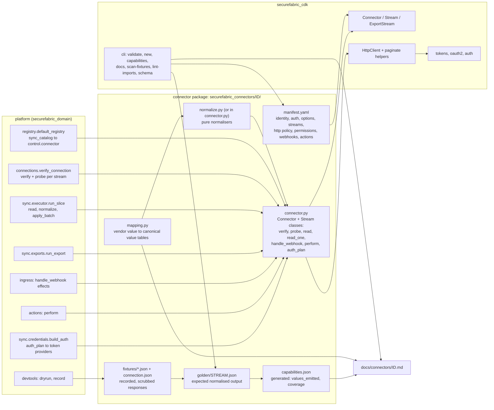
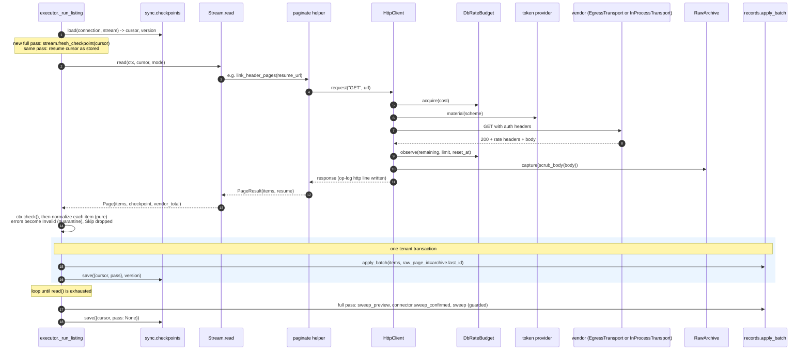

# Part 5: Connector platform

This part covers how a vendor integration is built and run: the connector development kit (`packages/cdk`), the two reference connectors (GitHub and SANDBOX in `packages/connectors`), the conformance suite that holds them to platform-level guarantees, and the tooling around them. Read it if you are writing the next connector (Tenable, Qualys, Wiz...), changing the HTTP client or the manifest model, or debugging why a stream ended with a particular health code. The sync engine that drives connectors is covered in [Part 4](04-sync-engine.md); connections, credentials and the connect flow in [Part 6](06-connections-and-connect-flow.md).

## Context

SecureFabric's value depends on many vendors, each with its own auth, pagination, rate limits, failure vocabulary and data shapes. The connector platform exists so that each new vendor is mostly mapping work, and so that every hard platform property (resumability, sweep safety, rate handling, secret hygiene, honest tri-state fields) is implemented once and tested against every connector, rather than rediscovered per vendor as a production incident.

The constraints that shaped it:

- **PD-2: two reference connectors.** GitHub is the real vendor ("truth"): live API, App auth, webhooks, GHES. SANDBOX is a synthetic in-process vendor ("breadth") that exercises every platform primitive GitHub does not use: API keys, OAuth2 variants, offset and page-token pagination, `since` filters, async exports, regional base URLs, and on-demand failure scenarios. The rule from `docs/plan/05-connector-sdk.md` section 7 is that no platform primitive ships without one of the two exercising it, and that a gap found while writing a connector is fixed in the CDK and SANDBOX, never worked around inside the connector.
- **CDK-03: the import boundary.** Connector code may import only `securefabric_cdk`, `securefabric_schema`, its own package (`securefabric_connectors`) and the standard library. No database, no vault, no HTTP library. Everything a connector does to the outside world goes through the `Context` it is handed, and the HTTP client injects auth itself, so connector code never holds a token. This is what lets the platform enforce rate budgets, egress policy, raw capture and log redaction in one place. It is enforced by `securefabric-cdk lint-imports` (`lint_imports` in `packages/cdk/src/securefabric_cdk/cli.py`, an AST walk over every `.py` outside `tests/`), run in CI as `test_import_boundary` and `test_import_boundary_catches_violations` in `packages/connectors/tests/test_tooling.py`. The CDK itself may depend on `securefabric_core` (clock, redaction, telemetry); connectors reach those only through the CDK.
- **Purity of `normalize` and `handle_webhook` (PD-11).** Normalisation is one raw item in, one canonical record (or `Skip`/`Tombstone`) out, with no network, clock or randomness. Webhook handling returns effects the platform applies. Fixtures, golden output, re-normalisation and sandbox connections all depend on that purity.
- **PD-9: Leen V2 wire compatibility.** Canonical records come from `securefabric_schema` (`FindingRecord`, `ResourceRecord`), so every connector emits Leen-compatible shapes by construction.
- Requirement families the code cites: CDK-02..10 (manifest schema, boundary, fixtures, golden, dry run, scaffold, coverage), CAT-01..03 (catalogue and capabilities), NORM-04/06/08/09/10 (mapping as data, tri-state honesty, quarantine, never fabricate, published mappings), RATE-01..09 (rate signals, parking, single 401 refresh, egress, pagination), SYNC-03/16/18 (bounded incrementals, exports, retention-aware intervals), STORE-06/10 (sweep guard, raw before parse), SEC-09 (every stream declares a permission), TEN-13 (sandbox connections), AUTH-05/06 (refresh single-flight and failure policy).

## How it works

### Package anatomy and how the platform calls a connector

A connector is one directory under `packages/connectors/src/securefabric_connectors/<id>/`, registered by one line in `all_connectors()` in `securefabric_connectors/__init__.py`. `securefabric_domain.registry.default_registry()` instantiates every class, and `sync_catalog()` upserts each manifest into `control.connector` (versioned, `is_current`), which is what the catalogue endpoints, integrations and connections reference.



The plan (`docs/plan/05-connector-sdk.md` section 1) described a `streams/` module per stream and a hand-written `docs.md`. As built, stream classes live in `connector.py`, GitHub keeps its normalisers in `normalize.py`, and the reference page is generated (below).

### The manifest

`manifest.yaml` is parsed by the Pydantic model `Manifest` in `packages/cdk/src/securefabric_cdk/manifest.py` (every sub-model uses `extra="forbid"`, so a misspelt key fails validation). `securefabric-cdk schema` prints the JSON Schema exported from that model (CDK-02). The catalogue, the connect forms (rendered from the `credentials` and `options` JSON Schemas), the capabilities block and the reference docs all derive from it.

| Block | Purpose |
|---|---|
| `id`, `version`, `display_name`, `description`, `categories`, `status`, `logo`, `docs_url`, `billing_exempt`, `api_version` | Identity. `id` matches `^[A-Z][A-Z0-9_]*$`; `version` is semver. `billing_exempt: true` (SANDBOX) keeps usage out of metering. |
| `auth` | `mode` (`APP`, `API_KEY`, `BASIC`, `OAUTH2`, `OAUTH2_CC`, `AWS_ROLE`), `vendor_app` (`required`/`optional`/`none`), `connect` (`form` or `redirect`), an optional `oauth2` block (`authorize_url`, `token_url`, `scopes`, `pkce`, `single_use_refresh_tokens`), `token_refresh_margin_s`. |
| `connection_config`, `credentials`, `options` | JSON Schemas (Draft 2020-12). Credential properties marked `x-secret: true` are secrets (`Manifest.secret_fields()`); `x-order` orders form fields; `readOnly` fields are written by `verify`, not by people. |
| `regions` | `id` and `api_base` per region (CAT-08). The default `Connector.base_url` returns the first. |
| `http` | `default_headers`; `retry` (retryable `statuses`, rate headers, `body_patterns`, `max_in_request_retries`); `budget` (`key` template, `per_hour`, `per_minute_points`, `max_concurrency`, `max_requests_per_second`, `write_cost`); connect and read timeouts. |
| `permissions` | Vendor permissions, each naming the `streams` and `actions` that need it and whether it is `optional`. Feeds probes, docs and the connect UI. |
| `webhooks` | Signature header and prefix, HMAC algorithm, delivery-id and event headers, and the JSON paths of the tenant reference and action. Used by `securefabric_domain.ingress.receive`. |
| `streams` | Per stream: `name`, `object` (`resource`/`vulnerability_finding`), `finding_types`/`resource_types`, `sync_mode` (`full`/`incremental`/`export`), `interval` (`default`/`min`/`max` seconds, each at least 60), `full_every` (periodic reconcile, at least 3600), `vendor_retention`, `deletion` (`sweep`/`vendor_reported`/`none`), `natural_key` template, `endpoint`, `webhook_events`, `capabilities` (`supported` + `notes` per field), `supports_targeted`, `depends_on`, `enabled_by_default`, `min_vendor_version`, `cost`. |
| `actions` | Write-back actions (`finding.set_state`), the permission tier they need, and the canonical `reasons` they accept. |
| `scrub_fields` | Field names dropped from raw capture, fixtures and stored vendor data everywhere (GitHub: `secret`). |
| `passthrough_allowlist` | `METHOD /path/{template}` pairs the passthrough proxy may forward. |

`Manifest._check` adds semantic checks the schema cannot express: stream names unique; `min <= default <= max`; the default interval no longer than `vendor_retention` (SYNC-18); a `full` stream cannot declare `vendor_reported` deletion (it must sweep or say `none`); finding streams declare `finding_types` and resource streams `resource_types`; `depends_on`, permission stream refs and permission action refs all resolve; if any permissions are declared, every stream is covered by one (SEC-09); the three embedded schemas are valid JSON Schemas; `OAUTH2`/`OAUTH2_CC` need an `oauth2` block and `OAUTH2` needs an `authorize_url`; option defaults validate against the option schema. `Connector.__init__` adds one more: every manifest stream must have an implementing `Stream` class.

Options are merged and validated by `validate_options`, which layers the platform options (`PLATFORM_OPTIONS`: `initial_lookback_days`, `severity_floor`, `external_use_only`, `stream_intervals`) over the connector's, rejects unknown keys, and checks each `stream_intervals` entry against the stream's `min`/`max` and `vendor_retention`. `version_at_least` compares versions for `min_vendor_version`; it treats a missing actual version (cloud vendors) as satisfying any minimum, and parses `3.8.0-rc1` as `3.8.0`.

Two auth details are worth calling out. `authorize_url` may be absolute, relative to the API base, or `local:/path`: SANDBOX has no website, so the platform serves that page through the connector's in-process vendor at `/v1/connect/local/<connector>/<path>` (`securefabric_domain/connect.py`), accepting only the connector's own callback as `redirect_uri`. And `Connector.platform_app()` lets a connector ship a vendor app registration that `securefabric-admin bootstrap` (`catalog.bootstrap_platform_apps`) creates in every environment; `SANDBOX_OAUTH` uses it for its synthetic OAuth client.

An annotated excerpt of the GitHub manifest (`packages/connectors/src/securefabric_connectors/github/manifest.yaml`, comments added here):

```yaml
auth:
  mode: APP                    # GitHub App: App JWT -> installation token (custom auth_plan)
  vendor_app: required         # the shared platform app or a customer-owned one (PD-10)
  connect: redirect
  token_refresh_margin_s: 600  # 1-hour installation tokens refresh with 10 minutes left
http:
  retry:
    statuses: [ 429, "5xx" ]
    reset_header: x-ratelimit-reset
    remaining_header: x-ratelimit-remaining
    body_patterns:             # a 403 that is really a secondary rate limit, not a permission error
      - { status: 403, contains: "secondary rate limit", treat_as: rate_limited }
  budget:
    key: "{vendor_app_id}:{installation_id}"   # one budget per installation, shared by connections
    per_hour: 5000
    write_cost: 5
streams:
  - name: dependabot_alerts
    min_vendor_version: "3.8"  # GHES releases older than this get the stream UNSUPPORTED
    object: vulnerability_finding
    finding_types: [ DEPENDENCY ]
    sync_mode: incremental
    interval: { default: 3600, min: 900, max: 86400 }
    full_every: 86400          # daily reconcile (spike S3 fallback)
    deletion: vendor_reported
    natural_key: "dependabot:{repository.id}:{alert number}"
    supports_targeted: true    # webhooks mark records dirty; read_one re-fetches them
    capabilities:
      exploitable: { supported: false, notes: "GitHub makes no exploitability assertion." }
      reachability: { supported: true }
```

### The runtime contracts

`packages/cdk/src/securefabric_cdk/connector.py` defines three base classes.

**`Stream`** (subclass sets `name`):
- `read(ctx, checkpoint, mode) -> AsyncIterator[Page]` owns pagination and checkpoints and nothing else. Each `Page` carries `items` (raw vendor dicts), the complete `checkpoint` to persist with this page's records, and optionally `vendor_total` (the vendor's own count of the full listing, which the sweep guard can use as confirmation).
- `read_one(ctx, key) -> RawItem | GoneMarker` for targeted refresh of one record named by a webhook or write-back.
- `normalize(raw, nctx) -> Record | Skip | Tombstone`, pure. `NormalizeContext` holds only `options`, `config` and `stream`.
- `persistent_checkpoint_keys` (default `("watermark",)`) and `fresh_checkpoint()`: when a new full pass starts, only these keys survive, so a new pass can never resume an older pass's listing position.

**`ExportStream(Stream)`** for async vendor exports (SYNC-16): `request_export(ctx, since) -> export_id`, `poll(ctx, export_id) -> {"status": pending|ready|failed|expired, "chunks", "retry_after"}`, `read_chunk(ctx, export_id, chunk)`. The engine (`securefabric_domain/sync/exports.py`) drives the loop: it checkpoints the export id and completed chunks under a separate `export` checkpoint key, parks the run while the vendor prepares (`ExportWait`), downloads up to `PARALLEL_CHUNKS = 4` chunks concurrently but applies them in order, one transaction per chunk, re-requests an expired export up to three times, and sweeps at the end of a full export.

**`Connector`** (subclass sets `manifest` and `stream_classes`): `verify(ctx) -> VerifyResult` (tenant identity for the duplicate-connection fingerprint, display name, `config_updates` merged into `connection_config`, `vendor_tenant_ref` for webhook routing); `probe(ctx, stream) -> Grant` (a `GrantStatus` of `GRANTED`, `UNAUTHORIZED`, `NOT_ENABLED`, `UNSUPPORTED` or `UNKNOWN`); `handle_webhook(delivery, config, options) -> list[WebhookEffect]`; `perform(ctx, action) -> ActionResult`; `auth_plan(...) -> AuthPlan`; `base_url(config, vendor_app)`; `local_transport(config, options)`; `platform_app()`; and `sweep_confirmed(stream, would_delete, live, vendor_total)`, a vendor-confirmed exception to the sweep guard (STORE-06).

Webhook effects are a closed set of frozen dataclasses in `types.py`: `MarkDirty(stream, key)`, `TriggerStream(stream, full=False)`, `ConnectionRevoked(suspended=)`, `ConnectionRestored`, `ReprobeGrants`, `UpdateConfig(updates)`, `Ignore(reason)`. `securefabric_domain/ingress.py` applies them: `MarkDirty` inserts into `sync.dirty_record` (picked up as a targeted run), `TriggerStream` creates a job, and so on. Payloads are signals, never data: a dirty record is always re-fetched with `read_one`.

**`Context`** (`context.py`) is everything a connector may touch: `http` (the `HttpClient`), `config`, `options`, `clock`, `deadline`, `stream`, `log` (writes customer-visible operation lines), `paginate` (the helper module), `now()`, `remaining_seconds()`, and `check()`, which long loops call for cooperative cancellation (`Cancelled`) and deadlines (`DeadlineExceeded`). There is no `ctx.db` and no `ctx.credentials`.

### Error taxonomy and how each error maps to an outcome

`errors.py` defines a closed set. The HTTP client raises most of them from the manifest's retry policy; connectors raise the rest where only they can tell. `classify()` in `packages/domain/src/securefabric_domain/sync/executor.py` maps each to a slice outcome and health code (see [Part 4](04-sync-engine.md) for what the scheduler does with each outcome).

| Error | Raised by | Slice outcome | Health code |
|---|---|---|---|
| `AuthRejected` | HTTP client on 401 after one refresh; connectors (GitHub uninstalled/suspended) | `failed` | `UNAUTHORIZED` |
| `ReauthorizationRequired` | token provider when refresh is exhausted | `failed` | `REAUTHORIZATION_REQUIRED` |
| `PermissionMissing(stream, endpoint)` | `body_patterns` `permission_missing`; connectors | `failed`, grant set `UNAUTHORIZED` | `UNAUTHORIZED` |
| `FeatureNotEnabled(stream, scope)` | `body_patterns` `feature_not_enabled`; connectors | `completed` with warning, grant set `NOT_ENABLED` | `HEALTHY` |
| `RateLimited(reset_at)` | HTTP client when the wait exceeds 2 minutes | `parked` until `reset_at` | `RATE_LIMIT_EXCEEDED` |
| `VendorUnavailable` (and raw `httpx2.TransportError`) | HTTP client after in-request retries | `retry` | `VENDOR_SERVER_ERROR` |
| `VendorRejected(status)` | HTTP client for unclassified 4xx | `failed` | `UNAUTHORIZED` for 401/403, else `VENDOR_CLIENT_ERROR` |
| `ConfigInvalid`, `EgressDenied` | manifest/option/base URL problems, egress policy | `failed` | `CONFIGURATION_ERROR` |
| `CursorExpired`, `ExportExpired`, checkpoint conflict | engine | `retry` | `INTERNAL_ERROR` |
| `DeadlineExceeded` | `ctx.check()` | `failed` | `EXECUTION_TIMEOUT` |
| `Cancelled` | `ctx.check()` | `cancelled` | `HEALTHY` |
| any other exception | a bug | `bug` (logged with stack) | `INTERNAL_ERROR` |

Two choices matter here. `FeatureNotEnabled` is a coverage fact, not a failure: a GitHub org without Advanced Security is a healthy connection with a `NOT_ENABLED` grant. And an exception inside `normalize` never fails a run: `_normalize` turns a Pydantic `ValidationError` or any other exception into an `Invalid` item, which `records.apply_batch` quarantines (NORM-08), so one malformed vendor record cannot block the rest.

### The HTTP client

`HttpClient` in `packages/cdk/src/securefabric_cdk/http.py` is the only way a connector talks to a vendor. It is built per slice by `securefabric_domain/sync/bundle.py::build_context` with four ports the platform implements: `AuthInjector` (token material, forced refresh), `RateBudget` (`acquire` before each request, `observe` the vendor's rate headers; `DbRateBudget` in production, keyed by the manifest's `budget.key` template), `RawCapture` (archive each successful body before parsing, STORE-10; `RawArchive` in production) and `OpLog` (customer-visible operation lines, OBS-01).

The per-request loop in `HttpClient.request`:

1. Acquire budget (cost 1 for GET/HEAD, `write_cost` otherwise), fetch auth material for the requested scheme, send.
2. **Network errors** (timeouts, connection resets, protocol errors) retry with jittered exponential backoff (`min(30, 2^(n-1))` seconds, ±20%) up to `max_in_request_retries` (default 3), then raise `VendorUnavailable`.
3. Read rate headers, report them to the budget, and log an `http` op-log line: method, a **path template** (`_path_template` collapses numeric and long hex segments to `{id}`, and the query string is never logged), status, duration, retry count, `rate_remaining`.
4. Statuses in the caller's `allow` set are returned as-is (connectors use this to inspect 403/404 themselves). 2xx and 304 bodies are captured, after `scrub_body` removes every `scrub_fields` key at any depth, and returned.
5. **Rate signals** (RATE-01), for 403 and 429 only: `Retry-After` (seconds or HTTP date), `remaining == 0` with a reset time, or a `body_patterns` match with `treat_as: rate_limited` (60 s). The wait is the longest signal. If it exceeds `PARK_THRESHOLD_S = 120` seconds, or five short sleeps have already happened, the client raises `RateLimited(reset_at)` so the engine parks the run and frees the worker (RATE-02); otherwise it sleeps in-process and retries. Checking rate signals before body classification is what keeps GitHub's "You have exceeded a secondary rate limit" 403 from being read as a permission error.
6. Remaining `body_patterns` matches raise `FeatureNotEnabled` or `PermissionMissing`.
7. **401**: one retry only, and only if a forced refresh produces a token with a different fingerprint (RATE-05). A second 401, or a refresh that returns the same token, raises `AuthRejected`. This prevents both refresh storms and infinite loops.
8. Retryable statuses (`429`, `5xx` by default) back off like network errors; once exhausted, a 429 becomes `RateLimited(now + 60 s)` and anything else `VendorUnavailable`.
9. Anything else raises `VendorRejected(status, body[:2000])`.

Every request also records OpenTelemetry metrics (`vendor_requests`, `vendor_request_duration`) attributed by connector and status class, and increments `vendor_requests` on the client, which conformance test 10 and the dry run read.

### Pagination helpers

`paginate.py` (RATE-09) provides four async generators, each yielding `PageResult(items, response, resume)` where `resume` is a JSON-serialisable token that restarts the listing after this page:

| Helper | Vendor style | Resume token |
|---|---|---|
| `link_header_pages` | `Link: <...>; rel="next"` (GitHub) | the next URL |
| `cursor_pages` | body cursor (`next_cursor`) | the next cursor |
| `page_token_pages` | Google-style `pageToken`/`nextPageToken` (SANDBOX images, findings) | the next token |
| `offset_pages` | `offset`/`limit` with optional `total` (SANDBOX hosts) | the next offset |

Streams put `resume` into the `Page.checkpoint`, so a slice that dies after page N resumes at page N+1.

### Egress

`egress.py` implements RATE-07/HOOK-08/AUTH-12. `EgressTransport` wraps the real transport for every vendor and webhook call (`securefabric_domain/runtime.py`): it resolves the host itself, rejects any address that is not globally routable (private, loopback, link-local, CGNAT, multicast, reserved, IPv4-mapped variants) and known metadata hostnames, then connects to the checked IP while keeping the original name for SNI and certificate verification, so DNS rebinding between check and connect is impossible. Redirects (at most three) pass through the transport again. `check_url` validates customer-supplied URLs up front (customer-owned GitHub App base URLs in `catalog.py`, webhook endpoints).

### Auth: token providers and OAuth2

`Connector.auth_plan(credentials, vendor_secrets, vendor_config, config, http)` returns an `AuthPlan`: either `static_headers` (API key as a bearer token, or HTTP basic) or a map of scheme to **exchange**, an async callable that mints a `CachedToken`. The default implementation covers the standard modes from the manifest alone: `OAUTH2` (refresh exchange), `OAUTH2_CC` (client-credentials exchange), and `api_key`/`username` credentials. GitHub overrides it with two schemes: `app` (a locally signed App JWT, `auth.github_app_jwt`, 9-minute expiry with `iat` backdated 60 s) and `default` (an installation token from `POST /app/installations/{id}/access_tokens`, minted with the `app` scheme).

`securefabric_domain/sync/credentials.py::build_auth` wraps each exchange in an `ExchangeProvider` (`tokens.py`) backed by a `DbCredentialStore`, and combines schemes with `MultiScheme`. All providers share one refresh discipline (AUTH-05/06): use the cached token while it has more than the margin left; otherwise take the connection's lock, re-read, and refresh only if still needed (fifty concurrent readers cause one vendor call); a forced refresh after a 401 re-mints only if nobody replaced the failing token meanwhile; after a failure wait at least 30 s before another attempt; count failing calendar days and raise `ReauthorizationRequired` after 4. Static secrets are registered with the log redactor so they cannot appear in logs.

`oauth2.py` implements the vendor-agnostic parts: `pkce_pair`/`s256` (RFC 7636), `authorize_url`, `exchange_code` (used by the control worker during connect; only the refresh token is kept, sealed), `refresh_exchange` (uses the newest refresh token, cached if it rotated, and flags `rotated_refresh` so the store persists a rotated single-use token with the access token in one transaction) and `client_credentials_exchange`. Token endpoint calls never use connection auth and are never captured; `invalid_grant`, `invalid_client`, `unauthorized_client` and any 401 become `AuthRejected` (counted by the failure policy).

### In-process vendor transport and transport selection

`inprocess.py` lets a connector supply a plain function `VendorRequest -> VendorResponse` and wraps it in `InProcessTransport`, so an in-process vendor still goes through the full client (auth, retries, budget, capture, logging) without a network or an HTTP library in connector code. `build_context` picks the transport in this order: an explicit transport (tests, recorder), then `connector.local_transport()` (SANDBOX), then, for an `is_sandbox` connection of a real connector, `fixtures_transport()` which replays the connector's `fixtures/*.json` non-strictly with a placeholder bearer token (TEN-13), and finally `platform.vendor_transport()` (the egress-checked real transport).

### One page, end to end



The page is the unit of durability: records, checkpoint, counts and state history commit together or not at all. The raw body is archived before parsing, so a mapping bug can be fixed and re-normalised from stored bytes.

### Normalisation, golden output, capabilities and generated docs

Each connector keeps its vendor-to-canonical tables in `mapping.py` as plain module-level dicts (NORM-04), for example `DEPENDABOT_SEVERITY`, `SECRET_SCANNING_RESOLUTION` and `WRITE_BACK` in GitHub, and `SEVERITY`, `STATE`, `REACHABILITY`, `SET_STATE` in SANDBOX. Normalisers look values up in these tables and return `None` rather than guess when a vendor value is absent (NORM-06/09); when a connector deliberately derives a value (GitHub's opt-in `secret_severity`), it lists the field in `meta_derived` so consumers can tell.

**Golden output** (CDK-05, `golden.py`): `normalize_all` runs a stream's `normalize` over a list of raw items and `assert_golden` compares the JSON (minus `vendor_data`) with `golden/<stream>.json`. A mapping change shows up as a diff in review; regenerate with `SF_UPDATE_GOLDEN=1`. SANDBOX golden output comes from `VendorState.generate(seed=11, ...)` (`test_sandbox_golden`); GitHub golden output comes from `FakeGitHub`'s payloads (`test_github.py::test_golden_output`), not from the live-recorded fixtures.

**Capabilities** (CAT-02/03, CDK-09): `securefabric-cdk capabilities DIR` computes `capabilities.json` from the golden output: per stream, the record count, `values_emitted` for `severity`, `state`, `type` and the tri-states `has_fix`/`exploitable`/`reachability`, and field `coverage` (share of records with a non-empty value). `check_capabilities` fails if the manifest declares a field supported but no golden record emits a value, or declares a tri-state unsupported while golden records emit one. `securefabric_domain/capabilities.py` serves the file to the catalogue API. `test_generated_capabilities_are_current_and_honest` fails CI when the file is stale or dishonest.

**Reference pages** (NORM-10): `securefabric-cdk docs DIR` (`docs.py`, or `make docs-connectors` for every connector) renders `docs/connectors/<id>.md` from three sources: the manifest (auth, permissions, streams, options, actions), `capabilities.json`, and every upper-case dict in `mapping.py`, with the comment block above each table used as its explanation. `test_generated_connector_docs_are_current` runs `--check` so a page cannot drift from the code.

### Fixtures: record, replay, scrub

A fixture file (`fixtures.py`) is `{"interactions": [{"request": {method, path, query}, "response": {status, headers, body}}]}`. `ReplayTransport` matches on method, path and sorted query (hosts are ignored, so absolute `Link` URLs replay), supports injectors (`fail_on(status, ordinal=, path_contains=, every=, times=)`) for failure tests, and is strict by default (an unknown request is an assertion error listing known keys). `RecordingTransport` wraps a real transport, keeps only a whitelist of headers (`link`, rate headers, `etag`...), and stores bodies after `scrub_fixture_body`: connector `scrub_fields` removed, then the core redactor applied to anything matching a secret pattern. It strips `content-encoding` when re-emitting a body it already decoded (a live-found bug; regression test `test_recording_transport_passes_on_compressed_responses`).

`find_secrets` walks a JSON value for scrubbed field names and unredacted secret-like strings. It backs `securefabric-cdk scan-fixtures` (run over the whole connectors tree by `test_fixtures_and_golden_carry_no_secrets`) and the refusal in `securefabric-admin record`.

### The conformance suite

`packages/domain/src/securefabric_domain/conformance.py` holds the suite (it lives in the domain package because it runs the real executor and write path against Postgres). A connector test builds a `Target`: connector id, credentials, options, config, streams in dependency order, a `transport()` factory, vendor mutators (`remove_one`, `empty_listing`, `restore`), an `inject(stream, status)` transport, `samples(stream)` raw items, `minimal` raw items per stream, the `secrets` that must never leak, and per-connector `expected` overrides for injected statuses. Each `check_*` raises a precise `AssertionError`.

| # | Check | What it asserts |
|---|---|---|
| 1 | `check_idempotent` | Two full syncs of an unchanged vendor: the second reports 0 added/updated/deleted, and every row's id, hash, state, deleted flag and `updated_at` is unchanged. |
| 2 | `check_resumable` | For a stream with at least two pages, killing the run after every page boundary k (`max_pages=k`) and resuming with the same generation yields exactly the record set of an uninterrupted run. |
| 3 | `check_stable_ids` | After clearing all checkpoints (a reset) and syncing again, every natural key keeps its row id. |
| 4 | `check_sweep` | Removing one record at the vendor and running a full pass deletes exactly that record, both straight through and when the pass is killed after one page and resumed. |
| 5 | `check_guarded` | A full pass over an empty listing completes with `sweep.aborted`, a "sweep aborted" warning, and no live rows deleted. |
| 6 | `check_tristate` | For every finding field (`exploitable`, `reachability`, `has_fix`) the manifest declares unsupported, normalising every sample yields `None`. |
| 7 | `check_never_fabricates` | A minimal raw item normalises to a record whose optional fields (title, description, tri-states, remediation, analytic output, ticket, `state_changed_at`, vulnerabilities, CVEs) are empty unless listed in `meta_derived`; resources do not invent a `url`. |
| 8 | `check_classified` | Injected 401 and 403 end `UNAUTHORIZED`, 404 `VENDOR_CLIENT_ERROR`, 500 `VENDOR_SERVER_ERROR` (outcome `failed` or `retry`), and an injected 429 with a long `Retry-After` ends `parked`/`retry` with `RATE_LIMIT_EXCEEDED`. |
| 9 | `check_linked` | No finding exists without at least one `data.finding_resource` link to an existing resource. |
| 10 | `check_bounded` | An incremental run right after a backfill costs at most 5% of the backfill's vendor requests (or one request) (SYNC-03). |
| 11 | `check_quiet` | No credential appears in operation events, operation summaries or stored `vendor_attributes_data`. |

SANDBOX runs all eleven in `packages/connectors/tests/test_sandbox_conformance.py` (resumable and sweep over `hosts`, `images`, `findings`; guarded and classified over `hosts` and `findings`; bounded over `findings`). GitHub runs them against `FakeGitHub` in `test_github.py` (`test_1_idempotent` through `test_11_quiet_and_the_secret_is_never_stored`; test 5 first grows the org past the sweep guard's 20-row threshold; test 11 additionally asserts no `"secret":` key in stored vendor data and no planted token in archived blobs). These tests need Postgres (`pytestmark = pytest.mark.integration`).

### SANDBOX in depth

SANDBOX (`packages/connectors/src/securefabric_connectors/sandbox/`) is a full connector whose vendor runs in-process. `SandboxConnector.local_transport` returns `InProcessTransport(SandboxVendor(options))`, so every request goes through the real `HttpClient`.

**The vendor** (`vendor.py`) is a deterministic generator. `vendor_for(api_key, options)` keys a process-wide registry by tenant (`t_` + SHA-256 of the API key), `seed`, `host_count`, `image_count` and `finding_count`, so a connection's vendor survives across slices and tests can mutate it between syncs (`tick`, `close_finding`, `reopen_finding`, `remove_finding` for a vendor-reported deletion, `purge_finding` for silent disappearance, `delete_host`). It deliberately uses its own vocabulary so mapping is real work: `risk` (`critical`..`none`), `status` (`open`/`resolved`/`suppressed`), `reachable` (`yes`/`maybe`/`no`/`unknown`), `fix_available`/`exploit_known` cycling through true/false/null, finding `kind`s covering every `FindingType`, hosts with cloud metadata and retired states, images and containers with digests.

**Primitives it exercises that GitHub does not:**

| Primitive | Where |
|---|---|
| API key auth (`sbx_` keys; `sbx_revoked*` rejected) | `SANDBOX` manifest, default `auth_plan` |
| OAuth2 authorization code with PKCE S256 and single-use rotating refresh tokens (reuse revokes the family) | `SANDBOX_OAUTH` variant, `oauth.py`, `authorize_url: local:/oauth/authorize`, shipped `platform_app()` |
| OAuth2 client credentials (`sbxc_` clients; secret derivable via `client_secret_for`) | `SANDBOX_CC` variant |
| Offset pagination with `total` | `hosts` (`offset_pages`) |
| Page-token pagination | `images`, `findings` (`page_token_pages`) |
| Incremental by `since` filter with a watermark | `findings` |
| Async export with polling, chunks and expiry | `finding_exports` (`ExportStream`, `sync_mode: export`, `vendor_retention: 259200`, disabled by default) |
| Regional base URLs | `regions: us, eu`, `SandboxConnector.base_url` |
| Vendor-reported deletion | `removed: true` normalises to a `Tombstone` |
| Every enum value, tri-states populated | generator cycles, `mapping.py` |

The two OAuth variants are built by `_variant()`, which copies the SANDBOX manifest and replaces `id`, `auth` and `credentials`; streams and normalisers are shared. The OAuth server's codes and tokens are HMAC-signed and self-validating; spent codes and refresh-token families live in process memory.

**Failure scenarios** are selected with the `scenario` option and implemented in `SandboxVendor._inject`: `rate_limit_20m` (one 429 with `Retry-After: 1200` on a paged findings request: parks), `rate_limit_short` (one 429 with 2 s: sleeps in-process), `fail_every_3rd_page` (500s), `server_errors` (503 on everything but `/v1/me`), `revoke_mid_run` (401 after three requests), `empty_listing` (trips the sweep guard), `expire_export`, `forbidden` (403 on findings), `not_found` (404 on findings). Engine tests in `packages/domain/tests/test_engine.py` (`test_rate_limit_parks_frees_the_worker_and_resumes`, `test_vendor_500s_retry_on_schedule_then_fail`, `test_401_is_not_retried`) run against these with no network.

SANDBOX also implements `handle_webhook` (`finding` event to `MarkDirty`, `asset` to `TriggerStream("hosts")`), `perform` for `finding.set_state` through `mapping.SET_STATE`, and `probe` (403 to `UNAUTHORIZED`, 404 to `NOT_ENABLED`).

### GitHub in depth

The GitHub connector (`packages/connectors/src/securefabric_connectors/github/`) syncs five streams: `repositories` and `branches` (full, swept) and `code_scanning_alerts`, `secret_scanning_alerts`, `dependabot_alerts` (incremental, `vendor_reported` deletion, daily full reconcile).

**App auth.** Covered above: `app` scheme JWT for `/app/...` calls (verify, `/meta`, token minting) and `default` installation tokens for everything else. A 401/403/404 when minting an installation token is `AuthRejected` ("uninstalled or suspended"). The base URL comes from the vendor app's `api_base_url` (customer-owned apps for GHES, egress-checked when registered), defaulting to `https://api.github.com`.

**Verify and probes.** `verify` reads `GET /app/installations/{id}` (404 or `suspended_at` is `AuthRejected`), records the account, `repository_selection`, granted `permissions` and `events` into `connection_config`, and picks `listing_mode`: `org` for organization installs with all repositories, `per_repo` otherwise (spike S2 fallback, so nothing depends on how org listings treat a repository selection). `probe` checks the granted permission per stream from `mapping.STREAM_PERMISSION` (missing is `UNAUTHORIZED` naming the stream), and in org mode requests one alert to tell `NOT_ENABLED` from `UNAUTHORIZED`.

**Org versus per-repository listing.** `listing_mode_for` honours the `listing_mode` option, else the verified config. In org mode an alert stream walks `/orgs/{org}/<family>/alerts`; in per-repo mode `_walk_per_repo` lists `/installation/repositories` and walks each repository's alerts, checkpointing the repository page URL and index so a resumed slice continues at the right repository. Per-repo mode swallows `FeatureNotEnabled` for one repository (logged), but re-raises `PermissionMissing`.

**Incremental newest-first walk.** Incremental passes list with `sort=updated&direction=desc` and stop at the first item older than the stored watermark minus a 5-minute `OVERLAP`; full passes list `sort=created&direction=asc`. The checkpoint is `{"watermark", "walk"}`, where `walk` holds the pass type, the target watermark, the current cursor, the highest `updated_at` seen and the per-repo position. The new watermark is committed only by the final empty `Page` after the walk completes, so a killed walk resumes from its cursor and never advances the watermark past records it did not see. `test_incremental_walk_sees_changes_and_stops_at_the_watermark` shows one page reaches the watermark on an idle org.

**Cursor rejection restart (spike S4).** If GitHub rejects a stored `Link` cursor with 400/404/410/422, `_walk` logs a warning and restarts that listing once from the beginning within the same pass. Other 403/404s go through `_classify_403_404`, which uses GitHub's wording to distinguish "not enabled" (`FeatureNotEnabled`) from "Resource not accessible by integration" (`PermissionMissing`).

**GHES version gating.** `_server_version` reads `installed_version` from `GET /meta` on anything other than api.github.com; verify stores it as `server_version`. `verify_connection` (`securefabric_domain/connections.py`) grants any stream whose `min_vendor_version` exceeds it `UNSUPPORTED` with the reason instead of probing (code scanning 3.0, secret scanning 3.1, Dependabot 3.8). `ORG_LISTING_MIN_GHES` falls back to per-repository listing where the org endpoint is newer than the server (code scanning 3.5, secret scanning 3.3, Dependabot 3.8), and secret locations are skipped below 3.3.

**Options.** `secret_locations` (`first`, or `all`: one extra request per alert with `has_more_locations`, stored as `_locations`); `branch_scope` (`default` costs no requests because the default branch comes from the repository listing; `protected` and `all` list branches per repository); `include_archived`; `secret_severity` (`unknown` by default because GitHub assigns secrets no severity; a fixed level or `by_validity` are derived and listed in `meta_derived`); `listing_mode`.

**Reachability.** Dependabot `reachability.verdict` maps through `DEPENDABOT_REACHABILITY` to the finding and its affected package; `unavailable` and `disabled` are deliberately absent, so they become `null` (spike S9).

**Secrets never stored.** Secret scanning requests send `hide_secret=true`; `scrub_fields: [secret]` removes the field from raw capture and fixtures; `normalize.py::_clean` drops it from `vendor_data`; `perform` pops it from the write-back response.

**Webhook effects** (`handle_webhook`): alert events become `MarkDirty("<family>_alerts", "<family>:<repo id>:<number>")`; `secret_scanning_alert_location` does so only with `secret_locations=all`; `repository` events trigger `repositories` and `branches`; `installation_repositories.added` additionally triggers full passes of all three alert streams (alerts on newly visible repositories are older than the watermark); `installation.deleted`/`suspend` revoke the connection, `unsuspend` restores it, `new_permissions_accepted` and `security_and_analysis` re-probe; `installation_target.renamed` updates `account_login`; everything else is `Ignore`. `sweep_confirmed` lets a repositories/branches sweep exceed the guard when the installation's own `total_count` confirms the shrink; an empty listing never confirms.

**Write-back.** `perform` maps the canonical `(state, reason)` through `mapping.WRITE_BACK[family]` to the family's PATCH body (for example Dependabot `IGNORED/accepted_risk` is `dismissed` with `tolerable_risk`); an inexpressible pair is `ConfigInvalid`. Comments are truncated to `COMMENT_MAX = 280` and reported as truncated. The result asks for a targeted re-fetch so the stored finding reflects what GitHub actually recorded.

**FakeGitHub** (`packages/connectors/tests/fake_github.py`) is an in-process GitHub serving the endpoints the connector uses, with payloads modelled on GitHub's REST schemas, `Link`-header pagination with opaque `after` cursors, mutable state for conformance (`snapshot`/`restore`, `empty`, `touch`), configurable `server_version` for GHES tests, and `FakeGitHubWeb` for the install flow. The connector has also been run live against the seeded `securefabric` org; the recorded fixtures in `github/fixtures/` back GitHub sandbox connections.

### Tooling

`securefabric-cdk` (`packages/cdk/src/securefabric_cdk/cli.py`) needs no database:

| Command | Does |
|---|---|
| `validate [DIR...]` | Loads each `manifest.yaml` through the model and semantic checks (CDK-02). |
| `new VENDOR [--dir D]` | Scaffolds `<vendor>/` with `__init__.py`, a valid API-key manifest with one incremental `findings` stream, a `connector.py` using `offset_pages`, an empty `mapping.py`, a `docs.md` stub, and empty `fixtures/` and `golden/`; then validates it (CDK-08). |
| `capabilities DIR [--check]` | Writes or checks `capabilities.json` and reports manifest/capability mismatches. |
| `docs DIR [--out docs/connectors] [--check]` | Renders the reference page. |
| `scan-fixtures DIR... [--field secret]` | Fails on secret-like values or scrubbed fields in any JSON under the directories. |
| `lint-imports [DIR]` | Enforces the CDK-03 import boundary. |
| `schema` | Prints the manifest JSON Schema. |

`securefabric-admin dryrun|record --connection <id> --stream <name> [--pages 3] [--mode full|incremental|backfill]` (`packages/domain/src/securefabric_domain/devtools.py`) operate on a live connection, so they live in the admin CLI, which may open the vault and database (a recorded deviation from the plan). `dryrun` reads a few pages through the real client with a `NullBudget` and no raw capture, normalises, and prints counts, skipped/invalid items, a sample, `stream_capabilities` and any manifest mismatches; nothing is persisted except a refreshed OAuth token (a single-use refresh token must never be spent unrecorded). `record` runs verify and probes, then the stream, through a `RecordingTransport`; drops token exchanges; refuses to write if `find_secrets` flags anything; and writes `fixtures/<stream>.json` plus `fixtures/connection.json` (the verified config minus transient keys). Export streams are rejected by both.

## Invariants and how they are enforced

| Guarantee | Mechanism | Test that proves it |
|---|---|---|
| Connectors import only the CDK, schema, themselves and stdlib | `cli.lint_imports` AST scan | `packages/connectors/tests/test_tooling.py::test_import_boundary`, `test_import_boundary_catches_violations` |
| Every shipped manifest is valid and semantically consistent | `Manifest` model + `_check` | `test_tooling.py::test_manifests_validate` |
| Declared capabilities match emitted values; `capabilities.json` is current | `cli.capabilities`, `check_capabilities` | `test_tooling.py::test_generated_capabilities_are_current_and_honest` |
| Reference pages match manifest, capabilities and mapping tables | `docs.write_docs(check=True)` | `test_tooling.py::test_generated_connector_docs_are_current` |
| Fixtures and golden files hold no secrets | `fixtures.find_secrets` | `test_tooling.py::test_fixtures_and_golden_carry_no_secrets`; `packages/domain/tests/test_devtools.py::test_record_refuses_a_dirty_recording` |
| Mapping changes are visible in review | golden snapshots | `test_tooling.py::test_sandbox_golden`, `test_github.py::test_golden_output` |
| A scaffolded connector runs through the real engine unmodified | `cmd_new` templates | `test_tooling.py::test_a_scaffolded_connector_runs_through_the_real_engine` |
| Long rate-limit waits park instead of holding a worker | `PARK_THRESHOLD_S`, `RateLimited` | `packages/cdk/tests/test_http.py::test_long_rate_limit_parks`, `test_short_rate_limit_sleeps_in_process`; `test_engine.py::test_rate_limit_parks_frees_the_worker_and_resumes` |
| GitHub's secondary-limit 403 is a rate limit, not a permission error | rate check before `body_patterns` classification | `test_http.py::test_secondary_rate_limit_body_is_not_a_permission_error`, `test_body_patterns_classify_403s` |
| 401 retries at most once, only with a new token | fingerprint comparison in `request` | `test_http.py::test_401_retries_once_when_refresh_yields_new_token`, `test_401_with_same_token_after_refresh_is_auth_rejected`, `test_401_twice_does_not_loop` |
| Captured bodies are scrubbed | `scrub_body` | `test_http.py::test_success_captures_scrubbed_body_and_logs`, `test_scrub_body_drops_fields` |
| No egress to private or metadata addresses; DNS pinned | `EgressTransport`, `resolve_checked` | `test_http.py::test_egress_rejects_private_and_metadata`, `test_egress_transport_pins_and_checks_redirects` |
| Concurrent refreshes collapse to one; failure policy holds | `TokenProvider.material` | `test_http.py::test_fifty_concurrent_readers_cause_one_refresh`, `test_concurrent_forced_refreshes_collapse`, `test_refresh_failure_policy` |
| Conformance 1-11 for both reference connectors | `securefabric_domain.conformance` | `test_sandbox_conformance.py::test_1_idempotent`..`test_11_quiet`; `test_github.py::test_1_idempotent`..`test_11_quiet_and_the_secret_is_never_stored` |
| Export resumes only unfinished chunks; expired exports are re-requested | `sync/exports.py` checkpoint | `packages/connectors/tests/test_sandbox_export.py::test_export_resumes_with_unfinished_chunks_after_a_kill`, `test_expired_export_is_requested_again` |
| Old GHES gets `UNSUPPORTED` streams and per-repo listing | `min_vendor_version`, `ORG_LISTING_MIN_GHES` | `test_github.py::test_old_ghes_gates_streams_and_lists_per_repository`, `test_current_ghes_uses_org_listings` |
| Feature off is healthy; missing permission names the stream | `FeatureNotEnabled`, probes | `test_github.py::test_feature_not_enabled_is_a_coverage_fact_not_a_failure`, `test_missing_dependabot_permission_is_active_but_unauthorized_naming_the_stream` |
| GitHub findings are valid Leen GitHub findings | normalisers + schema | `test_github.py::test_github_findings_match_leens_github_schema_strictly` |
| Dry run persists nothing; record output replays | `devtools` | `test_devtools.py::test_dryrun_reports_and_persists_nothing`, `test_record_writes_replayable_scrubbed_fixtures` |
| GitHub sandbox connections never reach GitHub | `fixtures_transport` + placeholder auth | `apps/api/tests/test_connections.py::test_github_sandbox_connection_replays_recorded_fixtures` |

## Failure modes

- **Vendor rate-limits us.** Short waits sleep in-process (at most five times); waits over two minutes raise `RateLimited`, the slice parks until `reset_at` without holding a worker, and health shows `RATE_LIMIT_EXCEEDED` (runbook `../runbooks/health/rate_limit_exceeded.md`). The budget learns from the headers so the next run paces itself.
- **Vendor is down.** In-request retries with backoff, then `VendorUnavailable`, outcome `retry` on the engine's schedule, health `VENDOR_SERVER_ERROR`; repeated failure feeds the connector failure-rate alert (`../runbooks/connector_failure_rate.md`).
- **Credential revoked or app uninstalled.** One forced refresh; then `AuthRejected`, outcome `failed`, health `UNAUTHORIZED`, not retried (`test_401_is_not_retried`). For GitHub the `installation.deleted` webhook revokes the connection directly. A refresh that keeps failing for four days becomes `REAUTHORIZATION_REQUIRED` (`../runbooks/refresh_failures.md`).
- **Worker dies mid-stream.** The last committed page's checkpoint is authoritative; the resumed slice continues from it in the same generation (conformance test 2). For exports, only unfinished chunks are downloaded again.
- **Vendor returns an empty or truncated listing.** The sweep guard aborts deletion and warns (conformance test 5; `../runbooks/sweep_aborted.md`), unless the connector's `sweep_confirmed` proves the shrink from the vendor's own count.
- **A stored cursor is no longer accepted.** GitHub restarts that listing once within the pass; the engine also treats `CursorExpired` as `retry`.
- **A malformed vendor record or a normaliser bug.** The record is quarantined as `Invalid`; the run continues (`../runbooks/quarantine_spike.md`).
- **The vendor feature is off.** `FeatureNotEnabled`: the run completes healthy with a `NOT_ENABLED` grant.
- **A customer points a base URL at an internal address.** `EgressDenied` at registration (`check_url`) and again on every request; health `CONFIGURATION_ERROR`.
- **A connector release changes stream intervals.** Schedules are reconciled from the current manifest when the scheduler leader starts (`reconcile_all_schedules`, see [Part 4](04-sync-engine.md)).

## Extending it: adding a connector

This walkthrough adds a hypothetical `TENABLE` connector.

1. **Scaffold.** `uv run securefabric-cdk new tenable` creates `packages/connectors/src/securefabric_connectors/tenable/` with a manifest that already validates.
2. **Write the manifest.** Set `auth.mode` and the `credentials` schema (mark secrets `x-secret: true`); if the vendor speaks standard OAuth2, fill the `oauth2` block and you write no auth code. Declare `regions`, the `http.retry` policy (rate headers, any 403/429 `body_patterns`), the `budget` key (what the vendor actually rate-limits: tenant, key or app), and `permissions` covering every stream. For each stream pick `sync_mode`, `deletion` (sweep only if you get complete listings; `vendor_reported` if the vendor reports deletions), a stable `natural_key`, intervals, `full_every`, `vendor_retention` if the vendor forgets data, and honest `capabilities`. Run `securefabric-cdk validate`.
3. **Implement streams in `connector.py`.** One `Stream` subclass per stream: `read` with a `ctx.paginate` helper, putting the helper's `resume` and any watermark into `Page.checkpoint`; commit a new watermark only when a walk completes; add `read_one` if webhooks or write-back will name records. Use `ExportStream` for bulk exports. Implement `verify` (tenant identity and config updates) and `probe` (telling "not enabled" from "not permitted"). Raise `FeatureNotEnabled`/`PermissionMissing` where only you can tell; leave retries, rate limits and auth to the client. Override `sweep_confirmed` only if the vendor gives an authoritative count.
4. **Write mapping and normalisers.** Put every vendor-to-canonical value table in `mapping.py` with a comment above it (it becomes the docs). Normalisers must be pure, return `None` for absent values, and list deliberately derived fields in `meta_derived`. Populate `resources` refs on findings so conformance test 9 passes.
5. **Register it.** Add the class to `all_connectors()` in `securefabric_connectors/__init__.py`.
6. **Record fixtures.** Create a connection to a test tenant and run `securefabric-admin record --connection <id> --stream <name>` per stream. Review the files and run `securefabric-cdk scan-fixtures`. Recorded fixtures also make GitHub-style sandbox connections work for the new connector.
7. **Golden output and capabilities.** Write a golden test (pattern: `test_sandbox_golden`), run it with `SF_UPDATE_GOLDEN=1`, review the diff, then `securefabric-cdk capabilities <dir>` and fix any manifest claim the data does not support.
8. **Conformance.** Write a test module like `test_sandbox_conformance.py`: a fake vendor (an `InProcessTransport` handler, or a `ReplayTransport` over the fixtures with mutators) and a `Target`, then call `check_idempotent` through `check_quiet`. Add the connector name to the `test_generated_capabilities_are_current_and_honest` and `test_generated_connector_docs_are_current` parametrisations in `test_tooling.py`.
9. **Docs.** `make docs-connectors` renders `docs/connectors/tenable.md`. Delete the scaffolded `docs.md` stub; nothing reads it.
10. **Webhooks and write-back (optional).** Add a `webhooks` block and `handle_webhook` returning effects; add `actions` with `reasons` and `perform` driven by a `WRITE_BACK`-style table, returning `refetch` so the stored record is re-read.
11. **Dry run against a live tenant.** `securefabric-admin dryrun` before enabling it for customers.

No migration, API change, dashboard change or scheduler change is needed. If a step needs something the CDK lacks (a new pagination style, auth scheme or error class), add it to the CDK and exercise it in SANDBOX first.

## Known gaps and open questions

- **Nightly live sync (CDK-07) is not built.** The plan (`docs/plan/05-connector-sdk.md` section 4, `docs/plan/10-delivery-plan.md` M5 exit) calls for a nightly sync against the seeded org with drift detection; no job, workflow or script implements it (`.github/workflows/ci.yml` runs only `make verify`).
- **No test for GitHub cursor-rejection restart.** `_walk` implements it, but `FakeGitHub` never rejects a cursor and the conformance suite has no such check, although progress.md (spike S4) says the suite tests it.
- **GitHub golden output and capabilities come from `FakeGitHub`, not the recorded live fixtures.** `values_emitted` therefore reflects payloads modelled on GitHub's docs; the 61 live-recorded alerts in `github/fixtures/` are used only for sandbox connections.
- **SANDBOX webhooks are declared but not reachable or tested.** `ingress.receive` needs a vendor app with an ingress secret to verify a signature; SANDBOX has `vendor_app: none`, and no test sends a SANDBOX delivery. All ingress tests use GitHub.
- **Plan items for SANDBOX not built:** HTTP basic auth (the default `auth_plan` handles `username`/`password`, but no connector or test uses it) and an out-of-order-webhooks scenario.
- **Declared but unused contract surface:** `budget.per_minute_points` is not read by the engine (`DbRateBudget` uses `per_hour` and `max_requests_per_second` only; `budget.max_concurrency` is used, as the admission cap per budget key in `sync/scheduler.py`), so GitHub's 900-points-per-minute secondary budget is not enforced proactively; `checkpoint_schema` is never validated; `depends_on` is validated but not used for ordering; `AuthPlan.header_format` and `Connector.auth_scheme_for` are never called; the `Gone` error class is unused (`GoneMarker` is used instead); `AuthMode.AWS_ROLE` has no auth plan.
- **`supports_targeted` is not enforced.** A `MarkDirty` for a stream without `read_one` would hit `NotImplementedError` and end as an internal error; today only streams that implement `read_one` are marked dirty.
- **SANDBOX state is per process.** The vendor registry and the OAuth server's spent codes and refresh families live in module globals, so with several worker processes, write-back mutations and refresh-token reuse detection are not shared between them. Acceptable for a synthetic vendor; worth knowing before using SANDBOX in multi-process load tests.
- **"Zero changes outside its directory" holds only for the scaffold test.** A real connector still needs a line in `all_connectors()` and entries in the hard-coded `["github", "sandbox"]` parametrisations in `test_tooling.py`, or its capabilities and docs drift checks never run.
- **Plan/code shape differences:** the plan's per-stream `streams/` modules, hand-written `docs.md`, and a test file from the scaffold do not exist; the conformance suite lives in `securefabric_domain` rather than the CDK because it needs the database. The `securefabric_connectors/__init__.py` docstring names `tests/test_boundaries.py`, which does not exist (the check is in `test_tooling.py`).
- **Spike S3 remains a fallback.** Alert streams reconcile daily (`full_every: 86400`) because it is not confirmed that GitHub moves `updated_at` on every alert change; relaxing to weekly waits on live verification.

## Further reading

- Plan: [Connector development kit and SANDBOX](../plan/05-connector-sdk.md), [GitHub connector](../plan/06-github-connector.md), [Sync engine](../plan/04-sync-engine.md), [Delivery plan](../plan/10-delivery-plan.md)
- Architecture: [Part 4: Sync engine](04-sync-engine.md), [Part 3: Data model and record store](03-data-model-and-record-store.md), [Part 6: Connections and connect flow](06-connections-and-connect-flow.md), [Part 7: Public API and events](07-public-api-and-events.md), [Part 9: Operations and reliability](09-operations-and-reliability.md)
- Generated connector pages: [GitHub](../connectors/github.md), [SANDBOX](../connectors/sandbox.md)
- Runbooks: [connector failure rate](../runbooks/connector_failure_rate.md), [refresh failures](../runbooks/refresh_failures.md), [sweep aborted](../runbooks/sweep_aborted.md), [quarantine spike](../runbooks/quarantine_spike.md), [health codes](../runbooks/health/)
- Package READMEs: `packages/cdk/README.md`, `packages/connectors/README.md`
