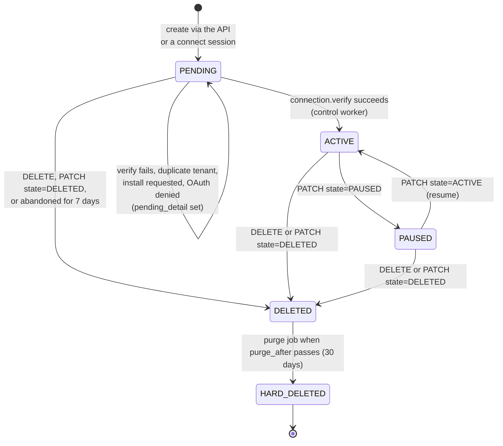
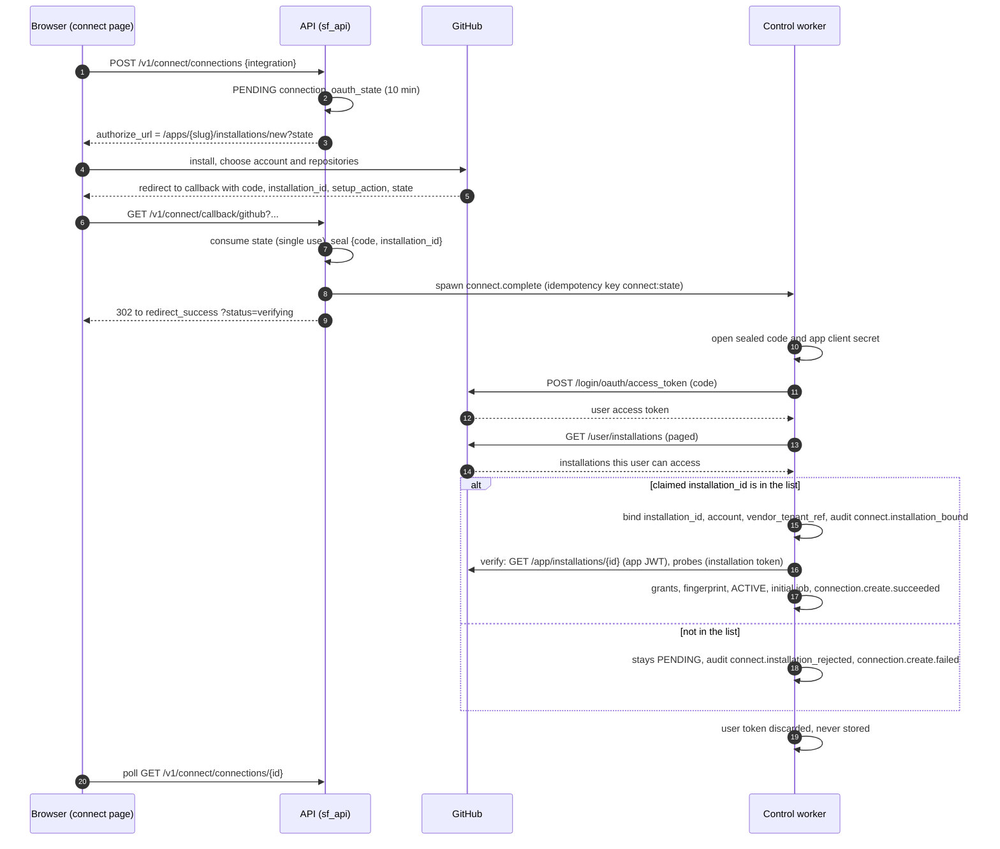
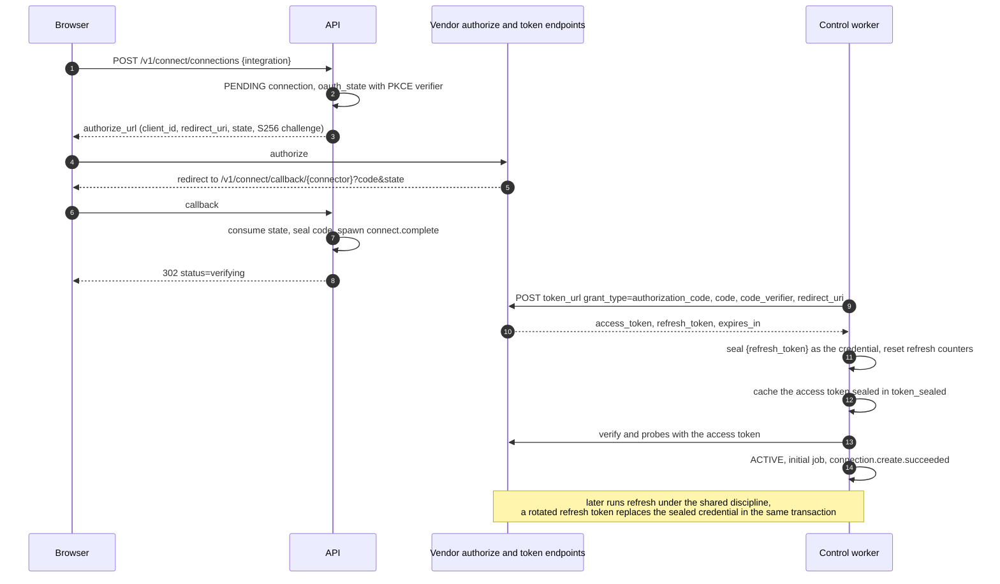

# Part 6: Connections and the connect flow

This part covers the connection: its lifecycle state machine, how a control worker verifies it and records what it may read, how credentials are rotated and refreshed, how health surfaces on it, and how an end user authorises one through a connect session (credential forms, the GitHub App install flow, generic OAuth2 with PKCE, client credentials). Read it before changing `packages/domain/src/securefabric_domain/connections.py`, `connect.py`, `sync/credentials.py` or `packages/cdk/src/securefabric_cdk/tokens.py` and `oauth2.py`. The vault, principals and roles this part relies on are explained in [Part 2](02-tenancy-identity-and-security.md); what happens once a connection is active (schedules, runs, health codes per run) is in [Part 4](04-sync-engine.md).

## 1. Context

A connection is one vendor tenant (a GitHub organization, a SANDBOX tenant) connected for one of the customer's organizations through one integration. It is the unit that gets credentials, schedules, a rate budget, health and data. The requirements that shape it:

| Area | Requirements |
|---|---|
| Lifecycle | CON-01 create, CON-02 states with an explicit transition table (illegal transition is 409), CON-03 pause and resume, CON-04 delete with a 30-day purge, CON-05 options validated against the manifest, CON-10 metadata, CON-11 test, CON-12 health object, CON-14 health history, CON-16 `external_use_only` |
| Credentials | AUTH-05 refresh discipline, AUTH-06 refresh failure policy, AUTH-07 and AUTH-08 verify and probe, AUTH-09 write-only, AUTH-10 one connection per vendor tenant per organization, AUTH-11 rotation that verifies before swapping |
| Connect flow | CON-06 connect sessions, CON-07 embedded UI, CON-08 hosted link, CON-09 re-authorisation keeps ids and data, CAT-04 forms rendered from JSON Schema, CAT-05 inline permission guide |
| Sandbox | TEN-13 sandbox connections for every connector |

Plan decisions: PD-3 puts the Integration between connector and connection, PD-4 makes the API seal credentials it can never open (so every vendor call, including code exchanges, happens in a worker), and PD-10 makes the shared, platform-owned GitHub App the default with customer-owned apps supported. One hazard was found during design and drives the GitHub flow: the installation id GitHub puts in the setup URL is not signed, so trusting it would let tenant B bind tenant A's installation through the shared app (`docs/plan/06-github-connector.md`, section 3).

## 2. The rows

`control.connection` (migration `0002_platform.sql`) holds the lifecycle and the public face:

| Column | Meaning |
|---|---|
| `state` | `PENDING`, `ACTIVE`, `PAUSED`, `DELETED`, `HARD_DELETED` (check constraint) |
| `organization_id`, `integration_id`, `connector_id`, `connector_version` | Where it belongs and which connector release created it |
| `identifier` | Optional customer key, unique among live connections of one organization |
| `options` | Customer options, validated against the manifest's options schema merged over the integration's `option_defaults` |
| `connection_config` | What verification learned (GitHub: `installation_id`, `account_login`, `account_type`, `repository_selection`, `listing_mode`, `permissions`, `events`, `server_version`). Internal keys (`_revoked`, `installation_choices`, `install_requested`) live here too. `permissions` and `events` are hidden from API output. |
| `vendor_tenant_ref`, `tenant_fingerprint` | The vendor's id for the tenant (GitHub: the installation id) and the duplicate-check fingerprint |
| `is_sandbox` | A sandbox connection (section 8) |
| `metadata`, `tags` | Customer data: metadata up to 16 KB (also a check constraint), tags up to 10 string pairs |
| `health_status`, `health_code`, `resolution_owner`, `health_details`, `health_description`, `health_changed_at` | The health object (section 4.7) |
| `pending_detail` | Why a connection is still `PENDING` (or why a verification failed): shown by the connect UI |
| `deleted_at`, `purge_after` | Soft delete and the hard-delete date |

`control.credential` (one row per connection, primary key `connection_id`) holds everything secret, sealed: `auth_mode` (`APP`, `API_KEY`, `BASIC`, `OAUTH2`, `OAUTH2_CC`, `AWS_ROLE`, `NONE`), `sealed` (the long-lived credential), `staged_sealed` (a rotation awaiting verification), `token_sealed` (cached short-lived tokens for every auth scheme, in one envelope) with `token_expires_at`, `vault_key_version`, the refresh bookkeeping (`last_refresh_at`, `last_refresh_failure_at`, `last_refresh_fail_day`, `refresh_fail_days`, `refresh_exhausted`), `rotated_at` and `fields_set` (the names of the credential fields, never their values).

`control.connection_grant` has one row per `(connection_id, stream)` with `status` (`GRANTED`, `UNAUTHORIZED`, `NOT_ENABLED`, `UNSUPPORTED`, `UNKNOWN`), the `endpoint` probed and a `detail`.

`GET /v1/connections/{id}` never returns credential material (AUTH-09). It returns an `authorization` block (`auth_mode`, `fields_set`, `rotated_at`, `last_refresh_at`, `refresh_exhausted`) and a `streams` array combining the manifest, the integration's enabled streams, grants, schedules and record counts (`connection_out` in `connections.py`).

## 3. The connection lifecycle

The transition table is data, `TRANSITIONS` in `connections.py`:

| From | Allowed targets |
|---|---|
| `PENDING` | `ACTIVE`, `DELETED` |
| `ACTIVE` | `PAUSED`, `DELETED` |
| `PAUSED` | `ACTIVE`, `DELETED` |
| `DELETED` | `HARD_DELETED` |
| `HARD_DELETED` | none |

`check_transition` raises `ConflictError` with code `invalid_state_transition` and the current and target states, which the API renders as a 409 problem document. `PATCH /v1/connections/{id}` accepts only `ACTIVE`, `PAUSED` and `DELETED` as targets, so a customer cannot activate a `PENDING` connection by hand (`PENDING → ACTIVE` is in the table only for the verifier) and cannot request `HARD_DELETED`. A deleted connection is a 404 to every read and write, since `get_row` treats `deleted_at` as absence.

Health is orthogonal to state: an `ACTIVE` connection may be `UNHEALTHY`, and an uninstalled GitHub App leaves the connection `ACTIVE` with health `UNAUTHORIZED` and its schedules paused (section 4.7).

### 3.1 Create (CON-01)

`create_connection` runs in one `tenant_tx`:

1. Requires `provisioning:write`; validates metadata size and tags.
2. Loads the organization (404 if absent) and the integration: by id or key if `integration` is given, otherwise `ensure_default_integration` creates or reuses the environment's default integration for `vendor`.
3. Validates options with `validate_options(manifest, {**option_defaults, **options})` (422 `invalid_options`).
4. Decides the connect style from the manifest: `auth.connect = redirect` (GitHub, SANDBOX_OAUTH) takes no credentials; form connectors require `credentials`, validated against the manifest's credential JSON Schema. Validation errors name only the field path, never the value.
5. Inserts the connection as `PENDING` (a duplicate `identifier` in the organization is 409 `connection_identifier_exists`), seals the credentials to the environment key with purpose `credential`, inserts the `control.credential` row with `fields_set`, and writes a `connection.created` audit event.
6. For a redirect connector, calls `begin_redirect` and returns `authorize_url` (also as `oauth2_authorize_url` for Leen compatibility). Otherwise spawns `connection.verify` on the `control` queue in the same transaction, so the task exists if and only if the connection does.

The response is `201` with the connection in `PENDING` and health `INITIALIZING`.

### 3.2 Verify and probe (AUTH-07, AUTH-08)

`connection.verify` is an Absurd task on the `control` queue (`apps/worker/src/securefabric_worker/handlers.py`, `max_attempts=3`) that calls `verify_connection(platform, environment_id, connection_id, reason=..., staged=...)`. Verification runs in a control worker because it needs the vault.

1. Load the connection bundle (connector, manifest, integration, vendor app, config). If `staged`, open `staged_sealed` and use it in place of the live credential.
2. Start an `auth` operation (`verify:<reason>`) so the attempt appears in `GET /v1/operations`.
3. Build a context with the connection's auth (section 7) and call `connector.verify(ctx)`. It returns a `VerifyResult`: `tenant_identity`, `display_name`, `vendor_tenant_ref` and `config_updates`.
4. For every stream that is both enabled on the integration and present in the manifest: if the vendor reported a `server_version` below the stream's `min_vendor_version` (GHES), record `UNSUPPORTED` with the reason; otherwise call `connector.probe(ctx, stream)`. A probe that raises a `ConnectorError` records `UNKNOWN` with the message.
5. Compute the tenant fingerprint and check for a duplicate (section 3.3).
6. Under `select ... for update` on the connection: merge `config_updates` into `connection_config`, set `vendor_tenant_ref` and `tenant_fingerprint`, clear `pending_detail`, upsert every grant row, and for a staged verification swap the credential (section 3.4).
7. If the connection was `PENDING`: set `ACTIVE`, queue the initial job ([Part 4](04-sync-engine.md)), emit `connection.create.succeeded` with the grants, and record a `connection.active` usage event. If it was `ACTIVE` and the reason is `reprobe`, `restore`, `reauthorize` or `rotate`: re-ensure schedules (and restart them for `restore` and `reauthorize`) and queue an on-demand job for the newly granted streams.
8. Recompute health (section 4.7), which emits `connection.health.changed` if it moved.

The `reason` parameter decides what a failure means:

| Reason | Spawned by | On a classified vendor rejection |
|---|---|---|
| `create` | create, and `GET /test` on a connection that never activated | Stays `PENDING`; `pending_detail` set; `connection.create.failed` emitted with the health code and message |
| `test` | `GET /v1/connections/{id}/test` on a non-pending connection | Nothing persisted except the operation log; returns `is_valid: false` |
| `rotate` | credential `PATCH`, or a re-authorising connect session with a form connector | `staged_sealed` discarded; the old credential keeps syncing; health untouched |
| `reprobe`, `restore` | inbound vendor webhooks (permissions changed, app unsuspended) | For an `ACTIVE` connection, health is recomputed with the rejection's code as an override |
| `reauthorize` | completing a redirect flow on an existing connection | Same as above |

A verification that raises something other than a classified `ConnectorError` is a crash, handled by `record_verify_crash`. Every attempt logs only the exception type (exception text can carry credentials). On the final attempt the outcome is made visible: health `INTERNAL_ERROR` (owner PLATFORM), `pending_detail` and `connection.create.failed` for a creation, the staged credential discarded for a rotation, and an `internal_error` alert. A later `GET /test` on a connection still `PENDING` spawns a `create` verification again, so it can still activate.

`GET /v1/connections/{id}/test` (CON-11) spawns the task and polls `absurd.get_task_result` every 250 ms for up to 30 seconds (`wait` parameter, 0.5 to 30). A vendor rejection is a 200 with `is_valid: false`; a timeout returns `is_valid: false, pending: true`.

### 3.3 Duplicate tenants (AUTH-10)

The fingerprint is `sha256(connector_id | vendor_app_id or "-" | tenant_identity)` (`fingerprint` in `connections.py`). For GitHub, `tenant_identity` is the GitHub account id of the installation's owner, so two installations of the same app on the same account collide, while the same account connected through the read app and the read-write app does not. Verification looks for another live connection in the same organization and integration with the same fingerprint. If one exists, the new connection stays `PENDING` with `pending_detail` naming the existing connection, `connection.create.failed` is emitted with error `DUPLICATE_CONNECTION`, and the verification returns `is_valid: false`. The partial unique index `connection_fingerprint_live` on `(organization_id, integration_id, tenant_fingerprint)` where `deleted_at is null` is the backstop if two verifications race.

The same vendor tenant may be connected from two different organizations, or two different customers: each passed its own authorisation. For GitHub they then share one rate budget, because the budget key is the installation ([Part 4](04-sync-engine.md)).

### 3.4 Credential rotation (AUTH-11)

`PATCH /v1/connections/{id}` with `credentials` validates them against the schema, seals them into `credential.staged_sealed` (updating `fields_set`), and spawns `connection.verify` with `reason = rotate, staged = true`. The live credential is untouched until verification succeeds; then, in the activation transaction, `sealed = staged_sealed`, `staged_sealed = null`, `rotated_at = now()`, `token_sealed = null` (cached tokens minted from the old credential are dropped), and the refresh failure counters reset. A rejected rotation nulls `staged_sealed` and nothing else. The connect UI tells the two apart through `last_verification` on `GET /v1/connect/connections/{id}`, read from the latest `verify:*` operation.

Re-authorisation through a connect session (CON-09) uses the same path for form connectors, and runs the redirect flow again for redirect connectors (section 6). Ids, history and data are unchanged either way.

### 3.5 Pause, resume and delete

All three run inside the `PATCH` transaction, followed by a `connection.updated` audit event.

| Operation | Effects (one transaction) |
|---|---|
| Pause (CON-03) | `state = PAUSED`; every schedule `PAUSED`; queued, parked and retry-waiting runs `CANCELLED` with warning `connection paused`; admitted and running runs get `cancel_requested`, so they finish the current page and stop; `connection.paused` in the outbox. Data stays readable. |
| Resume | `state = ACTIVE`; schedules `STARTED`; one `ON_DEMAND` job at initial priority over every enabled stream, each in the mode `jobs.mode_for` picks (a catch-up); `connection.resumed` in the outbox. |
| Delete (CON-04) | `state = DELETED`, `deleted_at`, `purge_after = now + 30 days`; the `control.credential` row deleted (the credential is gone at once); schedules and dirty records deleted; runs cancelled as for pause; `connection.deleted` in the outbox with `purge_after`. Every data read joins on a live connection, so the data disappears from the API immediately. |

`DELETE /v1/connections/{id}` is `PATCH state=DELETED` and returns 204. Two maintenance jobs in `packages/domain/src/securefabric_domain/maintenance.py` finish the lifecycle, each run hourly through the `sf_system` pool:

- `purge`: for each connection `DELETED` past `purge_after`, deletes its rows from `data.finding_resource`, `data.vulnerability_finding`, `data.resource`, `data.stream_head`, `data.object_clock`, `sync.checkpoint`, `data.quarantine`, `sync.dirty_record` and `control.connection_grant`, sets `HARD_DELETED`, writes a `connection.purged` audit event, then deletes the connection's raw page prefix from object storage.
- `abandoned`: deletes (with the same `_delete`) every connection still `PENDING` 7 days after `created_at`.

Deleting an organization returns 409 while it has a live connection (TEN-03, [Part 2](02-tenancy-identity-and-security.md)).

### 3.6 Options, tags and metadata

- **Options** (CON-05): validated on create and on `PATCH` against the manifest's options schema merged over the integration defaults; for an active connection a change re-ensures schedules, so an interval change applies at once. Retention-bounded intervals (SYNC-18) are enforced by the same validation ([Part 5](05-connector-platform.md)).
- **Tags**: at most 10; keys match `^[A-Za-z0-9_.:/-]{1,64}$`; values are strings up to 256 characters. Stored as JSON with a GIN index; `GET /v1/connections?tags[env]=prod` filters with `@>`.
- **Metadata** (CON-10): `PUT /v1/connections/{id}/metadata` replaces and `PATCH` merges, capped at 16 KB of compact JSON (422 `metadata_too_large`).
- **Identifier**: changeable by `PATCH`, still unique per organization.

`GET /v1/connections` filters by `organizationId`, `vendor`, `state`, `healthStatus`, `healthStatusCodes`, `integrationId` and tags, ordered by `(created_at, id)` with signed keyset cursors.

### 3.7 Health as it surfaces on a connection

Every stream run ends with one health code ([Part 4](04-sync-engine.md)). `health.compute` in `packages/domain/src/securefabric_domain/sync/health.py` rolls them up for the connection:

1. For each enabled stream, the grant decides first: `NOT_ENABLED` adds a detail `reason: feature_not_enabled` and contributes no code (the vendor feature is off, which is a coverage fact, not a failure); `UNAUTHORIZED` contributes `UNAUTHORIZED` with `reason: permission_missing` and the endpoint; `UNSUPPORTED` adds `reason: unsupported` and no code.
2. Otherwise the latest non-targeted finished run decides: none yet is `INITIALIZING`, `SUCCEEDED` is `HEALTHY`, `FAILED` contributes its recorded code (with a detail), `CANCELLED` counts as `HEALTHY`.
3. A `_revoked` marker in `connection_config` (set by an uninstall or suspend webhook) adds `UNAUTHORIZED` with the vendor's reason.
4. An explicit override (a failed re-verification, a crash) is added.
5. The connection's code is the worst by a fixed severity order.

| Code | Status | Owner | Severity |
|---|---|---|---|
| `HEALTHY` | HEALTHY | none | 0 |
| `INITIALIZING` | INITIALIZING | PLATFORM | 1 |
| `RATE_LIMIT_EXCEEDED` | UNHEALTHY | VENDOR | 2 |
| `EXECUTION_TIMEOUT` | UNHEALTHY | PLATFORM | 3 |
| `VENDOR_SERVER_ERROR` | UNHEALTHY | VENDOR | 4 |
| `VENDOR_CLIENT_ERROR` | UNHEALTHY | CUSTOMER | 5 |
| `INTERNAL_ERROR` | UNHEALTHY | PLATFORM | 6 |
| `CONFIGURATION_ERROR` | UNHEALTHY | CUSTOMER | 7 |
| `UNAUTHORIZED` | UNHEALTHY | CUSTOMER | 8 |
| `REAUTHORIZATION_REQUIRED` | UNHEALTHY | CUSTOMER | 9 |

`health.recompute` locks the connection row, writes the new code, status, owner, details and description only if something changed, and when the code itself changed inserts a `control.connection_health_event` row and emits `connection.health.changed` in the same transaction (HOOK-01). `GET /v1/connections/{id}/health/history` serves 30 days of those events (CON-14). Deleted connections never recompute. Each unhealthy code has a runbook under `docs/runbooks/health/`.

An uninstalled or suspended GitHub App arrives as a webhook effect (`ConnectionRevoked`, `packages/domain/src/securefabric_domain/ingress.py`): `_revoked` is set, schedules pause, health becomes `UNAUTHORIZED`, and `connection.sync.unauthorized` is emitted once. Unsuspending (`ConnectionRestored`) removes the marker and spawns a `restore` verification, which restarts the schedules.

## 4. Connect sessions

A connect session lets an end user authorise a connection without the customer handling credentials. One flow serves the hosted link (CON-08) and the embedded UI (CON-07), which is the same page in an iframe opened by `packages/connect-js` ([Part 8](08-dashboard-and-clients.md)).

`POST /v1/connect_sessions` (`create_session` in `connect.py`, `provisioning:write`, idempotency-key aware) takes `organization_id`, optional `integrations` (ids or keys; an unknown key becomes the environment's default integration for that connector), optional `connection_id` (re-authorise that connection; the session is then limited to its integration and must belong to the same organization), `option_presets`, and `redirect_success` and `redirect_error`. Redirect targets must have an origin listed in the environment's `settings.allowed_redirect_origins` (422 `redirect_not_allowed`); the default list is empty, so a customer must configure origins before using redirects. The response carries `token` (`sfcs_` plus 32 random bytes), `url` (`<PUBLIC_DASH_URL>/connect/<token>`) and `expires_at` (30 minutes). Only the SHA-256 of the token is stored.

| Endpoint (session token auth) | Purpose |
|---|---|
| `GET /v1/connect/session` | What the page renders: organization, offered integrations with their public connector descriptions (credential and option schemas, permission guide), option presets, branding from `settings.connect_ui`, redirect targets, `used_at` |
| `POST /v1/connect/connections` | Create the connection (or re-authorise), once |
| `GET /v1/connect/connections/{id}` | Poll status: `state`, `health_code`, `pending_detail`, grants, `missing_permissions`, `last_verification`. Only connections of the session's organization are visible. |

Rules enforced in code:

- **Expiry.** `authenticate_session_token` returns 410 `connect_session_expired` once `expires_at` has passed; an unknown token is 401.
- **Single use.** `mark_used` sets `used_at` only if it was null; a second create is 410 `connect_session_used`. If creation then fails (bad credentials, validation), `used_at` is reset, so a typo does not burn the link. Status reads stay allowed until expiry.
- **Scope.** The principal has only `provisioning:read` and `provisioning:write`, is pinned to the session's organization, and is refused on every non-connect route. An integration not offered by the session is a 404.

The hosted page (`apps/dash/src/app/connect/[token]/route.ts`) swaps the token in the URL for an `HttpOnly` cookie `sf_connect` scoped to `Path=/connect` (`SameSite=None; Secure; Partitioned` over HTTPS, so it works inside the customer's iframe), so the token never reaches page JavaScript, history or referrers. The API accepts that cookie in `get_connect_principal`. Forms are rendered from each connector's JSON Schema with no connector-specific UI code (CAT-04); redirect vendors open in a popup.

For a form connector the flow is short: the page posts credentials to `POST /v1/connect/connections`, the API creates the `PENDING` connection and seals the credentials exactly as in section 3.1, a control worker verifies, and the page polls the status endpoint until `ACTIVE` or a `pending_detail`. The customer learns the outcome from the `connection.create.succeeded` or `connection.create.failed` webhook.

## 5. Redirect flows: common machinery

Redirect connectors declare `auth.connect: redirect`. `begin_redirect` (`connect.py`) is called from connection creation (direct API or connect session) and from re-authorisation:

1. Resolve the vendor app for the integration (section 9); none is 422 `vendor_app_missing`.
2. If there is no connect session (a direct `POST /v1/organizations/{id}/connections`), insert an implicit, already-used session bound to this connection, because the callback must find a session to choose redirect targets.
3. Generate `state` (32 random bytes) and insert `control.oauth_state`: environment, session, connection, vendor app, `kind` (`install`, `authorize` or `oauth2`), the PKCE `code_verifier` for OAuth2 manifests that ask for PKCE, and `expires_at = now + 10 minutes`.
4. Build the authorize URL: for an OAuth2 manifest, `oauth2.authorize_url` with the manifest's `authorize_url` (absolute, relative to the vendor app's `base_url`, or `local:/path`), `client_id` from the vendor app config, `redirect_uri = <PUBLIC_API_URL>/v1/connect/callback/<connector>`, scopes and the S256 challenge; for GitHub `kind = install`, `<base_url>/apps/<slug>/installations/new?state=...`; for GitHub `kind = authorize`, `<base_url>/login/oauth/authorize` with client id, state and redirect URI.

`GET /v1/connect/callback/{connector}` is unauthenticated: the vendor redirects the browser there. `handle_callback` runs in the API and never calls the vendor (it could not: the vendor app's client secret is sealed). It:

1. Resolves `state` through the `control.resolve_oauth_state` definer function (the callback carries no tenant). Missing state redirects to `/connect/done?status=no_state` (an install started from GitHub's own UI binds nothing); unknown, consumed or expired state to `status=expired`.
2. Consumes the state with `update ... set consumed_at = now() where consumed_at is null` inside `tenant_tx`, so a replayed callback finds nothing.
3. Handles the outcomes: `error` from the vendor sets `pending_detail` "authorization denied" (`status=denied`); GitHub's `setup_action=request` (a non-owner asked an owner to approve) sets `install_requested` and a waiting `pending_detail` (`status=requested`); no `code` is `status=no_code`.
4. Otherwise seals `{code, installation_id, setup_action}` to the environment key with purpose `oauth_callback` into `oauth_state.callback_sealed`, and spawns `connect.complete` on the `control` queue with idempotency key `connect:<state>`.
5. Redirects the browser to the session's `redirect_success` or `redirect_error` (or `/connect/done`) with `connection_id` and `status` (`verifying` on the happy path).

`connect.complete` (`complete_redirect`, `max_attempts=2`) opens the sealed callback and the vendor app's secrets, nulls `callback_sealed` (the code is single use at the vendor anyway), and branches on `kind`.

## 6. The GitHub App install flow

The binding rule: **an installation id is never trusted from a URL**. The callback stores the claimed id sealed; the worker exchanges the code for a user access token with the app's client secret, lists `GET /user/installations` (following `Link` pagination), and binds only if the claimed id is in that list, proving the person in the browser can access the installation. A forged id ends in `_reject` with `audit_it=True`: the connection stays `PENDING` with `pending_detail` "the signed-in user cannot access that installation", a `connect.installation_rejected` audit event records the claimed id, and `connection.create.failed` is emitted. The user token is deleted from memory and never stored. All three GitHub calls use `platform.vendor_transport()`, so they pass the egress policy. The setup URL's parameters were confirmed live (spike S1 in `progress.md`): GitHub sends `code`, `installation_id`, `setup_action` and `state`, and the `installation` webhook can arrive before the callback, which is harmless because binding happens only here.

On a match the worker writes `installation_id`, `account_login`, `account_id`, `account_type` and `repository_selection` into `connection_config`, sets `vendor_tenant_ref` to the installation id, audits `connect.installation_bound`, and calls `verify_connection` inline with reason `create` (or `reauthorize` for an existing connection). GitHub's `verify` (`packages/connectors/src/securefabric_connectors/github/connector.py`) reads `GET /app/installations/{id}` with the app JWT: 404 is `AuthRejected` (uninstalled), `suspended_at` is `AuthRejected` (suspended). It derives `listing_mode` (`org` for organization installs with all repositories, `per_repo` otherwise, which is the spike S2 fallback), reads `installed_version` from `/meta` on GHES for version gating, and returns the account id as `tenant_identity`. `probe` checks `/installation/repositories` for repositories and branches, checks the installation's granted permissions for the alert families (missing permission is `UNAUTHORIZED` naming the stream), and in org mode requests one item of each org listing, mapping GitHub's 403 and 404 bodies to `NOT_ENABLED` or `UNAUTHORIZED`.

Two variants exist in the code. With no `installation_id` in the callback (the `authorize` kind, for "I already installed it"), exactly one accessible installation binds automatically; several write `installation_choices` into `connection_config` and leave the connection `PENDING` with "choose an installation". An owner-approval request (`setup_action=request`) leaves the connection waiting.

At run time GitHub uses two auth schemes (`auth_plan`): `app` mints an RS256 app JWT (issuer the app id, 9-minute expiry, issued-at backdated 60 seconds; `securefabric_cdk.auth.github_app_jwt`) with a 60-second refresh margin, and `default` exchanges it for an installation token through `POST /app/installations/{id}/access_tokens`, refreshed when fewer than 600 seconds remain (`token_refresh_margin_s` in the manifest). A 401, 403 or 404 on that exchange is `AuthRejected`. Per-connection secret material is nothing: the connection holds an installation id, and the only secret is the app's private key in `vendor_app.secrets_sealed`.

## 7. Generic OAuth2

`packages/cdk/src/securefabric_cdk/oauth2.py` implements authorization code with PKCE, refresh, and client credentials, driven entirely by the manifest's `auth.oauth2` block (`authorize_url`, `token_url`, `scopes`, `pkce`, `single_use_refresh_tokens`) and the default `Connector.auth_plan`. A connector whose vendor speaks standard OAuth2 writes no auth code. SANDBOX exercises both modes: `SANDBOX_OAUTH` (PKCE S256 required, single-use rotating refresh tokens with reuse detection that revokes the whole token family) and `SANDBOX_CC`, served by an in-process vendor in `packages/connectors/src/securefabric_connectors/sandbox/oauth.py`.

`_complete_oauth2` exchanges the code through the connector's `HttpClient` (so retries, egress and the token-response rule `capture=False` apply), with client authentication by HTTP Basic when the vendor app has a secret and `client_id` in the body for public clients. It requires a refresh token (`the vendor issued no refresh token` otherwise), seals only `{refresh_token}` as the credential (`fields_set = [refresh_token]`), clears the old token cache and failure counters, stores the fresh access token through `DbCredentialStore.save_token`, and verifies. Token endpoint errors map onto the error taxonomy: `invalid_grant`, `invalid_client`, `unauthorized_client` or any 401 is `AuthRejected`; other 400s are `VendorRejected`; a response without `access_token` is `VendorUnavailable`. A missing `expires_in` is taken as one hour.

The refresh exchange always uses the newest refresh token: the cached one if it rotated, else the sealed credential. When a refresh returns a new refresh token, `parse_token_response` marks it `rotated_refresh`, and `DbCredentialStore.save_token` re-seals the credential with the new refresh token in the same transaction that stores the new access token, so a crash cannot strand the only valid token of a single-use family.

**Client credentials (`OAUTH2_CC`).** The connection's credentials are `client_id` and `client_secret` entered in the form (or the vendor app's, if the form omits them). `client_credentials_exchange` mints a token, never keeps a refresh token, and re-mints when the cached token is inside its margin.

**Vendors with no website.** SANDBOX has no real authorize page, so its manifest says `authorize_url: local:/oauth/authorize`. The platform serves it at `/v1/connect/local/{connector}/{path}` (`local_vendor_page`) through the connector's in-process transport, accepting only that connector's own callback URL as `redirect_uri`, so the route cannot become an open redirect.

## 8. Sandbox connections (TEN-13)

`POST /v1/organizations/{id}/connections` with `is_sandbox: true` creates a connection that needs no credentials, even for a redirect connector. Its `connection_config` is seeded from the connector's recorded `fixtures/connection.json` (`sandbox_config`). `build_context` (`packages/domain/src/securefabric_domain/sync/bundle.py`) gives it the fixture replay transport instead of the egress transport whenever the connector has no in-process vendor, and authenticates every scheme with a placeholder `Bearer sandbox-replay` header that the replay transport ignores, so nothing can reach the real vendor. Verify, probes and syncs replay the recorded responses. The GitHub fixtures were recorded live from the seeded test organization with `securefabric-admin record` and scrubbed of tokens and secret values. SANDBOX connections (`is_sandbox` false) already run against the in-process vendor.

## 9. Vendor apps

A vendor app (`control.vendor_app`) is the vendor-side registration a connection authenticates through: GitHub App id, slug, client id and private key; an OAuth client id and secret. Two kinds exist:

- **Platform-owned** (`environment_id` null, `is_default`, readable by every tenant). `bootstrap_platform_apps` (`catalog.py`, run by `securefabric-admin bootstrap`) registers the shared GitHub Apps from `GITHUB_APP_*` and `GITHUB_APP_RW_*` as two permission tiers, `read` and `read_write` (SEC-09 keeps write permissions in a separate app), plus any app a connector ships through `Connector.platform_app()` (SANDBOX_OAUTH). Secrets are sealed with the platform key pair; webhook secrets are encrypted with the ingress key. Re-running it updates config and re-seals.
- **Customer-owned** (`POST /v1/vendor_apps`), required for GHES and allowed anywhere (PD-10). `create_vendor_app` checks that the connector uses vendor apps, validates `base_url` with the egress policy (`https` required, public addresses only), seals `secrets` to the environment key with purpose `vendor_app` (write-only: no endpoint returns them), and encrypts the webhook secret with the ingress key bound to the app id.

`resolve_vendor_app` picks the integration's `vendor_app_id` if set; otherwise the platform default for the tier the integration needs (`read_write` when `write_back_enabled`), falling back to `read`. The vendor app id is part of the tenant fingerprint (section 3.3).

## 10. Token providers and the AUTH-06 failure policy

At run time `build_auth` (`packages/domain/src/securefabric_domain/sync/credentials.py`) opens the connection's credential and its vendor app's secrets (worker-only; every opened string is registered for redaction) and asks the connector for an `AuthPlan`:

- **Static headers** (API key as bearer, basic auth) become a `StaticSecret`, which returns the same headers forever.
- **Exchanges** (OAuth2 refresh, client credentials, GitHub's `app` and `default` schemes) each become an `ExchangeProvider` over a `DbCredentialStore` for that scheme, combined by `MultiScheme`, which routes a request's scheme (`Connector.auth_scheme_for`) to its provider.

`TokenProvider.material` in `packages/cdk/src/securefabric_cdk/tokens.py` implements the shared discipline (AUTH-05, AUTH-06):

1. Use the cached token if it has more than the scheme's margin left (`token_refresh_margin_s`, default 900 seconds; GitHub 600; GitHub app JWT 60).
2. Otherwise take the lock and re-read the cache; refresh only if still needed. A forced refresh (after a 401) re-mints only if nobody replaced the failing token meanwhile, so concurrent 401s collapse into one refresh.
3. If the credential is `refresh_exhausted`, raise `ReauthorizationRequired` without calling the vendor.
4. If the last failure was less than 30 seconds ago, return the current token if it is still valid, else raise `VendorUnavailable` without calling the vendor.
5. Refresh. `AuthRejected` records a failure and becomes `ReauthorizationRequired` if that exhausts the credential; `VendorUnavailable` records a failure and is re-raised. Success saves the token and resets the counters.

`DbCredentialStore` makes this hold across processes. The lock is two-level: an in-process `asyncio.Lock` per `(connection, scheme)` so fifty coroutines in one worker hold one pooled connection, then a session advisory lock on `credential:<connection>:<scheme>`. Locks are per scheme because GitHub's installation-token exchange needs the `app` scheme while holding its own lock, and advisory locks on two pooled connections are not reentrant. Tokens for all schemes live sealed in one `token_sealed` envelope; `save_token` re-reads and merges before writing, so schemes do not overwrite each other. `token_expires_at` is the earliest expiry.

The failure policy is counted in SQL in `record_failure`: `refresh_fail_days` increments at most once per calendar day (tracked by `last_refresh_fail_day`), and `refresh_exhausted` becomes true when it reaches `EXHAUSTED_AFTER_DAYS` = 4. A run that hits `ReauthorizationRequired` ends with health `REAUTHORIZATION_REQUIRED` (owner CUSTOMER), the most severe code, and recovers only through re-authorisation or rotation, both of which reset the counters. A run that hits `AuthRejected` ends `UNAUTHORIZED`. The HTTP client refreshes once on a 401 and treats a 401 that returns with the same token as `AuthRejected`.

The `token_refresh` maintenance job (hourly) force-refreshes the `default` scheme of every `ACTIVE`, non-exhausted `APP`, `OAUTH2` or `OAUTH2_CC` credential untouched for 24 hours, so a broken credential is found before the next scheduled sync; it raises a `refresh_failures` alert when failures reach at least 3 and at least the number of successes ([runbook](../runbooks/refresh_failures.md)).

## 11. Invariants and how they are enforced

| Guarantee | Mechanism | Test |
|---|---|---|
| A new connection is `PENDING`, never echoes credentials, activates only after verification, and reports grants | `create_connection`, `verify_connection` | `apps/api/tests/test_connections.py::test_sandbox_connection_lifecycle` |
| An illegal state transition is a 409 | `TRANSITIONS`, `check_transition` | `test_connections.py::test_sandbox_connection_lifecycle` (`PENDING → PAUSED`) |
| The same vendor tenant cannot be connected twice in one organization | Fingerprint check plus `connection_fingerprint_live` | `test_connections.py::test_sandbox_connection_lifecycle` (duplicate stays `PENDING`, "already connected") |
| Delete removes the credential at once, makes the connection 404 and writes `connection.deleted` | `_delete` in one transaction | `test_connections.py::test_sandbox_connection_lifecycle` |
| Metadata is capped at 16 KB | `validate_metadata`, check constraint | `test_connections.py::test_sandbox_connection_lifecycle` |
| Bad credentials leave the connection `PENDING` and emit `connection.create.failed`; values are never echoed | Verify failure path, path-only validation errors | `test_connections.py::test_bad_credentials_stay_pending_and_emit_create_failed`, `test_invalid_credentials_never_echo_the_value` |
| A rotation swaps only after verification; a rejected one leaves the old credential syncing | `staged_sealed` | `test_connections.py::test_credential_rotation_verifies_before_swapping` |
| The connect UI can tell an accepted rotation from a rejected one, without seeing the secret | `last_verification` from the operation log | `test_connections.py::test_connect_status_reports_the_last_verification` |
| A crashed verification is visible (INTERNAL_ERROR, alert) and a retest recovers | `record_verify_crash`, `create` reason on retest | `test_connections.py::test_a_crashed_verification_is_visible_and_a_retest_recovers` |
| A GitHub installation binds only after GitHub confirms the user can access it; `state` is single use; the sealed code is erased after use | `handle_callback`, `complete_redirect` | `packages/connectors/tests/test_github.py::test_install_flow_binds_only_after_github_confirms_access` |
| A forged installation id is rejected and audited | `/user/installations` check, `_reject(audit_it=True)` | `test_github.py::test_callback_with_an_installation_the_user_cannot_access_is_rejected_and_audited` |
| An owner-approval request waits in `PENDING` | `setup_action=request` handling | `test_github.py::test_owner_approval_request_waits` |
| Missing permission is `ACTIVE` with `UNAUTHORIZED` naming the stream; a disabled feature is not a failure | Grants and `health.compute` | `test_github.py::test_missing_dependabot_permission_is_active_but_unauthorized_naming_the_stream`, `test_feature_not_enabled_is_a_coverage_fact_not_a_failure` |
| Uninstall produces exactly one health event and keeps data readable | `ConnectionRevoked` effect, `health.recompute` | `test_github.py::test_uninstall_turns_the_connection_unauthorized_with_exactly_one_health_event` |
| GHES streams below their minimum version are `UNSUPPORTED` | `min_vendor_version` in verify | `test_github.py::test_old_ghes_gates_streams_and_lists_per_repository` |
| PKCE follows RFC 7636; the full redirect flow activates, syncs, rotates the sealed refresh token, and a replayed refresh token is refused | `oauth2`, `_complete_oauth2`, `save_token` | `apps/api/tests/test_oauth.py::test_pkce_matches_rfc_7636`, `test_authorization_code_with_pkce_connects_syncs_and_rotates` |
| A denied authorisation leaves `PENDING` with a reason; the local authorize page accepts only our callback | Callback error handling, `local_vendor_page` | `test_oauth.py::test_denied_authorization_and_redirect_guard` |
| Client credentials mint and cache; a wrong secret never activates | `client_credentials_exchange` | `test_oauth.py::test_client_credentials_mint_and_cache` |
| A sandbox connection of a real connector never reaches the vendor | Fixture transport, placeholder auth | `test_connections.py::test_github_sandbox_connection_replays_recorded_fixtures` |
| Fifty concurrent readers cause one refresh, in process and across the database | Two-level single-flight | `packages/cdk/tests/test_http.py::test_fifty_concurrent_readers_cause_one_refresh`, `packages/domain/tests/test_engine.py::test_fifty_concurrent_readers_cause_one_refresh_against_the_database` |
| Concurrent forced refreshes collapse; a refresh is not retried within 30 s; 4 failing days exhaust | `TokenProvider.material`, store counters | `packages/cdk/tests/test_http.py::test_concurrent_forced_refreshes_collapse`, `test_refresh_failure_policy` |
| A 401 refreshes once; the same token again is `AuthRejected` | HTTP client | `test_http.py::test_401_retries_once_when_refresh_yields_new_token`, `test_401_with_same_token_after_refresh_is_auth_rejected` |
| No credential appears in operation logs | Redaction and registered literals | `test_connections.py::test_operations_log_and_usage` |

## 12. Failure modes

| Situation | What happens | Recovery |
|---|---|---|
| The vendor rejects credentials at creation | `PENDING`, `pending_detail` with the vendor's message, `connection.create.failed` | The end user retries with a fresh connect session or the customer rotates; abandoned after 7 days |
| A verification crashes (bug, unexpected response) | Absurd retries up to 3 attempts; on the last, `INTERNAL_ERROR`, `connection.create.failed` for a creation, an `internal_error` alert | Fix the cause; `GET /test` re-runs a `create` verification |
| The vendor is down during verification | `VendorUnavailable` is a classified rejection: `PENDING` with detail (create) or health override (active) | Retest, or the next sync recovers health |
| The worker dies between consuming the callback and binding | `callback_sealed` is nulled before the vendor calls, so the retry of `connect.complete` fails with "unknown or incomplete connect state" and the connection stays `PENDING` | The user restarts the connect flow (the code is single use at the vendor in any case) |
| The callback arrives twice, late, or forged | Consumed or expired `state` redirects to `status=expired`; a state never issued finds no row | None needed |
| An end user installs on GitHub without our state | `status=no_state`; nothing binds | Start from the connect link |
| Refresh keeps failing | Failures counted once per day; after 4 days `refresh_exhausted`, health `REAUTHORIZATION_REQUIRED`, no further vendor calls | Re-authorise through a connect session with `connection_id`, or rotate credentials |
| A single-use refresh token rotates and the process crashes | Access and refresh tokens are saved in one transaction, so either both are stored or neither | The next refresh uses whichever refresh token committed |
| GitHub App uninstalled or suspended | `UNAUTHORIZED`, schedules paused, one health event, data readable | Reinstall (a re-authorising session) or unsuspend (automatic `restore` verify) |
| A rotation is rejected | Staged credential discarded, old one keeps syncing, `last_verification.status = failed` | Submit correct credentials |
| A connection is deleted while a run is in flight | Queued runs cancelled; running runs finish the current page and stop; credential gone, so any further vendor call fails | Purge on day 30 |

## 13. Extending it

**A form-based connector (API key, basic auth, client credentials).** Declare `auth.mode` and the `credentials` JSON Schema in the manifest. The default `Connector.auth_plan` turns an `api_key` field into a bearer header and `username`/`password` into basic auth; anything else needs an override returning an `AuthPlan`. Implement `verify` (return a stable `tenant_identity`, which drives the duplicate check) and `probe` per stream. The connect page renders the form from the schema with no UI work.

**A standard OAuth2 connector.** Declare `auth.mode: OAUTH2` (or `OAUTH2_CC`), `auth.connect: redirect`, and an `auth.oauth2` block. Register the OAuth client as a vendor app (platform-owned through `Connector.platform_app()`, or customer-owned through `POST /v1/vendor_apps`). No platform code changes.

**A vendor with an install-and-bind step like GitHub's.** Today this logic is GitHub-specific code in `connect.complete_redirect` (the `/login/oauth/access_token` exchange and `/user/installations` check). A second such vendor needs either a connector hook for "prove this user may bind this tenant" or another branch there. Keep the rule: never bind a tenant id taken from a URL.

**A new verification reason.** Add it where `verify_connection` branches on `reason` (failure handling and the active-connection follow-up) and to the `Verification.reason` description in `apps/api/src/securefabric_api/routes/connect.py`.

**A new lifecycle state.** Change `TRANSITIONS`, the `state` check constraint in a migration, `ConnectionState` in `packages/schema`, and the `ConnectionPatch.state` literal; add the transition's side effects next to `_pause`, `_resume` and `_delete`.

## 14. Known gaps and open questions

- **Choosing among several GitHub installations has no completion path.** `complete_redirect` writes `installation_choices` and leaves the connection waiting, but no endpoint accepts a choice and the connect page never shows one. The `authorize` kind ("I already installed it") is reachable only when re-authorising (`connect_create` passes `mode` only on that path; new connections always use `install`), and the dashboard always sends `mode: "install"`.
- **Owner-approval requests never complete automatically.** The plan's design (match the `installation.created` webhook to the waiting connection, then "approved, click to finish") is not built; `install_requested` is set and nothing reads it. Such a connection is deleted by the `abandoned` job after 7 days unless re-authorised.
- **AUTH-10 is not a 409.** `docs/plan/06-github-connector.md` (section 3) says a duplicate is "rejected with 409"; the code leaves the duplicate `PENDING` with `pending_detail` and emits `connection.create.failed` with `DUPLICATE_CONNECTION`, because the duplicate is only knowable after verification, which is asynchronous.
- **Rotation and re-authorisation do not require the same vendor tenant.** A successful `rotate` or `reauthorize` overwrites `tenant_fingerprint` and `vendor_tenant_ref` with whatever the new credentials point at; data from the old tenant stays on the connection. A duplicate found during a rotation also leaves `staged_sealed` in place rather than discarding it.
- **`connect.complete` has no crash handling.** Unlike `connection.verify`, it has no `record_verify_crash` equivalent, and the verification it runs inline is outside that handler too; a crash there leaves the connection `PENDING` with whatever detail it had.
- **The PKCE verifier is stored in clear** in `control.oauth_state.code_verifier` (row retention 2 days). It is useless without the authorization code, which is sealed.
- **Connect session rules lack automated tests.** Single use, 410 on reuse and expiry, the failed-create un-burn and the redirect-origin check are covered by no test in the repository; `progress.md` records them as validated by connect-js tests and live (token swap 303, reuse 410).
- **The `token_refresh` job does not touch health.** It refreshes only the `default` scheme and logs failures; health changes come from the next run. The plan's "emit a health change on the first failure and on recovery" is met only through runs.
- **`AWS_ROLE` is an `auth_mode` value with no provider** (AUTH-01's AWS role mode is interface-only by plan). AUTH-13 relay agent, AUTH-14 mutual TLS and AUTH-02's Microsoft admin consent are deferred (`docs/plan/10-delivery-plan.md`, section 5). CON-15 destination connections exist only as the `direction` column.
- **`GET /test` holds an API request open** for up to 30 seconds while polling Absurd every 250 ms.
- **`abandoned` uses `created_at`.** A connection kept `PENDING` by repeated attempts is still deleted 7 days after it was first created.
- **Two sandbox connections of the same connector in one organization collide** on the fingerprint, because they replay the same recorded tenant.

## Further reading

- [Plan part 3: tenancy, connections and vault](../plan/03-tenancy-connections-vault.md), sections 5 to 8
- [Plan part 6: GitHub connector](../plan/06-github-connector.md), sections 2 to 4 and 9
- [Plan part 8: dashboard and connect UI](../plan/08-dashboard-and-connect-ui.md), section 5
- [Plan part 5: connector SDK](../plan/05-connector-sdk.md) for manifests, `auth_plan` and the SANDBOX connector
- [GitHub connector reference](../connectors/github.md), [SANDBOX connector reference](../connectors/sandbox.md)
- Health runbooks: [unauthorized](../runbooks/health/unauthorized.md), [reauthorization_required](../runbooks/health/reauthorization_required.md), [configuration_error](../runbooks/health/configuration_error.md), [internal_error](../runbooks/health/internal_error.md); alert runbooks: [refresh_failures](../runbooks/refresh_failures.md), [internal_error](../runbooks/internal_error.md)
- [Part 2: Tenancy, identity and security](02-tenancy-identity-and-security.md), [Part 4: Sync engine](04-sync-engine.md), [Part 5: Connector platform](05-connector-platform.md), [Part 7: Public API and events](07-public-api-and-events.md), [Part 8: Dashboard and clients](08-dashboard-and-clients.md)
