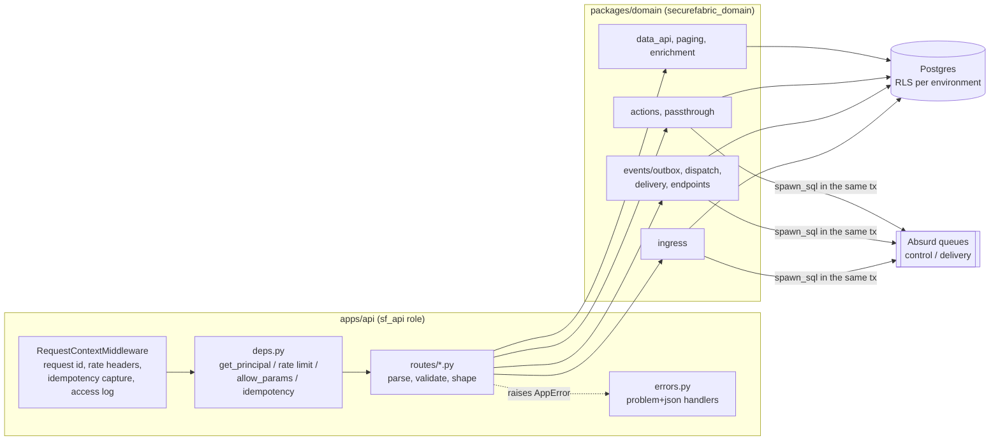
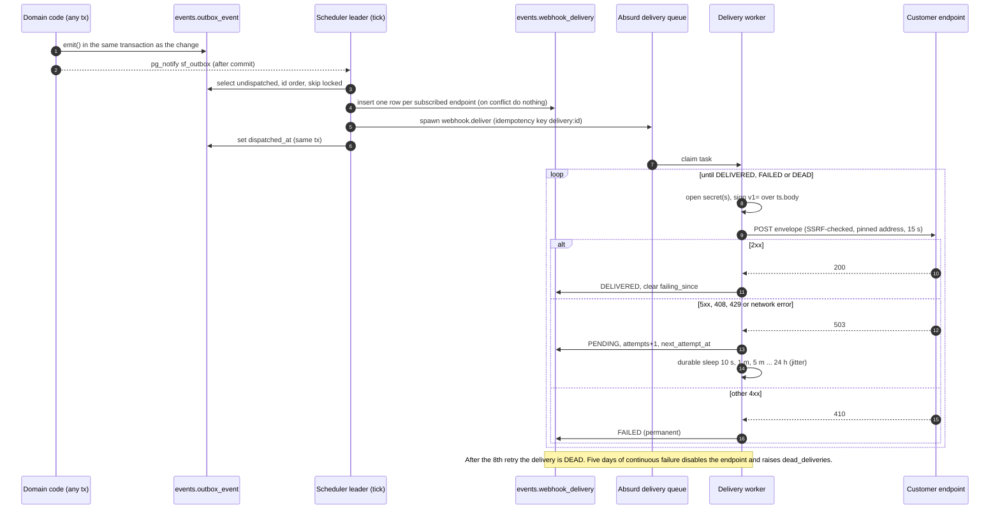
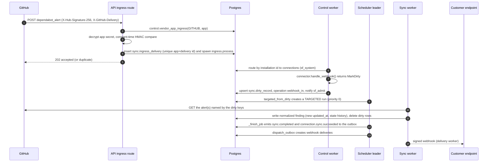

# Part 7: Public API and events

This part describes the `/v1` HTTP API as built: how the FastAPI app is assembled, the conventions every endpoint follows (errors, auth, paging, idempotency, rate limits), the Leen-compatible data API, the write-back action plane, the transactional outbox with signed outbound webhooks, and the inbound vendor-webhook ingress. Read it if you are adding an endpoint or an event type, debugging a customer's integration, or reasoning about what the API guarantees to clients.

## Context

SecureFabric exposes one API surface to two kinds of caller: customers' backends (API keys) and the dashboard (WorkOS sessions). PD-8 in `../plan/00-README.md` makes that a hard rule: the dashboard has no private backend, so every dashboard feature is automatically a customer feature, and the dashboard is the API's first and most demanding client. PD-9 requires wire compatibility with Leen V2 field names, enums, filters and the pagination envelope, so a Leen customer can switch base URL; everything we add must be additive.

The requirements that shaped the API (ids as used in the code and plan):

| Requirement | What it asks for |
|---|---|
| API-01, API-05 | Every Leen V2 filter; unknown query parameters are a 400 naming the parameter |
| API-02, API-03 | Keyset paging only; opaque cursors; a filter change against a cursor is an error that names the filter |
| API-06 | One error format (RFC 9457 problem details) everywhere |
| API-07 | Per-environment rate limits with `X-RateLimit-*` headers and 429 + `Retry-After` |
| API-08 | `Idempotency-Key` on creates, 24 h replay window |
| API-12, API-13 | Sorts with an id tiebreak; `include=resources` |
| CDC-01..CDC-04 | An incremental feed that never skips a change within a connection, deletes in the feed, `changeType`, change counts in `sync.completed` |
| ACT-02, ACT-03 | Write-back (`set_state`) with idempotency and a vendor read-back |
| HOOK-01..HOOK-11 | Event catalogue, signing, outbox, retries, replay, auto-disable, SSRF guard, envelope, per-connection sequence |
| TEN-02 | A foreign id is a 404, never a 403 |
| ENR-04..ENR-06 | CVE enrichment from a global mirror, vendor values win, GHSA aliases |

Two constraints are less visible but drive many choices. First, the API tier never holds a key that can open vendor credentials (PD-4, see [Part 2](02-tenancy-identity-and-security.md)), so anything that talks to a vendor on a customer's behalf (write-back, passthrough, connection tests) is queued to the control worker and the API waits for the result. Second, the TypeScript and Python clients are generated from the OpenAPI document ([Part 8](08-dashboard-and-clients.md)), so the schema has to be stable and fully typed; operation ids and response models are treated as public contract.

## How it works

### Application structure

The app lives in `apps/api/src/securefabric_api/`:

| Module | Role |
|---|---|
| `main.py` | `create_app()` factory (`uvicorn --factory securefabric_api.main:create_app`). The lifespan opens the `Platform` (pools, registry, vault, clock), builds the WorkOS client, starts the `RateLimiter` background sync, and calls `registry.sync_catalog` (tolerating a database that is still starting). Adds CORS only when `API_CORS_ORIGINS` is set, exposing the rate-limit, request-id, `X-Unsupported-Filters` and `Idempotent-Replayed` headers. |
| `api/router.py` | `v1_router` with `prefix="/v1"` and `responses=ERROR_RESPONSES`, so every operation documents problem+json for 400..500. Core routers are included statically; `data`, `events`, `actions`, `ops`, `ingress`, `admin` are imported by `_optional()` (a leftover of milestone-by-milestone delivery: a missing module is skipped, any other import error is raised). |
| `api/health.py` | `/health/live` and `/health/ready` (database ping), outside `/v1`. |
| `routes/*.py` | One module per area. Routes are thin: parse and validate parameters, call a function in `securefabric_domain`, wrap the result in a response model. |
| `deps.py` | `get_principal` (API key or WorkOS session), `get_connect_principal` (connect session token), `require_session`, `allow_params` (strict query parameters), `csv`, `parse_bool`, `tag_filters`, `uuids`, and the `idempotency` dependency. |
| `middleware.py` | `RequestContextMiddleware`, a pure ASGI middleware: assigns or propagates `X-Request-Id` (`req_<hex>`), binds it to structlog, adds `X-RateLimit-*` headers, captures the response body when an idempotency key is in play, records `api_request_duration` by route template (never by raw path, so metrics carry no ids), and logs one access line per request without bodies (SEC-07). |
| `errors.py` | `Problem`/`FieldError` models, `ERROR_RESPONSES`, `problem()`, and the exception handlers. |
| `ratelimit.py` | The per-environment limiter. |
| `openapi.py` | `generate_unique_id` (stable operation ids) and `build_schema()` / the `securefabric-openapi` entry point. |
| `schemas.py` | `ResponseModel` (fields with defaults are still marked required in the serialization schema), `RequestModel` (`extra="forbid"`), and the `Timestamp` type (ISO 8601 UTC with milliseconds, NORM-13, typed as `date-time`). |



Every domain call runs inside `tenant_tx(pool, environment_id)`, which sets the RLS environment for the transaction ([Part 2](02-tenancy-identity-and-security.md)). The only cross-tenant reads the API role performs go through narrow `SECURITY DEFINER` functions (`control.vendor_app_ingress`, `obs.flush_api_calls`, `obs.system_status`, the operator functions).

### Resource map

The generated OpenAPI document has 83 operations under `/v1` plus the two health probes. Three more routes are deliberately excluded from the schema: `POST /v1/ingress/{connector}/{vendor_app_id}` (vendor webhooks), `GET /v1/connect/callback/{connector}` and `GET /v1/connect/local/{connector}/{path}` (browser redirects in the connect flow).

| Area (tag) | Operations | What they do |
|---|---|---|
| Account (`account`) | `GET /me`, `POST /onboarding`, `GET, POST /environments`, `PATCH /environments/current`, `GET, POST /members`, `PATCH, DELETE /members/{user_id}`, `GET /audit_events` | Who the caller is, first sign-in (creates the account with `dev` and `prod`), environment settings (including connect-UI branding), team via WorkOS invitations, the audit log. All but `/me` and `GET /environments` call `require_session`: an API key gets 403 `session_required`. |
| API keys (`api_keys`) | `GET, POST /api_keys`, `DELETE /api_keys/{key_id}` | Scoped `sfk_` keys, shown once, revocable (TEN-06). |
| Organizations (`organizations`) | `POST, GET /organizations`, `GET, PATCH, DELETE /organizations/{id}` | The customer's end customers (TEN-04). Delete is a 409 while live connections exist. |
| Catalogue (`connectors`, `integrations`) | `GET /connectors`, `GET /connectors/{id}` (no auth); `GET, POST /integrations`, `GET, PATCH, DELETE /integrations/{id}`; the same five for `/vendor_apps` | Connector catalogue from manifests; connectors enabled per environment (write-back toggle, options); customer-owned vendor app registrations with write-only secrets. |
| Connections (`connections`) | `POST /organizations/{id}/connections`, `GET /connections`, `GET, PATCH, DELETE /connections/{id}`, `PUT, PATCH /connections/{id}/metadata`, `GET /connections/{id}/test`, `GET /connections/{id}/health/history` | Lifecycle, credentials rotation, pause/resume, metadata (16 KB), live credential test (waits up to 30 s), health history. See [Part 6](06-connections-and-connect-flow.md). |
| Jobs (`connections`, `jobs`) | `POST, GET /connections/{id}/jobs`, `POST /connections/{id}/reset`, `GET /jobs/{id}`, `POST /jobs/{id}/cancel`, `GET /jobs/{id}/logs` | On-demand sync, reset, cancel, per-stream results and operation log lines. See [Part 4](04-sync-engine.md). |
| Connect (`connect`) | `POST, GET /connect_sessions`; `GET /connect/session`, `POST /connect/connections`, `GET /connect/connections/{id}` | Session creation by the customer's backend; the hosted flow's three endpoints, authenticated by the `sfcs_` session token only. |
| Status (`status`) | `GET /status` | System status; summary without credentials, detail by audience. |
| Data (`data`) | `GET /vulnerability_findings`, `GET /vulnerability_findings/summary`, `GET /vulnerability_findings/{id}`, `GET /vulnerability_findings/{id}/history`, `GET /resources`, `GET /resources/{id}`, `GET /enrichments/cves/{cve_id}` | The Leen-compatible read API, described below. |
| Actions (`actions`) | `POST /vulnerability_findings/{id}/actions`, `GET /actions/{id}` | Write-back. |
| Webhooks and events (`webhooks`, `events`) | `GET, POST /webhook_endpoints`, `GET, PATCH, DELETE /webhook_endpoints/{id}`, `POST .../rotate_secret`, `POST .../ping`, `GET .../deliveries`, `POST .../replay` (range), `POST /webhook_deliveries/{id}/replay`, `GET /events` | Outbound webhook management and the pull feed. |
| Observability (`observability`) | `GET /operations`, `GET /operations/{id}`, `GET /usage` | Customer-visible operation log and usage counters (BILL-03). |
| Admin (`admin`) | `POST /connections/{id}/passthrough`; `GET /admin/search`, `GET /admin/scheduler`, `GET /admin/alerts`, `POST /admin/alerts/{id}/resolve`, `POST /admin/environments/{env}/connections/{id}/{action}`, `GET /admin/repairs/{task_id}`, `GET /admin/environments/{env}/raw_pages`, `GET .../raw_pages/{raw_page_id}` | Read-only vendor passthrough (RAW-01) for customers; the operator console API (OPS-01/05/08, RAW-02), gated by `require_operator` and, inside a customer environment, a required `X-Support-Reason` header (5..500 characters) that is audited. See [Part 9](09-operations-and-reliability.md). |

### Conventions

**Errors (API-06).** Every non-2xx body is `application/problem+json` with `type` (`https://docs.securefabric.dev/errors/<code>`), `title`, `status`, `detail`, a stable machine-readable `code`, `request_id`, and `errors[]` of `{field, message}`. Domain code raises `securefabric_core.AppError` subclasses (`BadRequestError`, `NotFoundError`, `ValidationFailedError`, `ConflictError`, `RateLimitedError`, ...) carrying `code`, optional `errors` and headers. `register_exception_handlers` maps `AppError`, Starlette HTTP errors (`not_found`, `method_not_allowed`, `http_<n>`), FastAPI's `RequestValidationError` (rewritten into the same shape with code `validation_failed`, so there is one format where Leen has two), and any unhandled exception (`internal_error`, logged with the exception type only). The idempotent replay path is the only non-problem error-like response: it returns the stored body with `Idempotent-Replayed: true`.

**Authentication.** `bearer_token` accepts `X-API-KEY` (Leen's header) or `Authorization: Bearer`. A token starting `sfk_` is an API key bound to one environment; a mismatched `X-Environment-Id` is a 404 `environment_not_found` (TEN-02 style). A `sfcs_` connect session token is refused everywhere except the `/v1/connect/*` routes (401 `invalid_credential_for_route`). Anything else is treated as a WorkOS access token, verified against WorkOS JWKS by `securefabric_domain.workos.authenticate_session`, with `X-Environment-Id` picking the environment. All three produce the same `Principal`; nothing below `deps.py` knows which was used. Scopes (`provisioning:read|write`, `data:read`, `jobs:execute`, `webhooks:manage`, `keys:manage`, `actions:write`) are checked by `principal.require(...)` in the domain layer and fail with 403 `scope_missing`.

**Stable operation ids and full typing.** `openapi.generate_unique_id` produces `<first tag>:<route name>` (for example `data:list_vulnerability_findings`) instead of FastAPI's path-and-method default, so moving a route does not churn the generated clients. Response models derive from `ResponseModel`, whose `json_schema_serialization_defaults_required=True` marks defaulted fields as required (they are always sent), so the generated TypeScript types them as present. Timestamps use the `Timestamp` annotated type rather than a catch-all serializer; the build log records that a catch-all once turned every field into `unknown` in the TS client, and `test_every_response_field_is_typed` now pins it (the only untyped field allowed is `PassthroughOut.body`, vendor JSON). The OpenAPI build pins `API_ENVIRONMENT=test`, `API_DOCS_ENABLED=true` and an empty root path so the document is byte-identical on every machine.

**Strict query parameters (API-05).** List endpoints declare `allow_params(...)`; any other parameter (except `cursor`, `limit` and `tags[...]`) is a 400 `unknown_parameter` listing each unknown name. Tri-state filters go through `parse_bool`, which accepts `true/false/1/0` and returns 422 `invalid_filter` otherwise, as Leen does for null.

**Pagination (API-02, API-03).** `packages/domain/src/securefabric_domain/paging.py` implements keyset paging for every paged list (`Page[T]` = `{items, next_cursor, previous_cursor}`). `limit` is 1..500 (default 100); out of range is 400 `invalid_limit`. A cursor is `base64url(json).base64url(hmac)`: the JSON holds a version (`CURSOR_VERSION = 1`), the sort name, the boundary row's sort key values plus id, the direction (`next`/`prev`), the full filter set, and a scope key; the signature is HMAC-SHA256 truncated to 16 bytes under `platform.cursor_key`. A tampered or unparseable cursor is 400 `invalid_cursor`; a cursor from another scope is 400 `cursor_scope_mismatch`. On a follow-up request the filters travel inside the cursor: omitting them is fine, resending identical values is fine (compared via `canonical_json`), and a different value is 400 `cursor_filter_mismatch` with `errors[0].field` naming the parameter. A changed `sort` is the same error on field `sort`. `keyset_page` builds a row-value comparison `(sort_expr, id) > (%s, %s)` with one direction for all columns, which keeps the comparison exact and index-friendly, fetches `limit + 1` rows to know whether there is more, and reverses for `prev` pages.

The design choice that differs from Leen: Leen returns 422 when `cursor` and `updatedSince` are both sent. Because our cursor carries the filters, the same `updatedSince` with a cursor is accepted, which is what naive Leen clients do in practice.

**Idempotency (API-08).** Ten creating POSTs declare `IdempotencyDep`: `create_organization`, `create_api_key`, `create_integration`, `create_vendor_app`, `create_connection`, `create_job`, `reset_connection`, `create_connect_session`, `create_webhook_endpoint`, `create_action`. The dependency hashes `method + path + "\n" + body` (SHA-256) and, in the caller's environment, looks for a `control.idempotency_key` row younger than 24 hours. A row with a different hash is 422 `idempotency_key_reused`; a row with no stored status is 409 `idempotency_in_progress`; a completed row raises `IdempotentReplay`, which returns the stored status and body with `Idempotent-Replayed: true`. Otherwise it inserts a placeholder (a unique violation from a concurrent request is also 409) and marks `request.state.idempotency`; the middleware captures the response body and `store_idempotent_response` saves status and JSON, or deletes the row on a 5xx so the client can retry. Retention deletes rows after 24 hours (`maintenance.py`).

**`Prefer: wait`.** `POST /vulnerability_findings/{id}/actions` and `GET /actions/{id}` accept `Prefer: wait=N` (capped at 30 s). `actions.get_action` polls the action row every 250 ms until it leaves `PENDING` or the deadline passes. No `Preference-Applied` header is sent. Passthrough always waits up to 30 s for its control task (`passthrough.request` polls `absurd.get_task_result`).

**Rate limiting (API-07).** `RateLimiter` in `ratelimit.py` counts requests per environment in one-minute windows (default `API_RATE_LIMIT_PER_MINUTE=1000`). Each API instance increments a local counter on every authenticated request (`_apply_rate_limit` in `get_principal` and `get_connect_principal`) and, once a second, calls the `SECURITY DEFINER` function `obs.flush_api_calls(window_start, env_ids[], counts[])` (migrations 0007, 0008). The function adds the local counts to `obs.api_rate_counter`, writes `api.calls` usage events (BILL-03), and returns the window's totals across all instances, which become the instance's `_global` view. The decision is `global + local >= limit`. If the flush fails, the counts are kept for the next attempt. A rejection is 429 `rate_limited` with `Retry-After` (seconds to the window end) and the `X-RateLimit-*` headers; allowed requests get the headers through the middleware. Requests without an environment (public catalogue, unauthenticated status, ingress) are not limited. The approximation is deliberate: across N instances a burst can exceed the limit by at most what N instances accept in one second, and it needs no Redis.

**Versioning stance.** Everything is in `/v1` (API-11); `test_every_v1_path_is_versioned_and_errors_are_problem_json` fails if a route escapes it. Additions are additive (new optional fields, new endpoints, new event types). Enumerations in responses are typed as plain strings (`FindingOut.severity: str`), so generated clients tolerate new values. There is no `/v2`, no `Deprecation`/`Sunset` header support yet, and no automated breaking-change gate (see Known gaps).

### The data API

Implemented in `packages/domain/src/securefabric_domain/data_api.py`, routed by `routes/data.py`.

**Scope.** A data request names exactly one of `X-CONNECTION-ID` (Leen's header) or `X-ORGANIZATION-ID` (ours, additive); neither or both is 400 `scope_header_required`. `resolve_scope` turns it into a `Scope` (connection ids, organization id, connector ids). A deleted connection or organization is 404. Organization scope accepts a `connectionId` filter to narrow to some of its connections. The summary endpoint is the exception: without a header it covers every live connection in the environment, which the dashboard overview uses.

**Ordering and the incremental feed.** The default sort is `updated_at:asc` with `id` as tiebreak. Within one connection, `updated_at` is assigned under the per-stream write lock and forced monotonic (PD-6, `data.object_clock`, see [Part 3](03-data-model-and-record-store.md)), so walking `(updated_at, id)` never skips a committed change (CDC-01). Across connections the clocks are independent and a later commit can carry an earlier `updated_at`, so organization-scoped reads hide rows with `updated_at` younger than `ORG_FEED_GUARD_S = 5` seconds. That trades five seconds of latency for not skipping rows; a connection-scoped reader sees changes immediately.

**Query shape.** `_common_where` matters for performance: a single connection is `connection_id = %s` (an equality lets the planner walk the `(connection_id, updated_at, id)` index), and organization scope leads with `organization_id = %s` so the `(organization_id, updated_at, id)` index drives the order. The build log records that `connection_id = any($1)` made every list a scan and sort, about 100x slower at 100k rows; `test_query_shape.py` pins the fix.

**Filters.** Findings accept Leen's `severity`, `state`, `type`, `has_fix`, `reachability`, `exploitable`, `firstSeenSince`, `lastSeenSince`, `stateUpdatedSince`, `updatedSince`, `resourceId`, `ids` (at most 100) plus our `cveId`, `changeType`, `connectionId`, `include`, `sort`. Resources accept `name`, `vendor`, `state`, `type`, `updatedSince`, `ids`, `changeType`, `connectionId`, `sort`. Comma-separated values OR within a filter; filters AND. Enum values are upper-cased and checked against the `securefabric_schema` enums (422 `invalid_filter`). A null `has_fix`/`exploitable` matches neither true nor false. `cveId` matches both `cve_ids` and GHSA identifiers that `data.advisory_alias` maps to the CVE. Sorts: findings `updated_at`, `severity` (via `severity_rank`), `state_updated_at` (nulls as `-infinity`), `first_seen`, `last_seen`; resources `updated_at`, `first_seen`, `last_seen`; each with `:asc|:desc`.

**`X-Unsupported-Filters`.** `unsupported_filters` checks `has_fix`, `exploitable` and `reachability` against the capability blocks of the finding streams of every connector in scope. If no connector can honour a filter, the response still succeeds and carries `X-Unsupported-Filters: exploitable`, so a client can tell "no matches" from "this vendor never says" ([Part 5](05-connector-platform.md) covers capabilities).

**Deletes and `changeType` (CDC-02, CDC-03).** Rows are soft-deleted with `deleted_at` and `state = DELETED`. A plain listing adds `deleted_at is null` unless `state=DELETED` is requested; a read with `updatedSince` returns deleted rows, so the incremental feed carries deletes. `changeType=added|updated|deleted` derives from `created_at` against `updatedSince` (or `created_at = updated_at` without it) and `deleted_at`.

**Rendering.** `render_finding` and `render_resource` produce Leen V2 shapes, then add `connection_id`, `organization_id`, `created_at`, `updated_at`, `deleted_at`, `is_stub` (resources), `cve_ids` and `enrichment` (findings) and a `_meta` block (`derived`, `stream`, `connector_version`, `natural_key`). The response models (`FindingOut`, `ResourceOut`) allow extra fields and serialize `_meta` by alias. Findings embed `resources[]` from `data.finding_resource`: compact references by default, full resource objects with `include=resources` (API-13). `GET /vulnerability_findings/{id}` always embeds full resources.

**Enrichment join (ENR-04..06).** Enrichment is read-time, not stored on tenant rows: `alias_map` resolves GHSA identifiers to CVEs, `effective_cves` merges them with the finding's own `cve_ids`, and `enrichment_for` reads `data.cve` (a global mirror fed by maintenance jobs in `enrichment.py` from CISA KEV, FIRST EPSS, NVD 2.0 and OSV). The block is `{source: "securefabric", cves: {CVE: {nvd, kev, epss}}, aliased_cves, kev, epss_max}`; vendor values in `vulnerabilities[]` are never overwritten (ENR-05). Joining at read time means a new KEV listing appears on every affected finding at once with no fan-out write and no `updated_at` churn; the cost is that enrichment changes are not in the incremental feed. `GET /enrichments/cves/{cve_id}` looks up one CVE (or a GHSA alias) in the mirror.

**History and summary.** `GET /vulnerability_findings/{id}/history` returns `data.state_history` transitions (`from_state`, `to_state`, `at`, `source`, `stream_run_id`). `GET /vulnerability_findings/summary` counts by severity, state and type, plus `open_by_severity` (OPEN and REOPENED), excluding deleted rows.

### The action plane (write-back)

`POST /vulnerability_findings/{id}/actions` with `{action: "set_state", state: OPEN|IGNORED|CLOSED, reason, comment}` (comment up to 2,000 characters) is handled by `securefabric_domain.actions.request_action`:

1. Requires the `actions:write` scope and an `Idempotency-Key` (400 `idempotency_key_required` without one; the generic dependency handles replay).
2. Validates the body: `reason` is required for IGNORED and CLOSED and must be one of the canonical `false_positive`, `accepted_risk`, `test_code`, `revoked`.
3. Resolves scope, loads the finding (404 if missing or deleted) and its connection and integration. 422 `action_unsupported` if the connector manifest declares no `finding.set_state`; 422 `write_back_disabled` if the integration's `write_back_enabled` is off and the action needs `read_write`; 422 `connection_not_active` unless the connection is ACTIVE.
4. `_expressible` asks the connector's mapping whether the vendor can record that state and reason for this finding's family (GitHub uses `mapping.WRITE_BACK` per alert family; SANDBOX uses `mapping.SET_STATE`). If not, 422 `reason_unsupported` lists the expressible `STATE:reason` pairs.
5. Inserts a `control.action` row (`PENDING`), spawns `action.perform` on the `control` queue in the same transaction (`max_attempts=1`, idempotency key `action:<id>`), writes an `action.requested` audit entry, and returns 202 with the action.

The control worker runs `perform_action`: it loads the connection bundle (credentials are opened only here), starts an operation log entry, and calls `connector.perform(ctx, Action(...))`. The connector returns a status, a message, the vendor response and a list of records to re-fetch. In one transaction the worker updates the action row, inserts `sync.dirty_record` rows for the re-fetch, emits `action.completed` or `action.failed` to the outbox, and notifies `sf_admit`. The scheduler's `targeted_from_dirty` then creates a targeted run, so the finding's state comes from what the vendor recorded, not from what we asked for. `max_attempts=1` is deliberate: a vendor write must not be repeated blindly after an ambiguous failure.

### Events

#### The outbox

`events.outbox.emit(conn, environment_id, type, data, connection_id=..., organization_id=...)` is the only way to produce an event. It runs on the caller's connection, so the event row commits or rolls back with the change it describes (HOOK-04). When a connection id is given, it increments `control.connection.event_seq` with `update ... returning`, which takes the connection's row lock; `sequence` therefore increases strictly per connection in commit order (HOOK-11). The event id is a UUIDv7, exposed as `evt_<hex>`. The stored `payload` is the full envelope (HOOK-10):

```json
{"id": "evt_…", "type": "sync.completed", "created_at": "2026-12-01T10:15:00.000Z",
 "environment_id": "…", "organization_id": "…", "connection_id": "…",
 "sequence": 4182, "data": {}}
```

`events.outbox_event` is range-partitioned by `created_at` (90-day retention) with a partial index on undispatched ids. `emit` ends with `pg_notify('sf_outbox', ...)` so the scheduler leader wakes immediately.

#### Event catalogue

`securefabric_schema.events.EventType` defines the catalogue; `RESERVED_EVENT_TYPES` lists names endpoints may subscribe to but nothing emits yet. Emitters, verified by searching for `emit(`:

| Event type | Emitted by | `data` |
|---|---|---|
| `connection.create.succeeded` | `connections.py` (verification finished, connection activated) | `vendor`, `error: null`, `description` (the verified tenant's name), `grants` |
| `connection.create.failed` | `connections.py` (rejected credentials, crashed verification on its final attempt), `connect.py` (a rejected installation or authorization in the redirect flow) | `vendor`, `error`, `description` |
| `connection.sync.succeeded` | `sync/scheduler.py` `_finish_job` (status SUCCESS or PARTIAL) | `job_id`, `vendor`, `type`, `status` |
| `connection.sync.failed` | `_finish_job` (FAILED, not an auth failure) | plus `error` (worst health code), `description` |
| `connection.sync.unauthorized` | `_finish_job` (FAILED with UNAUTHORIZED or REAUTHORIZATION_REQUIRED), `ingress.py` (`ConnectionRevoked` effect that changed health) | `error`, `description` |
| `sync.completed` | `_finish_job` for every finished job | per-stream `added`/`updated`/`deleted`/`quarantined`, `totals`, `window`, `has_changes` (CDC-04) |
| `connection.health.changed` | `sync/health.py` `recompute` on every transition | `previous`, `health` (the Leen-shaped health object) |
| `connection.paused`, `connection.resumed`, `connection.deleted` | `connections.py` lifecycle functions | `vendor` (plus `purge_after` on delete) |
| `action.completed`, `action.failed` | `actions.perform_action` | `action_id`, `finding_id`, `params`, `status`, `message` |
| `webhook.ping` | `events/endpoints.ping` | `endpoint_id`, `message` |
| Reserved: `finding.created/updated/deleted`, `resource.created/updated/deleted` | nothing (CDC-05) | |

#### Dispatch

`events/dispatch.dispatch_outbox` runs in every scheduler tick on the leader (`sync/scheduler.py`, woken by `sf_outbox` or the 1 s interval). In one `system_tx` it selects up to 500 undispatched events in id order `for update skip locked`, finds enabled, non-deleted endpoints in the event's environment whose `event_types` is empty or contains the type, inserts one `events.webhook_delivery` per endpoint (`on conflict (event_id, endpoint_id) do nothing`), spawns a `webhook.deliver` task on the `delivery` queue for each new row (idempotency key `delivery:<id>`), and sets `dispatched_at`. A crash before commit leaves the event undispatched and the next tick redoes it; the unique constraint makes a second pass a no-op.

#### Delivery, signing and retries

`events/delivery.py`. The `webhook.deliver` handler calls `deliver_with_retries`, which runs each attempt as an Absurd step and waits between attempts with Absurd's durable `sleep_for`, so a worker restart never loses a pending retry. `attempt_delivery`:

- Locks the delivery row; skips it if already DELIVERED, DEAD or FAILED; marks it FAILED if the endpoint is disabled or deleted.
- Opens the endpoint's sealed secret with the vault (only workers can), and the previous secret if `previous_secret_expires_at` is still in the future.
- Serializes the stored envelope canonically (`sort_keys`, compact separators) and signs `"{timestamp}.{body}"` with HMAC-SHA256: `SecureFabric-Signature: v1=<hex>`, plus a second comma-separated `v1=` value during the 24 h rotation overlap (HOOK-03). Other headers: `SecureFabric-Event-Id`, `-Event-Type`, `-Delivery-Id`, `-Timestamp`, `User-Agent: SecureFabric-Webhooks/1`. There is no bare-hash header.
- Posts through `platform.webhook_transport()`, an `EgressTransport` that resolves the host, rejects private and reserved addresses, and pins the connection to the checked address with SNI preserved (HOOK-08). Non-HTTPS URLs are refused unless `egress_allow_private` is set for local development. Timeout 15 s, no redirects.
- Classifies: 2xx is DELIVERED; an egress denial is FAILED; 5xx, 408, 429 and network errors retry at `RETRY_SCHEDULE_S = (10, 60, 300, 1800, 7200, 21600, 43200, 86400)` seconds with ±10% jitter, then DEAD; any other 4xx is FAILED permanently (HOOK-05).
- Records an `events.webhook_attempt` row (status, latency, 1 KB response excerpt, error), updates the delivery, and maintains `webhook_endpoint.failing_since`: cleared on success, set on the first failure. If a failure arrives with `failing_since` five or more days old, the endpoint is disabled with `disabled_reason = 'failing continuously for 5 days'` and a `dead_deliveries` alert is raised (HOOK-07).

Receivers verify with `verify_signature` semantics (5-minute timestamp tolerance, any of the comma-separated signatures); the samples in `docs/webhooks/verify.{py,mjs,go,rb}` implement it and are tested as real programs.



#### Endpoints, replay, ping and the pull feed

`events/endpoints.py` (all require `webhooks:manage`):

- **Create/update.** At most 5 live endpoints per environment, enforced by the `events.enforce_endpoint_limit` trigger (surfaced as 409 `endpoint_limit`). URLs must be HTTPS, at most 2,048 characters, and pass `check_url` (422 `invalid_url`). Event types must be in the catalogue or reserved (422 `invalid_event_types`); an empty list means every type. The secret (`whsec_` + 32 random bytes) is returned once, sealed per environment (`seal_for`, purpose `webhook_secret`), with only the last four characters kept as `secret_hint`. Re-enabling an endpoint clears `disabled_reason` and `failing_since`.
- **Rotate.** Moves the current sealed secret to `previous_secret_sealed` with a 24 h expiry and returns the new secret once.
- **Ping.** Emits `webhook.ping`, creates the delivery for this endpoint only, marks the event dispatched so it is not fanned out, and spawns the delivery task.
- **Deliveries.** Lists the most recent deliveries (up to 500) with an `attempts_log` aggregated from `webhook_attempt`.
- **Replay (HOOK-06).** `POST /webhook_deliveries/{id}/replay` resets a delivery (including DEAD and FAILED) to PENDING with `attempts = 0` and spawns a new task with a distinct idempotency key; `POST /webhook_endpoints/{id}/replay` does the same for every delivery of the endpoint created in `[since, until]`. Each replay is audited.
- **Pull feed.** `GET /events?after=evt_…&type=…&connectionId=…&limit=…` (scope `data:read`) returns stored envelopes in id order, environment-scoped by RLS, with `next_cursor` set to the last id returned. It is the same data as webhooks for customers who cannot receive them.

### Inbound ingress

Vendor webhooks are signals, never data: a delivery tells us which records may have changed, and the record is re-fetched from the vendor (`packages/domain/src/securefabric_domain/ingress.py`; PD-11 in `../plan/06-github-connector.md`).

**Receive (API process).** `POST /v1/ingress/{connector}/{vendor_app_id}` reads the raw body and calls `ingress.receive`. The connector manifest's `webhooks` block names the signature header and prefix, the delivery id and event headers, and JSON paths for the action and the vendor tenant reference. An unsigned delivery is 401 `signature_missing`. `_candidate_apps` calls the `SECURITY DEFINER` function `control.vendor_app_ingress(connector, ref)` (`default` means the platform-owned apps), so the API looks up exactly one app without browsing other tenants. Each candidate's webhook secret is decrypted with the ingress key (bound to the app id) and compared in constant time against `prefix + HMAC-SHA256(body)`. A mismatch is 401 `signature_invalid`, logged, and counted per app reference in process memory; 10 failures within a minute raise the `ingress_signature_failures` alert. On a match, the delivery is inserted into `sync.ingress_delivery` with `on conflict (vendor_app_id, delivery_id) do nothing`: a redelivery is acknowledged as `duplicate` with no effect. A new row spawns `ingress.process` on the control queue in the same transaction and the API returns 202. The route has no principal, so it is not rate-limited or environment-scoped; it is excluded from the OpenAPI document and from the isolation test's id sweep.

**Process (control worker).** `process_delivery` locks the row in a `system_tx` (routing is cross-tenant, so it runs as `sf_system`), marks deliveries without a tenant reference IGNORED, and finds every live connection whose `vendor_tenant_ref` (for GitHub, the installation id) and connector match, through an integration that uses this vendor app or the platform default. For each connection it calls the connector's pure `handle_webhook(delivery, config, options)`, then applies the returned effects in that connection's `tenant_tx`:

| Effect | Applied as |
|---|---|
| `MarkDirty(stream, key, reason)` | Upsert into `sync.dirty_record` (ACTIVE connections only) |
| `TriggerStream(stream, full)` | `jobs.create_job` of type WEBHOOK at interactive priority |
| `ConnectionRevoked(reason, suspended)` | Mark `_revoked` in `connection_config`, pause schedules, force health UNAUTHORIZED (owner CUSTOMER); emit `connection.sync.unauthorized` if health changed. Data stays readable. |
| `ConnectionRestored` | Clear `_revoked`, spawn `connection.verify` with reason `restore` |
| `ReprobeGrants` | Spawn `connection.verify` with reason `reprobe` |
| `UpdateConfig(updates)` | Merge into `connection_config` |
| `Ignore` | Nothing |

Each connection also gets an `obs.operation` row of kind `webhook_in` and a `pg_notify('sf_admit')`. The delivery ends ROUTED or IGNORED.

**Targeted refresh.** On its next tick the scheduler's `targeted_from_dirty` groups dirty records per (connection, stream). If a targeted run is already active for that pair it waits. Up to 500 keys become a TARGETED run of the oldest 200 keys (`TARGETED_BATCH`); more than 500 (`TARGETED_MAX`) become one INCREMENTAL run instead, which is cheaper than hundreds of single fetches. The executor deletes the dirty rows it fetched. When the job rolls up, `_finish_job` emits `sync.completed` and the sync outcome event, and any state change appears in the data feed with a new `updated_at`. A maintenance job (every 15 minutes) polls GitHub's delivery log for failed deliveries we never stored and asks GitHub to redeliver them.



The build log records the end-to-end latency measured live: a Dependabot alert dismissed on GitHub was IGNORED in our API 5.7 s later (gate: 2 minutes).

## Invariants and how they are enforced

| Guarantee | Mechanism | Test |
|---|---|---|
| Every error is problem+json with a stable `code` | `errors.register_exception_handlers`; `ERROR_RESPONSES` on `v1_router` | `apps/api/tests/test_core.py::test_authentication_errors_are_problem_json`; `test_openapi.py::test_every_v1_path_is_versioned_and_errors_are_problem_json` |
| Operation ids are unique, tag-prefixed and stable | `openapi.generate_unique_id` | `test_openapi.py::test_operation_ids_are_unique_and_tag_prefixed` |
| Every response field is typed; no response schema carries credentials | `ResponseModel`, `Timestamp` | `test_openapi.py::test_every_response_field_is_typed`, `test_no_response_schema_carries_credentials` |
| Timestamps are ISO 8601 UTC with milliseconds | `Timestamp`, `format_datetime` | `test_core.py::test_timestamps_are_iso_utc_with_milliseconds` |
| A foreign id is a 404 on every id-bearing endpoint | RLS + `tenant_tx`; test generated from the OpenAPI document | `test_isolation.py::test_every_id_endpoint_is_404_across_environments`; `test_core.py::test_cross_environment_ids_are_404` |
| Unknown parameters, tampered cursors and changed filters are 400s that name the problem | `allow_params`, `paging.decode_cursor`, `check_cursor_filters` | `test_core.py::test_organizations_crud_search_paging_and_conflict`; `test_data.py::test_incremental_feed_with_updates_and_deletes` |
| Every sort returns every row exactly once across pages | Keyset with id tiebreak, one direction for all columns | `test_data.py::test_every_sort_returns_every_row_exactly_once` |
| The incremental feed carries updates and deletes; plain listings hide deletes | `_common_where` deleted/`updatedSince` rules, `changeType` | `test_data.py::test_incremental_feed_with_updates_and_deletes` |
| Organization scope merges connections and hides rows younger than 5 s | `ORG_FEED_GUARD_S` | `test_data.py::test_organization_scope_merges_connections_and_hides_fresh_rows` |
| A filter no connector honours is reported, not silently ignored | `unsupported_filters` from capabilities | `test_data.py::test_unsupported_filter_header` |
| Responses validate against Leen V2's published schema; a Leen client works with the guide's changes | Leen-shaped renderers | `test_data.py::test_leen_v2_contract`, `test_a_leen_v2_client_works_after_the_migration_guide_changes` |
| List queries use index walks, not scans | Equality for one connection, `organization_id` lead for orgs | `packages/domain/tests/test_query_shape.py::test_one_connection_is_an_equality`, `test_organization_scope_leads_with_organization_id` |
| An idempotent replay returns the first response; a changed body is 422 | `deps.idempotency`, middleware capture | `test_core.py::test_idempotency_keys`; `test_actions.py::test_set_state_round_trip` |
| Rate limits apply per environment and are shared across instances through the API role | `RateLimiter`, `obs.flush_api_calls` | `test_core.py::test_rate_limit`, `test_rate_limit_counters_and_api_usage_flush_as_the_api_role` |
| Write-back records what the vendor recorded, rejects inexpressible reasons, needs a key and the scope | `request_action`, `_expressible`, re-fetch via dirty records | `test_actions.py::test_set_state_round_trip`; `packages/connectors/tests/test_github.py::test_write_back_dismisses_on_github_and_reads_back` |
| Events exist if and only if their change committed | `emit` on the caller's transaction | `packages/domain/tests/test_engine.py::test_on_demand_job_runs_to_success_and_emits_events` (events present after a job) |
| Dispatch is atomic and idempotent per (event, endpoint) | One `system_tx`; unique `(event_id, endpoint_id)` | `test_webhooks.py::test_dispatch_is_atomic_and_idempotent` |
| Signatures verify with the published algorithm; both secrets sign for 24 h after rotation | `delivery.sign`, previous secret window | `test_webhooks.py::test_signed_delivery_and_receiver_verification`, `test_rotation_sends_both_signatures_for_24_hours`; `test_webhook_samples.py::test_sample_accepts_what_we_sign_and_rejects_the_rest` |
| A receiver down for hours still receives every event; permanent 4xx fails; dead and failed deliveries can be replayed | Retry schedule with durable sleeps; replay | `test_webhooks.py::test_a_receiver_down_for_three_hours_receives_every_event`, `test_permanent_4xx_and_dead_letter_and_replay` |
| An endpoint failing for 5 days is disabled | `failing_since` + `AUTO_DISABLE_AFTER` | `test_webhooks.py::test_auto_disable_after_five_failing_days` |
| Subscriptions filter by type; endpoints are capped at 5, HTTPS and SSRF-checked; the pull feed is environment-scoped | Dispatch filter, trigger, `check_url`, RLS | `test_webhooks.py::test_event_type_subscriptions`, `test_ping_limits_and_pull_feed` |
| Unsigned or forged vendor deliveries are rejected; redelivery has no effect | Constant-time HMAC; unique `(vendor_app_id, delivery_id)` | `packages/connectors/tests/test_github.py::test_forged_or_unsigned_deliveries_are_rejected`, `test_dismissing_an_alert_on_github_updates_our_finding` |
| A vendor uninstall turns the connection UNAUTHORIZED with exactly one health event, keeps data readable, pauses schedules | `ConnectionRevoked` effect | `test_github.py::test_uninstall_turns_the_connection_unauthorized_with_exactly_one_health_event` |
| `sequence` increases strictly per connection | `update control.connection set event_seq = event_seq + 1` under the row lock | No dedicated test; tests read events `order by sequence` but do not assert gaps or order |

## Failure modes

**API instance crashes mid-request.** Nothing is half-written: every domain call is one transaction, and side effects (tasks, events) are inserted in that transaction. An idempotency placeholder without a status blocks retries with that key with 409 `idempotency_in_progress` until the 24 h retention removes it; the client must use a new key. A 5xx response deletes the placeholder so the same key can be retried.

**Database unavailable at boot.** `create_app` logs `catalog_sync_deferred` and starts; `/health/ready` reports `degraded` with 503 until the database answers.

**Rate-limit flush fails.** Counts stay in memory and are retried next second; each instance falls back to its own view, so the effective limit is looser until the database returns.

**Dispatcher crashes mid-batch.** The transaction rolls back, the events stay undispatched, the next tick redoes them; the unique constraint prevents duplicate deliveries (tested by monkeypatching `spawn_sql` to raise). The `outbox_lag` alert fires if the oldest undispatched event ages (runbook `../runbooks/outbox_lag.md`).

**Delivery worker dies between attempts.** The pending retry is an Absurd durable sleep; another worker resumes it at the right time. Each attempt is a checkpointed step, so a completed attempt is not repeated.

**Receiver is down.** Retries span about 44.6 hours (10 s to 24 h). After that the delivery is DEAD and can be replayed. If the endpoint keeps failing new deliveries for five days it is disabled and `dead_deliveries` is raised (`../runbooks/dead_deliveries.md`).

**Receiver returns 4xx.** The delivery fails permanently with no retry (a 410 or 401 will not fix itself). It can be replayed after the customer fixes their side.

**Endpoint resolves to a private address.** The attempt fails with `egress denied` and is not retried.

**Write-back vendor call fails.** The action ends FAILED with the vendor's message and `action.failed` is emitted. The task has one attempt; the client may retry with a new idempotency key after reading the message.

**Vendor webhook storm or forged traffic.** Forged deliveries cost one lookup and some HMACs, then a 401; a burst raises `ingress_signature_failures` (`../runbooks/ingress_signature_failures.md`). Duplicates are dropped at insert. Many dirty keys for one stream collapse into an incremental run.

**`ingress.process` fails part-way.** It retries up to 5 times. Effects for connections already processed run again; `MarkDirty` and config merges are idempotent, but a `TriggerStream` effect may be applied again (`jobs.create_job` skips streams that already have an active run, see [Part 4](04-sync-engine.md)).

## Extending it

**Adding an endpoint.**
1. Put the logic in `packages/domain/src/securefabric_domain/<area>.py`: call `principal.require("<scope>")`, run inside `tenant_tx(platform.pool, principal.env)`, raise `AppError` subclasses with a stable `code`, and call `audit(...)` for state changes.
2. Add the route in `apps/api/src/securefabric_api/routes/<area>.py` with an explicit `name=` (it becomes the operation id), a tag on the router, `RequestModel` inputs and `ResponseModel` outputs using `Timestamp` for times. Use `Page[T]` and `paging.keyset_page` for lists, `allow_params(...)` for strict query parameters, and `dependencies=[IdempotencyDep]` on creating POSTs.
3. Include the router in `api/router.py`.
4. Run `make generate` and commit `packages/client/src/v1.ts`; the pre-commit hook and CI fail otherwise. `test_openapi.py` checks ids, typing and the absence of credential fields; `test_isolation.py` walks every path in the schema, but only exercises paths whose parameters it has seeded ids for (`seed_a`): a path with a new kind of id is silently skipped until you add that id to the seed.

**Adding an event type.**
1. Add it to `EventType` in `packages/schema/src/securefabric_schema/events.py` (or move it out of `RESERVED_EVENT_TYPES`). `endpoints.EVENT_TYPES` is derived from the enum, so subscriptions accept it immediately.
2. Call `emit(conn, ...)` on the same connection that writes the change, passing `connection_id` when there is one so it gets a sequence.
3. Document the `data` shape in `docs/guides/webhooks.md`. Record-level events (CDC-05) need a volume cap before they are emitted: a full backfill would otherwise write one outbox row per record.

**Adding a filter.** Add the parameter to the route's `allow_params` list and signature, to the query dataclass (`FindingQuery`/`ResourceQuery`) and its `filters()` dict (so the cursor carries it), and to the where-clause builder. If connectors may not support it, add it to the `used` list in `list_findings` and to the stream capability blocks so `X-Unsupported-Filters` reports it.

**Adding a write-back action.** Declare it in the connector manifest's actions, implement `perform` and the expressibility mapping, extend `_expressible` (today it special-cases GITHUB and SANDBOX), and return re-fetch targets so the record reflects the vendor's answer.

**Accepting webhooks for a new connector.** Add a `webhooks` block to the manifest (signature header and prefix, delivery id and event headers, action and tenant-reference paths) and implement `handle_webhook` as a pure function returning effects ([Part 5](05-connector-platform.md)).

## Known gaps and open questions

- **One-time secrets are stored by the idempotency layer.** `store_idempotent_response` saves the full JSON response for every POST that carried an `Idempotency-Key`. For `create_api_key`, `create_webhook_endpoint` and `create_connect_session`, that response contains the plaintext key, `whsec_` secret or `sfcs_` token, which then sits unencrypted in `control.idempotency_key.response` for up to 24 hours (`deps.py`, `middleware.py`). The rest of the system seals secrets; this table does not.
- **The pull feed can skip events.** `GET /v1/events` pages by event id (UUIDv7 assigned in `emit` before commit). A transaction that started earlier but commits later inserts a smaller id after a poller has moved past it. The data API has a 5 s guard for the analogous problem in organization scope; `events_feed` has none (`events/endpoints.py`).
- **Events emitted while an endpoint is disabled are never delivered to it.** Dispatch skips disabled endpoints, so no delivery row is created; range replay only replays existing deliveries. The plan says "its events stay available for replay"; today only the pull feed has them. The plan also says account admins are emailed on auto-disable; the code raises an operator alert only.
- **Limiter is a fixed window, not a token bucket.** `ratelimit.py` resets counts at each minute boundary, so a client can send up to twice the limit across a boundary. The plan and docstring call it a token bucket.
- **Idempotency covers ten POSTs, not "any POST".** Other POSTs (`ping`, replays, `rotate_secret`, `cancel_job`, `invite_member`, `onboarding`, admin repairs, `/connect/connections`) ignore the header. The hosted connect UI sends an `Idempotency-Key` that the connect route does not honour (single-use sessions limit the impact).
- **No deprecation or breaking-change machinery.** API-09 (`Deprecation`/`Sunset` headers from a route annotation) is not implemented. The plan's "OpenAPI committed and diffed in CI, a removed field fails the build" (API-14) is only partly true: `check-generated` fails when `v1.ts` is stale, but regenerating it accepts any change, breaking or not. No `openapi.json` is committed.
- **Small inconsistencies.** `GET /vulnerability_findings/{id}` accepts `include` but ignores it (always full resources). `GET /actions/{id}` requires `provisioning:read`, not `actions:write` or `data:read`. `Prefer: wait` sends no `Preference-Applied`. Ingress signature-failure counting is per process, so the alert threshold is per instance.
- **The isolation sweep skips unseeded ids.** `test_isolation.py` seeds organization, connection, job, key, integration, finding, resource and webhook endpoint ids; operations keyed by `action_id`, `delivery_id`, `operation_id`, `user_id` or `vendor_app_id` are skipped without failing (the test only requires at least 20 checked operations).
- **No dedicated test for strict per-connection `sequence`.** The mechanism is a row-lock increment; no test asserts ordering or absence of gaps under concurrency.
- **Validated on a laptop.** Benchmarks (data API p95 30 ms at 1M findings, outbox 100% delivered within 60 s) and the rolling deploy drill ran on one machine; year-one scale was closed on per-partition evidence (see `progress.md`, M10).
- **Reserved record-level events** (`finding.*`, `resource.*`) are accepted as subscriptions but never emitted; subscribers to them receive nothing, without warning.

## Further reading

- Plan: `../plan/07-public-api-and-events.md` (design intent), `../plan/06-github-connector.md` section 8 (ingress), `../plan/00-README.md` (PD-8, PD-9)
- Guides: `../guides/webhooks.md` (receiving and verifying webhooks), `../guides/leen-migration.md`
- Research: `../research/leen-v2-and-workos.md`
- Runbooks: `../runbooks/outbox_lag.md`, `../runbooks/dead_deliveries.md`, `../runbooks/ingress_signature_failures.md`, `../runbooks/refresh_failures.md`
- Connector reference pages: `../connectors/`
- Related parts: [Part 2](02-tenancy-identity-and-security.md) (principals, RLS, vault), [Part 3](03-data-model-and-record-store.md) (tables, monotonic clock), [Part 4](04-sync-engine.md) (jobs, targeted runs, scheduler), [Part 5](05-connector-platform.md) (capabilities, actions, webhook effects), [Part 8](08-dashboard-and-clients.md) (generated clients), [Part 9](09-operations-and-reliability.md) (alerts, retention)
