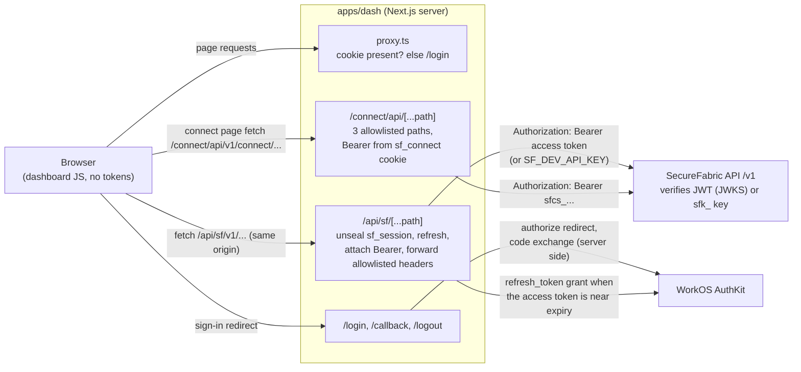
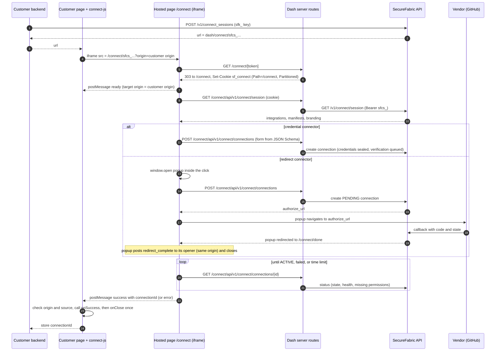

# Part 8: Dashboard, connect UI and clients

This part covers everything that sits in front of the `/v1` API: the Next.js dashboard in `apps/dash` (sign-in, the same-origin API proxy, the environment shell, every page), the hosted connect UI that customers embed, the `@securefabric/connect-js` embedding library, and the pipeline that generates the TypeScript and Python clients from the FastAPI schema. Read it if you work on the frontend, embed the connect flow, change an API model (and therefore the clients), or need to know where credentials live on the browser side.

## Context

The dashboard is not a separate product with its own backend. PD-8 (`../plan/00-README.md`) makes it a client of the public `/v1` API with a second authenticator (a WorkOS session instead of an API key), so every feature an operator or customer sees in the UI is also available to customers' code, and the UI exercises the API continuously. The plan's dashboard principles (`../plan/08-dashboard-and-connect-ui.md`, section 2) follow from that: no private UI backend, types come only from the generated client, and the mock store and simulated data the earlier prototype used are deleted rather than kept behind a switch.

The connect UI has a different audience: our customers' end users, on our customers' websites. It must collect vendor credentials (or start a vendor's OAuth or app-install redirect) without the credentials ever touching the embedding page, and without the session token that authorises it lingering in URLs, history or `Referer` headers (CON-06..CON-09, CAT-04: forms rendered from the connector's JSON Schema with no connector-specific UI code).

The clients exist because a typed contract is the cheapest way to keep three codebases (API, dashboard, customer code) in sync. The API's stable operation ids and fully typed response models ([Part 7](07-public-api-and-events.md)) are there to serve this pipeline.

Security constraints that shaped the browser side:

- Access and refresh tokens must not be readable by browser JavaScript (an XSS in the dashboard must not yield a bearer token).
- The dashboard must not be frameable; the connect page must be.
- Operator access inside a customer's environment must carry a reason that the API audits (OPS-01, OPS-05).

## How it works

### Application layout

`apps/dash` is a Next.js 16 app-router application (React 19, React Compiler on) that depends on three workspace packages: `@securefabric/client` (the generated API client), `@securefabric/ui` (shared components) and `@securefabric/tokens` (design tokens).

| Path | Role |
|---|---|
| `src/app/layout.tsx` | Root layout: Inter font, `Providers`. |
| `src/components/shell/providers.tsx` | `ThemeProvider` (next-themes), one `QueryClient` per mount (TanStack Query), `NuqsAdapter`, tooltip provider, toaster. |
| `src/app/page.tsx` | Home: reads `/v1/me` and `/v1/environments` and redirects to the first environment (`dev` preferred), or to `/dev` when onboarding is needed. |
| `src/app/[env]/layout.tsx` | Wraps every environment page in `EnvShell`. |
| `src/components/shell/shell.tsx` | `useAccount()` (queries `me` and `environments`), `EnvShell` (resolves the `[env]` slug or id to an environment, builds an environment-scoped client, renders onboarding, API-offline, missing-environment or the sidebar frame), `Onboarding`. |
| `src/components/shell/env-context.tsx` | `EnvContext` / `useEnv()`: `{client, devMode, env, environments, me}`; `useHref()` builds links inside the current environment. |
| `src/components/shell/*` | Sidebar (`app-sidebar.tsx`, operator item only when `me.is_operator`), command palette (cmdk), keyboard shortcuts, create-environment dialog. |
| `src/components/views/*.tsx` | One file per page area; the `page.tsx` files are thin wrappers that set metadata and render a view inside `Suspense`. |
| `src/lib/api.ts` | `api` (no environment) and `envClient(id)` (sends `X-Environment-Id`), both `createClient` from `@securefabric/client` pointed at the same-origin `/api/sf` prefix. |
| `src/lib/types.ts` | Aliases of generated schemas (`Me`, `ConnectionOut`, `FindingOut`, `EndpointOut`, ...). A backend model change breaks `tsc` here until the UI catches up. |
| `src/lib/session.ts`, `src/proxy.ts`, `src/app/{login,callback,logout}/route.ts`, `src/app/api/sf/[...path]/route.ts` | Authentication and the API proxy (below). |
| `src/app/connect/**`, `src/components/connect/*`, `src/components/schema-form.tsx`, `src/lib/connect-cookie.ts` | The hosted connect UI (below). |

**Data fetching.** Every view reads through TanStack Query with `unwrap(client.GET(...))` as the `queryFn`, so data and errors are typed end to end: `unwrap` returns the typed 2xx body or throws a `ClientResponseError` carrying the problem+json body (`code`, `errors[]`, `request_id`). Mutations invalidate the relevant query keys. Polling is per view (`refetchInterval`): the overview every 15 to 30 s, status every 10 s, webhook deliveries every 5 s, connection and job views while work is running. Keyset paging uses `useCursorStack()` in `components/kit.tsx`, a stack of cursors so "Previous" returns to exactly the page seen; any filter change calls `reset()` first, which is what keeps the dashboard from ever tripping the API's `cursor_filter_mismatch` 400. Creating POSTs send a fresh `Idempotency-Key` per mutation.

### Authentication

**WorkOS AuthKit, hand-rolled.** The plan assumed WorkOS's Next.js integration; the build uses a small module instead (`src/lib/session.ts`) against the documented AuthKit endpoints (`../research/leen-v2-and-workos.md`):

- `GET /login` stores `{state, returnTo}` in a 10-minute httpOnly `sf_auth_state` cookie and redirects to `{WORKOS_API_URL}/user_management/authorize` with `provider=authkit` (optionally `screen_hint`). In dev-key mode, or when WorkOS is not configured, it redirects straight to `return_to`.
- `GET /callback` checks `state` against the cookie, exchanges the code server-side (`POST /user_management/authenticate` with the client secret), and stores `{access_token, refresh_token, organization_id, user}` in the `sf_session` cookie, sealed with AES-GCM under a key derived (SHA-256) from `WORKOS_COOKIE_PASSWORD` (at least 32 characters). The cookie is httpOnly, `SameSite=Lax`, `Secure` in production, 30 days.
- `GET /logout` deletes the cookie and redirects to WorkOS's session logout URL (using the `sid` claim), which returns to `/login`.

**`proxy.ts`** (Next 16's name for middleware) is an optimistic gate: when WorkOS is configured and no dev key is set, any page request without an `sf_session` cookie is redirected to `/login?return_to=...`. It excludes `/api/*` (the proxy answers 401 itself), `/connect*`, the auth routes and static assets. It does not validate the cookie; the API verifies the token on every call.

**The same-origin proxy (backend for frontend).** `src/app/api/sf/[...path]/route.ts` handles every dashboard API call. It unseals the session, calls `freshSession` (refreshes with the rotating refresh token when the access token expires within 60 s, then re-seals the cookie on the response), and forwards the request to `SF_API_URL` (or `NEXT_PUBLIC_API_URL`) with `Authorization: Bearer <access token>`. Only allowlisted request headers pass (`accept`, `content-type`, `idempotency-key`, `prefer`, `x-connection-id`, `x-environment-id`, `x-organization-id`, `x-request-id`, `x-support-reason`) and only allowlisted response headers return (`content-type`, `idempotent-replayed`, `retry-after`, the `x-ratelimit-*` trio, `x-request-id`, `x-unsupported-filters`). A missing or unreadable session is a problem+json 401 `unauthenticated`; a failed refresh is 401 `session_expired` and deletes the cookie; an unreachable API is 502 `api_unreachable`. Because the browser only ever talks to its own origin, the API needs no CORS configuration for the dashboard, and no token is ever visible to page scripts.

The `x-support-reason` entry matters: the build log records that the proxy originally dropped it, which would have made every operator repair fail with `support_reason_required`. `admin.test.tsx` now checks the header is sent.

**Dev mode (`SF_DEV_API_KEY`).** For local work without WorkOS, setting `SF_DEV_API_KEY` (or the legacy alias `NEXT_PUBLIC_SF_DEV_API_KEY`) to an `sfk_test_` key makes `proxy.ts` skip the gate and the BFF send that key instead of a session. The key is read only in server code. `/v1/me` then reports `kind: "api_key"`, which the shell exposes as `devMode`; session-only pages (team, audit log, onboarding) answer 403 `session_required`, and the operator console shows its gate because a key is never an operator.

**Environment selection.** A WorkOS session can reach every environment of its account, so each request names one: `envClient(env.id)` sends `X-Environment-Id`, resolved from the `[env]` URL segment against `GET /v1/environments`. An API key is bound to one environment, so `/v1/environments` returns only that one.

**Onboarding.** A first sign-in has a WorkOS identity but no account. `/v1/me` returns `needs_onboarding: true`; `EnvShell` renders `Onboarding`, which posts `POST /v1/onboarding {account_name}` and invalidates every query. The API creates the account and its `dev` and `prod` environments, each with its own keys and vault keypair ([Part 2](02-tenancy-identity-and-security.md)).

### Page inventory

All pages live under `/[env]` and use the environment client unless noted.

| Route | View (file) | What it shows | API operations |
|---|---|---|---|
| `/[env]` | `OverviewView` (`overview.tsx`) | Connections by health, findings by severity, recent operations, usage | `GET /connections`, `/organizations`, `/operations`, `/usage`, `/vulnerability_findings/summary` (environment-wide) |
| `/[env]/catalog`, `/catalog/[provider]` | `CatalogView`, `ConnectorView` (`catalog.tsx`) | Connector catalogue from manifests: auth, streams, permissions, capabilities | `GET /connectors`, `/connectors/{id}`, `/integrations` |
| `/[env]/integrations`, `/integrations/[id]` | `IntegrationsView`, `IntegrationView` (`integrations.tsx`) | Enabled connectors, options, write-back toggle, customer-owned vendor apps | `/integrations`, `/vendor_apps`, `GET /connectors/{id}` |
| `/[env]/organizations`, `/organizations/[id]` | `OrganizationsView`, `OrganizationView` (`organizations.tsx`) | End customers; add a connection (credential form, redirect, or a connect link to send) via `AddConnectionDialog` (`add-connection.tsx`) | `/organizations`, `POST /organizations/{id}/connections`, `POST /connect_sessions` |
| `/[env]/connections` | `ConnectionsView` (`connections.tsx`) | Keyset-paged table with organization, state, health | `GET /connections`, `/organizations` |
| `/[env]/connections/[id]` | `ConnectionView` (`connection.tsx`) | Tabs: Overview, Jobs, Findings, Resources, Authorization, Settings; test, reset, re-authorise link | `/connections/{id}`, `/test`, `/health/history`, `/jobs`, `/reset`, `POST /connect_sessions`, data endpoints |
| `/[env]/jobs/[id]` | `JobView` (`connection.tsx`) | Per-stream results and operation log lines; cancel | `GET /jobs/{id}`, `/jobs/{id}/logs`, `POST /jobs/{id}/cancel` |
| `/[env]/findings`, `/[env]/resources` | `FindingsView`, `ResourcesView` (`explorers.tsx`) | Data explorer: scope picker (organization or connection), server-side filters and sort, keyset paging, detail sheet with state history, write-back (`set_state`) | `/vulnerability_findings`, `/{id}`, `/{id}/history`, `/{id}/actions`, `/resources` |
| `/[env]/logs` | `LogsView` (`logs.tsx`) | Operation log | `GET /operations`, `/operations/{id}` |
| `/[env]/metrics` | `MetricsView` (`metrics.tsx`) | Usage rollups (API calls, jobs, records) as charts | `GET /usage` (via `useUsage`) |
| `/[env]/webhooks` | `WebhooksView` (`webhooks.tsx`) | Endpoints, subscriptions, secret shown once, rotate, ping, delivery log, replay one or a range | all `/webhook_endpoints*`, `/webhook_deliveries/{id}/replay` |
| `/[env]/status` | `StatusView` (`status.tsx`) | Database, migrations, workers, queues, alert counts | `GET /status` |
| `/[env]/playground` | `PlaygroundView` (`playground.tsx`) | Request console built from the live OpenAPI document, with a curl equivalent | `GET /openapi.json` (through the proxy), then any operation |
| `/[env]/keys` | `KeysView` (`keys.tsx`) | Create with scopes (shown once), revoke | `/api_keys` |
| `/[env]/settings` | `SettingsView` (`settings.tsx`) | Tabs: General, Connect UI (branding), Team (WorkOS invitations and roles admin/developer/support), Audit log | `PATCH /environments/current`, `/members`, `/audit_events` |
| `/[env]/admin` | `AdminView` (`admin.tsx`) | Operator console: alerts (with runbook, resolve with a note), cross-account search, scheduler, repairs (with confirmation for destructive actions and polling of queued repairs), raw page viewer | `/admin/*` |

Outside `/[env]`: `/` (home redirect), `/login`, `/callback`, `/logout`, `/connect/[token]`, `/connect`, `/connect/done`, `/api/sf/[...path]`, `/connect/api/[...path]`.

### The operator console and its gate

Operator status is a flag on `control.app_user.is_operator`, set only by the break-glass `grant_operator` command in `securefabric_domain/admin.py` (audited). `/v1/me` reports it; the sidebar shows the "Operator console" item only when it is true, and `AdminView` renders `OperatorRequired` otherwise, without calling the admin API. The real gate is the API's `require_operator` (403 `operator_required`); the view also turns that error, if it arrives mid-session (rights revoked), into the gate rather than an error toast. Actions inside a customer environment (repairs, raw pages) require a reason of 5 to 500 characters, sent as `X-Support-Reason` through the proxy and written to that customer's audit log. Search, scheduler and raw-page rows are still `list[dict[str, Any]]` in the API, so `admin.tsx` declares local row interfaces for them; alerts and repair tasks are typed from the schema.

### The hosted connect UI

The connect flow's API side (sessions, single use, redirect validation, verification) is in [Part 6](06-connections-and-connect-flow.md). The UI side:

1. **Link.** The customer's backend calls `POST /v1/connect_sessions` and receives `url = {PUBLIC_DASH_URL}/connect/{sfcs_token}` (valid 30 minutes, single use).
2. **Token swap.** `GET /connect/[token]` (`src/app/connect/[token]/route.ts`) checks the token's shape, sets it in the `sf_connect` cookie (`src/lib/connect-cookie.ts`: httpOnly, `Path=/connect`, `Max-Age=3600`; over HTTPS `SameSite=None; Secure; Partitioned` so it works inside a third-party iframe under CHIPS), and answers 303 to `/connect` with `Cache-Control: no-store` and `Referrer-Policy: no-referrer`. The token leaves the address bar after one hop and is never readable by page JavaScript. The `origin` parameter added by connect-js is preserved.
3. **Connect proxy.** The page calls `/connect/api/...` (`src/app/connect/api/[...path]/route.ts`), which forwards only three paths (`v1/connect/session`, `v1/connect/connections`, `v1/connect/connections/{uuid}`) with `Authorization: Bearer <cookie value>`. Any other path is 404, a missing cookie is 401 `connect_session_missing`. The API itself also refuses `sfcs_` tokens outside `/v1/connect/*`.
4. **Render.** `ConnectFlow` (`components/connect/connect-flow.tsx`) loads `GET /v1/connect/session` (offered integrations with their connector manifests, option presets, branding, `used_at`), lets the user pick an integration (skipped when there is one), shows the permission guide, and then either a credential form or a "continue" button for redirect connectors. Branding (`name`, `logo_url`, `accent_color`, `theme`) comes from the environment's `settings.connect_ui`, edited in Settings.
5. **Forms from JSON Schema.** `components/schema-form.tsx` renders a connector's `credentials_schema` and nothing else (CAT-04): field order from `x-order` then declaration order, `readOnly` fields hidden, `x-secret` as password inputs, enums as selects, numbers typed, defaults with presets winning, and client-side `required`/`pattern`/`minimum`/`maximum` checks. `compactValues` drops empty values. Server-side field errors (`errors[].field` such as `credentials.api_key`) are mapped back onto the inputs. The same component renders the dashboard's own add-connection form.
6. **Redirect vendors.** For a connector whose manifest says `auth.connect = "redirect"` (GitHub App install, OAuth), the page opens a blank popup synchronously inside the click (so popup blockers allow it), then posts `POST /v1/connect/connections` and points the popup at the returned `authorize_url`. A vendor cannot be framed, so this step always leaves the iframe. The vendor redirects to the API callback, which redirects the popup to `/connect/done?connection_id&status`; `ConnectDone` posts `redirect_complete` to its opener (same origin only) and closes. Opened directly (no opener), it shows the outcome itself.
7. **Verification.** `usePollStatus` polls `GET /v1/connect/connections/{id}` until the connection is ACTIVE (success, with any `missing_permissions`), shows a `pending_detail` or DELETED (failure), or a time limit passes ("we'll keep trying").
8. **Report to the embedder.** `components/connect/protocol.ts` defines the messages (`ready`, `success`, `error`, `close`, `redirect_complete`), all stamped `source: "securefabric-connect"`. `notifyParent` posts to `window.parent` when framed or `window.opener` when in a popup, always with an explicit target origin taken from the `origin` query parameter; `parentOrigin` accepts only `https:` origins or `localhost`/`127.0.0.1`, and with no valid origin nothing is posted.

Framing policy is set in `next.config.ts`: every route except `/connect*` sends `Content-Security-Policy: frame-ancestors 'none'` and `X-Frame-Options: DENY`; `/connect` and `/connect/*` send `frame-ancestors *` and `Referrer-Policy: no-referrer`.

### `@securefabric/connect-js`

`packages/connect-js/src/index.ts` is a framework-free embedding library; `src/react.ts` adds `useSecureFabricConnect` and `ConnectButton`. `SecureFabric.connect({url | token+baseUrl, mode, onSuccess, onError, onClose, onEvent}).open()`:

- `resolveTarget` validates the link (path `/connect/sfcs_...`, HTTPS except on localhost), strips any query or hash, appends `origin=<embedder origin>`, and records the link's origin as the only trusted message origin.
- `mode: "modal"` (default) mounts a full-screen dialog with an iframe sandboxed to `allow-scripts allow-same-origin allow-forms allow-popups allow-popups-to-escape-sandbox`, locks page scroll, and closes on Escape, the close button, a backdrop click or a `close` message. `mode: "popup"` opens a window instead (for browsers that block third-party cookies) and watches for it to close; a blocked popup reports `popup_blocked`.
- `onMessage` accepts a message only if `event.origin` equals the link's origin, `event.source` is the frame or popup this call opened, and the payload has the `securefabric-connect` source. `success` and `error` map to the callbacks; `onClose` fires exactly once however the flow ends.
- The React hook reads the latest options when `open()` runs (inline callbacks are safe) and closes the flow on unmount.

### Generated clients

**TypeScript (`packages/client`).** The pipeline is FastAPI models → `securefabric_api.openapi.build_schema()` (the `securefabric-openapi` entry point) → `openapi-typescript --enum-values --default-non-nullable=false` → `packages/client/src/v1.ts` (about 12,600 lines, `paths`, `components`, `operations`). `pnpm -F @securefabric/client generate` (or `make generate`) rewrites it; `pnpm dev` in the package watches the Python sources and regenerates on change (`sync` regenerates only when `check-generated` fails). `src/index.ts` wraps `openapi-fetch`:

- `createClient(baseUrl, {token, headers, fetch})` returns a typed client whose `GET/POST/...` are checked against `paths`.
- `unwrap(promise)` returns the typed body or throws `ClientResponseError` (`code`, `status`, `requestId`, `errors`, `fieldErrors`), with subclasses `NotFoundResponseError`, `ValidationResponseError`, `TooManyRequestsResponseError` (`retryAfter`). Non-problem errors get a synthetic problem with `code: http_<status>`.
- `isApiError(error, code?)`, `RequestBody<"tag:operation">`, and re-exports of `paths`, `components`, `operations`.

**Drift gate.** `check-generated` regenerates into `--check` mode and fails if `v1.ts` differs from what the current API would produce. It runs in three places: the husky `pre-commit` hook (only when staged files touch `apps/api`, `packages/core|domain|tasks` Python or `v1.ts`), the `pre-push` hook (`turbo run typecheck check-generated`), and CI (`make verify` runs `turbo lint typecheck test check-generated check-tokens`). The dashboard typechecks against `v1.ts`, so an API change that the UI does not handle fails `tsc` in `apps/dash`.

**Publish readiness.** `package.json` exports the TypeScript sources inside the workspace and switches to `dist/*.js` and `dist/*.d.ts` through `publishConfig` (`pnpm -F @securefabric/client build`). The build log records a packed tarball installed into a scratch project under strict NodeNext with `skipLibCheck` off, and live calls; it also records two fixes found that way (declarations that violated openapi-fetch's constraint, a `.d.ts` import without an extension). Publishing is blocked on the owner's decision (`progress.md`, "Blocked on the owner").

**Python (`clients/python`).** `scripts/gen_python_client.py` (`make generate-python-client`) builds the same schema, shortens each operation id to its function name (failing on duplicates; the TS side keeps `tag:name`), and runs `openapi-python-client generate` with `clients/python-client.yaml` (package `securefabric_client`, ruff post-hooks). The output is a standard generated package: `client.py` (`Client`, `AuthenticatedClient`), `api/<tag>/<operation>.py` with `sync`/`asyncio` variants, `models/`, `types.py`, `errors.py`, built with `uv_build`. It is committed, validated live once per the build log, and not published.

### `packages/ui` and `packages/tokens`

`@securefabric/tokens` holds the design tokens in `src/tokens.ts` and generates `src/theme.css` and the token block of `DESIGN.md` (`scripts/generate.mjs`); `check-tokens` (part of `make verify`) fails on stale output, checks colour contrast (`scripts/check-contrast.mjs`) and lints `DESIGN.md`. `@securefabric/ui` is a shadcn-style component set on Base UI (button, card, input, dropdown, tooltip, sonner, ...) with `globals.css`, which imports the token theme; the dashboard imports `@securefabric/ui/globals.css` in `src/index.css` and uses its components alongside app-local ones in `src/components/ui`.

## Invariants and how they are enforced

| Guarantee | Mechanism | Test |
|---|---|---|
| The dashboard and clients are typed from the live API schema | `check-generated` in pre-commit, pre-push and CI; `lib/types.ts` aliases | CI `make verify`; `apps/api/tests/test_openapi.py::test_every_response_field_is_typed` |
| The client maps problem+json to typed errors and sends the bearer token | `unwrap`, `errorFor`, `createClient` | `packages/client/src/index.test.ts`: "maps problem details to NotFoundResponseError", "exposes per-field errors", "reads Retry-After on 429", "falls back to a synthetic problem for non-problem errors", "sends the bearer token" |
| Keyset paging in the UI walks forward and back without changing filters mid-walk | `useCursorStack`, `reset()` on filter change | `apps/dash/src/components/views/connections.test.tsx`: "pages with the keyset cursor and comes back" |
| Non-operators never call the admin API; `operator_required` shows the gate | `me.is_operator` check, `DenyContext` | `admin.test.tsx`: "shows the gate to a non-operator without calling the admin API", "shows the gate, not an error, when the API answers operator_required" |
| Operator repairs carry a reason, destructive ones need confirmation | Reason field, `X-Support-Reason` forwarded by the proxy, confirm dialog | `admin.test.tsx`: "needs a support reason and sends it as X-Support-Reason", "asks before a reset and sends wipe", "sends nothing when a reset is cancelled" |
| Credential forms come only from the connector's JSON Schema, secrets masked | `schema-form.tsx` | `schema-form.test.tsx`: "orders by x-order, then declaration order, and hides readOnly fields", "checks required, pattern and range", "renders every field from the schema, in order, with secrets masked", "reports typed values, numbers as numbers" |
| connect-js trusts only the link's origin and the window it opened | `resolveTarget`, `onMessage` origin and source checks | `packages/connect-js/src/index.test.ts`: "ignores messages from other origins, other windows, and other shapes", "opens a window and trusts only it", "rejects links that are not connect links, non-https links and missing input" |
| connect-js calls `onClose` exactly once and stops listening after close | `close()` guard | `index.test.ts`: "closes on Escape, on a close message, and calls onClose exactly once", "stops listening after close" |
| The React wrapper uses the latest callbacks and closes on unmount | `latest` ref, effect cleanup | `react.test.ts`: "opens the flow, forwards success with the latest callback, and closes on unmount" |
| Tokens never reach browser JavaScript | Sealed httpOnly `sf_session`; BFF attaches the bearer; `sf_connect` httpOnly and path-scoped | No automated test of the route handlers; validated live (token swap 303, reuse 410; WorkOS sign-in by the owner) per `progress.md` |
| The dashboard cannot be framed; the connect page can | `next.config.ts` headers | No automated test |

## Failure modes

**API down or unreachable.** The BFF returns 502 `api_unreachable`; `EnvShell` shows "Can't reach the SecureFabric API" with the configured URL and a retry button. The connect proxy returns a 502 problem with a user-facing message.

**Access token expired.** The BFF refreshes it transparently (60 s margin) and re-seals the cookie. If the refresh fails (refresh token revoked or already rotated), the response is 401 `session_expired` and the cookie is deleted; the next page load goes to `/login`.

**Concurrent refreshes.** Several API calls that arrive just before expiry each refresh with the same refresh token. WorkOS rotates refresh tokens on use, so the later refreshes can fail and log the user out. There is no single-flight around `freshSession` (see Known gaps).

**WorkOS misconfigured.** Without `WORKOS_CLIENT_ID`, `WORKOS_API_KEY` and `WORKOS_COOKIE_PASSWORD`, `proxy.ts` lets requests through and `/login` redirects back; every API call then fails with 401 from the BFF. A short cookie password throws at seal time.

**Connect link problems.** A malformed token redirects to `/connect?error=invalid_link`; an expired or used session is a 410 from the API, rendered as a named error state by `Gate`/`sessionError`. Opening the link in a different browser than the one that swapped it yields 401 `connect_session_missing`. A blocked vendor popup falls back to navigating the frame (`window.location.assign`), which the vendor will usually refuse to render in a frame. Verification that outlasts the polling limit tells the user to close the window; the connection keeps verifying server-side and the embedder can read its state through the API.

**Third-party cookies blocked.** In the modal, the partitioned cookie normally survives; where it does not, `mode: "popup"` runs the flow first-party.

**Stale generated client.** A commit that changes API models without regenerating `v1.ts` is stopped by the pre-commit hook; a push by the pre-push hook; a PR by CI.

## Extending it

**Adding a page.** Add `src/app/[env]/<route>/page.tsx` (metadata plus a view in `Suspense`), put the view in `src/components/views/<area>.tsx`, read data with `useEnv().client` and `useQuery({queryFn: () => unwrap(client.GET(...))})`, alias any new schema in `src/lib/types.ts`, and add a nav entry in `src/lib/nav.ts` (`NAV_GROUPS`). If the page needs data the API does not expose, add an endpoint ([Part 7](07-public-api-and-events.md)); the dashboard has no private backend. A new header the page must send has to be added to `FORWARD_REQUEST` in the BFF route, and a new response header to `FORWARD_RESPONSE`.

**Changing an API model.** Change the Pydantic model, run `make generate`, fix the TypeScript errors in `apps/dash`, commit `v1.ts` with the change, and regenerate the Python client with `make generate-python-client` if it is being kept current.

**Supporting a new connector in the connect UI.** Nothing in the UI changes: provide `credentials_schema` (with `title`, `description`, `x-order`, `x-secret`, `pattern`, `enum`, `default`) and the permission guide in the manifest, or declare `auth.connect: redirect` with an authorize plan ([Part 5](05-connector-platform.md), [Part 6](06-connections-and-connect-flow.md)).

**Adding a connect message type.** Extend the union in `src/components/connect/protocol.ts`, emit it with `notifyParent`, and handle it in `packages/connect-js/src/index.ts` (`onEvent` already forwards unknown types).

## Known gaps and open questions

- **Open redirect after sign-in.** `/callback` accepts `returnTo` if it starts with `/`, so `//evil.example` passes and `new URL("//evil.example", request.url)` resolves to another host (`src/app/callback/route.ts`, `return_to` from `/login`). It should require a single leading slash.
- **The connect page may be framed by any site.** `next.config.ts` sends `frame-ancestors *` for `/connect`; the plan specified the environment's allowed origins. The embedder's `origin` parameter is trusted for the postMessage target without checking it against the environment's allowed redirect origins, so any site holding a valid link can embed the flow and receive its result messages.
- **No tests for the server routes.** The BFF proxy, session sealing and refresh, the login/callback/logout routes, `proxy.ts`, the connect token swap and the connect proxy allowlist have no automated tests; they were validated live.
- **Refresh race.** `freshSession` has no single-flight; concurrent refreshes against rotating WorkOS refresh tokens can sign the user out (inferred from the code and WorkOS's documented rotation, not observed).
- **Secrets created from the dashboard are retained by the API's idempotency store.** The keys and webhooks views send `Idempotency-Key` on create, so the one-time `sfk_` key and `whsec_` secret are stored in plaintext in `control.idempotency_key` for 24 h ([Part 7](07-public-api-and-events.md), Known gaps).
- **A large unused table kit.** `src/components/data-table`, `src/lib/data-table`, `src/lib/store`, `src/lib/table-schema`, `src/lib/table` and `src/lib/filters` (about 17,700 lines, with their own tests) are not imported by any page; the explorers use plain queries with `useCursorStack`. The plan intended to adapt this kit to the API's paging and keep table state in the URL with `nuqs`; instead filters, sort and cursor live in component state, so table views are not shareable by URL.
- **Stale app README.** `apps/dash/README.md` still describes the removed mock (`/api/v1/workspace`, `src/lib/store.ts`, `src/lib/catalog.ts`, "still simulated in the browser") and says the API must allow the dashboard's origin via CORS, which the proxy makes unnecessary.
- **Python client has no drift gate.** Nothing checks `clients/python` against the schema, and `gen_python_client.py` runs `uvx --from openapi-python-client` without a version pin, so regenerations are not reproducible. Neither client is published (owner decision).
- **Untyped admin responses.** Operator search, scheduler and raw-page endpoints return `list[dict[str, Any]]`; `admin.tsx` mirrors the SQL shapes by hand.
- **Request console depends on `/openapi.json`.** With `API_DOCS_ENABLED=false` (likely in production), the playground cannot load its operation list.
- **No documentation site.** DX-01's generated docs site (plan section 7) is not built; the API serves Swagger at `/docs` when docs are enabled, and guides live in `docs/guides`.
- **Organization-scoped explorers lag by 5 s.** The Findings and Resources pages read with `X-ORGANIZATION-ID` by default, so rows changed in the last five seconds are hidden ([Part 7](07-public-api-and-events.md)).

## Further reading

- Plan: `../plan/08-dashboard-and-connect-ui.md`, `../plan/03-tenancy-connections-vault.md` (sessions, connect flow), `../plan/00-README.md` (PD-8)
- Research: `../research/leen-v2-and-workos.md` (AuthKit endpoints and claims)
- Package READMEs: `../../packages/connect-js/README.md`, `../../packages/client/README.md`, `../../clients/python/README.md`, `../../packages/tokens/DESIGN.md`
- Guides: `../guides/webhooks.md`, `../guides/leen-migration.md`
- Related parts: [Part 2](02-tenancy-identity-and-security.md) (principals, sessions, operator flag), [Part 6](06-connections-and-connect-flow.md) (connect sessions and verification), [Part 7](07-public-api-and-events.md) (the API these clients target), [Part 9](09-operations-and-reliability.md) (operator console backend, alerts)
