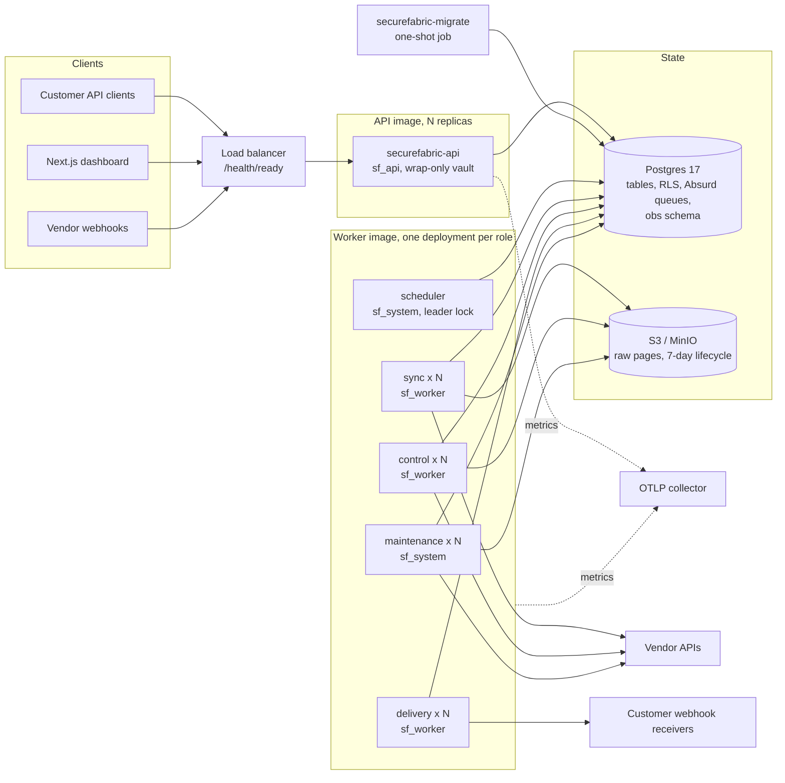
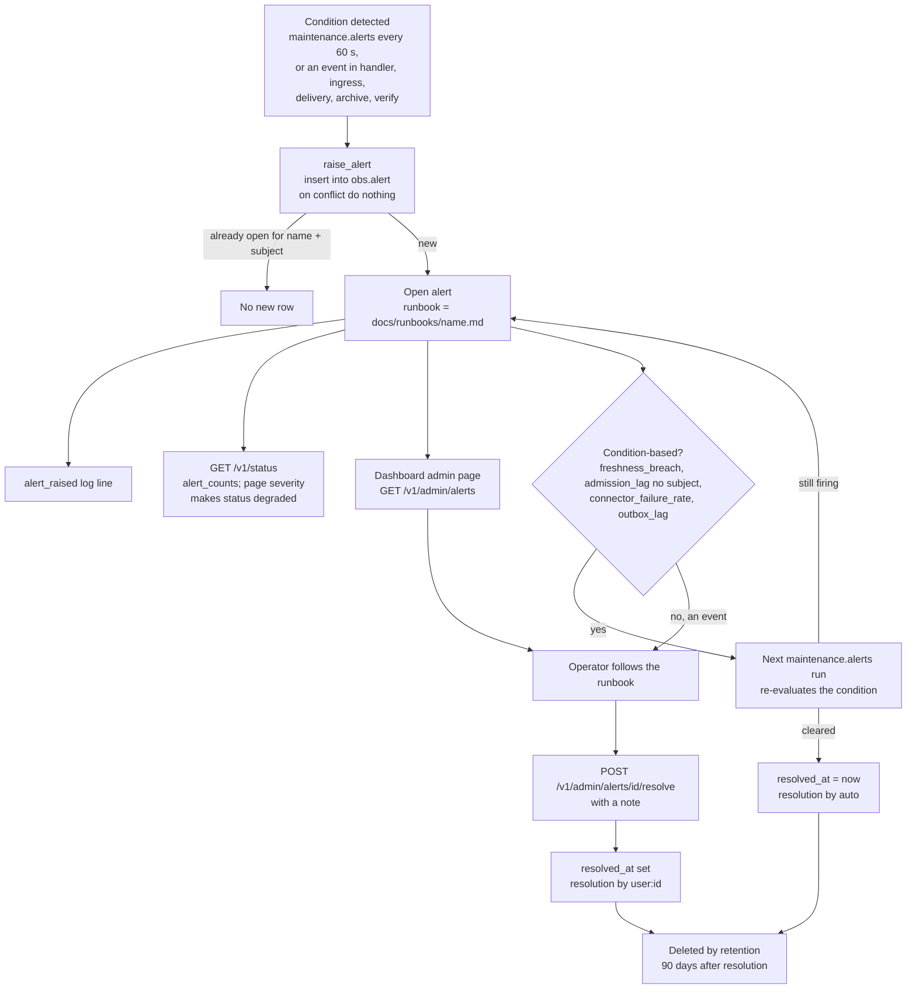
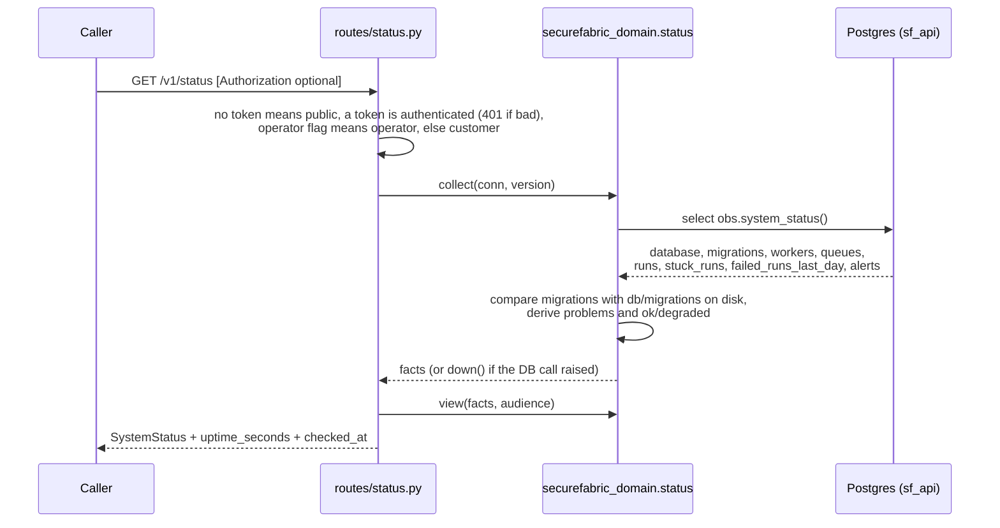

# Part 9: Operations and reliability

This part describes how SecureFabric is deployed, observed and kept healthy: the two images and the worker roles, configuration and migrations, logs, the operation log, metrics, alerts and runbooks, the status endpoint, the maintenance jobs, the operator console, the measured performance, the drills, key rotation, and the CI gates. Read it if you will run the platform, go on call for it, add an alert or a maintenance job, or need to know what has been proven under load and what has only been run on a laptop.

## Context

SecureFabric is a multi-tenant platform whose work is mostly asynchronous: scheduled syncs, inbound vendor webhooks, outbound customer webhooks, and housekeeping. The operational design follows from a few constraints in the plan ([part 9](../plan/09-operations-security-quality.md), [part 1](../plan/01-architecture.md)):

- **Postgres is the only coordination point.** Durable tasks run on Absurd inside Postgres (PD-1), so there is no Redis, no message broker and no separate scheduler service to operate. The only other stateful dependency is an S3-compatible object store for the 7-day raw page archive (STORE-10), which holds re-fetchable data and is not backed up.
- **The vault boundary shapes the deployment.** Vendor credentials are sealed to a per-environment key that only worker processes can open (PD-4). The API process never holds the master key, so roles differ in what secrets they are given, not only in what code they run.
- **Three audiences** need different views: customers (their connections' health, jobs and operation logs, OBS-01/02), operators (any account, read-only by default, audited, OPS-01/05), and the engineer on call (metrics, logs, alerts, OPS-02/03).
- **Every alert ships with a runbook** (OPS-02, OPS-06), written in the same change.
- **Housekeeping is idempotent and runs on one queue** (STORE-12): partitions, retention, purge on day 30 (CON-04), token refresh (AUTH-05), redelivery, usage rollup (BILL-01).
- **Non-functional targets** come from the plan's benchmark gates ([part 10, section 8](../plan/10-delivery-plan.md)): data API latency (NFR-04), ingest throughput (NFR-05), year-one size (NFR-06), scale-out (NFR-07), outbox delivery (NFR-03), restore (NFR-08) and zero-downtime deploys (NFR-09).

## How it works

### Deployment shape

There is one `Dockerfile` at the repository root for every Python app. `--build-arg APP=api|worker --target runtime` builds a slim, non-root (uid 10001) image that contains only that app's dependency closure, installed non-editable into `/opt/venv`, plus `db/migrations` at `/app/db/migrations`. The `CMD` is `exec ${APP_ENTRYPOINT}` so the entrypoint (`securefabric-api` or `securefabric-worker`) is PID 1 and receives SIGTERM directly. A `dev` target installs every workspace package editable for bind-mounted hot reload. Two auxiliary images under `docker/` wrap Absurd's tools: `docker/habitat` (Absurd's read-only web dashboard, no authentication, local only) and `docker/absurdctl`.

The **API image** runs uvicorn (`apps/api/src/securefabric_api/__main__.py`) with `proxy_headers=True` and `API_WORKERS` processes. It is stateless apart from the in-memory rate-limit window, which is synchronised through Postgres every second (`apps/api/src/securefabric_api/ratelimit.py` calling `obs.flush_api_calls()`), so API instances scale horizontally behind any load balancer that uses `GET /health/ready` (database ping; 503 when it fails) and `GET /health/live`.

The **worker image** runs `securefabric-worker --role <role>` (`apps/worker/src/securefabric_worker/main.py`). `WORKER_ROLE` (or `--role`) takes a role name, a comma list, or `all`:

| Role | Queues (`securefabric_tasks.ROLE_QUEUES`) | DB role | Holds | Scales |
|---|---|---|---|---|
| `scheduler` | none; runs the `Scheduler` loop | `sf_system` | no vault keys | singleton, leader-elected |
| `sync` | `sync_interactive`, `sync_bulk` | `sf_worker` | master key, payload keys | horizontally |
| `control` | `control` (verify, connect completion, ingress, passthrough, operator repairs, raw page reads, actions) | `sf_worker` | master key, payload keys | horizontally |
| `delivery` | `delivery` (outbound webhooks) | `sf_worker` | master key (to open signing secrets) | horizontally |
| `maintenance` | `maintenance` (`maintenance.run`) | `sf_system` | master key, payload keys | horizontally (jobs are idempotent) |
| `all` | every role in one process | | | local development |

`ROLE_QUEUES` also defines `sync-interactive` and `sync-bulk` to split the two sync pools onto separate deployments; those names are not in `ROLE_PLATFORM`, so they build their platform with the `control` role (same DB role and keys as `sync`, but `vault.opens` metrics are labelled `control`).

Each queue role gets its own `AsyncAbsurd` client and `Platform` (`securefabric_domain.runtime.build_platform`), which opens role-bound pools: every connection logs in with the migrating user and immediately runs `SET ROLE sf_api | sf_worker | sf_system` plus `statement_timeout = 60s` (`packages/db/src/securefabric_db/pool.py`). Which secrets a process can use is decided in `build_platform`: only `sync`, `control`, `delivery`, `maintenance` (and tests) get a `LocalKeyProvider` that can unwrap; the API gets a wrap-only provider from `VAULT_KEK_PUBLIC_KEY` (derived from the master key in local development); only `sync`, `control`, `maintenance` get the `PayloadKeyring`.

**The scheduler is a singleton.** `Scheduler.run_forever` (`packages/domain/src/securefabric_domain/sync/scheduler.py`) opens a dedicated autocommit connection and takes `pg_try_advisory_lock(727401002)`. Followers retry every 5 seconds; the leader reconciles all schedules (`reconcile_all_schedules`), then `LISTEN`s on `sf_admit` and `sf_outbox` and ticks every `WORKER_SCHEDULER_INTERVAL` (1 s) or on a notify. If the leader's connection drops, the session lock is released by Postgres and another scheduler takes over within about 5 seconds. Running several `all` workers (`make scale-worker n=4`) is therefore safe: they all compete for the lock and only one schedules.

**Liveness.** Every worker process upserts `obs.worker_heartbeat` every 5 seconds (`apps/worker/src/securefabric_worker/heartbeat.py`) and deletes its row on clean exit. A worker counts as online if `last_seen_at` is under 20 seconds old.

### Compose stacks

`compose.yaml` is the production-like stack (`make up`): `postgres:17-alpine` with a healthcheck and an init script that creates `securefabric_test`; MinIO (a Chainguard image pinned by digest, since MinIO stopped publishing community images to Docker Hub), bound to 127.0.0.1; a one-shot `migrate` service running `securefabric-migrate`; `api` (healthcheck on `/health/ready`) and `worker` (`stop_grace_period: 30s`), both waiting for `migrate` to complete. The `worker` service sets no `WORKER_ROLE`, so it runs `all`. `habitat` and `absurdctl` sit behind the `tools` profile. `compose.dev.yaml` (`make stack`) overlays a single `dev` image with the repository bind-mounted: uvicorn `--reload` for the API and `watchfiles --sigint-timeout=20 securefabric-worker` for the worker. Day-to-day development (`make dev`) runs only Postgres and MinIO in Docker and the API, worker and dashboard on the host.

### Configuration

All configuration is environment variables read by pydantic settings classes, with `.env` as a fallback file (real environment variables win):

| Class | Prefix | Where | Notable fields |
|---|---|---|---|
| `BaseServiceSettings` | per service | `packages/core/src/securefabric_core/settings.py` | `environment`, `log_level`, `log_format` (console or json) |
| `ApiSettings` | `API_` | `apps/api/src/securefabric_api/config.py` | host, port, workers, reload, CORS, docs, rate limit |
| `WorkerSettings` | `WORKER_` | `apps/worker/src/securefabric_worker/config.py` | `role`, `worker_id` (default `hostname:pid`), `concurrency` (4), `claim_timeout` (300 s), `poll_interval`, `scheduler_interval` |
| `DatabaseSettings` | `DATABASE_` | `packages/db/src/securefabric_db/settings.py` | url, pool sizes, timeouts |
| `PlatformSettings` | none | `packages/core/src/securefabric_core/platform.py` | `REGION`, public URLs, `VAULT_KEY_PROVIDER`, `VAULT_MASTER_KEY`, `VAULT_KEK_PUBLIC_KEY`, `INGRESS_KEY`, `PAYLOAD_KEYS`, `API_KEY_PEPPER`, `CURSOR_SIGNING_KEY`, `BLOB_*`, `WORKOS_*`, `GITHUB_APP_*`, `NVD_API_KEY`, `EGRESS_ALLOW_PRIVATE` |
| OpenTelemetry | `OTEL_` | standard SDK variables | `OTEL_EXPORTER_OTLP_ENDPOINT`, `OTEL_METRIC_EXPORT_INTERVAL` |

Secrets are `SecretStr` so they never print. `.env.example` documents every variable. If `BLOB_ENDPOINT` and both blob keys are not set, `build_platform` silently falls back to an in-process `MemoryBlobStore`, which is fine for tests but loses the archive on restart.

### Migrations

`securefabric-migrate` (`packages/db/src/securefabric_db/migrate.py`) is a forward-only runner. It applies `db/migrations/*.sql` in lexical order, each file in its own transaction, under `pg_advisory_lock(727401001)` so several replicas booting at once serialise. Each applied file is recorded in `public.schema_migrations` with a SHA-256 checksum; editing an applied file makes every later run fail with a checksum mismatch. `--status` lists applied and pending versions. The runner is the one-shot `migrate` service in compose and should be a pre-deploy job in production. The migrations this part depends on:

| Migration | Adds |
|---|---|
| `0002_platform.sql` | the `obs` schema (`operation`, `operation_event`, `audit_event`, `usage_event`, `usage_daily`, `api_rate_counter`, `worker_heartbeat`, `alert`), partition helpers `sf_ensure_partitions` / `sf_drop_partitions_before` (executable by `sf_system` only), the five Absurd queues, role grants |
| `0004_operator.sql` | SECURITY DEFINER `control.operator_search`, `control.operator_scheduler`, `control.operator_environment` |
| `0005_operator_grants.sql` | the same functions for `sf_worker` (repairs run in workers) |
| `0006_system_status.sql` | SECURITY DEFINER `obs.system_status()` |
| `0007_api_usage_flush.sql`, `0008_api_usage_flush_fix.sql` | SECURITY DEFINER `obs.flush_api_calls()` (0008 fixes an ambiguous column in `ON CONFLICT`) |

Expand-and-contract across releases (NFR-09) is a convention, not something the runner enforces.

### Graceful shutdown and rolling deploys

The API relies on uvicorn's drain on SIGTERM: stop accepting, finish in-flight requests, run the lifespan exit (stop the rate limiter, which flushes, then close pools). The rolling-deploy drill (below) proves zero failed requests when a balancer health-checks `/health/ready`.

Workers install SIGINT and SIGTERM handlers that set a stop event. Each queue worker then calls `client.stop_worker()` (stop claiming), waits up to 30 seconds for the claim loop to finish, and closes its pools; the scheduler leaves its loop and releases the advisory lock with its connection; the heartbeat row is deleted. A sync slice that is still running when the process exits keeps its Absurd lease until `WORKER_CLAIM_TIMEOUT` (300 s) expires, after which another worker reclaims it and resumes from the last saved checkpoint ([Part 4](04-sync-engine.md)). If any component task crashes, the worker logs `worker_component_crashed` and stops the whole process, so the orchestrator restarts it rather than leaving a half-alive worker.

### Logging and redaction

`configure_logging` (`packages/core/src/securefabric_core/logging.py`) routes structlog and the standard library (including uvicorn) through one handler: context variables, level, logger name, ISO UTC timestamp, then exception formatting in JSON mode, and **redaction as the last step before rendering** (SEC-07). `securefabric_core.redact` replaces values whose key matches a sensitive-name pattern (secret, token, password, authorization, api key, private key, cookie, signature, pepper, master key...) with an allowlist of harmless names such as `secret_type`, and scrubs value patterns anywhere in strings: GitHub tokens (`ghp_`, `github_pat_`...), our own API keys (`sfk_live|test_...`), connect session tokens (`sfcs_`), webhook secrets (`whsec_`), JWTs, PEM private keys, bearer tokens, AWS access keys and Stripe-style keys. `register_secret` adds literal values per process (canary credentials in tests).

The API middleware (`apps/api/src/securefabric_api/middleware.py`) assigns or propagates `X-Request-Id` (`req_<hex>`), binds it into the log context and writes one `request` access line per call with method, path, status and duration; bodies are never logged. Code that handles exceptions which might carry credentials logs only the exception type (for example `record_verify_crash` in `connections.py`); the full traceback stays on the Absurd run, readable by operators.

### The operation log (customer-visible)

Every logical action (a stream run, a verification, an auth refresh, an action, an inbound or outbound webhook, a passthrough request) opens an `obs.operation` row with `kind`, `action`, `status`, links to the connection, job, run and request id, and a redacted `summary`. Lines go to `obs.operation_event` (`level`, `kind` = `log` or `http`, `message`, `http` metadata). `OperationLog` (`packages/domain/src/securefabric_domain/sync/oplog.py`) buffers up to 200 lines, redacts every message and field, truncates to 4,000 characters and flushes in its own tenant transaction; request and response bodies and headers are never stored. Connector code logs through `ctx.log`, so its output lands here rather than on stdout.

Customers read it with `GET /v1/operations` (filters `kind`, `status`, `connectionId`, `jobId`, `since`; keyset paging, newest first; defaults to the last 30 days, the retention of these daily partitions, OBS-03), `GET /v1/operations/{id}` (up to 5,000 lines) and `GET /v1/jobs/{id}/logs`. Both tables are RLS-protected and daily-partitioned (`apps/api/src/securefabric_api/routes/ops.py`, `packages/domain/src/securefabric_domain/ops.py`).

### Metrics

All instruments are defined once in `packages/core/src/securefabric_core/telemetry.py` (`Instruments`, OPS-03). `configure_telemetry` installs an OTLP/HTTP `PeriodicExportingMetricReader` only when `OTEL_EXPORTER_OTLP_ENDPOINT` is set, with `service.name` (`securefabric-api` or `securefabric-worker`) and `deployment.environment`; otherwise the OpenTelemetry API's no-op meter makes every call free. **Attributes are low-cardinality by rule**: connector, stream, route template, status class, outcome, role, state, priority, object type. Never tenant, connection or run ids. The API records routes as templates (`route_template` rebuilds `/v1/connections/{connection_id}` from the matched path parameters), and `status_class` keeps 429 apart from other 4xx.

| Metric | Type | Attributes | Emitted from |
|---|---|---|---|
| `securefabric.vendor.request.duration` (s) | histogram | `connector`, `status_class` | `securefabric_cdk.http.HttpClient._observe` |
| `securefabric.vendor.requests` | counter | `connector`, `status_class` | same |
| `securefabric.run.duration` (s) | histogram | `connector`, `stream`, `outcome` | `sync/handler.py` `_observe`, per slice |
| `securefabric.run.vendor_requests` | histogram | `connector`, `stream` | same |
| `securefabric.records.written` | counter | `connector`, `stream`, `change` (added, updated, deleted) | same |
| `securefabric.records.quarantined` | counter | `connector`, `stream` | same |
| `securefabric.scheduler.admission_lag` (s) | gauge | none | `Scheduler.record_gauges`, every 10 ticks |
| `securefabric.scheduler.runs` | gauge | `state`, `priority` | same |
| `securefabric.scheduler.schedule_lateness` (s) | gauge | none | same |
| `securefabric.events.outbox_lag` (s) | gauge | none | same |
| `securefabric.store.batch_write.duration` (s) | histogram | `object_type` | `records.py`, around `_apply_batch` (includes lock wait) |
| `securefabric.api.request.duration` (s) | histogram | `route`, `method`, `status_class` | API middleware (health probes excluded) |
| `securefabric.api.rate_limited` | counter | none | `apps/api/src/securefabric_api/deps.py` |
| `securefabric.events.webhook_deliveries` | counter | `outcome` (delivered, retry, dead, permanent) | `events/delivery.py` |
| `securefabric.vault.opens` | counter | `role`, `purpose` | `vault.py`; a rise is a security signal |

The scheduler gauges are only emitted by the leader. There are no traces yet; only metrics are exported.

### Audit events and usage metering

`obs.audit_event` (monthly partitions, 366 days) is append-only for every application role (`revoke update, delete` in `0002_platform.sql`). `tenancy.audit` records `actor_kind` (`user`, `api_key`, `support`, `system`, `connect_session`), actor id, action, target, IP, user agent, request id and detail. Operator actions are recorded as `support` because the support principal carries `extra.support`. Tenants read their own rows through `GET /v1/audit_events` (`routes/me.py`). Operationally relevant actions include `support.access`, `support.<repair>`, `support.raw_page_viewed`, `operator.granted`, `maintenance.retention` and `connection.purged`.

Usage (BILL-01, read-only BILL-03) is raw events in `obs.usage_event` (`api.calls` from the rate-limit flush, `job.finished` from the scheduler's job roll-up, `connection.active` on activation) and a daily rollup in `obs.usage_daily` written by the `usage_rollup` job. SANDBOX and `is_sandbox` connections never count toward `active_connections`. `GET /v1/usage` returns live counts, the daily series and API calls by hour for the last 24 hours.

### Alerts

An alert is a row in `obs.alert` (`name`, `severity` of `page`, `ticket` or `info`, `subject`, `detail`, `runbook`, `raised_at`, `resolved_at`). `raise_alert` (in `sync/scheduler.py`) inserts with `on conflict (name, coalesce(subject, '')) where resolved_at is null do nothing`, so an open alert for the same name and subject is never duplicated, and writes an `alert_raised` warning log line. The runbook path comes from `securefabric_domain.obs.RUNBOOKS`, which maps each name to `docs/runbooks/<name>.md`.

| Alert | Severity | Raised by | Trigger | Closes |
|---|---|---|---|---|
| `freshness_breach` | ticket | `maintenance.alerts` | an ACTIVE, HEALTHY connection's STARTED stream has `last_success_at` older than its interval plus 1 hour (NFR-02); subject `connection/stream` | auto, per subject |
| `admission_lag` (no subject) | page | `maintenance.alerts` | oldest admissible run (`QUEUED`, `PARKED`, `RETRY_WAIT` with `not_before <= now()`) older than 5 minutes | auto |
| `admission_lag` (`run <id>`) | page | `Scheduler.expire` | a run QUEUED for over an hour is EXPIRED (`EXECUTION_TIMEOUT`) | operator |
| `connector_failure_rate` | page | `maintenance.alerts` | at least 10 runs of a connector finished in 10 minutes and over 20% failed with `VENDOR_SERVER_ERROR` or `RATE_LIMIT_EXCEEDED` (RATE-08); subject the connector id | auto, per connector |
| `outbox_lag` | page | `maintenance.alerts` | oldest undispatched outbox event older than 2 minutes | auto |
| `sweep_aborted` | page | `sync/handler.py` | the sweep guard refused a deletion pass | operator |
| `quarantine_spike` | ticket | `sync/handler.py` | quarantined records above 1% of a slice's records | operator |
| `internal_error` | page | `sync/handler.py`, `connections.record_verify_crash` | a run FAILED with `INTERNAL_ERROR`, or a verification crashed on its final attempt | operator |
| `dead_deliveries` | ticket | `events/delivery.py` | a webhook endpoint was auto-disabled after 5 days failing | operator |
| `refresh_failures` | page | `maintenance.token_refresh` | at least 3 refresh failures in a sweep and no fewer failures than successes | operator |
| `ingress_signature_failures` | ticket | `ingress.py` | 10 or more rejected inbound signatures for one vendor app within 60 s in one API process | operator |
| `partition_manager_behind` | page | `maintenance.partitions` | rows found in any `<table>_default` partition | operator |
| `raw_archive_failing` | ticket | `sync/archive.py` | first object-store write failure in an archive session; syncs continue | operator |
| `payload_unreadable` | ticket | `maintenance.payload_reencrypt` | stored payloads that no loaded `PAYLOAD_KEYS` version opens | operator |

Auto-resolution happens only in `maintenance.alerts`, which runs every minute: `_resolve_cleared` closes open alerts of a name whose subject is no longer firing and stamps `detail.resolution = {"by": "auto", "note": "condition cleared"}` (the `outbox_lag` branch sets `resolved_at` without the resolution note). Everything else is an event, not a condition, and stays open until an operator closes it with `POST /v1/admin/alerts/{id}/resolve` and a note, which `ops.resolve_alert` stores as `detail.resolution = {"by": "user:<id>", "note": ...}`. Operators list alerts with `GET /v1/admin/alerts` (`include_resolved` optional; the dashboard's admin page shows them with a resolve action). Resolved alerts are deleted after 90 days.

There is no outbound notification channel. A raised alert is visible as the row, the `alert_raised` log line, the open-alert counts in `GET /v1/status`, and (for `page` severity) a `degraded` overall status with "N paging alert(s) open". Routing those to a pager is left to the log or status pipeline of the deployment.

**Runbooks.** `docs/runbooks/` has a page per alert (13) and per health code (9, under `docs/runbooks/health/`), plus `README.md` (an index with severities) and the restore drill. Each page gives the trigger, diagnosis queries, the fix and how to close. `HEALTH_RUNBOOKS` maps every non-HEALTHY `HealthCode` (`INITIALIZING`, `UNAUTHORIZED`, `RATE_LIMIT_EXCEEDED`, `VENDOR_CLIENT_ERROR`, `VENDOR_SERVER_ERROR`, `EXECUTION_TIMEOUT`, `CONFIGURATION_ERROR`, `REAUTHORIZATION_REQUIRED`, `INTERNAL_ERROR`) to its page. `packages/domain/tests/test_runbooks.py` enforces the link: it scans every `raise_alert(conn, "<name>"` call in the domain package and fails if a name lacks a `RUNBOOKS` entry, checks every runbook page exists and every relative `.md` link in it resolves, and checks the health map covers exactly the non-HEALTHY codes.

### System status

`GET /v1/status`, `make status` and the dashboard's Status page share one source, `packages/domain/src/securefabric_domain/status.py`:

`obs.system_status()` (migration 0006) is a SECURITY DEFINER function returning only operational facts: Postgres version, database name and size; applied migration versions; worker heartbeats with an `online` flag; per-queue Absurd counts (pending, running, sleeping, completed, failed, cancelled, `oldest_pending_seconds`); active run counts by state; runs RUNNING for over 15 minutes; failed runs in the last day; open alerts counted by severity and the 50 newest. The API role cannot read `public.schema_migrations`, which is why this goes through a definer function. `collect` adds the pending and unknown migrations (compared against the files on disk when present) and computes `problems`: pending migrations, no worker online, any queue whose oldest pending task waited over 60 seconds, stuck runs, open `page` alerts. Any problem makes the status `degraded`; a failed database call makes it `down` (via `status.down`, never an exception).

`view` redacts by audience:

| Audience | Who | Sees |
|---|---|---|
| `public` | no credentials | `status`, `version`, `database.reachable`; everything else empty |
| `customer` | any authenticated principal | also workers (only `worker_id`, `role`, `queues`, `version`, `concurrency`, `online`, `last_seen_at`), queues, run counts, migrations, problems, `alert_counts`; no `size_bytes`, no alert list |
| `operator` | a principal with `is_operator` | everything, including host names, pids and the open alerts with subjects |

`make status` (`scripts/status.py`) calls the same `collect` locally as the database owner, so it always sees the operator view, and adds per-environment connection counts, toolchain and dependency checks, Docker services, generated-code drift and git state. `make status-api` asks the running API instead.

### Maintenance jobs

`packages/domain/src/securefabric_domain/maintenance.py` holds the jobs and their cadence (`SCHEDULE`, seconds). On each tick the scheduler leader calls `spawn_due`, which spawns `maintenance.run` with `{"job": name}` on the `maintenance` queue for every job whose interval has elapsed since this leader last spawned it. The idempotency key `maint:<job>:<floor(epoch / interval)>` makes it one task per job per window, so a leader failover or a second scheduler never doubles a run. `run_job` dispatches by name and logs `maintenance_done`; tasks get 3 attempts.

| Job | Every | What it does |
|---|---|---|
| `partitions` | 1 h | `sf_ensure_partitions`: daily partitions from yesterday to 8 days ahead for `sync.raw_page`, `obs.operation`, `obs.operation_event`; monthly partitions about 2 months ahead for `control.connection_health_event`, `data.state_history`, `events.outbox_event`, `obs.audit_event`, `obs.usage_event`. Rows in any `_default` partition raise `partition_manager_behind`. |
| `retention` | 1 h | Drops partitions older than `PARTITION_RETENTION_DAYS` (raw pages 7, operations 30, outbox 90, audit 366, health events, state history and usage 400); deletes rows past `ROW_RETENTION` (finished jobs 90 days, quarantine 30 days, idempotency keys 24 h, OAuth state and used connect sessions 2 days, ingress deliveries 7 days, webhook attempts 30 days, non-pending deliveries 90 days, rate counters 1 day, resolved alerts 90 days) and soft-deleted findings and resources after 90 days. Audited as `maintenance.retention`. |
| `purge` | 1 h | For connections `DELETED` with `purge_after` passed (day 30, CON-04): deletes their rows from data, checkpoint, quarantine, dirty-record and grant tables, marks them `HARD_DELETED`, audits `connection.purged`, deletes their blob prefix. |
| `abandoned` | 1 h | Deletes connections left `PENDING` for 7 days. |
| `token_refresh` | 1 h | Forces a refresh for ACTIVE `APP`, `OAUTH2` and `OAUTH2_CC` credentials untouched for 24 hours (AUTH-05), each under an `auth`/`refresh` operation; raises `refresh_failures` on a bad sweep. |
| `alerts` | 1 min | Evaluates and auto-resolves the condition alerts above. |
| `github_redelivery` | 15 min | GitHub does not retry failed App deliveries: lists `/app/hook/deliveries` for each GitHub vendor app and asks GitHub to redeliver failed ones whose GUID is not in `sync.ingress_delivery`. |
| `usage_rollup` | 1 h | Upserts today's `obs.usage_daily` row per environment. |
| `enrichment` | 24 h | `enrichment.run_all`: CISA KEV, FIRST EPSS, NVD backfill of referenced CVEs, GHSA to CVE aliases ([Part 7](07-public-api-and-events.md)). |
| `nvd_incremental` | 2 h | NVD changes since the stored cursor. |
| `payload_reencrypt` | 10 min | Re-seals stored `vendor_data` that is plaintext (format byte 1) or sealed with an older key version, up to 20,000 rows per run in primary-key order with `for update skip locked`; skips and counts rows it cannot open, raising `payload_unreadable`. Does not touch `updated_at`. |

Absurd's own task retention (`cleanup_ttl` of 30 days per queue) is not driven by any job here: Absurd schedules `cleanup_all_queues` through pg_cron, which the stock `postgres:17-alpine` image does not have. `make absurd-cleanup` runs it by hand.

### Operator console

Operators are dashboard users with `control.app_user.is_operator = true`. The flag can only be set by the break-glass CLI, `securefabric-admin operator EMAIL` (`packages/domain/src/securefabric_domain/admin.py`), which runs as `sf_system` and audits `operator.granted` with `break_glass: true`. The flag is read when a WorkOS session is turned into a principal (`workos.py`); API keys are never operators.

Cross-account reads go through three SECURITY DEFINER functions with pinned `search_path` (migrations 0004 and 0005): `control.operator_search(q)` (by connection id, vendor tenant ref, identifier, organization or account name, 200 rows), `control.operator_scheduler()` (queued, admitted, running, parked and retrying runs with a human-readable `waiting_reason`, 1,000 rows) and `control.operator_environment(id)`. Everything else an operator does inside a customer's environment goes through `operator.support_principal`, which requires the operator flag and an `X-Support-Reason` header of 5 to 500 characters, resolves the environment, swaps in a principal with role `support` and read-only scopes (`provisioning:read`, `data:read`) or all scopes for a repair, and writes `support.access` with the reason before anything else happens. From then on the operator works through the normal tenant transactions and RLS.

Repairs are `POST /v1/admin/environments/{env}/connections/{id}/{action}`, with `action` constrained by the `RepairAction` enum:

| Action | Runs | Effect |
|---|---|---|
| `trigger` | API | on-demand job (`params.streams`, `params.full`), requested by `support:<id>` |
| `pause`, `resume` | API | connection state PAUSED or ACTIVE |
| `reset` | API | reset streams (`params.wipe` optional) |
| `rebuild_counts` | API | recompute `data.stream_head` from the record tables |
| `renormalize` | control worker | replay the raw archive for `params.stream` with no vendor calls; the stream is validated before queueing |
| `purge_now` | control worker | set `purge_after = now()` on a DELETED connection, then run `purge` |
| `reprobe` | control worker | re-run verification with reason `reprobe` |

Queued repairs return a task id; `GET /v1/admin/repairs/{task_id}` returns its state, result and failure name and message (never the traceback). Repairs that need the vault run in the control worker because the API cannot open sealed data. The raw page viewer (RAW-02) is `GET /v1/admin/environments/{env}/raw_pages` (list) and `.../raw_pages/{id}`, which spawns `raw.read` on the control queue, audits `support.raw_page_viewed`, and polls up to 30 seconds; the worker opens the sealed archive object, redacts the body and caps it at 512 KiB. The dashboard page `/[env]/admin` exposes all of this to operators only.

### Performance and capacity

The plan's benchmark gates ([part 10, section 8](../plan/10-delivery-plan.md)) have runnable harnesses in `tools/bench/`, invoked through `make bench` or `make bench-<gate>` against `TEST_DATABASE_URL` only. Results recorded in `progress.md` (laptop Postgres, 2026-11-23):

| Gate (target) | Harness and what it measures | Measured |
|---|---|---|
| Ingest, at least 2,000 records/s per worker (NFR-05) | `ingest.py`: a real SANDBOX backfill through the executor and the full write path in one process, then an unchanged second pass | 2,919 findings/s; unchanged pass 4,760/s with 0 rows written |
| Data API at 1M findings, 50 req/s (NFR-04): list p95 at most 500 ms, get by id 150 ms, `lastSeenSince` 2 s, organization scope 1 s | `api_latency.py`: seeds through the real ingest path, starts uvicorn on port 8002, drives a fixed rate per scenario over HTTP | list 30 ms, next page 27 ms, get 19 ms, `lastSeenSince` 29 ms, org scope 29 ms, 0 errors |
| Admission, 200 runs/s, lag under 5 s | `admission.py`: on-demand jobs over many environments, the real `admit` including the Absurd spawn in the same transaction | 1,158 runs/s with caps lifted; with default caps it stops at the queue cap of 64 |
| Outbox, 99% delivered within 60 s (NFR-03) | `outbox.py`: bursts of events, scheduler dispatch, delivery workers, signed requests to an in-process receiver | 100% within 60 s, p99 10.7 to 14.4 s for 2,000 to 3,000 events |
| Scale-out, 2 workers roughly 2x (NFR-07; pass at 1.6x) | `scale_out.py`: the ingest benchmark as 1 process, then 2 concurrent processes on separate tenants | 1.87x |
| Absurd under our pattern (spike S12) | `absurd_load.py`: spawn and drain short tasks with 1 to 8 claimers, then time cleanup | 46k tasks/min (1 claimer) to 118k (4), claim p95 at most 21 ms |

**The `= any($1)` lesson.** The first API run was about 100 times too slow (p50 4.3 s at 100k findings): the connection scope was written as `connection_id = any($1)` even for one connection, which hid the value from the planner, so every list scanned and sorted a whole partition. The data API now emits `connection_id = %s` for a single connection and leads organization-scoped queries with `organization_id = %s`, so the `(connection_id, updated_at, id)` and `(organization_id, updated_at, id)` indexes drive the order. `packages/domain/tests/test_query_shape.py` pins those predicate shapes so a refactor cannot quietly reintroduce the scan.

**Autovacuum after large backfills.** Measured immediately after loading 1M rows, next-page and organization-scoped p95 were 6.6 s and 3.9 s while autovacuum and analyze processed the fresh partition; once it settled every gate passed. Expect read spikes after very large backfills. The plan's mitigation (partition-level autovacuum settings, lower fillfactor) is not in the migrations.

**Year-one sizing (NFR-06).** A finding takes 2,375 bytes including indexes (measured over 1.02M rows), so 100M findings is about 237 GB. Records are hash-partitioned 64 ways by `connection_id`, which gives about 1.56M rows per partition, about the size at which the API gates were measured. The owner accepted this per-partition evidence instead of a full 100M run; `make bench-api ARGS="--findings 100000000"` remains available for a server of around 300 GB.

### Drills

| Drill | How | Result recorded |
|---|---|---|
| Backup restore (NFR-08) | `make drill-restore` runs `tools/drills/restore_drill.py`: `pg_dump -Fc` in the compose Postgres, restore into a scratch database, check every migration with matching checksum, core table row counts, RLS enabled with policies, and that a sealed credential opens with the vault; then drop the scratch database. Runbook: [restore_drill](../runbooks/restore_drill.md), quarterly and after schema, role or vault changes. | 4.6 MB dump in 1.2 s, restore 3.5 s, 35 RLS tables and 39 policies, credential opened |
| Rolling deploy (NFR-09) | `tools/drills/rolling_deploy.py`: two API processes, a client-side balancer that routes only to instances passing `/health/ready` and retries a refused connection once, 30 req/s of finding reads, each instance SIGTERM'd (uvicorn `--timeout-graceful-shutdown 20`) and replaced in turn | 386 requests, 386 x 200, zero 5xx |
| Payload key rotation (STORE-09) | `packages/domain/tests/test_records.py::test_payload_key_rotation_drill`: plaintext, then key 1 with re-encryption, then keys 1 and 2, then key 2 alone; every row opens and no `updated_at` moves | passes in the test suite; live, all 527 dev payloads sealed with version 1 |

The rolling-deploy drill covers API instances only. Worker shutdown under load has no drill.

### Security operations

| Secret | Rotation as built |
|---|---|
| `PAYLOAD_KEYS` | Versioned (`"1:<b64>,2:<b64>"`, versions 1 to 255, highest seals). Add the new version to every `sync`, `control` and `maintenance` worker, let `payload_reencrypt` re-seal (watch `remaining` in its result or the `payloads_reencrypted` log line reach 0), then remove the old version. Deploy the new list to all maintenance workers together: one still on the old list would see new-version rows as stale, fail to open them and raise `payload_unreadable`. Rows sealed with a dropped key are unrecoverable. |
| Webhook endpoint secrets | `POST /v1/webhook_endpoints/{id}/rotate_secret`: the previous secret keeps signing for 24 hours and both signatures are sent (HOOK-03); audited `webhook_endpoint.secret_rotated`. |
| API keys | Create a new key, switch clients, `DELETE /v1/api_keys/{id}` (sets `revoked_at`); keys may carry `expires_at`. |
| Vendor credentials | Customer-driven rotation through a staging column, verified before it replaces the live credential (AUTH-11, [Part 6](06-connections-and-connect-flow.md)). |
| `VAULT_MASTER_KEY`, environment keys | Not rotatable yet. `VAULT_KEY_PROVIDER` accepts only `local` (anything else raises `VaultError`). Reads already understand one previous environment key version (`vault_previous_private_key_wrapped`), but no code writes it. A restore needs the matching master key, or every credential is unreadable. |
| `API_KEY_PEPPER`, `CURSOR_SIGNING_KEY`, `INGRESS_KEY` | Single-version. Changing the pepper invalidates every API key; changing the cursor key invalidates outstanding cursors; changing the ingress key makes stored inbound-webhook secrets unreadable. |

Secret handling in logs relies on three layers: `SecretStr` in settings, redaction in the logging pipeline and in every operation-log line, and logging only exception types where an exception could carry credentials. `securefabric.vault.opens` by role and purpose is the signal to watch for unexpected decryption.

### CI and quality gates

`make verify` is what CI runs: `lock-check` (`uv lock --check`, `pnpm install --frozen-lockfile --lockfile-only`), then `turbo run lint typecheck test check-generated check-tokens` across every workspace package, then `ultracite check`. Python packages are turbo tasks through thin `package.json` scripts (ruff check and format, mypy strict, pytest); TypeScript packages run Biome, tsc and vitest. `check-generated` regenerates the TypeScript client from the live FastAPI OpenAPI document and fails on drift; the client depends on the `api` workspace package, so turbo's `^transit` dependency invalidates the cache when API code changes. Integration tests skip without `TEST_DATABASE_URL`. Pytest also carries the connector gates: manifest validation, the import boundary, golden output, the fixture secret scan, generated capabilities and generated connector docs (`packages/connectors/tests/test_tooling.py`).

Git hooks (husky, installed by `make hooks`):

- `.husky/pre-commit` blocks commits to `main`; runs `ultracite fix` on staged TS, JSON, CSS and YAML (re-staging only fully staged files); runs `uv run --frozen pre-commit run` for `.pre-commit-config.yaml`; checks the generated client when API, core, domain or tasks Python or `v1.ts` is staged; and checks `securefabric-cdk docs --check` for every connector when connector files are staged.
- `.pre-commit-config.yaml`: whitespace, end of file, YAML (with `--unsafe` for compose's `!reset`), TOML, merge conflicts, large files (lockfiles and recorded fixtures excluded), `detect-private-key`, `uv lock --check`, ruff check and format, and **mypy in two passes**, `mypy apps packages` and `mypy conftest.py scripts`, because the root `conftest.py` and the connector tests' `conftest.py` would both map to the module `conftest` in one run.
- `.husky/commit-msg` runs commitlint with `@commitlint/config-conventional`.
- `.husky/pre-push` blocks pushes to `main` and runs `turbo run typecheck check-generated`.

`.github/workflows/ci.yml` has three jobs: `verify` (Postgres 17 service, uv 0.9.15, pnpm, turbo cache, `make install`, `make verify`, and commitlint over the PR range), `dash` (Next.js production build) and `docker` (builds the `api` and `worker` runtime images with the GitHub Actions cache, no push). Benchmarks and drills are not in CI.

## Invariants and how they are enforced

| Guarantee | Mechanism | Test |
|---|---|---|
| Every raised alert name has a runbook | `RUNBOOKS` map; regex scan of `raise_alert` calls | `packages/domain/tests/test_runbooks.py::test_every_raised_alert_has_a_runbook_entry` |
| Every runbook page exists and its links resolve | file and link checks | `test_runbooks.py::test_every_runbook_page_exists_and_its_links_resolve` |
| Every unhealthy health code has a runbook | `HEALTH_RUNBOOKS` equals the non-HEALTHY `HealthCode` set | `test_runbooks.py::test_every_unhealthy_code_has_a_health_runbook` |
| Condition alerts close themselves; event alerts stay open | `_resolve_cleared` in `maintenance.alerts` | `packages/domain/tests/test_maintenance.py::test_alerts_resolve_when_their_condition_clears` |
| Only operators resolve alerts, and the note is kept | `ops.resolve_alert` checks `is_operator` | `test_maintenance.py::test_operators_resolve_alerts_with_a_note` |
| Status works under the least-privileged API role and redacts by audience | `obs.system_status()` definer; `status.view` | `apps/api/tests/test_core.py::test_status_runs_under_the_api_role_and_hides_detail_by_audience`, `packages/domain/tests/test_status.py::test_collect_works_as_sf_api_and_views_redact` |
| A database outage is reported as `down`, not raised | `status.down` | `test_status.py::test_down_is_reported_not_raised` |
| Metrics are emitted and carry no ids | `Instruments`; route templates | `apps/api/tests/test_telemetry.py::test_sync_api_and_vault_emit_the_ops_03_metrics` |
| 429 is its own status class; export is off without an endpoint | `status_class`, `configure_telemetry` | `test_telemetry.py::test_status_class_keeps_429_apart`, `test_without_an_endpoint_export_stays_off` |
| Log and operation-log lines carry no credentials | redaction processor, `OperationLog` | `packages/core/tests/test_primitives.py::test_redact_by_name_and_pattern`, `apps/api/tests/test_connections.py::test_operations_log_and_usage` |
| Rate-limit counts and API usage flush as `sf_api` and are shared across instances | `obs.flush_api_calls()` | `test_core.py::test_rate_limit_counters_and_api_usage_flush_as_the_api_role` |
| Operator access needs the flag and a reason, and is audited as `support` | `support_principal`, `tenancy.audit` | `packages/domain/tests/test_operator.py::test_operator_console` |
| Bad repairs are refused before queueing; queued repairs can be followed | `operator.repair`, `repair_status` | `test_operator.py::test_queued_repairs_are_validated_up_front_and_can_be_followed` |
| The audit log is append-only | `revoke update, delete` | `packages/db/tests/test_rls.py::test_audit_log_is_append_only` |
| Partitions exist ahead of time, idempotently | `maintenance.partitions` | `test_maintenance.py::test_partitions_are_created_ahead` |
| Old partitions and rows are removed | `maintenance.retention` | `test_maintenance.py::test_retention_drops_old_partitions_and_rows` |
| Deleted connections are hard-deleted on day 30 | `maintenance.purge` | `test_maintenance.py::test_purge_hard_deletes_after_30_days` |
| PENDING connections are deleted after 7 days | `maintenance.abandoned` | `test_maintenance.py::test_abandoned_pending_connections` |
| Freshness alerts carry their runbook; SANDBOX never counts toward usage | `maintenance.alerts`, `usage_rollup` | `test_maintenance.py::test_freshness_alert_and_usage_rollup` |
| Redelivery asks only for failed deliveries never stored | `maintenance.github_redelivery` | `packages/connectors/tests/test_github.py::test_redelivery_poller_asks_only_for_failed_deliveries_we_never_stored` |
| Payload keys rotate without moving `updated_at` | `payload_reencrypt`, `PayloadKeyring` | `packages/domain/tests/test_records.py::test_payload_key_rotation_drill` |
| Unopenable payloads are skipped and alerted, not stalled on | keyset walk, `payload_unreadable` | `test_records.py::test_reencryption_skips_and_alerts_on_rows_it_cannot_open` |
| Single-connection and organization scopes stay index walks | `data_api._common_where` | `packages/domain/tests/test_query_shape.py::test_one_connection_is_an_equality`, `test_organization_scope_leads_with_organization_id` |
| Every spawned task has a handler on its queue; roles map to queues | `handlers.register`, `ROLE_QUEUES` | `apps/worker/tests/test_worker.py::test_every_spawned_task_has_a_handler_on_its_queue`, `test_roles_and_queues` |
| Generated connector docs match the code | `securefabric-cdk docs --check` | `packages/connectors/tests/test_tooling.py::test_generated_connector_docs_are_current` |

## Failure modes

- **Scheduler leader dies.** Its session advisory lock is released with the connection; a follower acquires it within about 5 seconds and reconciles schedules. Maintenance spawns from the new leader reuse the window's idempotency key, so nothing runs twice. While no scheduler is alive nothing is admitted or dispatched; `admission_lag` and `outbox_lag` cannot be raised either, because they are evaluated by a maintenance job the scheduler spawns. `GET /v1/status` still shows rising queue and run counts.
- **A worker dies mid-task.** Its heartbeat goes stale (offline after 20 s; status reports "no worker online" if none remain). Absurd re-offers the task after the 300-second claim lease; sync slices resume from their checkpoint ([Part 4](04-sync-engine.md)). The heartbeat row of a crashed worker is never deleted and remains as an offline entry.
- **Postgres unreachable.** `/health/ready` returns 503 so balancers drain the API; `GET /v1/status` returns `down`. The heartbeat loop logs `heartbeat_failed` and keeps running; the scheduler logs `scheduler_connection_lost` and retries every 2 seconds.
- **Object store down.** Archive writes fail, `raw_archive_failing` is raised once per archive session, and syncs continue without raw pages (the archive is evidence, not the source of truth). Renormalisation and the raw page viewer cannot see pages that were never written.
- **Partition manager falls behind.** Rows land in the `_default` partitions and `partition_manager_behind` pages. The runbook moves the rows after creating the missing partitions.
- **Vendor outage.** Failing runs raise `connector_failure_rate` per connector once the 10-run, 20% threshold is crossed; it clears itself when the rate drops.
- **OTLP collector down.** Export failures stay inside the OpenTelemetry SDK reader; request handling is unaffected.
- **A maintenance job fails.** Absurd retries it up to 3 times; the next window spawns it again. Every job is written to be safe to repeat.
- **Payload key missing.** `payload_reencrypt` skips and counts rows it cannot open and raises `payload_unreadable`; it does not stall on them.
- **Migration checksum mismatch.** The runner refuses to apply anything; the compose `migrate` service fails and `api` and `worker` do not start.

## Extending it

- **A new alert.** Call `raise_alert(conn, "<name>", subject, detail, severity=...)` with a literal name (the runbook test's regex looks for that shape), add the name to `RUNBOOKS` in `obs.py`, and write `docs/runbooks/<name>.md` with trigger, diagnosis, fix and how to close. Add it to the table in `docs/runbooks/README.md`. If the condition can be re-checked, evaluate it in `maintenance.alerts` and close cleared subjects with `_resolve_cleared`; otherwise operators close it.
- **A new metric.** Define it in `Instruments` with unit and description, record it at the call site through `instruments()`, keep attributes to bounded sets, and extend `test_sync_api_and_vault_emit_the_ops_03_metrics` if it is part of the OPS-03 set.
- **A new maintenance job.** Write an idempotent `async def job(platform, **args) -> dict` in `maintenance.py`, add it to `JOBS` and `SCHEDULE`, use `system_tx(platform.sys_pool)` for cross-tenant work, audit it if it deletes or changes customer data, and add a test to `test_maintenance.py`. The worker needs no change: `maintenance.run` dispatches by name.
- **A new operator repair.** Add the action to `REPAIRS` in `operator.py` and to the `RepairAction` literal in `routes/admin.py`, validate parameters before queueing, audit it as `support.<action>`, and put vault-needing work in `perform_repair` so it runs in the control worker. Regenerate the TypeScript client (`make generate`) and update the dashboard admin page.
- **A new status fact.** Add it to `obs.system_status()` in a new migration (`create or replace`), surface it in `status.collect`, decide per audience in `status.view`, and extend `test_status.py`.
- **A new partitioned table.** Add it to `DAILY` or `MONTHLY` and to `PARTITION_RETENTION_DAYS`, and create initial partitions in the migration as `0002_platform.sql` does.
- **A new migration.** `make db-new-migration name=<snake_case>` creates a timestamp-prefixed file, which sorts after the existing `0001` to `0008` files; never edit an applied migration.

## Known gaps and open questions

- **No alert delivery.** Alerts are rows, a log line and status counts; nothing pages anyone. A deployment must route `alert_raised` logs or `GET /v1/status` into its paging system.
- **Only metrics are exported.** The plan's traces are not implemented, and the only log context bound automatically is `request_id` (`middleware.py`); environment, connection and run ids are not bound in context as the plan describes.
- **The customer status view leaks host names through `worker_id`.** `WorkerSettings.worker_id` defaults to `hostname:pid`, and `_WORKER_PUBLIC` in `status.py` keeps `worker_id`, so customers see host names and pids even though the `hostname` and `pid` fields are removed. The test checks only the field names.
- **`ingress_signature_failures` counts per process.** `_SIGNATURE_FAILURES` in `ingress.py` is in memory, so a burst spread across API replicas may never reach 10 in one process.
- **`securefabric.scheduler.runs` can go stale.** `record_gauges` only sets values for state and priority pairs that currently have rows; a pair that drops to zero keeps its last value.
- **The production-like compose stack does not pass platform secrets.** `compose.yaml` gives containers only `DATABASE_URL` and `API_*`/`WORKER_*` variables, and the runtime image has no `.env`. `build_kek` raises `VaultError` when neither `VAULT_MASTER_KEY` nor `VAULT_KEK_PUBLIC_KEY` is set, and without `BLOB_*` the archive is in memory. `progress.md` records the API and worker running on the host, not `make up`.
- **Worker graceful shutdown is not drilled.** The rolling-deploy drill covers the API only; worker shutdown waits 30 seconds, the same as compose's `stop_grace_period`, and anything still in flight falls back to the 300-second lease.
- **Absurd task cleanup is not scheduled** (it needs pg_cron); `make absurd-cleanup` is manual.
- **Key rotation is partial.** No KMS provider; no master-key or environment-key rotation; single-version pepper, cursor and ingress keys. `payload_reencrypt(connection_id=...)` for one tenant is not reachable through any API or CLI.
- **Two plan gates were never run**: the 1M-finding backfill in under 2 hours and the weekly reconcile of 100M rows with dead tuples under 20%. Partition-level autovacuum settings are not in any migration. All gates ran on a laptop; year-one capacity is extrapolated from per-partition evidence.
- **Plan CI gates not built**: OpenAPI breaking-change diff and migration lint (expand/contract is a convention only). Benchmarks and drills are not in CI.
- **Smaller items.** `HEALTH_RUNBOOKS` is only used by the test and is not returned by the API. `purge_now` runs the platform-wide `purge`, not just the one connection. Of the maintenance jobs only `retention` and `purge` write audit events, though the module docstring and STORE-12 say each job is audited. Heartbeat rows of crashed workers are never cleaned up.

## Further reading

- Plan: [Part 9, operations, security and quality](../plan/09-operations-security-quality.md), [Part 10, delivery plan and benchmark gates](../plan/10-delivery-plan.md), [Part 1, architecture](../plan/01-architecture.md)
- Runbooks: [index](../runbooks/README.md), [restore drill](../runbooks/restore_drill.md), [admission_lag](../runbooks/admission_lag.md), [outbox_lag](../runbooks/outbox_lag.md), [partition_manager_behind](../runbooks/partition_manager_behind.md), [payload_unreadable](../runbooks/payload_unreadable.md), [internal_error](../runbooks/internal_error.md), [health: internal_error](../runbooks/health/internal_error.md)
- Related parts: [Part 2, tenancy, identity and security](02-tenancy-identity-and-security.md) (roles, RLS, vault), [Part 3, data model and record store](03-data-model-and-record-store.md) (partitioning, payload encryption), [Part 4, sync engine](04-sync-engine.md) (scheduler, admission, leases), [Part 7, public API and events](07-public-api-and-events.md) (outbox, webhooks, enrichment), [Part 8, dashboard and clients](08-dashboard-and-clients.md) (Status and admin pages), [Part 10, decisions, status and roadmap](10-decisions-status-and-roadmap.md)
- Build log: [`progress.md`](../../progress.md) (M7 and M10 entries)
